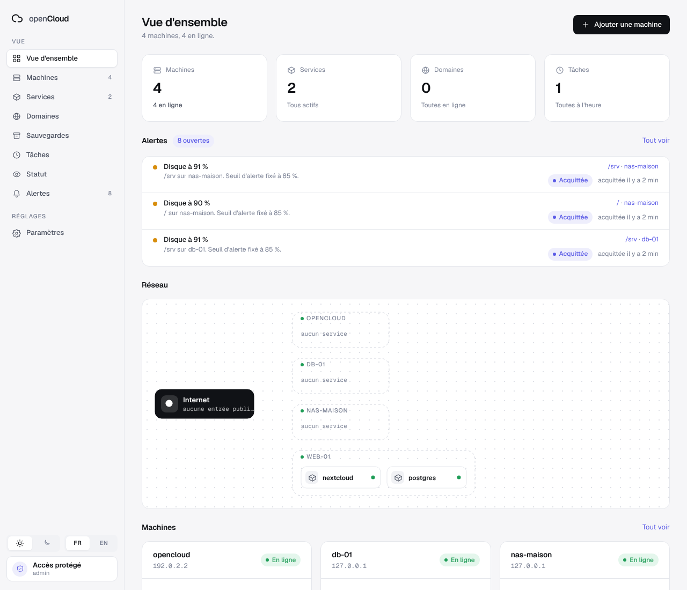

# openCloud

[English](README.en.md) · Contribuer : voir [AGENTS.md](AGENTS.md) et [docs/projet/](docs/projet/)

[](https://github.com/ldesfontaine/opencloud/actions/workflows/ci.yml)

**openCloud est une supervision auto-hébergée** qui **déclare** ce qui doit
tourner, le **compare** à ce qui tourne, et fait quelques **gestes** nommés
depuis l'interface (direction : [docs/projet/23-direction.md](docs/projet/23-direction.md)).
Elle suit vos machines, leurs conteneurs Docker, des sondes HTTP/TCP et leurs
certificats, vos tâches planifiées par ping, des alertes par webhook signé, une
page de statut publique, les mises à jour d'images détectées, et un jeton d'API
en lecture pour un agent IA, par mcp-maison. Un seul binaire Go, avec SQLite et
l'interface web embarqués.

> **Maturité.** Version `v0.0.1`, pré-version. Les binaires Linux amd64 et
> arm64 sont dans la [release v0.0.1](https://github.com/ldesfontaine/opencloud/releases/tag/v0.0.1),
> ou se compilent. Une installation neuve n'a **pas de compte** : elle ne sert
> que l'écran de première configuration, et le premier qui l'ouvre crée le
> compte. Créez-le avant d'exposer le port hors de la machine.



## Ce que ça fait, ce que ça ne fait pas

| Fait | Ne fait pas |
| --- | --- |
| Mesure chaque machine toutes les 10 s : processeur, mémoire, disques, réseau | N'agit sur une machine que par des **ordres signés**, un par geste, que son agent accepte selon les **droits cochés à son installation** (hors `observe` et `probe.lan`, qui ouvre le réseau local aux sondes sans permettre aucun ordre, rien n'est coché d'office). Aucun shell, aucune commande libre, rien par le jeton d'API |
| Suit les conteneurs Docker : état, santé, redémarrages, journaux, réseaux | Lit Docker en lecture seule ; n'y touche que pour déployer un service déclaré (`docker compose up`, fichier Compose **généré** depuis l'annuaire, jamais saisi) |
| Déclare vos services (interface, ou fichier YAML : `opencloud export` / `opencloud apply`) et montre l'écart avec ce qui tourne | Ne déclare rien tout seul : un conteneur inconnu s'affiche « non déclaré ». Le fichier YAML ne s'applique que par la commande |
| Déploie ou redéploie un service Compose déclaré, depuis sa fiche ; le `.env` part une fois avec l'ordre, écrit sur la machine, jamais gardé par openCloud | Ne retire rien : supprimer le service de l'annuaire laisse conteneurs et dossier sur la machine |
| Sonde des URL et des ports, juge les certificats et leur échéance | Ne renouvelle pas un certificat |
| Surveille un cron ou une sauvegarde par une URL de ping | N'exécute pas la tâche |
| Compare chaque image à son registre et fabrique la commande de mise à jour | N'applique pas la mise à jour d'un service qu'il n'a pas déployé : vous jouez la commande. Pour un service **déployé par openCloud** : nouvelle version dans l'annuaire, puis « Redéployer », sans retour arrière automatique |
| Dit si la version d'un service, ou le système d'une machine, est encore maintenu, et jusqu'à quand, d'après endoflife.date | Ne cherche pas de failles (CVE). Appelle endoflife.date une à deux fois par jour ; se coupe sous Paramètres |
| Sauvegarde la base chaque nuit, une fois la page Sauvegardes remplie : chiffrée (`age`), envoyée à l'agent de la machine que vous choisissez ; `serve` n'en garde aucune copie | La sauvegarde de la base ne prend que la base et ses deux clés, pas le `data/` ni le `.env` d'un service. N'écarte pas la machine openCloud comme destination : choisissez-en une autre. Phrase perdue, aucune sauvegarde ne se relit. Un échec se lit sur la page, sans alerte |
| Sauvegarde les VM et conteneurs d'un hôte Proxmox : une archive par VM, produite et chiffrée (`age`) par l'agent de l'hôte (`vzdump`), rangée chez l'agent d'une autre machine ; restauration sans openCloud (`age`, `qmrestore`) | Le droit `backup.produce` vaut root sur l'hôte pour un agent compromis. Une VM à la fois, plus de 55 minutes par VM échoue. N'écrit rien dans Proxmox par son API (le jeton, en lecture seule, ne sert qu'à lister les VM). Voir [Sauvegarder des VM Proxmox](docs/installation.md#sauvegarder-des-vm-proxmox) |
| Tient un journal d'audit de chaque geste qui écrit et de chaque ordre, envoyé aussi vers les canaux que vous cochez | Sans canal coché, qui efface la base efface la trace |
| Met à jour ses agents depuis une version signée que vous importez (`opencloud release import`) | Aucune version signée n'est encore publiée, et la `v0.0.1` n'embarque pas la clé qui les vérifie : la première version signée s'installe à la main, serveur et agents ; les suivantes passent par ce geste |
| Envoie les alertes en webhook signé (Discord, Slack, Mattermost, ntfy, JSON), par e-mail via votre relais SMTP, ou dans un salon Matrix | Pas de SMS |
| Publie des pages de statut publiques sous `/statut/<adresse>` | Pas de comptes multiples ni de second facteur en propre : derrière un SSO (Authelia), le mode `forward` les lui délègue |
| Donne à un agent IA un jeton d'API en lecture, pour mcp-maison | Aucune écriture ni action sur une machine par ce jeton, aucun secret rendu |

openCloud observe, et n'agit que par des gestes nommés, signés et journalisés,
que chaque machine autorise à son installation. L'interface existe en français
et en anglais (sélecteur FR/EN en bas de la barre latérale). Le détail de
chaque flux est dans
[docs/projet/22-fonctionnement.md](docs/projet/22-fonctionnement.md).

## Comment c'est fait

| Pièce | Rôle |
| --- | --- |
| `opencloud serve` | Sur la machine openCloud : l'interface, l'API, la base. Il n'observe rien de sa machine et n'agit sur aucune machine lui-même : il signe des ordres que les agents exécutent |
| `opencloud agent` | Sur **chaque** machine, la machine openCloud comprise : s'enrôle une fois par jeton, puis tient un flux HTTPS vers le serveur. Clé Ed25519, aucune connexion entrante. Il exécute les ordres signés que ses droits admettent, et refuse les autres |
| Un proxy (Traefik) | Termine TLS devant `serve`, qui écoute en HTTP sur une adresse locale |

Linux seulement (l'agent lit `/proc`). Vérifié sur Linux amd64 ; arm64 se
compile par compilation croisée, sans test sur une vraie machine arm64 à ce jour.

## Démarrage rapide

Pour essayer sur votre poste. L'installation sur un serveur est dans
[docs/installation.md](docs/installation.md).

Il faut Go 1.26.10 ou plus, Node.js 20.19 ou plus, `make` et `git`.

```sh
git clone https://github.com/ldesfontaine/opencloud.git
cd opencloud
make build                      # compile le front puis le binaire : bin/opencloud
```

Une configuration minimale :

```sh
mkdir -p dev/state
cat > dev/config.toml <<EOF
listen = "127.0.0.1:8080"
state_dir = "$PWD/dev/state"
EOF
./bin/opencloud serve -config dev/config.toml
```

`make run` fait ces deux étapes à votre place. Ouvrez
<http://127.0.0.1:8080>.

**Créez le compte** : l'écran de première configuration le demande avant
tout (identifiant, mot de passe de 12 caractères ou plus), puis l'interface
s'ouvre. Ou par l'API, tant qu'aucun compte n'existe :

```sh
curl -X POST -H 'Content-Type: application/json' \
  -d '{"username":"admin","password":"une phrase de 12 caractères ou plus"}' \
  http://127.0.0.1:8080/api/auth/actions/enable
```

**Ajoutez une machine** : Machines → Ajouter une machine, donnez-lui un nom.
openCloud affiche la préparation de la machine (le compte dédié `opencloud-agent`,
son dossier, son binaire) puis une commande à coller, en root :

```sh
printf '%s\n' 'oc_…' | sudo -u opencloud-agent /var/lib/opencloud-agent/bin/current agent -server https://opencloud.example.org
```

L'agent tourne sous ce compte, dans le groupe `docker` si la machine a Docker :
**le groupe `docker` équivaut à root** (la socket lance un conteneur qui monte
`/`), le compte dédié protège des erreurs, pas d'un attaquant décidé. Root reste
possible, par un drop-in documenté.

Le jeton sert une fois et expire en 1 h. L'agent exige HTTPS vers openCloud,
sauf `-allow-plain` sur un réseau déjà chiffré (WireGuard) ; vers la boucle
locale, HTTP passe. La suite (proxy, service, `-pin`) est dans
[docs/installation.md](docs/installation.md#ajouter-une-machine).

**La machine openCloud a aussi son agent**, comme toute machine : `serve`
n'observe rien d'elle, et sans cet agent elle ne se voit pas. Après la création du
compte, l'écran de première configuration affiche la ligne qui l'installe
(avec le seul droit d'observer), et la préparation au-dessus ; collez-les sur cette machine, en root. Elle ne
s'affiche qu'une fois, et vaut 1 h : passé ce délai, « Ajouter une machine »
jouée sur elle en redonne une (ou Ré-enrôler, sur sa fiche). L'unité systemd de
cet agent est dans [docs/installation.md](docs/installation.md#installer-le-serveur).

Mot de passe perdu : `opencloud auth disable -config dev/config.toml` ramène
à l'écran de première configuration.

## Documentation

| Document | Pour |
| --- | --- |
| [docs/installation.md](docs/installation.md) | Installer sur un VPS Debian avec Traefik, ajouter une machine, mettre à jour, sauvegarder, désinstaller |
| [docs/installation/](docs/installation/) | Fichiers d'exemple : `config.toml` commenté, unités systemd, configuration Traefik |
| [docs/projet/22-fonctionnement.md](docs/projet/22-fonctionnement.md) | Le fonctionnement détaillé : flux, chiffrement, données stockées, limites connues |
| [docs/projet/23-direction.md](docs/projet/23-direction.md), [24-modele-cible.md](docs/projet/24-modele-cible.md) | La direction décidée (d'observateur à plan de contrôle) et le modèle de données cible : ce qu'on construit, pas l'existant |
| [AGENTS.md](AGENTS.md), [docs/projet/](docs/projet/) | Contribuer : méthode, conventions de code, direction artistique |

## Licence

[Apache 2.0](LICENSE).
