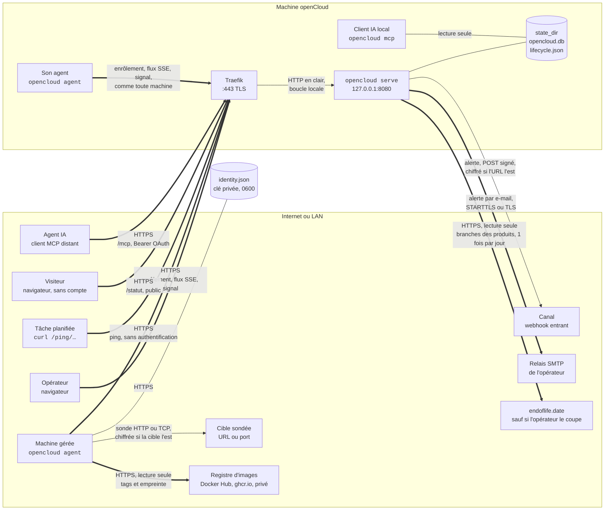

# Fonctionnement

> Ce document suit l'application. Chaque fonctionnalité intégrée y ajoute ce
> qu'elle change : un flux, un port, une donnée stockée. Dernière mise à jour :
> première configuration à la place du mode ouvert, journal d'audit, agents
> séparés des machines (droits, révocation), la machine openCloud avec un
> agent comme les autres, puis les ordres signés envoyés aux agents et les
> droits appliqués par l'agent (#146), 21 octobre 2026.

## Les acteurs

| Acteur | Ce que c'est | Ce qu'il fait tourner |
| --- | --- | --- |
| L'opérateur | L'opérateur, dans un navigateur | Le front React, chargé une fois avec la page, qui lit l'API JSON et affiche. Tant qu'aucun compte n'existe, l'écran de première configuration à la place de l'interface : il crée le compte, puis l'interface s'ouvre |
| La machine openCloud | Le VPS où openCloud est installé | `opencloud serve` : l'API, le front embarqué, la base. **Et son agent, `opencloud agent`, comme toute machine** : `serve` n'observe rien de sa propre machine. La ligne qui l'installe s'affiche dès la première configuration (« La machine openCloud ») |
| La commande locale | `opencloud export` et `opencloud apply`, lancées sur la machine openCloud, sous le compte du service ou en root | Rien de son côté : elles parlent au `serve` qui tourne par la socket `state_dir/control.sock`. `export` écrit ce qu'il répond ; `apply` lit un fichier, montre le plan que le serveur en tire, demande confirmation, puis lui demande de l'écrire. Elles n'ouvrent pas la base |
| Une machine | Un VPS, une VM, un NAS, que openCloud gère sans l'héberger | `opencloud agent` : le démon qui parle à openCloud, mesure la machine et veille son Docker. Un agent à la fois par machine ; ses droits sont cochés à l'installation, écrits dans son fichier, rapportés à chaque connexion et **appliqués** : un ordre hors de ses droits est refusé. Il exécute les **ordres signés** par la clé du serveur qu'il a épinglée à l'enrôlement (aujourd'hui `agent.ping`, qui ne change rien) et refuse tout autre |
| Docker | Le démon de conteneurs d'une machine, s'il y en a un | Les services et leurs réseaux : l'agent le lit par sa socket, en lecture seule, et ne lui demande jamais rien d'autre |
| Traefik | Le proxy de la machine openCloud | Termine TLS et transmet à openCloud sur la boucle locale |
| Une tâche | Un cron, une sauvegarde, un script, n'importe où | Un `curl` sur son URL de ping quand elle démarre ou finit |
| Une cible | Une URL ou un port qu'une sonde vérifie, dedans comme dehors | Rien : elle reçoit une requête et répond, c'est tout ce qu'on lui demande |
| Un visiteur | N'importe qui, dans un navigateur, sans compte | Une page de statut publique, à son adresse `/statut/<slug>` : un petit bundle à part, qui lit l'instantané et le direct publics de cette page, et d'elle seule |
| Un canal | Une URL entrante : Discord, Slack, Mattermost, ntfy, un récepteur à soi ; un salon Matrix ; ou des adresses e-mail | Rien : il reçoit un POST signé, un message du bot dans le salon, ou un e-mail, quand une alerte s'ouvre, s'aggrave ou se résout |
| Un relais SMTP | Celui de l'opérateur : Gmail, Brevo, l'hébergeur, un Postfix local | Rien : il reçoit d'openCloud les e-mails des canaux e-mail, avec l'identifiant réglé sous Paramètres, et les livre |
| Un registre | Docker Hub, ghcr.io, un registre privé : là d'où les images ont été tirées | Rien : il répond en lecture à l'agent de chaque machine, qui lui demande les tags d'un dépôt et l'empreinte d'un tag, jamais une image |
| endoflife.date | Un service public et gratuit qui tient, produit par produit, les branches maintenues et leur date de fin | Rien : il répond en lecture à la machine openCloud, une fois par jour, deux au plus, **tant que l'opérateur n'a pas coupé la fin de support** sous Paramètres. Les agents ne l'appellent jamais |
| Un agent IA | Claude, Cursor, l'inspecteur MCP, un script : un client MCP, distant en HTTPS ou local sur stdin/stdout | Des appels d'outils sous `/mcp`, derrière un jeton : vingt et une lectures qui rendent les faits de l'API. Aucune écriture pendant la refonte : elles reviendront avec la couche d'actions typées. Jamais une action sur une machine, jamais un secret d'openCloud ; en revanche les journaux bruts d'un conteneur, qui peuvent en contenir un |

Un seul binaire, `opencloud`, deux rôles. La machine openCloud fait tourner
les deux : le serveur, et son agent, qui en fait une machine comme les autres
dans l'interface.

## Le schéma

Trait double : chiffré. Trait simple : en clair, mais sans quitter la machine.

## Ce qui est chiffré, ce qui ne l'est pas

| Flux | D'où à où | Chiffrement | Qui prouve quoi |
| --- | --- | --- | --- |
| Interface | navigateur → Traefik | TLS de Traefik | L'opérateur, par HTTP Basic, avec le compte créé à la première configuration (mode `basic`) : identifiant et mot de passe, renvoyés par le navigateur à chaque requête, `/api/events` et les flux de journaux compris. En mode `forward`, le mandataire qui authentifie (Authelia derrière Traefik) : openCloud ne croit l'en-tête d'identité (`Remote-User` par défaut) que d'un pair de `trusted_proxies` qui porte aussi le secret partagé (`forward_secret_file`, en-tête `X-OpenCloud-Proxy-Secret`), et répond `401` à tout le reste ; c'est au mandataire d'écraser l'en-tête envoyé par le client. Mode `none` (installation neuve, ou après `opencloud auth disable`) : aucun compte, le serveur ne sert que la première configuration et répond `401 auth.setup_required` au reste ; le premier qui atteint le port crée le compte (« Comment l'opérateur entre dans l'interface »). Le front charge la page, puis parle à `/api/…` en JSON |
| Interface | Traefik → openCloud | En clair, sur `127.0.0.1` de la même machine | Toute écriture de l'API exige `Content-Type: application/json`, même sans corps, et un `Sec-Fetch-Site` présent doit valoir `same-origin` ou `none`. Toute requête sous `/api/…` et sur `/oauth/authorize` exige un `Host` reconnu (hôte de `public_url`, `localhost`, IP littérale, hôte de `listen`), contre le DNS rebinding : sinon `403 bad_host`. Pas de cookie, mais le navigateur joint aussi les identifiants Basic à une requête partie d'une page tierce : c'est cette garde qui l'arrête |
| Direct | navigateur → `/api/events`, une connexion par onglet | TLS de Traefik | L'opérateur, par HTTP Basic ou par le mandataire, comme l'interface ; refusé en mode `none` (`401 auth.setup_required`). Le flux ne dit que « les machines ont changé », « les tâches ont changé », jamais lesquelles. Plafond de 64 onglets, comptés par le serveur et non par les abonnés du bus (la page de statut y est abonnée aussi), `503` au-delà |
| Agent | machine → Traefik | TLS de Traefik, ou empreinte épinglée par `-pin` si pas de domaine | Ed25519 : l'agent signe un aléa qu'il tire, l'identifiant de sa machine et l'heure (protocole 2), openCloud vérifie avec la clé enrôlée. Le signal porte les mesures de la machine et ce que son Docker a montré, dans un débit borné par machine ; les journaux d'un conteneur remontent par `POST /agent/logs/…`, jeton de session |
| Agent, sens retour | openCloud → machine, sur le flux ouvert | Le même flux | Le serveur pousse des **commandes d'observation** (« suis les journaux du conteneur X », « arrête », le jeu de sondes, les images à ne pas interroger) : des lectures, **non signées**, que l'agent ne reçoit que du serveur qui tient son flux, jamais une entrée du navigateur. Les **ordres** voyagent dans une enveloppe **signée Ed25519 par la clé du serveur** (`server.key`), que l'agent vérifie avec la clé épinglée à l'enrôlement avant d'en lire un champ : qui tient le flux sans la clé (un mandataire, un faux serveur) peut couper ou retarder un ordre, pas en fabriquer ; un ordre périmé ou rejoué est refusé (« Comment un ordre part et revient ») |
| Journaux | navigateur → `/api/containers/{id}/logs/stream` | TLS de Traefik | L'opérateur, par HTTP Basic ou par le mandataire. En mode `none`, refusé comme le reste de l'interface (`401 auth.setup_required`). Une seconde connexion par onglet ; seize lectures de journaux en tout, tirages et outil MCP compris |
| Sonde | machine qui sonde → la cible | Celui de la cible : TLS si la sonde est en `https://` ou si une sonde TCP demande la poignée de main, rien sinon | Personne : une sonde n'est pas authentifiée, elle regarde du dehors comme n'importe qui. Un certificat refusé rend l'essai **dégradé**, jamais hors ligne, et la requête n'est pas rejouée. La chaîne est jugée par la machine qui sonde, avec les autorités qu'elle connaît |
| Docker | agent → `/var/run/docker.sock` | Aucun : une socket Unix de la machine | Les droits Unix : l'agent est root. `opencloud serve` ne lit plus la socket : il n'a besoin ni de root ni du groupe `docker`. Le client ne connaît aucun verbe qui écrit |
| Agent | Traefik → openCloud | En clair, boucle locale | `X-Forwarded-*` cru seulement depuis `trusted_proxies`. `X-Forwarded-For` se lit de la droite : la source est la dernière entrée qui n'est pas un mandataire de confiance, ce que le client écrit à gauche ne compte pas |
| Agent en dev | machine → `http://127.0.0.1` | Aucun, et c'est accepté : rien ne sort de la machine | Idem |
| Agent sur un LAN | machine → `http://192.168.…` | **Refusé** par l'agent, sauf `-allow-plain` | Réservé à un réseau déjà chiffré, WireGuard par exemple |
| Ping | tâche → Traefik → `/ping/{jeton}` | TLS de Traefik | Personne : le jeton dans l'URL est le secret. Qui l'a peut faire passer une tâche pour faite |
| Statut | visiteur → Traefik → `/statut/<slug>`, `/statut/<slug>/api/…` | TLS de Traefik | Personne, par conception : la page est publique. Elle ne dit que le nom de ses composants et ce que l'opérateur a écrit ; jamais un identifiant d'objet, un nom de machine, de conteneur ou de sonde, une cible, un port, ni rien d'une autre page. Des tests le prouvent sur la réponse réelle |
| Registre | agent → le registre de l'image | TLS, sauf vers la boucle locale (un registre sur `localhost:5000`, comme Docker le fait) | L'agent s'authentifie par un jeton anonyme, ou signé des identifiants en clair du `config.json` de Docker de la machine ; le registre ne prouve rien de plus que son certificat. Rien ne sort qu'un nom de dépôt et un tag ; l'agent ne tire jamais une image. Aucune redirection suivie |
| Agent IA | client MCP → Traefik → `/mcp` | TLS de Traefik | Un Bearer, indépendant de l'authentification de l'interface : jeton d'accès OAuth d'une heure, obtenu par code et PKCE S256 puis le secret du client, ou jeton d'API créé sous Paramètres, à échéance de 30, 90 (défaut) ou 365 jours, ou sans échéance si l'opérateur le choisit. Le jeton porte une portée, `read` (défaut d'un jeton d'API comme d'un jeton OAuth) ou `write` (demandée et cochée), **inerte pendant la refonte** : `/mcp` n'enregistre aucune écriture, un jeton `write` ne voit pas plus d'outils qu'un `read`. Activer l'authentification de l'interface révoque tous les jetons. Sans en-tête, `401` avec l'adresse des métadonnées, c'est ainsi qu'un client découvre OAuth ; MCP désactivé, `404` partout. Le jeton est haché avant d'être cherché, et son dernier usage noté |
| Agent IA | client MCP → `/oauth/authorize`, page de consentement, `/oauth/token` | TLS de Traefik | Le `redirect_uri` est jugé avant tout redirect, y compris pour dire une erreur : la boucle locale toujours, n'importe quel port, sinon une adresse déclarée sous Paramètres, comparée telle quelle. Puis **l'opérateur consent** : une page de l'interface, derrière ses identifiants, montre le client, l'adresse de retour exacte, ce que l'autorisation donne et sa durée ; le code n'existe qu'après « Autoriser ». Le secret du client, jamais envoyé à l'autorisation, est vérifié à l'échange en temps constant. Un code sert une fois, dix minutes ; un rafraîchissement rejoué révoque toute sa famille. Débit borné par adresse, plus serré sur `/oauth/token` |
| Agent IA local | `opencloud mcp` ↔ le client, sur stdin/stdout | Aucun : deux processus de la même machine, rien ne passe par le réseau | Les droits Unix sur `state_dir`, en 0700 : il faut tourner sous le compte du service. Lecture seule : aucune écriture n'est enregistrée, ce processus ne tient ni le bus du direct ni les flux des agents. Il lit aussi `secret.key` et refuse de démarrer sans elle : il ne la crée jamais. Au démarrage, il chiffre aussi les clairs restés (une base d'avant), donc il écrit dans la base ce jour-là, une fois |
| Commande locale | `opencloud export` et `opencloud apply` → `state_dir/control.sock` | Aucun : une socket Unix de la machine, rien ne passe par le réseau | Les droits Unix : la socket est en 0600 et `state_dir` doit être fermé au groupe et aux autres (sinon `serve` ne l'ouvre pas), il faut tourner sous le compte du service ou en root. Aucune garde d'opérateur ni de même-origine, aucun navigateur n'y passe ; elle ne sert que les quatre routes `/api/manifest/…` (export, plan, apply, journal), chacune avec sa méthode, tout le reste y répond 404. Elle **écrit** l'annuaire : qui l'atteint peut déjà lire la base et la clé de chiffrement, c'est le même raisonnement que pour `opencloud auth`. L'acteur du journal est `cli` et son nom est celui que la commande déclare : indicatif |
| Alerte par e-mail | openCloud → le relais SMTP | STARTTLS exigé (défaut, 587) ou TLS dès la connexion (465), certificat vérifié contre le magasin du système ; `none` seulement si l'adresse jointe est sur la boucle locale ou un réseau privé, vérifié à la connexion | openCloud s'authentifie par AUTH PLAIN ou LOGIN, après le chiffrement. Un relais qui ne propose pas STARTTLS est refusé : jamais de repli en clair. Au-delà du relais, le message voyage comme tout courrier, et son destinataire le garde |
| Alerte Matrix | openCloud → le serveur d'accueil | TLS : le serveur d'accueil est exigé en `https://` | openCloud écrit au nom du bot par `Authorization: Bearer <jeton>`, le jeton du canal ; qui a ce jeton parle au nom du bot partout où il est invité. Le serveur d'accueil prouve qui il est par son certificat. Le message dit ce que dit le corps d'un webhook, et le salon le garde |
| Alerte | openCloud → le canal | Celui de l'URL : TLS si elle est en `https://`, rien sinon, et l'interface le dit | openCloud prouve au récepteur que c'est lui, par `OpenCloud-Signature`, HMAC-SHA256 du corps avec le secret du canal, quand il y en a un. Le récepteur ne prouve rien : un 2xx suffit. Le corps dit le nom de l'objet, de la machine, la cible d'une sonde, le point de montage : ce qu'un canal reçoit, son service le garde |

Donc non, rien ne passe en clair sur le LAN de l'infra : le seul clair est sur
la boucle locale de la machine openCloud, entre Traefik et le processus. Entre
deux machines, l'agent exige HTTPS, ou qu'on lui dise explicitement que le
réseau est déjà chiffré.

Au repos, les secrets que l'opérateur saisit dans l'interface sont chiffrés dans la
base ; voir « Ce qui est stocké, et où ». Le fichier de l'annuaire exporté n'en
porte aucun : voir « Comment l'annuaire s'exporte et s'applique ».

## Ce qui est stocké, et où

Le schéma de la base, tables, clés étrangères et index, se lit en un fichier :
[`migrations/001_schema.sql`](../../migrations/001_schema.sql), groupé par
domaine et commenté. Le tableau dit ce qui est gardé et pourquoi ; le fichier
dit comment. Une migration de plus part de `002`.

| Où | Fichier | Contenu | Protection |
| --- | --- | --- | --- |
| Machine openCloud, `state_dir` | `opencloud.db` | Les machines (`machines` : nom, hôte, adresse, système), leurs agents (`agents` : clé publique Ed25519, version, racine `/srv/workspace`, date d'enrôlement, dernier signe de vie, révocation, l'empreinte de la clé du serveur que l'agent dit avoir épinglée `server_key_fingerprint`, le dernier rang d'ordre donné `last_order_seq` ; un seul actif par machine, l'index `agents_one_active` le tient), les droits que chaque agent rapporte de son fichier (`agent_capabilities` : droit, chemins, instant du rapport), les jetons d'enrôlement (avec les droits demandés, `requested_capabilities`, et l'agent qui l'a consommé, `agent_id`) | Jetons stockés hachés : une copie de la base n'enrôle personne. Un jeton vaut **1 h** et sert une fois (`machine.TokenLifetime`) ; au démarrage, `serve` efface les jetons périmés jamais servis et les consommés depuis plus de 90 jours, **sauf celui d'un agent actif** : il dit ce qui était demandé, contre quoi se lit ce que l'agent rapporte. La clé publique n'est pas un secret. Une machine retirée emporte ses agents et leurs droits (cascade) |
| Machine openCloud, `state_dir` | `opencloud.db` | Les tâches surveillées et leur jeton de ping, **chiffré** (AES-256-GCM, clé du serveur, lié à sa ligne) : la page doit le réafficher. Pour le retrouver à chaque ping, la colonne `token_lookup` garde son SHA-256 ; le chiffré est dans `token_sealed` | Une copie de la base seule ne livre pas les URL de ping ; elle donne l'empreinte, qui ne remonte pas au jeton (128 bits tirés au hasard). Qui a la base **et** `secret.key` les lit. Le jeton se régénère depuis la page de la tâche : l'ancienne URL cesse aussitôt de répondre, sans recréer la tâche. La machine d'une tâche, facultative, est en `restrict` : une machine à laquelle une tâche est rattachée ne se retire pas (409 `machine.has_heartbeats`), on détache la tâche d'abord |
| Machine openCloud, `state_dir` | `opencloud.db` | Les pings bruts (forme, source, méthode, corps tronqué à 10 Kio, **en clair**) et les exécutions (début, fin, durée, code) | Purgés : pings après 7 jours, exécutions après 90 jours |
| Machine openCloud, `state_dir` | `opencloud.db` | Les ressources mesurées par machine : le brut toutes les 10 s dans `machine_samples`, ses volumes dans `machine_disks`, les moyennes par heure et par jour dans `machine_rollups` (une ligne par machine, granularité `hour` ou `day` et seau) | Purgés : brut et volumes après 48 h, horaire après 90 jours, journalier après un an. La machine retirée emporte tout |
| Machine openCloud, `state_dir` | `opencloud.db` | L'annuaire déclaré : `projects`, `declared_services`, `service_units`, `service_provides`, `project_services`, et sur chaque unité la politique de mise à jour (`service_units.update_policy`, `watch`, `hold` ou `ignore`). Aucun secret, aucune donnée lue sur une machine | Pas de purge : ce que l'opérateur déclare reste. Supprimer un service emporte ses unités et ses fournitures, supprimer un projet ne retire que les liens ; une machine qui porte des services ne se retire pas, un service que des sondes ou des composants visent non plus |
| Machine openCloud, `state_dir` | `opencloud.db` | Le journal des fichiers appliqués : la table `applies` (`id` en `apl_` et seize hexadécimaux, `at`, `finished_at`, `actor_kind` `cli` ou `operator`, `actor_name`, `file_hash`, `file_name`, `prune`, `plan_hash`, `state` `confirmed`, `applied` ou `failed`, les quatre compteurs, `done`, `error` et `error_object`, et `plan`, le JSON des changements dans l'ordre d'écriture). **Ni le fichier ni aucun secret** : le plan ne porte que des valeurs de l'annuaire, la cible d'une sonde y est masquée (`user:…@hôte`) et un jeton n'y est jamais ; une tâche créée y est notée `token_generated` sans le jeton. Pas de clé étrangère vers les objets touchés : le journal leur survit | Pas de purge : le journal est petit (une ligne par fichier appliqué) et c'est lui qui répond à « qui a changé ça ». Une ligne restée `confirmed` au démarrage est celle d'un arrêt brutal : `serve` la passe en `failed` (`manifest.interrupted`) |
| Machine openCloud, `state_dir` | `opencloud.db` | Le journal d'audit : la table `audit_events`, une ligne par geste réussi qui écrit un objet déclaré ou une autorité : `at`, `actor_kind` et `actor_name`, `action`, `object_kind`, `object_id`, `object_name` recopié, `details` (JSON plat de textes) et `apply_id` quand un apply l'a écrit. **Aucun secret** : ni mot de passe, ni jeton, ni secret, ni URL de webhook (« Le journal d'audit ») | Ajout seul : un déclencheur refuse toute modification d'une ligne, hors la mise à nul du lien `apply_id` (`ON DELETE SET NULL`). Pas de clé étrangère vers l'objet : la ligne lui survit. Purgé après **un an** (`audit.Retention`), avec les alertes, au démarrage puis une fois par jour |
| Machine openCloud, `state_dir` | `opencloud.db` | Les ordres envoyés aux agents : `action_runs` (identifiant, genre `action`, paramètres sans secret `params`, machine et agent en `set null` avec `machine_name` recopié, état, `refusal_reason`, `not_after`, rang `seq` unique par agent, `requested_by` recopié de l'acteur, `requested_at`, `finished_at`) et leur sortie, `run_logs` (rang, instant, flux, ligne ; 64 lignes au plus par run), partie avec son run (`cascade`). Écrit **avant** que l'ordre ne parte (« Comment un ordre part et revient ») | Un run survit à sa machine et à son agent : c'est une trace. Purgé à 90 jours (`action.Retention`) avec sa sortie, par la boucle des ordres. La sortie est ce que l'agent a écrit : rien n'y est masqué |
| Machine openCloud, `state_dir` | `opencloud.db` | Le rattachement des conteneurs à l'annuaire : `containers.unit_id` (l'unité déclarée, nulle tant que rien ne rattache) et `containers.match_level` (`label`, `compose` ou `name`), recalculés à chaque rapport et après chaque écriture de l'annuaire ; la table `ignored_keys` (machine, genre `compose_project` ou `container_name`, valeur) des conteneurs que l'opérateur dit voulus. Les deux labels du produit que le conteneur porte, `containers.label_service` et `containers.label_unit` (texte, vides par défaut) et `containers.label_invalid` (0 ou 1 : des labels de la marque étaient là, mal formés), pour que le rapprochement relise la valeur sans la demander à l'agent ; aucun autre label n'est gardé. Aucun secret, aucun identifiant Docker : une clé d'observation survit à la recréation du conteneur | `unit_id` passe à nul quand l'unité est supprimée (`ON DELETE SET NULL`), `ignored_keys` part avec sa machine. Pas de purge : l'opérateur retire une clé d'un geste |
| Machine openCloud, `state_dir` | `opencloud.db` | Les conteneurs : une fiche par conteneur dans `containers` (nom, projet Compose, image, état Docker, code de sortie, tué faute de mémoire, tué sans arrêt demandé, santé, ports publiés, mode réseau, privilégié, dépendances déclarées, dates), ses transitions dans `container_events`, ses mesures dans `container_samples`, ce que chaque machine dit de son Docker dans `machine_engines` | Purgés : transitions après 90 jours, fiche d'un conteneur détruit après 30 jours avec ses transitions et mesures, mesures après 48 h ; plafonnés par machine (fiches vivantes, archivées, transitions, cadence des mesures : « Comment les conteneurs sont suivis », point 6). **L'extrait de journal** d'un arrêt anormal (50 lignes, 10 Kio) est stocké en clair sur la transition : ce qu'une application écrit dans ses logs peut s'y trouver |
| Machine openCloud, `state_dir` | `opencloud.db` | Le réseau des conteneurs : les réseaux Docker de chaque machine dans `machine_networks` (nom, pilote, interne, projet Compose), l'appartenance de chaque fiche à ses réseaux dans `container_networks` (adresse, alias) | Remplacés à chaque inventaire ; la fiche supprimée emporte ses appartenances, la machine retirée emporte tout. Les adresses sont celles des réseaux internes de Docker, pas des adresses publiques |
| Machine openCloud, `state_dir` | `opencloud.db` | Les sondes dans `probes` (nom, type, cible, machine qui sonde, service surveillé, état, cadence, seuils, attentes HTTP, poignée de main TLS demandée, dernier essai, `revised_at` : l'instant de la dernière édition qui a remis l'état à zéro), chaque essai dans `probe_results`, l'agrégat par jour UTC dans `probe_days` | Purgés : essais après 7 jours, agrégat après un an. La sonde supprimée emporte son histoire ; `machine_id` (la machine qui la lance) est en `restrict` : une machine qui lance des sondes ne se retire pas (409 `machine.has_probes`), on change la machine de la sonde ou on la supprime d'abord. `service_id` vise un **service déclaré**, sur n'importe quelle machine, en `restrict` : un service qu'une sonde surveille ne se supprime pas (409 `directory.service_linked`, avec le plan), et recréer un conteneur ne casse plus rien. La cible est écrite en clair : une copie de la base dit ce qui est surveillé, pas comment y entrer. Une cible HTTP n'accepte pas d'identifiants (`https://nom:mot@…`, refus `probe.target_credentials`) ; une sonde qui en porte d'avant ce refus les garde en clair, en pause (« Comment une cible est sondée ») |
| Machine openCloud, `state_dir` | `opencloud.db` | Le dernier certificat vu par chaque sonde, dans `probe_certificates` (une ligne au plus par sonde, partie avec elle) : sujet, émetteur, dates, empreinte SHA-256, chaîne valide, nom correspondant, agrafe OCSP | Écrasé à chaque essai qui en voit un ; un essai muet n'efface rien. **Aucun historique, aucune chaîne complète** : le renouvellement se lit au changement d'empreinte, l'âge sur la date de début. Rien de secret : un certificat serveur est public par construction |
| Machine openCloud, `state_dir` | `opencloud.db` | Les pages de statut dans `status_pages` (adresse `slug` unique, titre, annonce en texte brut, langue, projet facultatif, une page par projet au plus, en `restrict` vers lui) ; les composants dans `status_components` (leur page, en `cascade` ; nom public, ordre), leurs objets dans `status_component_members` (quatre clés étrangères, exactement une remplie ; celle du service vise un **service déclaré**, en `restrict`), les incidents dans `incidents` (titre, impact, statut, fenêtre d'une maintenance, dates), leurs composants dans `incident_components`, leur fil dans `incident_updates`. Une maintenance ne tait aucune alerte : c'est un silence qui le fait | Les quatre clés d'un membre sont en `restrict` : une machine, un service, une sonde ou une tâche qu'un composant affiche refuse d'être supprimé tant qu'on ne l'a pas retiré du composant ; le composant supprimé emporte ses liens et ses rattachements aux incidents, l'incident reste ; la page supprimée emporte ses composants de même. Un projet qui a sa page refuse d'être supprimé (`project.has_status_page`). Incidents résolus purgés après un an. Tout est écrit par l'opérateur pour être lu par le public : rien de secret |
| Machine openCloud, `state_dir` | `opencloud.db` | Le dernier constat sur chaque image d'une machine dans `image_checks` (issue, empreinte tirée, empreinte publiée, tag plus récent et son empreinte, type déduit) ; sur la fiche `containers`, ce que Compose dit du service (`compose_service`, `compose_dir`, `compose_file`). La politique de l'opérateur ne vit plus sur la fiche : elle est sur l'unité (`service_units.update_policy`) | Écrasé à chaque vérification ; purgé après 30 jours sans vérification ; la machine retirée emporte tout. Le dossier du projet Compose est un chemin de la machine, en clair |
| Machine openCloud, `state_dir` | `opencloud.db` | Les alertes dans `alerts` (type, gravité, objet et son nom recopié, machine, service déclaré, détails en JSON, dates dont le début du calme, acquittement ; l'objet et le service en clés étrangères `set null`), les canaux dans `alert_channels` (**URL et secret chiffrés** — le jeton du bot pour Matrix —, format, destinataires d'un e-mail ou salon Matrix dans `destination`, gravité minimale), les livraisons dans `alert_deliveries` (événement, essais, motif, code, heure de l'essai suivant, ou retenue par la limite du canal, ou tue par un silence), les silences dans `mutes` (cible en clé étrangère, type, fenêtre, motif, auteur) | Résolues purgées après 90 jours, livraisons avec leur alerte, canaux sans purge. Silences finis depuis plus de 90 jours purgés avec les alertes (au départ, puis une fois par jour) ; une machine (avec ses conteneurs), un service déclaré, une sonde ou une tâche retirée emporte ses silences par la clé étrangère (`cascade`), une pause ou un archivage les garde ; le plan de suppression les compte. **L'URL et le secret d'un canal sont chiffrés** (AES-256-GCM, clé du serveur, liés à leur ligne) : un webhook Discord, Slack ou ntfy porte son jeton dans le chemin de l'URL, c'est un secret autant que la clé de signature. Il faut pouvoir les rejouer au récepteur, un haché ne servirait à rien ; l'API ne renvoie jamais le secret. Pour Matrix, c'est le jeton d'accès du bot : le déconnecter du compte du bot le révoque |
| Machine openCloud, `state_dir` | `opencloud.db` | L'accès d'un agent IA : le client OAuth dans `mcp_clients` (une ligne, secret **haché**, préfixe affiché, adresses de retour déclarées), les codes d'autorisation dans `mcp_codes` (hachés, dix minutes, servis une fois, avec la portée consentie), les jetons dans `mcp_tokens` (hachés ; portée `read` ou `write`, inerte pendant la refonte ; accès 1 h, rafraîchissement 30 j, API 30, 90 ou 365 j ou sans échéance au choix ; famille, dernier usage, révocation) | Rien n'est en clair : une copie de la base n'ouvre rien. Purge toutes les 15 minutes des codes et jetons échus, jetons d'API compris ; un révoqué reste jusqu'à son échéance, c'est lui qui trahit un rejeu (un jeton d'API sans échéance révoqué reste donc, inerte). Désactiver MCP efface le client et tous les jetons ; activer l'authentification de l'interface les révoque tous, efface les codes en attente et garde le client. Les demandes qui attendent le consentement ne sont **pas** en base : en mémoire de `serve`, dix minutes, 32 au plus (voir « Comment un agent IA lit openCloud ») |
| Machine openCloud, `state_dir` | `opencloud.db` | L'accès de l'opérateur à l'interface dans `auth_settings` (une ligne) : le mode (`none`, `basic`, `forward`), l'identifiant, l'empreinte **bcrypt** du mot de passe (coût 12), le nom de l'en-tête d'identité du mode `forward` (`forward_header`), la date d'activation | Le mot de passe n'est jamais stocké ni renvoyé ; une copie de la base donne l'identifiant, pas l'accès. L'identité transmise par le mandataire n'est jamais stockée : elle arrive avec chaque requête. `none` ne veut plus dire « ouvert » : aucun compte, l'installation attend sa première configuration. Désactiver efface identifiant, empreinte et en-tête, et y ramène |
| Machine openCloud, `state_dir` | `opencloud.db` | Les réglages de l'opérateur dans `settings`, une seule ligne : la langue de l'interface ; les seuils d'alerte du disque (`disk_attention_percent`, `disk_danger_percent`, zéro tant que rien n'est réglé) ; le relais d'e-mails (`mail_host`, `mail_port`, `mail_tls`, `mail_username`, `mail_from`, et **`mail_password` chiffré** : il faut le rejouer au relais, un haché ne servirait à rien ; l'API ne le renvoie jamais, `has_password` dit seulement qu'il y en a un) ; la fin de support (`lifecycle_disabled`, à 0 tant qu'elle est activée) | Chaque écrivain relit, modifie sa clé et réécrit dans une seule transaction : la langue et le relais changés en même temps survivent tous deux, même depuis deux processus. **Le mot de passe du relais est chiffré** comme les autres secrets saisis dans l'interface, lié à la ligne des réglages. `opencloud mcp` les lit dans la base, comme `serve` |
| Machine openCloud, `state_dir` | `secret.key` | La clé qui chiffre les secrets ci-dessus : une ligne `key-v1:<id>:<clé>`, AES-256, 32 octets tirés au hasard, jamais en base. `<id>` est l'empreinte courte de la clé, inscrite aussi dans chaque chiffré ; le temps d'une rotation, le fichier porte plusieurs lignes (quatre au plus) : un chiffré s'ouvre avec la clé de son `<id>`, la première ligne scelle | Mode 0600, écriture atomique, refusée si un autre compte peut la lire. `serve` la crée au premier démarrage par une création exclusive (un lien dur d'un temporaire écrit et synchronisé : si le fichier existe, elle échoue) ; deux `serve` lancés ensemble sur une base neuve tirent chacun une clé, un seul gagne, l'autre relit la sienne. `opencloud secrets rotate` en tire une neuve et rescelle chaque secret, l'ancienne gardée sous `secret.key.rotated-<horodatage>` ; `opencloud secrets forget` remplace une clé perdue, l'ancienne gardée sous `secret.key.forgotten-<horodatage>`. `opencloud mcp` la lit et ne la crée jamais. **À sauvegarder à part, une fois** : sans elle, la base garde ses données mais perd ses secrets. `opencloud secrets forget` repart d'une clé neuve (voir `installation.md`) |
| Machine openCloud, `state_dir` | `server.key` | La clé qui **signe les ordres** envoyés aux agents : une ligne `ed25519-v1:<graine>`, Ed25519, tirée au premier démarrage de `serve`, jamais en base ; une seconde ligne, la clé précédente, le temps d'une rotation (`opencloud secrets rotate-server-key`, puis `finish-server-key`). Sa moitié publique est livrée à chaque agent à l'enrôlement, qui l'épingle | Les règles de `secret.key` : mode 0600 jugé sur le descripteur, refusée si un autre compte peut la lire, création exclusive (deux `serve` lancés ensemble gardent la même). Illisible ou abîmée, `serve` refuse de démarrer plutôt que d'en tirer une autre. **Qui l'a commande toutes les machines** ; perdue, chaque agent refuse les ordres (`bad_signature`) jusqu'à son ré-enrôlement ; volée, aussi : une rotation se fait sous la signature de l'ancienne clé, elle ne chasse pas qui la tient. À sauvegarder avec `secret.key`. `opencloud mcp` ne la lit pas |
| Machine openCloud, `state_dir` | `lifecycle.json` | La dernière lecture d'endoflife.date : quel dépôt d'images est quel produit, et les branches des produits que les services utilisent (nom, maintenue ou non, date de fin, dernière version). Absent tant que la fin de support n'a jamais été activée | Données publiques, 0600, écriture atomique, remplacé d'un bloc à chaque lecture réussie ; l'effacer coûte une lecture de la source |
| Machine openCloud, `state_dir` | `control.sock` | La socket de commande, créée par `serve` à son démarrage et retirée à son arrêt : aucune donnée, une porte locale vers `/api/manifest/…`. Une socket que personne n'écoute (arrêt brutal) est remplacée au démarrage suivant ; celle d'un `serve` vivant n'est jamais touchée | Mode 0600, et `state_dir` fermé au groupe et aux autres, sans quoi elle n'est pas ouverte. Elle n'est pas à sauvegarder |
| Toute machine, la machine openCloud comprise, `/var/lib/opencloud/agent` | `identity.json` | Clé privée Ed25519, identifiant de la machine et de l'agent (`agent_id`), adresse d'openCloud, empreinte du certificat, langue, **droits** (`rights`, écrits par `-rights` au premier lancement ; absents chez un agent d'avant : `observe` seul), **la clé publique du serveur** épinglée à l'enrôlement (`server_key`), le rang du dernier ordre exécuté (`last_order_seq`) | Mode 0600 ; le perdre impose un ré-enrôlement. La clé du serveur et le rang ne se touchent pas à la main (la clé change seule pendant une rotation, par l'ordre `agent.server_key`) : une autre clé fait refuser chaque ordre, un rang baissé rouvre la porte aux rejeux d'ordres encore valables (deux minutes). Les droits se lisent et se changent à la main : l'agent rapporte ce qu'il y lit, l'interface montre l'écart |

**Ce que le chiffrement couvre.** Quatre colonnes, chiffrées à l'écriture, chacune liée à sa table, sa colonne et sa ligne (un chiffré recopié ailleurs ne s'ouvre plus) :
`settings.mail_password`, `alert_channels.url`, `alert_channels.secret` et
`heartbeats.token_sealed`. Un secret vide reste vide. Un chiffré a la forme `v1:<8 hexadécimaux>:<base64>` ; une valeur non vide d'une autre forme n'est jamais rendue comme un secret, la lecture la refuse. Les jetons d'enrôlement, les jetons
MCP et le mot de passe de l'interface sont hachés.

**Ce qu'il ne couvre pas.** Les identifiants qu'une cible de sonde portait
avant leur refus (la sonde est en pause, « Comment une cible est sondée »), les extraits de journaux d'un arrêt anormal et le corps des pings
restent en clair : ils peuvent contenir un secret que l'opérateur n'a pas saisi
comme tel. La clé est **à côté de la base**, sous le même compte : le gain vaut
pour une copie de la base seule (sauvegarde égarée, disque rendu), pas pour qui
lit tout `state_dir`.

**Au démarrage**, `serve` charge la clé, la crée si elle manque et si la base
n'a aucun chiffré, puis ouvre chaque chiffré de la base pour vérifier que la
clé est la sienne, sans rien écrire. `mcp` fait de même, sans jamais créer la
clé. **Deux refus** : une base qui contient des secrets chiffrés alors que
`secret.key` est absente (une clé neuve chiffrerait les écritures suivantes et la
base mêlerait deux clés), et un chiffré qui ne s'ouvre pas avec la clé (autre
clé, valeur altérée). Journal : `secret key created`.

Le jeton en clair n'existe qu'à deux endroits, un instant : l'écran qui l'affiche
une fois, et la commande qui le passe à l'agent. Le secret du client MCP et un
jeton d'API n'existent en clair qu'à l'écran qui les montre une fois, puis chez
le client qui les garde.

## Comment une machine entre

1. L'opérateur nomme la machine et coche les droits de son agent
   (« Les droits d'un agent », plus bas). openCloud tire un jeton, en garde
   l'empreinte et les droits demandés, affiche le clair une seule fois avec la
   commande à coller.
2. Sur la machine : `printf '%s\n' 'oc_…' | sudo opencloud agent -server https://… -rights observe,…`
   (`-rights` n'y est que si un droit dépasse `observe`).
   Le jeton entre par l'entrée standard de l'agent, lue seulement quand
   il n'a pas d'identité et reçoit `-server` (invite « Jeton
   d'enrôlement : » sur un terminal ; entrée vide ou fermée : refus, code 2).
   Jamais dans les arguments d'un processus : `/proc/<pid>/cmdline` de
   l'agent et de `sudo` se lit depuis tous les comptes de la machine, et le
   premier qui copie le jeton prend l'identité (ou remplace la clé, au
   ré-enrôlement) ; `printf` est une commande interne du shell, il ne
   crée pas de processus. `-token` est refusé (code 2), avec un message qui
   renvoie à l'entrée standard. L'agent déjà enrôlé ne lit jamais l'entrée (systemd). L'agent
   tire une clé Ed25519 et un identifiant, envoie sa clé publique et le jeton.
   Il joint l'empreinte (SHA-256, préfixée) de l'identifiant de la machine
   (`/etc/machine-id`, sinon `/var/lib/dbus/machine-id`) **et** de
   l'identifiant du démarrage (`/proc/sys/kernel/random/boot_id`) ; jamais
   les identifiants bruts, et rien s'il en manque un. Le démarrage compte
   parce qu'une image clonée (modèle de VPS, clone Proxmox) garde le
   machine-id de son modèle : vérifié le 10 octobre 2026, deux clones
   étaient pris l'un pour l'autre et le second refusé à tort.
3. `opencloud serve` fait la même empreinte au démarrage (`SetServerHost`).
   C'est **la seule chose qui distingue la machine openCloud** : l'agent qui
   présente l'empreinte du serveur s'enrôle sous l'identifiant stable de la
   machine openCloud, `local`, et reprend sa ligne et son historique si elle
   existe (une base d'avant les agents, un agent révoqué) ; sinon il la
   crée, au nom de son jeton. Tant qu'elle a un agent actif, un second
   agent qui vient de la même machine par un jeton de machine neuve est
   refusé, 409 `local_agent_active` : **le jeton n'est pas consommé**, et
   remplacer l'agent passe par Ré-enrôler, sur sa fiche. Sans empreinte
   d'un côté ou de l'autre (agent plus vieux, machine sans identifiant), pas
   de rapprochement : l'agent s'enrôle sous son propre identifiant.
   L'empreinte n'est pas un secret fort ; elle ne sert qu'à qui tient déjà un
   jeton, donc le droit d'enrôler une machine. Rien de l'empreinte n'est
   stocké. Les autres machines s'enrôlent sous l'identifiant que leur agent
   a tiré.
   Puis openCloud consomme le jeton, crée la machine (ou la retrouve) et inscrit son
   **agent** (`agt_` et seize hexadécimaux) dans une seule transaction : deux
   agents avec le même jeton, un seul passe. Le jeton ne sert plus jamais ; il
   garde le nom de l'agent qui l'a consommé.
4. À chaque connexion, l'agent tire un aléa de 32 octets et signe, avec la
   clé de son agent actif, l'étiquette `opencloud-agent-proof/v2`, l'aléa,
   l'identifiant de la machine (précédé de sa longueur) et l'heure. Il ouvre
   un flux qui reste ouvert, et redit sa version, son système et ses droits
   (en-tête `OpenCloud-Agent-Rights`) : la version et le signe de vie se
   notent sur l'agent, l'adresse et le système sur la machine. En ligne,
   c'est ce flux. « Vu il y a », c'est le dernier signal, envoyé toutes les
   30 s. **La preuve ne demande rien au serveur avant elle** (protocole 2,
   #146) : il n'y a plus de défi à demander. Le serveur accepte une heure à
   5 min au plus de la sienne et retient le couple (machine, aléa) dix
   minutes, seulement après une signature vérifiée : le même aléa rejoué est
   refusé, et au-delà de dix minutes c'est l'heure qui le refuse. Un
   anonyme ne peut rien inscrire dans cet ensemble. Un redémarrage du
   serveur l'oublie : une preuve captée moins de 5 min avant peut alors
   resservir une fois, ce qui suppose de lire le trafic en clair, donc de
   tenir le proxy qui termine TLS (il tient déjà le flux).
   Chaque requête de l'agent porte `OpenCloud-Agent-Protocol: 2`. Un agent
   d'une autre version reçoit `426 protocol_unsupported`, sur chaque chemin
   `/agent/…`, `/agent/challenge` du protocole 1 compris.
   **L'agent ne suit aucune redirection** : une réponse 3xx est un refus, un
   proxy mal réglé ou un faux serveur ne l'envoie pas ailleurs avec ses
   en-têtes. Il lit le flux par lignes de 64 Kio au plus et par événements
   de 1 Mio au plus ; au-delà, il coupe et se reconnecte. Le serveur découpe
   un long événement en lignes `data:` de 32 Kio au plus, que l'agent
   recolle sans séparateur, et refuse d'en pousser un de plus de 1 Mio.
   L'intervalle d'une sonde reçue ne descend jamais sous le plancher
   (`probe.MinInterval`, 30 s), même si le serveur le demande.
5. Flux coupé : l'agent revient avec un délai croissant, 1 s à 60 s. Ces
   refus se lisent à part :

   | Réponse | Sens | L'agent |
   | --- | --- | --- |
   | `401 replayed` | cet aléa a déjà servi pour cette machine | tire un nouvel aléa et réessaie |
   | `401 bad_proof` | la signature n'est pas celle de la clé de l'agent | s'arrête (code 2) et le dit |
   | `401 revoked` | la signature est la bonne, mais l'opérateur a révoqué l'agent | s'arrête (code 2) et dit de ré-enrôler |
   | `404 machine_not_found` | machine retirée, ou sans agent | s'arrête (code 2) et le dit |
   | `426 protocol_unsupported` | l'agent et le serveur ne parlent pas la même version du protocole | s'arrête (code 2) et dit d'installer le même binaire que sur la machine openCloud |

   Ré-enrôler garde l'identifiant de la machine et son historique : un
   **nouvel agent** est inscrit, l'ancien révoqué dans la même transaction.
   Une preuve mal formée (`400 bad_proof`) se réessaie comme tout refus
   passager. Un agent du protocole 1 lit le `426` comme un refus passager : il
   réessaie sans fin, hors ligne, jusqu'à ce qu'on remplace son binaire
   (`installation.md`).
6. Serveur redémarré avant que l'agent ait vu la coupure : son signal arrive
   avec une session que le serveur ne connaît plus (`no_session`), l'agent
   rouvre aussitôt son flux avec une preuve neuve. Horloge de la machine à
   plus de 5 min de celle d'openCloud (`clock_skew`) : la preuve est
   refusée, la machine reste hors ligne, l'agent écrit dans son journal,
   dans la langue de l'opérateur, de régler l'heure par NTP, et réessaie
   avec le même délai croissant. Tout autre refus (un 404 d'un proxy en
   plein redéploiement, un 5xx) se réessaie aussi ; seul un refus
   d'enrôlement arrête l'agent au premier lancement.

### Les droits d'un agent

Liste de départ prise par Lucas le 21 octobre 2026 (décision 9). **Appliqués
par l'agent** (#146) : chaque genre de la liste fermée déclare le droit qu'il
exige (`action.RightOf`), et l'agent refuse un ordre dont le droit n'est pas
dans son fichier. Les changer, c'est ré-enrôler (décision 10, plus bas).

| Droit | Portée | Ce qu'il permet |
| --- | --- | --- |
| `observe` | — | Mesurer la machine, lire son Docker, lancer ses sondes : les commandes d'observation, et l'ordre `agent.ping`, qui ne change rien. Toujours là, la case est cochée et grisée |
| `agent.update` | — | L'ordre `agent.update`, mettre à jour l'agent depuis le serveur. Déclaré pour que le droit s'applique ; aucune route ne l'envoie encore, et un agent qui a le droit le refuse (`not_implemented`) jusqu'à #153 étape 5 |
| `docker.deploy` | — | Déployer un service Compose |
| `docker.update` | — | Mettre à jour l'image d'un service |
| `backup.receive` | un chemin | Recevoir des sauvegardes, dans ce dossier |
| `files.write` | un à huit chemins | Écrire des fichiers, dans ces dossiers |

- **Forme texte**, la même dans la ligne d'installation, le fichier de
  l'agent, l'en-tête et la base : droits séparés par `,`, un droit borné
  suivi de `=` et de ses chemins séparés par `:`
  (`observe,docker.update,files.write=/opt/site:/srv/workspace`). Un chemin
  est absolu, propre (`path.Clean`), fait de lettres, chiffres, `.`, `-`,
  `_`, `/`, jamais `/` seul : la ligne se colle sans guillemets. `observe`
  s'ajoute toujours ; les droits se rangent dans l'ordre du tableau, les
  chemins triés, sans doublon (`machine.NormalizeCapabilities`).
- **À l'émission** : `POST /api/machines/tokens` reçoit `{name,
  capabilities: [{name, paths}]}` ; un droit inconnu, un chemin faux ou une
  portée fausse se refusent en 422 (`machine.capability_unknown`,
  `machine.capability_path`, `machine.capability_scope`). Le jeton garde la
  forme texte (`requested_capabilities`). Un jeton de ré-enrôlement reprend
  ce que le jeton de l'agent courant demandait, `observe` seul s'il ne
  demandait rien.
- **À l'installation** : `-rights` se juge avant l'enrôlement (refus, code 2,
  `agent.rights_invalid` : le jeton n'est pas consommé), puis s'écrit dans
  `identity.json` (`rights`). Un agent déjà enrôlé ignore `-rights`.
- **À chaque connexion** : l'agent redit ce que dit son fichier ; le serveur
  le stocke dans `agent_capabilities`, en remplaçant le rapport précédent.
  Un en-tête illisible ne remplace rien, le flux s'ouvre quand même ; un
  agent d'avant les droits n'envoie rien, rien n'est stocké.
- **L'écart** : la fiche de la machine montre les droits rapportés et ceux
  que le jeton demandait, et le dit quand ils diffèrent
  (`capabilities_differ` : le fichier a été modifié sur la machine, ou la
  ligne avant d'être jouée). Rien à comparer tant que l'un des deux manque.
- **Appliqués par l'agent** : c'est le fichier qui fait foi, pas le jeton.
  Un ordre dont le droit n'y est pas est refusé, `right_missing:<droit>`
  (« Comment un ordre part et revient »), sans prendre son rang ; le refus
  revient par le signal et s'inscrit au journal d'audit (`action.refused`,
  sous l'agent). Un fichier illisible vaut `observe` seul, le plus étroit.
  Les droits bornés (`backup.receive`, `files.write`) se jugeront chemin par
  chemin avec l'ordre qui nomme un chemin ; aucun n'existe encore.
- **Le serveur n'envoie pas ce qu'il sait refusé** : un ordre dont l'agent a
  rapporté ses droits sans celui-là est refusé tout de suite,
  `409 action.right_missing`, sans run ni journal. Tant que l'agent n'a rien
  rapporté, l'ordre part et l'agent juge.
- **Les changer, c'est ré-enrôler** (décision 10, prise le 21 octobre 2026) :
  fiche › Agent › **Changer les droits**, qui ouvre les droits cochés du jeton
  courant ; « Créer le jeton » émet un jeton de ré-enrôlement avec les
  nouveaux (`POST /api/machines/{id}/actions/reenroll`, corps
  `{capabilities}` ; sans corps, ceux d'avant), et sa ligne porte `-rights`.
  Jouée sur la machine (`identity.json` supprimé), elle installe un nouvel
  agent, l'ancien est révoqué ; la machine et son historique restent. Pas de
  changement signé par une clé de l'opérateur : modifier le fichier à la main
  se voit comme un écart, et c'est le fichier qui s'applique.

### Révoquer un agent

`POST /api/machines/{id}/actions/revoke`, bouton « Révoquer l'agent » de la
fiche, après confirmation. Pour une machine compromise : l'agent est refusé
**sans supprimer la machine** (revue RSSI, C09).

| Ce qui se passe | Ce qui reste |
| --- | --- |
| `agents.revoked_at` posé sur l'agent actif ; son flux est coupé (`session_closed`) ; les jetons de ré-enrôlement en attente pour la machine sont annulés, dans la même transaction | La machine, son historique, ses services déclarés, ses sondes et tâches ; l'agent révoqué reste visible sur la fiche, avec sa date de révocation |
| À sa preuve suivante, l'agent lit `401 revoked` et s'arrête | La machine passe hors ligne et n'est jamais déclarée **perdue** : sans agent actif, il n'y a rien à perdre |

Refus : `409 machine.no_agent` sans agent actif (déjà révoqué, ou jamais
enrôlé), `404` pour une machine inconnue. La machine openCloud se révoque
comme les autres. **Ré-enrôler lève la révocation** : un nouveau jeton, un
nouvel agent, une nouvelle clé ; l'ancien reste révoqué. Ce que l'agent
détenait, il le détient encore (sa clé, désormais refusée ; les `.env` des
services de la machine) : après une compromission, tourner les secrets des
services de cette machine reste à faire à la main.

### La machine openCloud

Une machine comme les autres, avec un agent comme les autres : `serve`
n'observe rien de sa propre machine, ni ses mesures, ni son Docker, ni ses
sondes, ni ses images. Son identifiant reste `local`, la ligne qu'elle a
toujours eue : c'est par lui qu'elle garde son historique.

| Étape | Ce qui se passe |
| --- | --- |
| Premier démarrage | Tant que la machine openCloud n'a **jamais** eu d'agent (pas de ligne `local`, ou une ligne sans agent), `serve` émet le jeton de son agent (`OfferLocalEnrollment`) : `observe` seul, nommé d'après le nom d'hôte (sans le domaine ; un nom d'hôte qui ne fait pas un nom de machine laisse `opencloud`), un jeton de ré-enrôlement si la ligne existe. Le clair ne vit qu'en mémoire. Le journal dit, en `INFO` et dans la langue de l'interface, qu'un jeton attend pour cette machine et où trouver la ligne ; **jamais le jeton** |
| Première configuration | Le compte créé, l'écran montre la ligne d'installation de l'agent de cette machine (`POST /api/machines/local-enrollment` : le jeton déjà émis s'il attend encore, un neuf sinon), avec le rappel d'activer `opencloud-agent.service`. « Ouvrir l'interface » passe à la suite. Si la ligne ne s'obtient pas, l'interface s'ouvre directement |
| Ensuite | `409 machine.local_enrolled` dès que la machine a, ou a eu, un agent : un agent révoqué ne se réinstalle pas de lui-même. La ligne se redonne par la fiche › **Ré-enrôler**, ou par Ajouter une machine, jouée sur elle (l'empreinte la rattache à `local`) |
| À chaque démarrage | Le jeton est émis de nouveau tant que la machine n'a jamais eu d'agent : celui d'avant, dont le clair est perdu, expire seul dans l'heure |
| Hors ligne | Sans le flux de son agent, la machine openCloud est hors ligne, comme les autres ; tant qu'elle n'a pas d'agent actif, elle n'est jamais déclarée **perdue** |
| Retrait | Comme les autres, par son plan : elle emporte son agent. Au démarrage suivant, sans ligne `local`, le jeton est de nouveau offert |

`opencloud mcp` lit la machine openCloud comme les autres, par le dernier
signal de son agent.

## Comment un ordre part et revient

Un **ordre** agit sur une machine ; une **commande d'observation** la lit.
Les deux passent par le flux de l'agent, pas par la même porte. La liste est
fermée et vit dans le protocole (`agentwire.Kind`) : jamais une chaîne shell.

| | Commandes d'observation | Ordres |
| --- | --- | --- |
| Genres | `logs`, `logs_stop`, `probes`, `image_checks` (noms figés par les agents installés) | `agent.ping` : il ne change rien et prouve le chemin ; `agent.server_key`, que le serveur envoie seul pendant une rotation de sa clé. Les gestes (`agent.update`, `docker.deploy`…) viendront avec #153 étape 5 |
| Sur le fil | un événement SSE à leur nom, au contenu typé (`agentwire.Command`) | l'événement `order` : le corps JSON tel qu'il a été signé, sa signature, l'empreinte de la clé |
| Signées | **non** : elles ne font que lire, et ne partent que du serveur qui tient le flux | **oui**, Ed25519, par `server.key` |
| Écrites avant l'envoi | non | oui : le run dans `action_runs`, l'événement `action.order` au journal d'audit |
| Droits | `observe`, toujours là | celui de son genre (`action.RightOf`), appliqué par l'agent |

1. **L'opérateur demande** : `POST /api/machines/{id}/actions/ping`, bouton
   « Éprouver l'agent » de la carte Ordres de la fiche. Refus, sans rien
   écrire : `404` machine inconnue, `409 machine.no_agent` sans agent actif,
   `409 action.right_missing` quand l'agent a rapporté ses droits sans celui
   de l'ordre, `409 action.machine_offline` sans flux ouvert.
2. **Le serveur écrit le run**, état `queued`, et prend dans la même
   transaction le **rang** suivant de l'agent (`agents.last_order_seq`, qui ne
   recule jamais, même quand les runs sont purgés ; un agent révoqué entre-temps
   n'en reçoit pas). Puis l'événement `action.order` (acteur, genre, machine,
   agent ; l'objet est le run, nommé par sa machine). `requested_by` recopie
   l'acteur (`operator:lucas`, `mcp:…`).
3. **Il signe** le corps `{run_id, machine_id, agent_id, kind, params,
   not_after, seq}` avec `server.key`, précédé de l'étiquette
   `opencloud-order/v1` et d'un octet nul : la signature d'un ordre ne vaut
   pour rien d'autre. `not_after` vaut l'instant plus 2 min
   (`action.OrderLifetime`).
4. **Il marque le run `sent`, puis le pousse** sur le flux : la réponse de
   l'agent trouve toujours un run envoyé. Un flux tombé ou une file pleine :
   le run finit `failed`, raison `undelivered`. L'API rend le run (`201`).
5. **L'agent juge**, dans cet ordre, et refuse au premier écart : il a une
   clé du serveur épinglée (`server_key_missing`) ; la signature est de cette
   clé, sur ces octets, vérifiée avant de lire un champ (`bad_signature`) ; le
   corps se lit (`bad_order`) ; il vise cette machine (`wrong_machine`) et
   cet agent : un ordre fait pour l'agent d'avant un ré-enrôlement est refusé
   (`wrong_agent`) ; il n'est pas périmé (`expired`) ; son rang dépasse
   strictement le dernier exécuté (`replayed`) ; son genre est connu
   (`unknown_kind`) ; son fichier porte le droit du genre
   (`right_missing:<droit>`). Il **écrit le rang** dans `identity.json` avant
   d'exécuter (`state_unwritable` s'il ne le peut pas) : un rejeu reste
   refusé après un redémarrage. Un refus se rapporte au run que le corps
   nomme ; une enveloppe illisible ne se rapporte pas, elle se journalise.
6. **Il exécute** : `agent.ping` finit `succeeded`, sortie `pong <version>`.
   `agent.server_key` épingle la clé qu'il livre, sortie `pinned <empreinte>`.
   `agent.update`, déclaré pour son droit, est refusé `not_implemented`.
7. **Il répond par le signal**, section `actions`, sans attendre les 30 s :
   un résultat réveille la boucle du flux. Un signal raté remet les résultats
   en tampon (32 au plus). Le serveur fait avancer le run : `accepted`, puis
   `succeeded` ou `failed`, ou `refused` avec la raison ; la sortie va dans
   `run_logs`, 64 lignes de 4 Kio au plus par run. Un run inconnu, d'une
   autre machine ou déjà fini est ignoré : un rapport rejoué ne double rien,
   une réponse arrivée après l'expiration ne la défait pas. Un rapport hors
   de ces bornes (plus de 32 résultats, un état que seul le serveur pose,
   une raison sur deux lignes) refuse la section, `bad_actions` ; les autres
   s'écrivent.
8. **La boucle des ordres** (toutes les 30 s) passe `expired` ce qui attend
   encore (`queued`, `sent`) après `not_after`, et purge les runs de plus de
   90 jours avec leur sortie. Un run `accepted` n'expire pas : l'agent y
   travaille.

| État | Posé par | Fini |
| --- | --- | --- |
| `queued` | le serveur, à l'écriture | non |
| `sent` | le serveur, juste avant de pousser | non |
| `accepted` | l'agent, quand un ordre dure (aucun aujourd'hui) | non |
| `refused` | l'agent, avec sa raison | oui |
| `succeeded`, `failed` | l'agent ; `failed` aussi par le serveur (`undelivered`) | oui |
| `expired` | la boucle des ordres, après `not_after` | oui |

**La clé du serveur.** `server.key` (Ed25519) naît au premier démarrage de
`serve`, à côté de `secret.key`, sous les mêmes règles (« Ce qui est stocké,
et où »). Sa moitié publique part dans la réponse à l'enrôlement
(`server_key`), avec l'identifiant de l'agent ; l'agent l'épingle dans
`identity.json`. C'est une confiance au premier usage, prise au seul moment
où l'intention de l'opérateur est prouvée : le jeton d'enrôlement, consommé
par cette même requête. Un serveur sans clé refuse l'enrôlement
(`503 server_key_missing`) avant de consommer le jeton. L'agent redit
l'empreinte épinglée à chaque ouverture du flux (en-tête
`OpenCloud-Server-Key`) ; le serveur la garde sur l'agent
(`server_key_fingerprint`, vide si la forme n'est pas une empreinte), et la
carte Ordres la compare à `GET /api/agents/server-key` : un agent qui a
épinglé une autre clé, ou aucune, refusera chaque ordre, et la carte le dit.

**La rotation de la clé du serveur.** `opencloud secrets rotate-server-key`
tire une clé neuve et garde l'ancienne en seconde ligne de `server.key`. Au
redémarrage, le serveur signe chaque ordre avec la clé que son agent a
épinglée (`server_key_fingerprint`) : les deux sont valables. À l'ouverture
du flux, un agent resté sur la précédente reçoit l'ordre `agent.server_key`
(la clé publique neuve), signé par la précédente, demandé par la règle
`rule:server_key_rotation` et journalisé comme tout ordre ; il l'épingle
dans `identity.json`, répond, et le serveur note la neuve sur l'agent.
`GET /api/agents/server-key` rend aussi `previous_fingerprint`, et la carte
Ordres dit d'un agent resté dessus qu'il recevra la neuve à sa prochaine
connexion. `opencloud secrets finish-server-key` retire la précédente ; il
refuse tant qu'un agent actif l'a encore épinglée, en le nommant, sauf
`-force` (l'agent sera à ré-enrôler). Une seule rotation à la fois. La
rotation passe la main d'une clé saine à une autre : la neuve est livrée
sous la signature de l'ancienne, donc qui a volé l'ancienne peut livrer la
sienne. Une clé volée se remplace en ré-enrôlant chaque agent.

**Ce que la signature prouve, et ce qu'elle ne prouve pas.** Un ordre exécuté
a été écrit par le serveur qui détient `server.key`, pour cette machine et cet
agent, il y a moins de deux minutes, et jamais exécuté avant. Qui tient le
flux sans la clé (Traefik compromis, un faux serveur derrière un certificat
accepté) peut couper, retarder (dans la limite de `not_after`) ou rejouer
(refusé par le rang), pas fabriquer. Il peut en revanche forger une commande
d'observation : faire lire des journaux, changer le jeu de sondes, rien
d'autre. Qui a `server.key` commande toutes les machines.

**Lire.** `GET /api/actions?machine=&limit=` (20 par défaut, 100 au plus, du
plus récent au plus ancien, avec la sortie ; `400 bad_query` sur un nombre
illisible), l'outil MCP `list_actions`, la carte « Ordres » de la fiche
d'une machine, relue sur le sujet du direct `actions`.

## Comment une tâche est surveillée

**Vocabulaire.** Le code dit *heartbeat*, l'opérateur dit *tâche* (*job*
dans l'API) : deux noms pour un concept, gardés exprès. Les routes, les clés
du catalogue et les outils MCP sont figés ; renommer le paquet et les tables
ne rapporterait rien.

| Sous le nom `heartbeat` | Sous le nom `job` ou tâche |
| --- | --- |
| Le paquet `internal/heartbeat` (`Heartbeat`, `Service`), les tables `heartbeats`, `heartbeat_pings`, `heartbeat_runs`, la section `heartbeats` du fichier de l'annuaire, le genre d'objet `heartbeat` des alertes et des silences | Les routes `/api/jobs…`, les clés `job.*`, les types d'alerte `job_late` et `job_failed`, le sujet direct `jobs`, les outils MCP `list_jobs`, `get_job`, `pause_job`, `resume_job`, l'écran `/taches` |

1. L'opérateur crée une tâche : un nom, un intervalle, une grâce, une
   machine facultative. openCloud tire un identifiant pour la page et un
   jeton `hb_…` pour l'URL de ping, qu'elle garde chiffré (la page doit le
   réafficher) avec son empreinte SHA-256, par laquelle un ping retrouve la
   tâche sans déchiffrer. Son état est « Nouveau », avec déjà une
   première échéance : création + intervalle + grâce. Passé ce délai sans
   aucun ping, elle passe « En retard » et l'alerte « Tâche en retard »
   s'ouvre, avec sa propre phrase : « n'a jamais signalé de passage depuis sa
   création il y a … : vérifiez que la commande de ping est bien branchée ».
   Une sauvegarde mal branchée ne reste donc pas « Nouveau » pour toujours.
   Les tâches créées avant ce correctif reçoivent la même échéance au
   démarrage de la boucle des tâches (un rattrapage dans le composant, pas
   une migration : la règle reste en Go, à un seul endroit, et se rejoue
   sans effet) ; déjà dépassée, elles passent en retard au premier
   contrôle.
2. La tâche appelle l'URL, en GET ou en POST, sans authentification :
   `/ping/{jeton}` quand elle a fini, `/ping/{jeton}/start` quand elle
   démarre, `/ping/{jeton}/{code}` quand elle finit avec ce code de sortie.
   Chaque ping repousse l'échéance à maintenant + intervalle + grâce.
3. Un `start` ouvre une exécution ; la fin la clôt avec sa durée et son code.
   Un `start` sans fin est clos en « Dépassée » par le `start` suivant ou par
   l'échéance. Un code de sortie autre que 0 met la tâche « En échec ».
4. Toutes les 15 s, une boucle passe « En retard » les tâches dont
   l'échéance est dépassée. Le prochain ping les remet « À l'heure ».
5. En pause, une tâche n'a plus d'échéance, et **un ping ne la reprend
   pas** : il est écrit tel quel dans les pings bruts, pour qu'on voie qu'un
   cron oublié tourne encore, et l'URL répond toujours 200 `ok`. Rien
   d'autre ne bouge : ni l'état, ni le dernier ping, ni l'échéance, ni les
   exécutions, ni les alertes. Seule la reprise la remet en surveillance :
   elle rouvre une échéance complète ; une tâche qui n'a jamais pingé
   redevient « Nouveau » avec cette échéance. Supprimé, son URL répond 404
   et son historique disparaît avec lui.
6. **L'édition se fait sur place** (`PUT /api/jobs/{id}`) : le nom, la
   machine (facultative), l'intervalle et la grâce. L'identifiant et le jeton
   ne changent jamais par là, l'historique reste. L'échéance n'est
   recalculée que si l'intervalle ou la grâce change :

   | La tâche est | L'échéance devient | L'état |
   | --- | --- | --- |
   | en cours d'attente (Nouveau, À l'heure, Démarré, En échec) | décalée de la différence entre le nouveau et l'ancien total intervalle + grâce | inchangé |
   | En retard | dernier ping (sa création si elle n'a jamais pingé) + nouvel intervalle + nouvelle grâce, si cette date est à venir | Nouveau (jamais pingée), En échec (dernier code autre que 0) ou À l'heure ; sinon elle reste en retard |
   | En pause | rien ne change | En pause |

   Une échéance devenue passée n'est pas jugée par l'édition : la boucle des
   15 s s'en charge. Côté alertes, une tâche encore en retard ou en échec
   voit son alerte **renommée** sans nouvelle notification ; une tâche sortie
   du retard (À l'heure, Nouveau) lève l'alerte « Tâche en retard » ; un
   retour à « En échec » la lève aussi, et ouvre l'alerte « Tâche en échec ».
   L'alerte suit aussi la machine de la tâche quand l'édition la change.
7. **Le jeton se régénère** depuis la page de la tâche, section « URL de
   ping », après confirmation (`POST /api/jobs/{id}/actions/regenerate-token`,
   204). L'ancienne URL répond 404 aussitôt ; l'état, l'échéance et
   l'historique ne bougent pas ; c'est permis en pause. Le jeton neuf est
   chiffré avec son empreinte, en une seule écriture. Le journal note
   l'identifiant et le nom de la tâche, jamais le jeton. Le script qui
   appelait l'ancienne URL doit être mis à jour : l'interface le dit avant.

Le ping est écrit en une seule transaction : ping brut, exécution, état de la
tâche. La source notée est l'adresse résolue par `trusted_proxies` ; un
relais par l'agent, s'il vient un jour, y écrira `agent:<machine>` sans
changer le schéma.

Le jeton vient de l'URL, donc d'un anonyme : il est borné avant de coûter la
moindre mémoire. Au-delà de 256 octets (un vrai jeton en fait 29, la marge
laisse passer les jetons hérités en clair, dont le format n'a jamais été
garanti), le ping répond `404 unknown token` sans seau ni lecture de la
base, après avoir compté sur la source : un flot de faux jetons géants
s'arrête à la limite par adresse. Le seau par jeton est indexé par
l'empreinte du jeton, de taille fixe : ce qu'une requête fait retenir ne
dépend plus de sa taille. Le serveur HTTP borne aussi les en-têtes à 64 Kio
(`MaxHeaderBytes`, 1 Mio par défaut dans Go) : les plus gros en-têtes
légitimes, `Authorization`, `X-Forwarded-For` et la preuve signée de
l'agent, tiennent en quelques centaines d'octets ; l'interface ne pose aucun
cookie, et ceux qu'un mandataire d'authentification pose sur le domaine
parent pèsent quelques Kio. Au-delà, `431` avant même le routage.

## Comment une machine est mesurée

1. L'agent lit `/proc/stat`, `/proc/meminfo`, `/proc/loadavg`, `/proc/net/dev`
   et `/proc/mounts` toutes les 10 s, puis fait un `statfs` par volume. Le
   processeur et le réseau sont des deltas entre deux lectures : un
   pourcentage actif, un débit en octets par seconde hors boucle locale. La
   mémoire, le swap, la charge sur une minute, le nombre de cœurs et les
   volumes sont instantanés.
2. Un volume est un système de fichiers de disque monté : ext2 à ext4, xfs,
   btrfs, zfs, f2fs, jfs, vfat, exfat, ntfs, ntfs3, fuseblk. Le reste ne
   compte pas : les pseudo-systèmes du noyau et les tmpfs, l'overlay des
   conteneurs, les images en boucle (`/dev/loop…`, dont les snaps), les
   montages réseau (nfs, cifs), et tout ce qui est monté sous `/boot`,
   `/snap`, `/var/lib/docker` et `/var/lib/containers`. Un même
   périphérique monté plusieurs fois, `/` et `/home` sur un btrfs par
   exemple, fait un seul volume, nommé par son point de montage le plus
   court. Un volume qui ne se mesure pas est laissé de côté, jamais montré à
   zéro ; un volume dont le point de montage ou le périphérique porte un
   caractère de contrôle (`\012`, un saut de ligne) aussi, le serveur
   refuserait sinon toute la lecture. `disk_used` et `disk_total` font la somme des volumes.
3. Les lectures attendent dans un tampon en mémoire d'une heure au plus. Le
   signal de toutes les 30 s les emporte dans son corps, par lots de 120 ; un
   rattrapage après une coupure enchaîne les signaux jusqu'à vider le tampon
   (quatre au plus : 360 lectures gardées, trois lots pleins et un dernier).
   Un redémarrage de l'agent perd le tampon : pas de spool sur disque. Le
   serveur borne le débit des signaux de chaque machine (« Limitation de
   débit sur `/agent/signal` ») ; sur un `429`, l'agent garde son flux et son
   tampon, et réessaie au signal suivant.
4. La machine openCloud est mesurée par son agent, comme les autres :
   `opencloud serve` ne mesure rien.
5. openCloud refuse en bloc un lot dont une lecture est hors de mesure
   (pourcentage hors de 0 à 100, nombre négatif, date à plus de cinq minutes
   dans le futur ou plus vieille que le brut gardé, volume sans point de
   montage absolu ou compté deux fois, point de montage ou périphérique qui
   porte un caractère de contrôle ou de l'UTF-8 invalide, plus de 32
   volumes) ; le signal de
   vie compte quand même. Une lecture déjà en base, rejouée, est ignorée,
   ses volumes avec. Chaque section du signal (lectures, services, sondes,
   images) s'écrit seule : une section refusée n'emporte pas les autres.
   Le serveur journalise le refus et répond `200` avec
   `{"rejected":{"<section>":"<clé>"}}` ; l'agent jette la section refusée
   et ne rejoue pas ce qui a été accepté. Seul un corps illisible vaut un
   `400` global. Un agent plus vieux, qui ne pose pas l'en-tête
   `OpenCloud-Signal-Sections`, reçoit toujours le `400` de la première
   section refusée, les autres étant écrites ; face à un serveur plus
   vieux, l'agent remet dans son tampon les sections qui suivaient la
   refusée.
6. Toutes les 5 min, le rollup rejoue tous les seaux horaires que le brut
   couvre encore, puis les seaux journaliers, en une instruction SQL par seau
   qui réécrit le seau s'il existe. Pas de curseur : un redémarrage ou un
   rattrapage se corrige seul. Le journalier est pondéré par le nombre
   d'échantillons de chaque heure.
7. La purge, au départ puis une fois par jour, efface chaque étage au-delà de
   sa rétention. Chaque fenêtre lit une table gardée strictement plus
   longtemps qu'elle : une purge ne tronque jamais une lecture en cours.

| Fenêtre | Table lue | Pas des points |
| --- | --- | --- |
| 1 h | brut | 10 s |
| 24 h | brut, groupé | 5 min |
| 7 j, 30 j | horaire | 1 h |
| 90 j | journalier | 1 jour, en UTC |

La valeur courante est le dernier échantillon en base. Passé 90 s sans
échantillon, la machine est « indisponible » : l'API dit `available: false`
et le front affiche un tiret et l'âge de la dernière mesure, jamais un zéro.
L'API rend des faits : octets, octets par seconde, pourcentage processeur ;
les pourcentages de mémoire et de disque et les unités lisibles se
calculent dans le navigateur.

## Comment les conteneurs sont suivis

Un conteneur est ce que Docker montre d'une machine : openCloud en garde une
fiche, l'observé. Le mot « service » est celui de l'annuaire, ce que
l'opérateur déclare (section suivante). La fiche porte un genre pour qu'une
application native en soit une aussi plus tard. Le projet Compose est un
groupe, pas une entité : `nextcloud` et `nextcloud-db` sont deux conteneurs
du groupe `nextcloud`, comme sur la planche « Machine ».

**Vocabulaire (annuaire 3b).** Les tables
`containers`, `container_events`, `container_samples` et `container_networks`,
les colonnes `container_id`, le paquet `internal/container`, les routes
`/api/containers…` et `/api/machines/{id}/containers`, les outils MCP
`list_containers`, `get_container` et `get_container_logs`, le sujet direct
`containers` et la clé `containers` de `/api/counts` portaient « service »
avant. Ce qui reste sous l'ancien mot l'est exprès : la section `services` du
signal et les codes `service.logs_*` que les agents installés envoient (clés
figées), et les types d'alerte `service_*` (des noms que lisent les canaux et
leurs récepteurs). Le genre d'objet d'une alerte de conteneur est
`container`.

1. L'agent sonde la socket Docker au départ puis toutes les 60 s tant
   qu'elle ne répond pas, en lecture seule, API Engine épinglée à `1.41`
   (Docker 20.10, celui de Debian 12) ; un démon plus vieux est refusé. Il
   dit à openCloud si Docker est présent, sinon pourquoi : pas de socket,
   pas le droit, démon muet, trop vieux. Ce n'est pas une erreur : la
   machine n'a aucun conteneur, et l'interface l'écrit.
2. Docker répond : l'agent liste et inspecte chaque conteneur (un
   `docker compose run` est laissé de côté), envoie l'inventaire complet,
   puis le redonne toutes les 5 min. Une fiche que l'inventaire ne nomme
   plus est archivée. Un conteneur qui réapparaît avec le même id
   retrouve sa fiche.
3. Entre deux inventaires, l'agent suit le flux d'événements de Docker et
   traduit `create`, `start`, `die`, `pause`, `unpause`, `destroy`,
   `health_status`, `rename` ; `kill` et `stop` ne changent rien par
   eux-mêmes, le `die` qui suit porte l'état et le code de sortie. Ils
   disent seulement qu'un arrêt est **demandé** : `docker stop`, `restart`
   et `compose down` envoient d'abord le signal d'arrêt (un `kill` dont le
   signal n'est pas 9), puis SIGKILL au bout du délai, et Docker émet
   `stop` ; `docker kill` n'envoie que SIGKILL. Un `die` en 137 sans
   demande d'arrêt dans le délai d'arrêt du conteneur plus une minute
   (10 s par défaut), sans manque de mémoire, et sur un conteneur qui
   n'est pas en train d'être retiré (`rm -f`, `compose down`), est
   marqué **tué** (`killed`). Un `start` efface la demande en attente.
   Chaque événement repart avec le conteneur réinspecté. Sur un `die` à
   code hors 0, 137 ou 143, tué faute de mémoire ou tué, l'agent capture les 50
   dernières lignes du journal. Une coupure du flux repart de l'horodatage
   du dernier événement reçu ; un événement sans horodatage ne déplace
   jamais ce point de reprise, et une fin de flux ne le remet jamais à zéro
   (le démon rejouerait alors tout son tampon). Une ligne d'événement de
   plus de 256 Kio (les labels d'une image, que son auteur écrit) est
   **sautée**, jamais fatale : une ligne `WARN` sans son contenu, et le flux
   continue ; le démon la rejouerait sinon en tête de chaque reconnexion. Côté
   serveur, un événement plus vieux que l'état que la réinspection a lu
   (le conteneur a démarré depuis) est de l'histoire : il ne remet pas la
   fiche dans l'état qu'elle a quitté et sa transition est marquée
   rejouée. Cela vaut pour un événement déjà marqué rejoué par l'agent, ou
   de plus de six minutes (l'écart d'horloge toléré d'un agent, cinq
   minutes, plus une) ; un `die` tout frais qu'une relance a devancé
   garde son état, pour que la boucle de plantages d'un conteneur
   `restart: always` reste visible.
4. Toutes les 30 s, l'agent mesure chaque conteneur qui tourne en un appel
   (`stats?one-shot`) : le processeur est un delta entre deux mesures, en
   pourcentage d'un cœur (200 % = deux cœurs), la mémoire est l'usage moins
   le cache de fichiers, comme `docker stats`. Un compteur qui recule
   (conteneur relancé) vaut une première mesure : rien ce tour. La mesure a
   sa propre cadence, tant que le démon répond : un flux d'événements qui
   retombe sans cesse ne la prive pas. L'inventaire, lui, reste dans la
   boucle des événements, pour qu'un instantané plus vieux qu'un événement
   ne passe pas après lui.
5. Tout attend dans un tampon en mémoire et part dans le corps du signal,
   section `services` à côté des lectures (clé figée : les agents installés
   l'envoient sous ce nom). Après une reconnexion, ce qui
   attendait est marqué **rejoué** : le serveur l'écrit, mais la feature
   alertes n'y verra pas du neuf. Un agent plus vieux n'envoie pas de
   section : le serveur l'accepte.
6. openCloud refuse en bloc un rapport de forme absurde (plus de 256
   conteneurs, 512 événements ou 1 024 mesures, un Docker absent sans
   raison) ; le signal de vie compte quand même, et les autres sections du
   signal s'écrivent (« Comment une machine est mesurée », point 5). Un
   élément seul hors de mesure (un id qui n'est pas un id Docker, un état
   inconnu, une date dans le futur, un port hors bornes, un nom de
   conteneur qui porte un caractère de contrôle (un saut de ligne) ou de
   l'UTF-8 invalide, un rattachement
   réseau sans id : Docker n'en donne pas encore à un conteneur tout juste
   créé) est écarté, avec une ligne de journal qui le nomme et dit
   pourquoi ; le reste du rapport passe. Un conteneur écarté d'un
   inventaire complet est archivé comme absent, il revient au rapport
   suivant. Sinon il
   écrit tout en une transaction : fiches, transitions (une par changement
   d'état ou de santé, jamais par événement sans changement), mesures, état
   du Docker. L'instant d'une transition est celui de l'événement, **au plus
   tard l'heure du serveur** : la validation tolère cinq minutes d'avance aux
   horloges, la base ne les garde pas.
   Le volume que garde une machine est **plafonné**, quoi que son agent
   envoie ; la rétention borne la durée, ces plafonds le volume :

   | Plafond | Valeur | Au-delà |
   | --- | --- | --- |
   | Fiches vivantes (`MaxLiveContainersPerMachine`) | 512 : le double d'un inventaire complet (256) | L'événement qui décrirait une fiche neuve est écarté et la ligne de journal `container records refused` le dit ; l'inventaire suivant dit la vérité. Une fiche vivante déjà connue continue d'être suivie ; une archivée qu'un événement ranimerait compte comme une neuve |
   | Fiches archivées (`MaxArchivedPerMachine`) | 2 000 : un hôte qui redéploie une cinquantaine de services par jour en garde moins de 1 500 sur 30 jours | Les plus anciennes sont effacées à l'écriture, avant leurs 30 jours, avec leurs transitions et mesures |
   | Transitions (`MaxTransitionsPerMachine`) | 20 000, tous conteneurs confondus : plus de 200 par jour sur 90 jours | Les plus anciennes sont effacées à l'écriture. Au pire, avec des extraits pleins, environ 200 Mio par machine |
   | Mesures (`MinSampleSpacing`) | Une par conteneur toutes les 15 s au plus : l'agent mesure toutes les 30 s | Une mesure à moins de 15 s d'une autre du même conteneur n'est pas écrite. Au pire 11 520 mesures par conteneur vivant sur 48 h, là où la clé en laissait passer une par seconde |

   Les plafonds sont par machine, pas par conteneur : un plafond par
   conteneur ne borne rien tant que le nombre de conteneurs ne l'est pas. Le
   coût : une machine qui mentirait efface son propre historique le plus
   ancien ; celui des autres machines n'est jamais touché. Les durées de
   rétention ne changent pas. Les plafonds s'appliquent dans la transaction
   qui écrit le rapport (`internal/store`).
   La machine openCloud passe par son agent, comme les autres.
7. Le serveur rend des faits : l'état Docker brut, le code de sortie, la
   santé, `oom_killed` et `killed`. Le navigateur en fait les pastilles :
   Actif, Démarre, Défaillant, Manque de mémoire, Tué, Redémarre, En pause,
   Arrêté ; un
   `exited` à 0, 137 ou 143 est « Arrêté », tout autre code « Défaillant ».
   Un conteneur tué par le noyau faute de mémoire sort aussi en 137 :
   Docker le dit par `State.OOMKilled`, l'agent le remonte avec l'état
   (`oom_killed`, absent chez un agent plus vieux, lu comme faux), et la
   pastille est « Manque de mémoire », jamais « Arrêté ». Un conteneur
   tué sans arrêt demandé (point 3) est « Tué » ; un agent plus vieux ne
   le dit pas, et 137 reste « Arrêté ». Docker ne garde pas ce fait :
   l'inventaire le conserve tant que la fiche reste sur le même arrêt
   (même état, même fin). Le compteur de la barre
   latérale passe en rouge dès qu'un conteneur est défaillant ou redémarre.
8. Les journaux : l'opérateur ouvre une fiche, le serveur tire un
   identifiant de requête et pousse `logs` sur le flux de l'agent ; l'agent
   ouvre le journal (100 lignes par défaut, 500 au plus) et livre des lots
   toutes les secondes ou toutes les 64 lignes par `POST /agent/logs/{id}`,
   que le serveur relaie au navigateur en SSE. Une ligne de plus de 64 Kio
   est coupée, pas refusée, pour un conteneur sans TTY comme pour un
   conteneur TTY : le flux brut d'un TTY, comme un cadre multiplexé dont
   l'en-tête annonce une taille, est lu par morceaux, sans jamais garder
   plus que la borne, et le reste fait la ligne suivante. Un lot n'est
   accepté que
   de la machine à qui la requête a été poussée, et ne compte pas comme
   signe de vie : seul le signal en est un. L'onglet fermé, le
   serveur pousse `logs_stop`. Quatre suivis par machine ; seize lectures
   en tout, suivis, tirages uniques et `get_container_logs` confondus ;
   au-delà, refusé avec la clé du catalogue. Une file de commandes pleine
   est refusée aussi (`container.machine_busy`, 503). Le navigateur garde 1 200 lignes et
   retombe sur un tirage unique si le direct échoue avant la première
   ligne. Une machine hors ligne le dit, sans attendre.
   Le serveur ne fait pas confiance aux bornes de l'agent. Un lot de plus de
   64 lignes ou un nom de flux de plus de 16 octets est refusé en
   `413 batch_too_large` ; la requête reste ouverte, le lot suivant dans
   la limite passe. Une ligne de plus de 64 Kio (`MaxLogLineBytes`) est
   coupée à la réception, sur une limite de caractère, pas refusée : le
   lecteur de Docker des agents installés laisse passer un peu plus d'une
   ligne multiplexée et ne coupe pas celle d'un terminal, un refus
   arrêterait leur suivi. Un
   tirage unique ne garde que les `tail` dernières lignes (100 par défaut,
   500 au plus), quoi que l'agent envoie, et coupe la demande au-delà de
   4 Mio reçus (`MaxFetchLogBytes`) : il rend ce qu'il a gardé et dit à
   l'agent d'arrêter (`logs_stop`). Le coût : sur un agent qui déborde, la
   réponse est la fin de ce qui est arrivé d'abord, sans avertissement.
9. La purge, au départ puis une fois par jour, efface les transitions de
   plus de 90 jours, les fiches archivées depuis plus de 30 jours (leurs
   transitions et mesures partent avec) et les mesures de plus de 48 h. Les
   plafonds du point 6 jouent à l'écriture, pas à la purge.

| Ce que l'agent lit | Où | Ce qu'il en garde |
| --- | --- | --- |
| `GET /_ping` | en-têtes `Api-Version`, `Server` | présent, version, version d'API |
| `GET /containers/json?all=1` | liste | id, labels Compose, état |
| `GET /containers/{id}/json` | inspect | nom, labels du produit, image et son empreinte, état, code de sortie, `OOMKilled`, délai d'arrêt (`Config.StopTimeout`), santé, redémarrages, ports publiés, dates |
| `GET /events?filters=container` | flux | action, id, instant, code de sortie, signal d'un `kill` (pour savoir si un arrêt était demandé) |
| `GET /containers/{id}/stats?one-shot` | mesure | compteurs processeur, mémoire, limite |
| `GET /containers/{id}/logs` | journal multiplexé | lignes horodatées, stdout et stderr |
| `GET /images/{nom}/json` | inspect d'une image | `RepoDigests` : l'empreinte que la machine a tirée, pour les mises à jour |

Les labels de Compose sont lus : le projet, le service, le dossier et le
fichier du projet. Les labels du produit le sont aussi, et ceux-là seuls
parmi les autres : l'agent ne garde que les clés qui commencent par
`<préfixe>.` (le préfixe est celui de `brand.LabelPrefix`, dérivé de l'identifiant du produit),
sans le préfixe, et les borne. Le suffixe suit `^[a-z0-9][a-z0-9_.-]{0,62}$`, la valeur est
non vide et tient en 255 octets, 16 clés au plus ; `service` et `unit` passent avant la coupe.
Un label de Traefik, de Compose ou hérité de l'image ne quitte jamais la
machine. Le préfixe se reconnaît sans tenir compte de la casse, et une valeur
ne porte aucun caractère de contrôle. Un label de la marque hors bornes est
écarté sans perdre le conteneur ; si l'agent a écarté des labels de la marque
et qu'il ne reste pas la paire service et unité, il ajoute la clé réservée `invalid` (le
nombre de clés écartées), qu'une image ne peut pas écrire : le serveur sait
alors le conteneur étiqueté, mal, et ne le laisse pas retomber sur Compose ni
sur son nom. Le serveur refait la même garde à la réception : une carte hors
bornes, un `service` qui n'est pas `svc_` suivi de 16 hexadécimaux ou une
`unit` qui n'est pas un nom d'unité donnent le même constat (écart « labels of
container … » au journal). Ils voyagent dans le champ `labels` de
l'inventaire du signal ; un serveur plus ancien ignore ce champ, comme un
agent plus ancien ne l'envoie pas (le décodeur du signal est tolérant, un test le fige). Les ports publiés
s'affichent dans la colonne Domaine en attendant les domaines.

**Ce que la fiche ne porte plus : la politique de mise à jour.** Elle vivait
sur la fiche, donc sur l'identifiant Docker, et un conteneur recréé la
perdait. Elle vit sur l'unité de l'annuaire (section suivante) : la fiche la
lit par son unité, et une fiche qu'aucune unité ne rattache suit (`watch`).

## Comment l'annuaire se déclare

L'annuaire est ce que l'opérateur **dit** exister, par opposition aux conteneurs
que l'agent **voit** (section précédente). Déclarer ne lit rien sur les machines ;
le rapprochement des deux est dit dans la section suivante.

- **Un service déclaré** a son propre identifiant (`svc_` + 16 caractères
  hexadécimaux), jamais tiré de Docker : recréer un conteneur ne le change pas.
  Il porte un nom, un titre facultatif, une machine, une nature
  (`application` ou `infra`), une origine (`compose`, `container` ou `binary`),
  une adresse publique facultative, `declared_by` (`operator` ; `migration` désignait un service repris de
  l'existant par l'ancienne migration 024) et `needs_review`.
- **Le nom est unique par machine**, et le projet Compose l'est aussi
  (un service par machine et par projet Compose), de même que le nom d'un
  conteneur et celui d'une unité systemd. Un même nom peut vivre sur deux
  machines : les regrouper est le rôle du projet.
- **Ses unités** (une à 32) sont ce qui tourne : un service Compose, un
  conteneur ou un binaire. Le genre de l'unité se déduit de l'origine du
  service (`container` pour Compose comme pour un conteneur seul, `binary`
  pour un binaire). Une unité garde son identifiant (`unit_` + 16
  caractères) quand l'édition le renvoie ; une unité absente de la liste
  renvoyée est retirée, un identifiant inconnu, d'un autre service ou donné
  deux fois est refusé (`directory.unit_invalid`). Les noms d'unités, comme
  leurs noms de conteneur, peuvent s'échanger dans une même édition ; deux
  unités d'un même service ne déclarent pas le même conteneur ni la même
  unité systemd (`directory.unit_key_duplicate`).
- **Une version `latest`** est refusée ; l'image s'écrit sans étiquette ni
  empreinte, en référence lisible par le registre (minuscules : l'écart la lit
  avec le même analyseur, `directory.image_invalid` sinon) ; la version est facultative (sans elle, l'écart dira « version
  non vérifiable »). L'empreinte `sha256:` est facultative et ne s'attache
  qu'à une image, pas à un binaire.
- **Ce qu'il fournit** (`sso`, `proxy`, `tls`, `backup-target`) n'est admis que
  pour un outil d'infra ; une application n'en déclare aucun.
- **Un projet** (`prj_` + 16 caractères) regroupe des services ; un service peut
  être dans plusieurs projets, ou dans aucun. Supprimer un projet ne retire que
  les liens : les services restent.
- **La politique de mise à jour est sur l'unité** (`watch`, `hold`, `ignore` ;
  par défaut `watch`). `PUT /api/directory/units/{id}/update-policy` la règle ;
  un binaire n'a pas d'image à interroger et n'admet que `watch`
  (`directory.update_policy_invalid`, 422 ; 404 `directory.unit_not_found`).
  Éditer le service redit celle de chaque unité. Le détail est dans « Comment
  une image est comparée à son registre ».
- **Un service que des sondes ou des composants visent ne se supprime pas** :
  `DELETE` répond 409 `directory.service_linked`, avec le plan de la
  suppression (« Comment une suppression se décide »). La fiche du service
  donne la même liste (`links.probes` et `links.components`). Détachez la
  sonde ou le composant, puis supprimez.
- **Une machine qui porte un service déclaré ne se retire pas** (`restrict`) :
  l'API répond 409 `machine.has_declared_services`. La machine locale reste
  protégée comme avant (403). Cela vaut aussi pour les services que la montée
  de version a créés : pour retirer une machine, on retire dans l'ordre les
  sondes et les composants qui visent ses services, puis ses services, puis la
  machine (`restrict` à chaque étape, chacun avec son plan).
- **Les écritures** passent par `internal/directory`, une transaction par
  opération dans `internal/store/directory.go`. Chacune publie le sujet
  `directory` sur le bus.
- **L'API** : `GET/POST /api/directory/services`, `GET/PUT/DELETE
  /api/directory/services/{id}` (la liste accepte `?machine=` et `?project=`),
  `GET/POST /api/directory/projects`, `GET/PUT/DELETE
  /api/directory/projects/{id}`, et le plan de chaque suppression en `GET
  …/{id}/delete-plan`. Les refus sont des clés de catalogue
  (`directory.*`, `project.*`) en 422, 404 si l'objet n'existe pas.
- **L'interface** : l'onglet Annuaire et l'onglet Projets de la page Services,
  la fiche d'un service et le formulaire (déclaration et édition).

**La reprise de l'existant** (l'ancienne migration 024, qui repointait sur
l'annuaire les sondes, composants et politiques qui visaient un conteneur, et
créait pour eux des services « à vérifier ») a disparu avec le schéma unique :
une base neuve n'a rien à reprendre. `needs_review`, `declared_by = migration`,
la ligne `declared services to review` au journal et l'action **Valider**
(`POST /api/directory/services/{id}/actions/review`) restent dans le code, sans
plus rien qui les produise.

Ce que devient chaque lien quand un conteneur est recréé (nouvel identifiant
Docker, même service) :

| Lien | Avant | Après |
| --- | --- | --- |
| Sonde | Restait sur l'ancienne fiche, archivée ; à la purge (30 jours), `service_id` passait à NULL : la sonde survivait, sans service | Garde son service déclaré |
| Membre d'un composant | Restait sur l'ancienne fiche : le composant la voyait « disparue » (panne), puis perdait le membre à la purge | Garde son service déclaré ; l'état se lit sur les conteneurs vivants de ses unités |
| Politique de mise à jour | Restait sur l'ancienne fiche ; la nouvelle repartait à « suivre » | Sur l'unité : le nouveau conteneur la suit |
| Alerte | Sur la fiche | Sur le conteneur, qui a son état ; elle porte le service déclaré de son unité (`service_id`) et se tait avec lui (voir « Comment une alerte naît ») |
| Silence | Sur la fiche | Sur le service déclaré, ou sur le conteneur s'il n'est pas déclaré (table `mutes`) |

Chaque écriture de l'annuaire demande ensuite à la machine concernée de
rapprocher ses conteneurs (section suivante).

## Comment un conteneur se rattache à l'annuaire

Le serveur rapproche ce que l'opérateur a déclaré de ce que l'agent voit. Le
résultat se garde sur la fiche du conteneur (`containers.unit_id`,
`containers.match_level`) ; l'écart, lui, ne se stocke jamais.

**Trois niveaux**, du plus fort au plus faible :

| Niveau | Clé | Pour | Force |
| --- | --- | --- | --- |
| `label` | machine de l'agent + `<préfixe>.service` = identifiant du service déclaré + `<préfixe>.unit` = nom d'une unité conteneur de ce service | tout service déclaré, de toute origine, par son unité conteneur | la plus forte : survit à un renommage du service, du projet Compose ou du conteneur |
| `compose` | machine + projet Compose du conteneur = `compose_project` du service + service Compose du conteneur = nom de l'unité | un service d'origine Compose | forte, tant que le projet garde son nom |
| `name` | machine + nom du conteneur = `container_name` d'une unité | un service d'origine « conteneur seul » | **faible**, signalée « rattachement faible » : un renommage le perd |

Les deux derniers niveaux sont choisis par l'origine du service déclaré, donc
disjoints. Un conteneur qui répond à deux niveaux est rattaché par le plus fort ;
l'unité « conteneur seul » qui portait son nom paraît alors absente.
Une unité binaire ne rapproche jamais rien. Plusieurs conteneurs d'une même
unité sont admis (répliques) et se montrent tous.

**La priorité du label est sans repli.** Un conteneur qui porte au moins un
label du produit ne cherche que par label : si l'identifiant ne désigne aucune
unité conteneur d'un service déclaré **sur la machine de l'agent**, il reste
non déclaré. Il ne retombe ni sur son projet Compose ni sur son nom, car un
label faux qui se replierait en silence cacherait l'erreur à l'opérateur.
La clé de l'index est structurée (machine, service, unité), jamais une
concaténation : la valeur d'un label est libre, elle ne peut pas en imiter une autre. Le
label se lit à la machine de l'agent, et le service déclaré à sa propre
machine : un label vers un service d'une autre machine est donc orphelin.

**Un label orphelin** est un conteneur non déclaré, avec le motif que la fiche
et la liste « Non déclarés » montrent (`label_problem`), dans l'ordre où il est vérifié :

| Motif | Quand |
| --- | --- |
| `invalid` | des labels de la marque sont là mais mal formés (clé en majuscules, valeur de plus de 255 octets, caractère de contrôle, identifiant ou nom illisible) et aucun n'est lisible |
| `incomplete` | `service` ou `unit` manque |
| `service_unknown` | aucun service déclaré de cette machine n'a cet identifiant (la fiche dit « sur la machine X » si le service existe ailleurs) |
| `unit_unknown` | le service existe, il n'a pas d'unité de ce nom |
| `unit_binary` | l'unité de ce nom est un binaire, qu'aucun conteneur ne rejoint |

Un groupe de conteneurs non déclarés qui n'est fait que d'orphelins n'est pas
adoptable (`adoptable: false`) : l'unité qu'on leur créerait ne les
rattacherait pas, le label continuerait de gagner. `GET /api/directory/proposal` répond
alors 409 `directory.container_labelled`, et la proposition d'un groupe mixte
part du premier conteneur sans label. L'opérateur corrige le label (ou
l'annuaire), puis le rapport suivant ou le rapprochement suivant rattache.

**Ce qu'un label ne peut pas faire.** Il ne crée rien dans l'annuaire, il ne
modifie rien dans l'annuaire, il ne rattache pas à un service d'une autre machine, il ne
rattache pas à une unité binaire, il ne se replie sur rien. Tout ce qu'il peut faire est de choisir,
parmi les unités déjà déclarées sur la machine de l'agent, celle d'un conteneur. Le
conteneur qui l'écrit est du côté de la machine, donc sous la main de qui la contrôle ; le
choix reste borné à ce que l'opérateur a déclaré. `TestLabels_NeverWriteTheDirectory`
(vrai store) le garde. Les labels que l'image elle-même porte (`LABEL` du
Dockerfile) sont lus comme les autres : une image qui écrirait
`<préfixe>.service` rattacherait ou serait orpheline, jamais plus.

**Passage de Compose à label.** Un agent plus ancien ne transmet pas les labels : tant qu'il n'est pas
mis à jour, un conteneur étiqueté reste rattaché par Compose ou par son nom. Dès que l'agent est mis à jour
(serveur d'abord), le niveau passe à `label` au rapport suivant ; si le label est faux, le conteneur devient
orphelin au même moment, sans repli.

- **Quand.** À chaque rapport de l'agent (les fiches que le rapport touche sont
  rapprochées dans la même écriture ; si le rapprochement échoue, le rapport
  passe quand même avec le rattachement que les fiches avaient), après chaque écriture de l'annuaire
  (création, édition et suppression d'un service, pour la machine concernée,
  ou les deux machines si le service en change) et une fois au démarrage de
  `serve`, pour rattraper ce qu'un arrêt a laissé en route. Seules les lignes
  qui changent sont écrites.
- **Sérialisation par machine.** Le suivi des conteneurs tient un verrou par
  machine : un rapport et un rapprochement de la même machine ne se chevauchent
  jamais, donc l'un ne défait pas l'autre en écrasant ses fiches avec un état
  lu avant lui. Le verrou est lâché avant les alertes et le bus. L'annuaire
  appelle le rapprochement **après** avoir validé sa transaction, jamais
  dedans : pas d'attente en cercle. Un rapprochement qui échoue est journalisé
  (`WARN`) sans défaire l'écriture de l'annuaire ; le rapport suivant, ou le
  prochain démarrage, le refait.
- **Une unité supprimée entre-temps.** L'écriture du rattachement vérifie que
  l'unité existe encore (sous-requête) et écrit sinon « non rattaché » : une
  course entre un rapport et une suppression ne laisse ni erreur de clé
  étrangère ni lien mort.
- **Un conteneur archivé garde son dernier rattachement** et n'est jamais
  recalculé : sa fiche dit « était rattaché à… » tant que l'unité existe. Un
  projet Compose renommé sur la machine perd ses conteneurs au rapport suivant
  (ils paraissent non déclarés, l'unité absente) ; renommer le projet dans
  l'annuaire les retrouve à l'écriture.
- **Une machine hors ligne montre son dernier inventaire** : l'écart ne sait
  pas que l'agent est parti, c'est l'alerte de machine qui le dit.

**L'écart se calcule à chaque lecture** (`GET /api/directory/gaps`, la fiche
d'un service, l'outil MCP `list_declared_services`) à partir des fiches, sans
relancer le rapprochement. Pour chaque conteneur rattaché, la première règle
qui s'applique décide :

| # | Règle | Verdict | Motif |
| --- | --- | --- | --- |
| 1 | L'image observée est illisible | non vérifiable | `image_unreadable` |
| 2 | L'image déclarée est illisible (la validation ne l'admet plus ; des lignes plus anciennes peuvent en porter) | non vérifiable | `image_unreadable` |
| 3 | Autre registre ou autre dépôt que l'image déclarée | divergent | `image_differs` |
| 4 | Une empreinte est épinglée, l'empreinte observée est connue et diffère | divergent | `digest_differs` |
| 5 | Une empreinte est épinglée et l'image observée l'écrit elle-même (`dépôt@sha256:…`), égale à l'épinglée | conforme, quel que soit le tag | |
| 6 | Le conteneur est sur `latest` ou sans tag | non vérifiable | `tag_latest` |
| 7 | Aucune version n'est déclarée | non vérifiable | `version_unpinned` |
| 8 | Le tag observé n'est pas la version déclarée | divergent | `tag_differs` |
| 9 | Une empreinte est épinglée, l'empreinte observée est inconnue | non vérifiable | `digest_unknown` |
| 10 | Sinon | conforme | |

L'empreinte observée est celle que l'image écrit (`dépôt@sha256:…`), à défaut
celle que le dernier constat sur l'image a lue localement (`RepoDigests`). La
règle 4 se contente de l'une ou de l'autre ; la règle 5 n'accepte que celle que
l'image écrit : l'empreinte lue localement ne dit pas ce que le conteneur a
démarré, et un tag mobile (`latest`) peut avoir bougé depuis. Une image
épinglée par son empreinte seule est donc conforme sans version déclarée ;
sur `latest` avec l'empreinte épinglée lue localement, elle reste « sur
`latest` ». Un conteneur arrêté **compte comme présent** : l'état de Docker
reste l'affaire de la pastille et des alertes, pas de l'écart.

Puis **l'unité** : un binaire est « non observé » (aucun agent ne le regarde
encore) ; une unité sans conteneur vivant est « déclaré, absent » ; sinon
le pire verdict de ses conteneurs. **Le service** prend le pire de ses unités,
du plus grave au moins grave : absent, divergent, non vérifiable, non observé,
conforme. Le rattachement faible est le « ou » des conteneurs et des unités :
il se montre à côté de l'état, il ne le change pas.

**Les conteneurs non déclarés** sont les fiches vivantes sans unité, groupées
par la clé qu'on peut ignorer : le projet Compose (`compose_project`), à défaut
le nom du conteneur (`container_name`). Un groupe dont le projet Compose est
déjà déclaré sur la machine porte l'identifiant de ce service.

- **Adopter** (`GET /api/directory/proposal?container=<id de fiche>`) : le
  serveur lit le conteneur et ses voisins du même projet et rend une
  définition au format du corps de la création, que le formulaire reprend.
  Rien n'est écrit. Projet Compose non déclaré : un service d'origine Compose,
  une unité par service Compose du projet. Projet déjà déclaré : la réponse
  porte `service_id` et la définition du service, ses identifiants d'unités
  compris, plus les unités qui manquent (sans identifiant, comme l'édition
  l'attend) ; le formulaire s'ouvre alors en édition de ce service. Conteneur
  sans projet : un service « conteneur seul ». L'image se propose sans tag ni
  empreinte, la version vient du tag sauf `latest`, les ports de ceux que
  Docker publie. Au plus 32 unités par proposition, celle du conteneur demandé toujours
  retenue en tête ; un projet plus gros s'adopte en plusieurs fois. Un
  service déjà déclaré avec 32 unités ne peut plus rien recevoir : 409
  `directory.units_full`. 404 `directory.container_not_found` si la fiche a
  disparu, 409 `directory.container_declared` si elle est déjà rattachée,
  409 `directory.container_labelled` si elle porte un label (orphelin, voir plus haut).
- **Ignorer** (`POST /api/directory/ignored`, corps `machine_id`, `kind`,
  `value`) : une ligne de `ignored_keys`, idempotente. Le groupe reste dans la
  liste, derrière « Montrer les ignorés », et ne compte plus parmi les
  conteneurs à régler. `DELETE /api/directory/ignored?machine=&kind=&value=`
  le retire (404 `directory.ignore_not_found`). Un refus de forme est un 422
  `directory.ignore_invalid`.
- **L'interface** : la colonne « Écart » de l'onglet Annuaire, la liste « Non
  déclarés » dessous (masquée quand un projet est choisi : un projet ne regroupe
  que du déclaré), l'écart par unité et les conteneurs rattachés sur la fiche
  d'un service déclaré, la carte « Annuaire » sur la fiche d'un conteneur.
- **Les sujets du direct** : l'écart croise l'annuaire et les conteneurs ; il se
  relit quand l'un ou l'autre change. La fiche d'un conteneur suit aussi
  l'annuaire.

## Comment l'annuaire s'exporte et s'applique

L'annuaire déclaré sort en un fichier YAML, `opencloud.yaml`, que l'opérateur
relit, garde dans Git et rejoue avec `opencloud apply`. Le format est un
contrat : ce qui l'écrit et ce qui le lit sont le même paquet,
`internal/manifest`, et un test exige qu'un export relu puis réécrit redonne
les mêmes octets, **commentaires exceptés** : celui d'un service « à vérifier »
est régénéré par l'export, la lecture ne le lit pas.

- **Deux chemins, un seul code.** Le bouton « Exporter » de l'onglet Annuaire
  télécharge `GET /api/manifest/export` (même garde que le reste de l'API) ;
  `opencloud export [-o fichier]` demande la même route à `serve` par la socket
  `state_dir/control.sock`. L'outil MCP `export_directory` rend le même texte
  dans le champ `yaml`, mais **sans le mot de passe qu'une cible de sonde
  d'avant leur refus porte encore** (`https://user:…@hôte`) : le fichier de l'opérateur le garde tel qu'il est
  stocké, parce que l'apply le compare, un fichier masqué le remplacerait par
  « … ». Le texte rendu à MCP se lit, il ne se réapplique pas tel quel. Les commentaires du fichier sont dans la langue de
  l'interface.
- **Avec propositions.** `opencloud export -propose` (route `?propose=1`,
  outil MCP `export_directory` avec `propose: true`) ajoute à la fin du fichier
  ce que les conteneurs non déclarés laissent deviner, avec le calcul de
  « Adopter » (`directory.ProposeAll`) : un service nouveau par groupe adoptable
  non ignoré, **sans `id`** et précédé d'un commentaire « Proposé depuis des
  conteneurs non déclarés : relisez avant apply », et, pour un projet Compose
  déjà déclaré, les unités qui manquent à la fin de son entrée, chacune
  commentée. Les propositions sont triées par machine puis par nom, et deux
  groupes ne reçoivent jamais le même nom. Un orphelin de label n'est pas proposé. Rien n'est écrit dans l'annuaire :
  c'est un fichier à relire, que `opencloud apply` plane comme n'importe quel
  autre (`TestExport_ProposedFileGivesAnApplicablePlan` l'exige avec le vrai
  plan). Sans `-propose`, les octets sont ceux d'avant.
- **La socket.** `serve` ouvre son port principal d'abord, puis la socket dans
  `state_dir`. Ce qui la protège, exactement : `state_dir` doit être fermé au
  groupe et aux autres (`mode & 0o077 == 0`, vérifié avant d'écouter ; sinon un
  avertissement et pas de socket), car la socket naît avec les droits du umask
  et ne passe en `0600` (`chmod`) qu'un instant après ; puis son propre mode
  `0600`. Elle est retirée à l'arrêt. Au démarrage, une socket déjà là est
  essayée : si quelqu'un répond, c'est un autre `serve` vivant, on n'y touche
  pas et ce processus n'a pas de socket (avertissement) ; seule une socket que
  personne n'écoute (arrêt brutal) est remplacée, et tout autre fichier du même
  nom reste. Un échec à l'ouvrir est un avertissement, pas un refus :
  l'interface et les agents n'en dépendent pas.
  Serveur arrêté, la commande le dit (« le serveur ne tourne pas ») et sort en
  `1`. Un chemin de socket dépasse vite les 108 octets d'un `sockaddr_un` :
  les tests créent leur dossier sous `/tmp`.
- **Écriture déterministe.** Deux exports d'un annuaire inchangé donnent les
  mêmes octets : pas d'horodatage, des sections dans un ordre fixe, des
  éléments triés (machines et projets par nom, services par machine puis nom,
  sondes et tâches par nom, clés ignorées par machine, genre, valeur ; les
  unités gardent l'ordre saisi). Les versions (`"1.27"`) et les ports sont
  toujours entre guillemets, les autres textes seulement quand YAML les
  prendrait pour autre chose : un nombre, `true`, `null`, mais aussi les pièges
  de YAML 1.1 (`yes`, `no`, `on`, `off`, `y`, `n`, `1:30`) et la clé de fusion
  `<<`, que d'autres lecteurs liraient autrement. `opencloud export -o` écrit le fichier en 0600,
  par un fichier temporaire renommé : le temporaire a un **nom aléatoire** et
  s'ouvre en création exclusive, dans le dossier du fichier. Un fichier posé
  d'avance sous `<fichier>.tmp` par un autre compte n'est donc jamais réutilisé
  (lancée en root, la commande lui aurait livré l'export, sur son inode). Même
  règle pour l'identité de l'agent, `secret.key` et `lifecycle.json`. Un échec
  supprime le temporaire ; une coupure en laisse un, que rien ne relit et que
  la prochaine écriture réussie du même fichier supprime (un temporaire garde
  une copie de ce qui s'écrivait : une clé oubliée par `secrets forget` n'y
  survit pas).
- **Borné comme la lecture.** Un annuaire dont le fichier dépasserait 256 Kio
  ne s'exporte pas : l'export répond 422 `manifest.export_too_large` (la
  commande affiche la clé, l'outil MCP la rend), plutôt que d'écrire un
  fichier que la lecture refuserait.
- **Jamais un secret, jamais un état.** Le jeton d'une tâche s'écrit
  `token: {secret: kept}` : à la lecture, le serveur garde le sien. Ni le jeton,
  ni son empreinte, ni l'URL de ping ne sortent. L'état (pause, essais,
  conteneurs rattachés, historique) n'est pas dans le fichier. Un service
  « à vérifier » (`needs_review`) est annoncé par un commentaire que la lecture
  ignore.
- **Les identifiants** (`svc_…`, `prj_…`, et les 16 caractères des sondes et des
  tâches) sont toujours écrits : ils rattachent l'entrée à son objet quand on la
  renomme. Les unités n'en ont pas dans le fichier, elles se reconnaissent à
  leur nom dans le service ; les machines et les clés ignorées, à leur nom.

| Section | Ce qu'elle écrit | Identité |
| --- | --- | --- |
| `machines` | Le nom des machines que le fichier cite ; elles se lisent, jamais ne se créent | Le nom |
| `projects` | `id`, `name`, `title` | `id`, sinon `name` |
| `services` | `id`, `machine`, `name`, `title`, `nature`, `origin`, `compose_project`, `public_url`, `provides`, `projects` (les **noms** des projets du service), `units` (`name`, `image`, `version`, `digest`, `container_name`, `systemd_unit`, `ports`, `updates`) | `id`, sinon machine + nom |
| `probes` | `id`, `name`, `runner` (la machine qui sonde, toujours écrite), `service` (`machine/nom`), `kind`, `target`, `interval`, `timeout`, les seuils, les attentes HTTP, `tls` | `id`, sinon `name` |
| `heartbeats` | `id`, `name`, `machine`, `every`, `grace` (toujours écrit, `0s` par défaut), `token: {secret: kept}` | `id`, sinon `name` |
| `ignored` | `machine`, et `compose_project` ou `container_name` avec sa valeur | La paire |

**La lecture est stricte.** Le fichier est lu en arbre de nœuds, jamais
décodé d'un coup dans une structure, pour pouvoir citer une ligne. Sont
refusés, avec leur ligne et une clé du catalogue `manifest.*` : une clé
inconnue ou répétée (le décodage de nœuds ne voit pas les doublons : le
paquet les compte), une section que ce format ne porte pas encore (canaux,
pages, réglages, sauvegardes), une ancre ou un alias YAML (`&nom`, `*nom`), plusieurs
documents, une version absente ou autre que `1`, un type qui n'est pas celui
attendu (une chaîne n'est jamais lue comme un nombre ou un booléen, un booléen s'écrit exactement `true` ou `false`, une étiquette personnalisée `!nom` est refusée sur un bloc, une liste ou une valeur), une clé ignorée sans machine, une
durée sans unité ou qui n'est pas ronde (une sonde en secondes entières, une
tâche en minutes entières), un secret qui n'est pas exactement
`{secret: kept}` ou qu'un fichier tente d'écrire en clair, plus de 256 Kio.
La lecture rend les refus d'un coup, cent au plus, pas le premier seulement.

### Le plan

`apply` ne lit pas le fichier lui-même : il l'envoie à `serve`, qui le juge.
Le plan est une fonction pure (`manifest.BuildPlan`) du fichier, de l'annuaire
tel qu'il est et de `--prune` : le même fichier face à la même base donne le
même plan, octet pour octet. Il liste, dans l'ordre où ils s'écriront, les
changements (créer, modifier, supprimer) avec, pour une modification, chaque
champ **avant → après** dans le vocabulaire du fichier, et les conséquences
(`probe_resets`, `heartbeat_deadline_moves`, `unit_removed`, `unit_added`,
`service_moves`, `token_generated`, `password_changed`). Il compte aussi ce qui est inchangé et ce
que la base garde sans que le fichier le nomme.

- **Reconnaître un objet.** Une entrée qui donne un `id` vise cet objet, et un
  `id` inconnu est refusé (`id_unknown`) : c'est ainsi qu'un renommage garde
  l'objet, son historique et ses liens. Sans `id`, l'entrée se reconnaît à son
  nom (machine et nom pour un service) **parmi les objets que aucune autre
  entrée ne réclame** : deux sondes de même nom, dont l'une est réclamée par son
  `id`, ne sont pas ambiguës ; deux entrées sans `id` pour deux objets du même
  nom le sont (`name_ambiguous`). Un `id` donné deux fois est refusé
  (`id_duplicate`, avec la ligne de la première), un nom donné deux fois aussi
  (`name_duplicate`). Une entrée sans objet est une création.
- **Les références se résolvent sur l'état visé**, pas sur l'état d'avant : un
  projet, un service et la sonde qui vise ce service peuvent naître dans le
  même fichier, et un service renommé reste celui que sa sonde nomme. Une
  machine, un service ou un projet inconnus sont refusés à la ligne de
  l'entrée (`machine_unknown`, `service_unknown`, `project_unknown`).
- **La validation est celle des domaines.** Le parseur n'exige pas les champs
  obligatoires : le plan appelle `Complete` puis `Validate` du service, de la
  sonde, de la tâche et du projet, sur les seules entrées qu'il écrirait. Un
  seuil négatif, une durée `0s`, des fournitures sur une application, un nom
  invalide y sont refusés avec la clé de leur domaine (`directory.*`, `probe.*`,
  `job.*`, `project.*`), à la ligne de l'entrée. Les doublons de `machines`
  aussi. Cette clé est déclarée avec l'erreur, dans le domaine
  (`refusal.Invalid`, voir « Les refus » plus bas) : le plan la lit par
  `refusal.KeyOf` sans passer par le serveur. Une erreur qui n'est pas un
  refus devient `manifest.entry_invalid`, jamais son texte. **Un seul refus
  interdit tout** : un plan refusé n'écrit rien, il est rendu avec ses refus
  et `applicable: false`.
- **L'ordre.** Projets, services, puis sondes, tâches et clés ignorées ; les
  suppressions de ce que `--prune` retire viennent **après** ce qui les visait
  (sondes avant leur service, service avant son projet). Les clés d'unicité
  (nom, projet Compose, unité observée) se libèrent avant d'être reprises : un
  service qui prend le nom qu'un autre quitte passe après lui. Deux services qui
  se prennent la clé l'un de l'autre n'ont pas d'ordre : `swap_refused`, « en
  deux fois ». Une clé qu'un objet supprimé par `--prune` tient encore ne se
  reprend pas dans le même passage (`key_from_pruned`).
- **`--prune` ne touche jamais une machine**, et supprimer un service, une
  sonde ou une tâche que des composants de statut visent est refusé dans le
  plan, avec leur liste (`prune_blocked`) : le fichier ne porte pas les
  composants, il ne peut pas les détacher. De même, supprimer un projet qui a
  sa page de statut est refusé dans le plan (`prune_status_page`). Le plan d'`apply` lit pour cela le
  plan de suppression du domaine (`DeletePlan`, `DeleteServicePlan`, `DeleteProjectPlan`), celui
  que le geste rejoue : `apply` supprime par le même `Delete`, qui refuserait
  de la même façon. Ce qu'une suppression emporte est affiché avant : les
  essais, les jours et les silences d'une sonde, les pings, les exécutions et
  les silences d'une tâche, les unités et les liens d'un service (le plan du
  domaine compte aussi ses silences). Ces comptes sont lus au moment du plan et **ne
  comptent pas dans l'empreinte** : l'historique grossit pendant qu'on lit.
- **Aucun secret dans un plan.** Un jeton existant n'est jamais régénéré
  (`token: {secret: kept}` ne fait rien) ; une tâche créée reçoit le jeton que le
  serveur tire, et le plan le dit sans le montrer. La cible d'une sonde est
  montrée sans son mot de passe.

L'**empreinte du plan** (`plan_hash`) est le sha256 du JSON de `--prune` et des
changements avec leurs valeurs d'avant, leurs conséquences et ce qu'une
suppression emporte **de structure** (unités, liens de projet) ; l'historique
(essais, jours, pings, exécutions) n'y est pas, il grossit pendant qu'on lit.
Toute modification faite dans l'interface entre le plan et l'application la
change. Un fichier qui met des identifiants dans une cible est refusé
(`probe.target_credentials`), comme dans l'interface. Une sonde d'avant ce refus
se relit inchangée depuis son propre export, et perd ses identifiants par le
fichier : le champ `target` reste masqué (`user:…@hôte`) et la conséquence
`password_changed` le dit.

### L'application

Il n'y a **pas de transaction unique** : chaque objet passe par le geste de son
domaine (`CreateService`, `UpdateProbe`, `Assign` des sondes, `Rematch` des
conteneurs, échéances des tâches, alertes), dans sa propre transaction. C'est
ce qui pousse aux agents leurs sondes et refait le rattachement des
conteneurs, comme une saisie dans l'interface ; un service modifié retrouve
d'abord ses unités **par leur nom** pour leur garder leur identifiant, leur
politique de mise à jour et leurs conteneurs rattachés. Ce qui tient lieu de
garantie :

1. **Le fichier est jugé en entier avant la première écriture.**
2. **Le plan est rejoué sous verrou** (un seul apply à la fois, un second
   répond `409 manifest.busy`) et comparé à l'empreinte que l'opérateur a
   confirmée ; s'il diffère, rien n'est écrit, la réponse est
   `409 manifest.plan_changed` avec le plan d'aujourd'hui.
3. **L'exécution est détachée du client** (`context.WithoutCancel`, bornée à
   deux minutes) : un Ctrl-C ou une connexion coupée ne laisse pas un
   fichier à moitié écrit sans journal.
4. **Chaque objet est relu juste avant d'être écrit.** Le plan garde la
   définition qu'il a vue (service, sonde, tâche, projet) ; l'écriture relit
   l'objet et la compare. Une édition faite dans l'interface *pendant*
   l'application (un titre, une unité renommée) arrête l'écriture avec
   `manifest.plan_changed` au lieu d'être écrasée sans bruit ; de même pour
   un nom que le plan avait trouvé libre et qu'une autre main a pris. La
   relance recalcule le plan sur l'annuaire d'aujourd'hui.
5. **Un refus au milieu arrête tout.** La ligne du journal passe `failed`
   avec `done` (les changements écrits), l'erreur et l'objet refusé. Ce qui est
   écrit reste écrit ; relancer le même fichier reprend où il s'est arrêté, car
   ce qui est fait ressort « inchangé ». Une panique ferme aussi la ligne.
6. **L'arrêt du serveur** (`SIGTERM`) est jugé entre deux changements : un
   changement commencé va jusqu'au bout, le suivant n'est pas écrit et la ligne
   dit `manifest.interrupted`. Si un changement dépasse le délai d'arrêt du
   processus, celui-ci s'arrête avant d'avoir fermé la ligne : elle reste
   `confirmed` et passe `failed` (`manifest.interrupted`) au démarrage suivant,
   comme tout arrêt brutal (voir « Ce qui est stocké »).

Le journal est écrit **avant** le premier changement (`confirmed`) et fermé
après le dernier, quoi qu'il arrive. Un plan qui n'a rien à changer n'ouvre
aucune ligne (`422 manifest.nothing_to_apply`).

### Les routes, la commande, l'interface

| Route | Ce qu'elle fait |
| --- | --- |
| `POST /api/manifest/plan` | Juge le fichier (`file`, `file_name`, `prune`), rend le plan. Un fichier refusé reste un `200` avec `applicable: false` et ses `problems` ; un corps illisible est un `422 manifest.request_invalid` |
| `POST /api/manifest/apply` | Écrit le fichier si `plan_hash` est celui d'aujourd'hui : `201` avec le passage et ses changements (`state` `applied` ou `failed`) ; `409 manifest.plan_changed` ou `manifest.busy` ; `422 manifest.not_applicable` (avec le plan) ou `manifest.nothing_to_apply` |
| `GET /api/manifest/applies?limit=` | Le journal, du plus récent au plus ancien, sans les plans (40 par défaut, 200 au plus) |
| `GET /api/manifest/applies/{id}` | Un passage avec son plan ; `404` sinon |

Le corps d'un plan ou d'un apply est borné à 1 Mio (le fichier, à 256 Kio,
dans une chaîne JSON). Sur le port web, ces routes sont des routes d'opérateur
comme le reste de l'API (authentification, garde même-origine) ; sur la
socket, aucune garde. **L'acteur** d'un apply est `cli` sur la socket, sous le
compte système que la commande déclare (`actor_name`, indicatif, jamais une
preuve), et `operator` sur le port web, sous l'identifiant Basic ou l'identité
transmise par le mandataire. Seules les quatre routes `/api/manifest/…` sont
servies sur la socket, et chacune avec sa méthode.

`opencloud apply [-config] [-prune] [-yes] [-dry-run] <fichier>` :

- montre le plan dans la langue de l'interface (genres, conséquences et refus
  viennent des catalogues), puis demande `Appliquer ces changements ? [o/N]` ;
- **sans terminal et sans `-yes`, elle refuse** : rien ne s'applique jamais sans
  confirmation ; `-dry-run` montre le plan et s'arrête ;
- si l'empreinte a changé entre la question et l'écriture (`409`), elle montre
  le nouveau plan et redemande, **une fois, seulement en interactif** : c'est
  quelqu'un qui lit le nouveau plan et le confirme. Sous `-yes`, personne ne
  l'a lu (avec `-prune`, une suppression apparue entre-temps passerait) : le
  nouveau plan est montré, rien n'est écrit, et la commande sort en `1`
  (« l'annuaire a changé pendant la commande : relancez-la ») ;
- « Rien à changer. » sort en `0` sans appeler l'application ;
- codes de sortie : `0` appliqué ou rien à changer, `2` fichier refusé ou plan
  non confirmé, `1` erreur (serveur absent, application arrêtée) ;
- un arrêt au milieu dit où : `Arrêté au changement 3/5 (sonde wiki-http) : …
  Les 2 premiers sont écrits ; corrigez puis relancez`.

Dans l'interface, le lien « Journal des fichiers » de l'onglet Annuaire mène à
`/services/annuaire/journal` (date, acteur, fichier et empreinte courte, état,
`+1 ~2 −0`) et chaque ligne au détail d'un passage (`…/journal/:id`) : ses faits,
pourquoi il s'est arrêté, et son plan, avec ce qui est écrit. **L'interface
n'applique pas de fichier** : le chemin est Git puis la commande.

## Comment le réseau des services se lit

L'onglet Réseau d'une machine dessine ce qui relie ses services et ce
qui est exposé au monde. Le serveur rend des faits : les services, les
groupes, les arêtes, les constats ; le navigateur place et trace.

1. À chaque inventaire, l'agent lit sur chaque conteneur son mode réseau
   (`bridge`, `host`, `none`, `container:<id>`, ou le nom du premier
   réseau joint), s'il est privilégié, les réseaux qu'il joint avec son
   adresse et ses alias (l'id court du conteneur est écarté des alias),
   et ses dépendances déclarées : le label Compose
   `com.docker.compose.depends_on`, puis les liens hérités de `--link`.
   Il liste aussi les réseaux de la machine en un appel : nom, pilote,
   interne ou non, projet Compose. Les deux listes complètes voyagent
   avec l'inventaire.
2. Entre deux inventaires, le flux d'événements porte aussi les réseaux :
   un `connect` ou un `disconnect` réinspecte le conteneur concerné et
   repart avec ses réseaux du moment, sans transition ; un `create` ou un
   `destroy` de réseau fait relire la liste, qui repart seule.
3. openCloud refuse en bloc un rapport hors de mesure (plus de 256
   réseaux par machine ou 32 par conteneur, un id qui n'est pas un id
   Docker, une adresse qui n'en est pas une, plus de 16 alias, plus de 64
   dépendances, une dépendance d'une source inconnue) ; sinon il écrit
   tout dans la même transaction que les fiches : la liste des réseaux
   remplace la précédente, les appartenances d'une fiche remplacent les
   siennes.
4. Les constats d'exposition sont calculés à la lecture, jamais stockés,
   jamais alertés : la fonctionnalité alertes ne les a pas repris, c'est à
   décider. Le mode `host` court-circuite l'analyse des ports. C'est le
   port du conteneur qui compte, pas celui de l'hôte.
5. La topologie se calcule à la lecture, sur `GET /api/machines/{id}/network`.
   Un groupe est un réseau créé par l'opérateur ou par Compose ; `bridge`,
   `host` et `none` n'en font jamais. Un réseau qu'un service dit joindre
   compte même si la machine ne l'a pas encore listé. Un service dans
   plusieurs réseaux va dans celui où il a le plus de voisins, le premier
   par le nom à égalité ; ses autres réseaux se lisent dans l'inspecteur.
   Une arête publique va d'Internet à chaque port publié sur toutes les
   interfaces (`0.0.0.0`, `::` ou une adresse vide ; les deux sur le même
   port n'en font qu'une). Une arête de dépendance va d'un service à
   celui qu'il déclare : une dépendance Compose se résout dans le même
   projet, un lien par le nom du conteneur ; ce qui ne se résout pas n'a
   pas d'arête, la fiche le dit. Ce qu'un réseau partagé laisse deviner
   n'est pas une dépendance : c'est une joignabilité, l'inspecteur
   l'écrit « joint par le réseau X ».
6. Le navigateur place en trois colonnes : Internet ; ce qu'Internet
   atteint, services publiés hors groupe puis groupes qui en abritent un ;
   puis le reste. Une route publique ne traverse donc jamais un nœud. Le
   point d'un nœud dit le danger d'abord, puis l'attention d'un constat
   ou d'un redémarrage, puis l'état. Le filtre Tous, Actifs, Arrêtés cache
   des nœuds, les arêtes et les groupes vides avec eux. Le sujet
   `containers` du direct relit la topologie ; la sélection tient par
   identifiant.

| Constat | Règle | Niveau |
| --- | --- | --- |
| `host_network` | mode réseau `host` | attention |
| `privileged` | conteneur privilégié | attention |
| `database_port_public` | port de conteneur 3306, 5432, 6379 ou 27017 publié sur toutes les interfaces | attention |
| `port_public` | tout autre port publié sur toutes les interfaces | information |

| Ce que l'agent lit en plus | Où | Ce qu'il en garde |
| --- | --- | --- |
| `GET /containers/{id}/json` | `HostConfig` | mode réseau, privilégié, liens |
| `GET /containers/{id}/json` | `NetworkSettings.Networks` | par réseau : id, adresse, alias |
| `GET /containers/{id}/json` | label `com.docker.compose.depends_on` | les noms de services, dans l'ordre du label |
| `GET /networks` | liste | id, nom, pilote, interne, projet Compose |
| `GET /events?filters=container,network` | flux | `connect`, `disconnect`, `create`, `destroy` |

Le nœud proxy attend le proxy ; l'inspecteur dit maintenant le certificat
du service, quand une sonde en surveille un. Une sonde se lit sur la fiche
du service qu'elle surveille, pas encore sur le graphe ; les alertes
d'exposition, à décider ; le bouton Redémarrer, les actions : le client
Docker ne connaît aucun verbe qui écrit.

## Comment une image est comparée à son registre

openCloud dit quand l'image d'un service a quelque chose de plus récent à
offrir. Il ne tire rien et ne relance rien : il fabrique la commande, et
c'est l'opérateur qui la joue. Ce que le module d'origine faisait de plus,
les CVE, le changelog, le score de risque, n'a pas été repris.

1. **L'agent de chaque machine interroge lui-même** les registres de ses
   images : il a le trousseau Docker de la machine, et un registre privé
   joignable seulement depuis elle. La machine openCloud le fait par son
   agent, comme les autres. Le premier passage
   attend 2 min après le démarrage ; ensuite, toutes les 5 min, l'agent
   liste ses conteneurs (arrêtés compris, jetables exclus) et vérifie les
   images jamais vues ; chaque image se revérifie **toutes les 24 h**.
   Une pause de 2 s sépare deux images.
2. **Pour une image**, l'agent lit dans Docker l'empreinte tirée
   (`RepoDigests`), demande au registre la liste des tags du dépôt
   (`/v2/<dépôt>/tags/list`, 1 000 par page, 10 pages au plus) puis
   l'empreinte que le tag courant pointe aujourd'hui (`HEAD
   /v2/<dépôt>/manifests/<tag>`). Le jeton vient du `realm` que le registre
   annonce, anonyme ou signé des `auths` en clair du `config.json` de
   Docker ; les assistants (`credHelpers`) ne sont pas lus. Sur Docker
   Hub, un `HEAD` ne compte pas dans le quota de pulls (100 par heure et
   par adresse, anonyme) ; la liste des tags non plus. La cadence et la
   pause tiennent ce quota loin.
3. **La comparaison de versions tourne chez l'agent**, en fonction pure :
   un tag se lit comme des composants numériques, un « v » facultatif et
   une variante d'une liste fermée (`-alpine`, `-bookworm`, `-slim`…). Le
   tag plus récent retenu est **écrit de la même façon** : même variante,
   même « v », même nombre de composants. `3.20` va vers `3.24`, jamais
   vers `3.22.1` ; `postgres:16` va vers `17` et se suit au digest en
   attendant ; `latest`, `lts`, `1.2-rc1` ne sont pas des versions. Le
   signal ne porte que des faits par image : issue, empreinte tirée,
   empreinte publiée, tag plus récent et son empreinte ; jamais la liste
   des tags, qui dépasse 10 000 entrées pour `node`.
4. **Le serveur écrit le dernier constat** par (machine, image) et en
   déduit le type : majeure, mineure ou correctif d'après le premier
   composant qui bouge ; **digest** quand le même tag pointe une autre
   empreinte que celle tirée. Comparer à l'empreinte tirée, et non à une
   référence mémorisée, fait que le premier passage dit déjà la vérité.
   Un rapport hors de mesure (plus de 256 résultats, une empreinte qui
   n'en est pas une, une date dans le futur) est refusé en bloc.
5. **La commande est fabriquée, jamais exécutée.** Sous Compose : `cd
   <dossier> && docker compose pull <service> && docker compose up -d
   <service>` ; pour un tag plus récent, l'interface montre la ligne
   `image:` du service avant et après, avec le fichier Compose concerné :
   l'opérateur la change dans son dépôt, la commande tire ce que le
   fichier écrit. La ligne d'avant est celle que Docker rend, variables
   résolues : elle peut s'écrire autrement dans le fichier.
   Pour un conteneur lancé à la main : `docker pull <image:tag>` seul, et
   la fiche dit de le recréer avec ses options, qu'openCloud ne connaît
   pas. Une rétrogradation est impossible par construction : seul un tag
   strictement plus récent est nommé.
6. **La politique se règle sur l'unité de l'annuaire**, pas sur la fiche :
   `watch` (par défaut), `hold` (vérifié, ni montré ni compté), `ignore` (le
   registre n'est jamais interrogé). Tous les conteneurs rattachés à l'unité
   la suivent, les recréés comme les répliques ; une fiche qu'aucune unité
   ne rattache suit (`watch`), et la carte de la fiche propose de déclarer le
   service pour régler la politique. Le serveur pousse à l'agent la liste des
   images exclues par la commande `image_checks` du flux, à l'ouverture
   et à chaque changement ; « Vérifier maintenant » pousse la même
   commande avec `now`, et l'agent repasse sur toutes ses images. Une
   machine hors ligne refuse, et l'interface le dit.
7. **Les issues se lisent** : `ok` ; `local` (pas d'empreinte tirée, image
   construite sur place) ; `unauthorized` (le registre refuse : image
   privée, ou construite sur place et inconnue du Hub, qui répond 401 et
   non 404) ; `not_found` ; `unreachable` ; `unsupported` (référence
   illisible ou désignée par son empreinte). Un refus d'authentification
   n'est pas une erreur : on passe.
8. **Aucune alerte** : une version disponible n'est pas une panne. La
   ligne du tableau porte une pastille accent dans la colonne Image (le
   tag trouvé, ou « reconstruite »), la fiche une carte Mise à jour
   (constat, empreintes, commande à copier, actions), la vue d'ensemble
   compte les services à jour à faire, `/api/counts` porte le chiffre.
   Un constat écrit publie le sujet `containers` du direct.
9. Un constat qu'aucun passage n'a rafraîchi depuis 30 jours est purgé,
   au départ puis une fois par jour.

| Ce que l'agent demande | Où | Ce qu'il en garde |
| --- | --- | --- |
| `GET /v2/<dépôt>/tags/list?n=1000` | le registre | les tags, page après page par l'en-tête `Link` |
| `HEAD /v2/<dépôt>/manifests/<tag>` | le registre | `Docker-Content-Digest` : l'empreinte que le tag pointe, celle que Docker note en tirant ; en `GET` avec l'empreinte calculée si l'en-tête manque |
| `GET <realm>?service&scope` | le serveur de jetons annoncé | un jeton Bearer, gardé le temps d'un dépôt |
| `GET /images/<nom>/json` | Docker, sur la socket | `RepoDigests` |

## Comment la fin de support se lit

Le constat sur l'image dit s'il existe plus récent. Il ne dit pas si la
version qui tourne est encore maintenue : c'est une autre question, et une
autre source. openCloud la lit sur endoflife.date, **activée par défaut**
(décidé par Lucas le 12 octobre 2026) ; l'opérateur la coupe sous
Paramètres, et plus rien ne sort. C'est, avec la comparaison des images à
leur registre, ce qu'openCloud appelle à l'extérieur sans qu'on le lui ait
demandé : la carte des Paramètres le dit.
Elle vaut pour l'image d'un service et pour le système d'une machine. Pour
le système c'est une information seule : aucune commande n'est proposée.

| Ce que ça rapporte | Ce que ça coûte |
| --- | --- |
| La fiche d'un service et celle d'une machine disent la branche qui tourne, jusqu'à quand elle est maintenue, et les branches maintenues au-dessus | Une fois par jour, deux au plus, la machine openCloud appelle un tiers, dès l'installation : il voit son adresse et le nom des produits demandés (« postgresql », « traefik », « debian ») |
| Un correctif proposé dans une branche morte se voit comme tel | Ce que la source ne suit pas reste « support inconnu » ; ses dates sont celles d'une base tenue par des bénévoles |

1. **Seule la machine openCloud appelle**, par `internal/lifecycle`. Les
   agents n'appellent rien : la source apprend une adresse, pas la liste des
   machines.
2. Une lecture fait `1 + N` requêtes : la table des identifiants, puis un
   produit par requête, pour les `N` produits des images présentes et des
   systèmes des machines
   (64 au plus : au-delà, les suivants par ordre alphabétique restent
   « en attente »), avec une demi-seconde entre deux. La sortie passe par
   `internal/egress`, comme les canaux d'alerte.
3. **La cadence** : une lecture par jour, **deux au plus**. Jamais deux
   lectures à moins de douze heures. La seconde ne sert qu'à rejouer un
   essai raté, ou à lire le produit d'un service ou d'une machine arrivés
   depuis. La boucle regarde chaque heure s'il est l'heure de lire ; ce
   regard ne sort pas de la machine. Rallumer le réglage lance une
   lecture aussitôt. Le prix : un nouveau service attend jusqu'à douze
   heures son support, un essai raté aussi.
4. **Du dépôt au produit** : la source publie des identifiants
   `pkg:docker/library/postgres` ; openCloud compare le dépôt de l'image,
   sans l'hôte du registre. Un dépôt absent de cette table : « support
   inconnu ». Aucune correspondance n'est devinée.
   **Du système au produit** : l'agent nomme son système comme
   os-release (« Debian GNU/Linux 12 ») ; une table courte de
   `internal/lifecycle/system.go` relie ce nom à un produit (Debian,
   Ubuntu, Alpine, Rocky, AlmaLinux, Fedora, CentOS, RHEL, Oracle, Amazon,
   openSUSE Leap, SLES, Linux Mint). C'est la seule correspondance tenue
   ici : la source n'en publie pas. Un système absent de la table :
   « support inconnu ». Proxmox VE se présente comme Debian : c'est le
   support de sa base qui est dit.
5. **Du tag à la branche** : les nombres en tête du tag, du plus précis au
   plus large : `16.4` est de la branche `16`, `v3.1.4-alpine` de la `3.1`.
   `latest`, ou un tag sans version : « branche inconnue ».
6. **Fin de support** : la source le dit, ou la date de fin est passée. La
   date compte aussi parce qu'une lecture gardée vieillit, et la date non.
7. **Vers quoi monter** : les branches maintenues au-dessus de celle qui
   tourne, les quatre plus proches, avec leur dernière version et leur date
   de fin.
8. **Une panne de la source ne casse rien** : la lecture précédente reste
   affichée, l'essai se rejoue douze heures après. Un produit qui ne répond pas
   garde ses branches et leur date de lecture ; au-delà de 30 jours, sa
   fiche dit que ces dates ont pu changer. Un produit que la source annonce
   sans l'avoir (404) n'est pas une panne : « support inconnu ».
9. **Aucune alerte, aucun compteur** : une pastille sur la fiche du service,
   dans la carte « Mise à jour de l'image », sous un trait, et sur le
   résumé d'une machine, sous son système. Les listes ne la portent pas
   encore. `GET /api/machines` et `GET /api/machines/{id}` portent
   `lifecycle` quand le réglage est activé. `GET /api/containers/{id}` porte `lifecycle` quand le
   réglage est activé, et rien sinon ; l'outil MCP `get_container` rend la
   même fiche.
10. **Le réglage** : `GET`/`PUT /api/settings/lifecycle`, la clé
    `lifecycle_disabled` de la table `settings` (à 0 : activée). La carte
    « Fin de support » des Paramètres dit ce qui sort, la date de la
    dernière lecture, ou qu'elle a échoué, et porte le bouton « Couper ». Le client MCP
    local (`opencloud mcp`) relit `lifecycle.json` et n'appelle jamais la
    source.

| Ce que la machine openCloud demande | Ce qu'elle en garde |
| --- | --- |
| `GET https://endoflife.date/api/v1/identifiers/purl/` | les identifiants `pkg:docker/…` : dépôt → produit ; réponse bornée à 4 Mio |
| `GET https://endoflife.date/api/v1/products/<produit>/` | par branche : nom, maintenue, fin de support, date de fin, dernière version ; réponse bornée à 1 Mio, 200 branches au plus |

**Le système d'une machine reste à jour** : l'enrôlement le note, puis
l'agent le redit à chaque ouverture du flux, par l'en-tête
`OpenCloud-Agent-OS`. Une montée de version se voit au redémarrage de
l'agent, sans ré-enrôler. Un agent plus ancien ne le redit pas : la
machine garde le système de son enrôlement.

Ce qu'openCloud n'envoie jamais : un nom de service, un tag, une
empreinte, un nom de machine, une version de système. Ce que la fin de support n'est pas : une
recherche de failles. Une branche maintenue peut porter une CVE non
corrigée ; une branche morte en porte sûrement qu'on ne corrigera plus.

## Comment une cible est sondée

Une sonde vérifie qu'une URL ou qu'un port répond, à intervalle régulier.
Elle ne naît que de l'interface : aucun label, aucune découverte. C'est
**l'agent de la machine qui la porte** qui l'exécute ; la machine openCloud
voit la cible depuis l'extérieur (c'est aussi celle d'une sonde sans
`runner` dans le fichier de l'annuaire), l'agent de la machine du service
la voit depuis l'intérieur, ce qui marche derrière un NAT. Le formulaire
propose la première machine de la liste.

1. L'opérateur crée la sonde : un nom, un type (HTTP ou TCP), une cible,
   une machine, un service de l'annuaire facultatif, un intervalle, un délai et deux
   seuils. Venue d'une fiche de service, elle arrive pré-remplie sur le
   premier port publié. La sonde est « Nouveau » : rien n'est su tant
   qu'aucun essai n'est revenu.
2. Le serveur pousse à cette machine **le jeu complet de ses sondes**, sur
   le flux déjà ouvert, à chaque changement et à chaque connexion. Le jeu
   remplace le précédent ; une sonde en pause n'y est pas. Une machine
   hors ligne le reçoit en revenant. Une file de commandes pleine (16 en
   attente) le dit au journal et le jeu repart dans les 30 s. La machine
   openCloud reçoit le sien sans passer par le réseau : c'est son rôle
   d'agent.
3. L'agent tient une goroutine par sonde. Une sonde part tout de suite,
   puis suit son intervalle ; une sonde dont rien n'a changé garde sa
   goroutine et son horloge quand le jeu est repoussé.
4. La sonde résout le nom elle-même, écarte les adresses de **lien-local**
   (dont `169.254.169.254`, celle des métadonnées d'hébergeur, qui livre
   les identifiants de l'instance) et les deux adresses de métadonnées qui
   n'en sont pas, `fd00:ec2::254` (AWS en IPv6) et `100.100.100.200`
   (Alibaba Cloud), puis compose vers l'adresse retenue :
   ce que le nom répondrait au deuxième appel ne change pas la
   destination. La boucle locale et les adresses privées restent ouvertes,
   c'est l'usage voulu.
5. Une sonde HTTP envoie un GET, HEAD ou POST — jamais une méthode qui
   écrit —, lit au plus 64 Kio du corps, et juge le code reçu puis le
   texte attendu. Une sonde TCP ouvre la connexion et la referme.
6. **Un certificat refusé n'est pas une panne.** Quand la requête HTTPS
   échoue sur la chaîne, la sonde ouvre une poignée de main nue pour
   savoir si l'hôte répond et lire ce qu'il présente : **la requête n'est
   jamais rejouée**, rien de ce qu'elle portait ne part vers un pair non
   vérifié. L'essai est alors **dégradé** : un succès partout où cela
   compte, l'uptime n'en est pas entamé, seul l'état change.
7. Les essais attendent dans un tampon en mémoire et partent dans le corps
   du signal, section `probes`. Après une reconnexion, ce qui attendait est
   marqué **rejoué** : le serveur l'écrit dans l'histoire, mais ni l'état,
   ni les compteurs, ni le direct n'y voient du neuf.
8. openCloud refuse en bloc un rapport hors de mesure (plus de 512 essais,
   une date à plus de cinq minutes dans le futur ou plus vieille que le
   brut gardé, une durée négative, un code hors de 100 à 599, un motif
   inconnu) ; le signal de vie compte quand même. Une sonde que la machine
   ne porte plus est ignorée, ses essais avec. Un essai déjà en base,
   rejoué, tombe sur la même clé et ne compte pas deux fois.
9. L'état ne bascule **qu'au seuil atteint** : trois échecs de suite par
   défaut pour passer Hors ligne, deux succès pour revenir. Trois
   exceptions : le premier essai fixe l'état tout de suite, parce qu'une
   sonde qui répond n'a pas à rester « Nouveau » ; Dégradé et En ligne
   sont deux nuances d'un même succès et passent de l'une à l'autre sans
   seuil ; une sonde en pause ne bouge pas, même si un essai parti avant
   la pause arrive après.
10. Toutes les 5 min, le rollup réécrit chaque jour UTC **entièrement**
    couvert par le brut, en une instruction par jour. Le jour que la
    rétention entame n'est pas rejoué : il a déjà été agrégé quand il
    était entier. Pas de curseur : un redémarrage ou un rattrapage se
    corrige seul. La purge, au départ puis une fois par jour, efface les
    essais de plus de sept jours et l'agrégat de plus d'un an.

| Fenêtre | Table lue | Pourquoi |
| --- | --- | --- |
| 24 h | `probe_results` | Le brut est gardé sept jours, strictement plus longtemps |
| 7 j, 30 j, 90 j | `probe_days` | L'agrégat garde des comptes, pas un pourcentage : les jours s'additionnent |

Le serveur rend des faits : des essais et des succès, jamais un
pourcentage ; le navigateur divise, et affiche un tiret quand la fenêtre
est vide, jamais un zéro qui ferait croire à une panne. Les motifs d'échec
voyagent en un mot d'une liste fermée (`timeout`, `refused`, `dns`,
`unreachable`, `address`, `status`, `body`, `redirect`, `tls_untrusted`,
`tls_expired`, `tls_hostname`), que le front traduit : le navigateur ne lit
jamais le texte d'une erreur Go.

Une machine porte 64 sondes au plus ; au-delà, la création est refusée avec
la clé du catalogue. Le compte et l'insertion se font sous un même verrou :
deux créations simultanées ne passent pas toutes deux sur la dernière
place, et il en va de même des composants, des canaux et des jetons d'API.
L'intervalle va de 30 s à 24 h, le délai de 1 s à 30 s sans dépasser
l'intervalle. Le service surveillé, quand il est donné, est un **service de
l'annuaire**, sur n'importe quelle machine : il doit exister, sinon la
création est refusée (`probe.service_invalid`, 422), jamais en erreur
interne. Le lien est en `restrict` : le service ne se supprime pas tant qu'une
sonde le vise. La sonde qui sonde de l'extérieur un service d'une autre
machine est le cas courant.

**La cible n'accepte pas d'identifiants.** `https://user:mot@hôte`, ou
`https://user@hôte`, est refusé à la création, à l'édition et par le fichier
de l'annuaire (`probe.target_credentials`, 422) : ce n'est pas pris en charge
pour l'instant, faute de pouvoir les garder chiffrés ; ils finiraient en clair
dans la base et dans l'export, qui va dans Git. Une sonde créée avant ce refus
qui en porte passe **en pause au démarrage** de `serve`, avec une ligne `WARN`
(identifiant, nom, machine, cible masquée `user:…@hôte`), redite à chaque
démarrage tant que la cible n'a pas changé. La reprendre est refusé avec la
même clé ; l'éditer demande une cible sans identifiants. Le masque
`user:…@hôte` reste sur toutes les sorties, pour ces sondes et pour
l'historique (alertes passées).

**Une sonde s'édite sur place.** `PUT /api/probes/{id}` remplace la
définition entière, comme la création la donne : un champ omis prend sa
valeur par défaut, et tous les refus de la création reviennent, avec leur
clé. L'identifiant, la date de création et l'histoire (`probe_results`,
`probe_days`) restent. Ce qui change décide de ce que la sonde garde :

| Ce qui change | État et compteurs | Certificat |
| --- | --- | --- |
| Le nom, le service, l'intervalle, les seuils | gardés | gardé |
| La méthode, le code attendu, le texte attendu, les redirections, le délai | remis à zéro | gardé : la cible est la même |
| Le type, la cible, la machine, la poignée de main TLS | remis à zéro | effacé, relu au premier essai |

*Remis à zéro* : l'état repasse à « Nouveau » (une sonde en pause reste en
pause), les compteurs à 0, et `revised_at` prend l'instant de l'édition
(colonne **en millisecondes**, vide tant que la sonde n'a jamais été
révisée).
L'écriture est une seule instruction qui ne relit pas l'état : un essai qui
arrive pendant l'édition ne se perd pas. Deux onglets qui éditent la même
sonde ou la même tâche : le dernier enregistrement gagne, comme pour les
canaux.

**Les essais de l'ancien réglage.** Un essai déjà parti quand l'opérateur
édite arrive après l'édition, mesuré sur l'ancienne cible. Deux gardes
l'empêchent de fausser l'état tout juste remis à zéro : le rapport est
jugé sur `revised_at` — un essai pris avant lui va dans l'histoire sans
toucher l'état ni les compteurs, comme un essai rejoué —, et l'écriture de
l'état ajoute `revised_at IS ?` (celui lu avec la sonde) : un signal lu
avant l'édition n'écrase pas ce qu'elle a remis à zéro, et la sonde lue
dans cet état n'est pas montrée au moteur des alertes (l'écriture rend celles
qu'elle a vraiment écrites). La garde compare à la milliseconde l'instant de
l'essai, daté par l'agent, et celui de la révision, daté par le serveur : elle
vaut ce que valent leurs horloges. **Un agent en retard voit son premier essai
après l'édition compter pour l'histoire seulement** ; **un agent en avance date
« après » un essai de l'ancien réglage, qui fixe alors l'état** depuis
« Nouveau » (le suivant le corrige). Le fil vers l'agent ne change pas :
l'essai ne porte pas le numéro de la révision.

**Changer de machine.** Les deux machines reçoivent leur jeu à jour, l'ancienne
sans la sonde, la nouvelle avec ; le plafond de 64 sondes compte sur la
nouvelle, sous le même verrou que la création (`probe.too_many`). Le service
rattaché doit tourner sur la nouvelle machine, sinon `probe.service_invalid` :
il se détache d'abord. **Les alertes** : une remise à zéro montre la sonde
« Nouveau » au moteur, qui lève tout ce qu'elle avait ouvert ; sans remise à
zéro, il voit l'état d'avant et ne fait que renommer l'alerte ouverte, sans
rien notifier.

## Comment un certificat est jugé

Un certificat n'est pas un objet d'openCloud : c'est **un fait de la
sonde**. Aucune liste à tenir, aucune cadence de plus, aucun écran de
création. Surveiller l'échéance d'un domaine, c'est créer une sonde
dessus ; une sonde HTTPS en voit un sans qu'on demande rien, et une sonde
TCP en voit un quand on lui demande la poignée de main — ce qui couvre un
port chiffré qui ne parle pas HTTP, SMTP ou IMAP.

1. **Qui vérifie** : la machine qui porte la sonde, la même qui sonde, avec
   les autorités qu'elle connaît. Le serveur ne juge jamais une chaîne à sa
   place : il ne l'a pas vue.
2. **Quand** : à chaque essai, à la cadence de la sonde. Même quand la
   requête vient d'aboutir, la chaîne et le nom sont revérifiés : tenir
   pour vrai ce qu'on n'a pas vérifié, c'est ne jamais voir une chaîne
   cassée.
3. **Ce qui est vérifié, séparément** : que la chaîne remonte à une
   autorité connue de cette machine, dates comprises ; que le certificat
   couvre le nom demandé. Les deux ne se déduisent pas l'un de l'autre —
   une chaîne impeccable peut servir le mauvais domaine.
4. **Ce qui est lu sans rien demander** : l'agrafe OCSP que la cible remet
   pendant la poignée de main. **Aucun répondeur n'est contacté.** Ce qui
   n'est pas agrafé n'est pas su, et se dit en ne disant rien. Une agrafe
   périmée ne prouve plus rien : elle vaut « sans réponse exploitable ».
5. **Ce qui est stocké** : le dernier certificat vu, et lui seul. Pas
   d'historique des vérifications, pas de chaîne complète. Un
   renouvellement se reconnaît au changement d'empreinte, l'âge se lit sur
   la date de début. Un essai qui ne voit rien n'efface pas ce qu'on
   savait : une coupure ne fait pas disparaître ce que la cible sert.
6. **Une autorité interne** se déclare par `-ca-file` sur l'agent de la
   machine qui sonde (la clé `ca_file` de `config.toml` n'existe plus :
   `serve` ne sonde rien) : le paquet PEM s'**ajoute** au magasin du
   système, il ne le remplace pas, donc les autorités publiques continuent
   de marcher. Un chemin faux, un fichier illisible ou un PEM sans
   certificat **arrêtent le démarrage** — sans quoi `crypto/x509` rendrait
   un magasin vide sans une ligne de journal, et toutes les chaînes
   deviendraient « autorité inconnue ». À poser sur **chaque machine qui
   sonde**, la machine openCloud comprise.

**L'échéance et la confiance sont deux faits, jamais fusionnés.** Un
certificat d'autorité interne, ou qui couvre le mauvais nom, garde une date
parfaitement lisible — et c'est justement le cas où l'opérateur se fait
avoir. L'interface les montre côte à côte : une pastille pour l'échéance,
une pour la confiance quand il y a un doute, et jamais l'une à la place de
l'autre.

| État | Ce qu'il dit | Seuil |
| --- | --- | --- |
| Valide | L'échéance est loin | plus de 30 jours |
| À renouveler | L'échéance approche | 30 jours, puis danger à 7 |
| Expiré | L'échéance est passée | — |
| Non vérifié | La chaîne ne remonte à aucune autorité connue de la machine qui sonde, ou le certificat ne couvre pas le nom demandé | — |
| Révoqué | L'agrafe dit que l'émetteur l'a révoqué avant son échéance | — |

Les seuils sont ceux du produit, tenus à un seul endroit et servis au
navigateur par `/api/session` : le compteur de la vue d'ensemble et la
couleur d'une ligne basculent sur le même chiffre. Le serveur rend des
faits — des dates, deux booléens, un mot pour l'agrafe — et compte ce qui
approche ; l'état, la couleur et les jours restants se font dans le
navigateur. Les jours restants s'arrondissent **vers le haut** : douze
heures font encore un jour, et ce qui est passé s'arrondit vers le bas,
pour que « 1 jour » et « −1 jour » ne se confondent jamais.

**Une sonde dégradée et un certificat expiré ne se contredisent pas** : la
sonde parle de disponibilité, le certificat parle de confiance. Le service
répond parfaitement ; on ne peut simplement plus prouver à qui on parle.
C'est pourquoi un certificat refusé laisse l'uptime intact. Et une chaîne
refusée **parce que** le certificat est expiré ne se compte pas deux fois :
« Expiré » le dit déjà.

Une sonde en pause ne compte pas : elle ne regarde plus, et ce qu'elle a vu
ne dit plus rien de la cible.

## Comment une page de statut est publiée

Un visiteur ne connaît pas openCloud. **Il y a autant de pages que
l'opérateur en crée**, chacune à son adresse `/statut/<slug>` (minuscules,
chiffres et tirets ; « api » est réservé), avec son titre, son annonce, sa
langue et ses composants ; une page peut être rangée dans un projet, une par
projet au plus. Chaque page est servie par le même binaire, sur le même
port, derrière Traefik, sans compte : un bundle à part, sans une ligne de
l'administration, qui lit son slug dans l'adresse. Elle porte les jetons,
la typographie et les pastilles de la direction artistique, sans la barre
latérale, dans la langue que l'opérateur a réglée pour elle (vide : celle de
l'interface) — un visiteur ne choisit pas —, en clair ou en sombre selon son
système. **Une page ne révèle pas les autres** : `/statut` seul mène à la
page s'il n'y en a qu'une (`302`), sinon répond `404`, jamais une liste ; une
adresse inconnue répond `404` comme tout chemin inconnu.

1. **Un composant** appartient à une page, choisie à sa création et qui ne
   change plus, a un nom public et regroupe des objets qu'openCloud
   surveille déjà : une machine, un service, une tâche, une sonde. Le
   certificat n'est pas un objet, c'est un fait de la sonde : rattacher
   une sonde rattache son certificat. Le nom est le seul mot d'openCloud
   qui sort en public.
2. **Son état se dérive** de ses objets, à la lecture, jamais stocké : le
   pire l'emporte. Un objet qui ne dit rien de la cible ne compte pas ;
   un composant dont aucun objet ne compte est **caché du public** et
   signalé à l'opérateur.
3. **L'état global** d'une page est le pire de ses composants visibles. Sans composant,
   la page dit « rien à afficher », jamais « tout fonctionne » à vide.
4. **Un incident** est ce que l'opérateur dit au public : un titre, un
   impact, un fil d'entrées datées qui portent chacune le statut qu'elles
   donnent, et les composants touchés. **Tant qu'il est ouvert, son impact
   remplace l'état dérivé de ses composants** : l'opérateur en sait plus
   que la sonde, et dire « maintenance » quand la sonde dit « hors ligne »
   est tout l'intérêt. Résolu, l'état dérivé reprend. Un incident peut
   toucher des composants de plusieurs pages : **chaque page le montre
   réduit à ses propres composants**, jamais le nom de ceux d'une autre. Un
   incident qui ne touche plus aucun composant (le sien supprimé) ne paraît
   plus sur aucune page, et reste dans l'administration.
5. **Une maintenance** est un incident d'impact « maintenance » avec une
   fenêtre. Planifiée, elle s'affiche sans rien changer ; la boucle la
   passe « en cours » à l'heure du début et la résout à l'heure de la fin,
   en écrivant chaque passage dans le fil. Une fenêtre déjà ouverte à la
   création commence tout de suite ; une fenêtre déjà finie est refusée.
   Une entrée du fil sans message, qui ne change pas le statut, est
   refusée aussi : elle ne dirait rien au public. **Une maintenance ne tait
   pas les alertes** : elle dit au public ; l'opérateur pose un silence sur la
   même fenêtre (« Comment une alerte naît »). Le composant statut ne lit
   ni n'écrit aucune alerte, et le moteur des alertes ne lit pas la page.
6. **Le public voit**, page par page : le titre, l'annonce, l'état global, les composants
   visibles avec leur état et, pour ceux qui ont une sonde, la somme des
   jours de leurs sondes sur 90 jours ; les incidents ouverts, les
   maintenances planifiées, et ce qui a été résolu dans les 14 derniers
   jours. **Il ne voit jamais** un identifiant d'objet, un nom de machine,
   de conteneur, d'image ou de sonde, une cible, une adresse, un port.
7. **Le direct public** est un second bus, à part des onglets de
   l'administration, qui ne porte que « status ». Le composant statut
   écoute le bus interne : à chaque sujet qui touche un membre d'un
   composant (`machines`, `directory`, `containers`, `jobs`, `probes` ;
   jamais `resources`, `alerts` ni le sien), et toutes les 30 s, il relit l'instantané de
   chaque page (les objets une seule fois pour toutes) et ne publie **que si quelque chose de
   visible a changé sur l'une d'elles** — vingt sondes
   à la minute ne font pas relire vingt fois chaque visiteur. Le même
   sujet part sur le bus interne pour l'administration. Relecture à la
   reconnexion, pas de rejeu. Cet abonnement interne occupe une des 64
   places du bus. Le bus public est **un seul pour toutes les pages** : un
   « status » dit qu'une page a changé sans dire laquelle, et chaque
   visiteur relit la sienne ; il apprend au plus qu'il s'est passé quelque
   chose ailleurs, jamais quoi.
8. **Une page se met dans un cadre** : seules les pages HTML publiques (`/statut`, `/statut/<slug>`) servent
   `frame-ancestors *` sans `X-Frame-Options`, par une fonction testée ;
   elle ne porte aucun bouton, il n'y a rien à y détourner. Son API et
   tout le reste gardent la politique stricte.

| Objet | Son état | Ce que le composant en fait |
| --- | --- | --- |
| Sonde | hors ligne | panne |
| Sonde | dégradée, ou en ligne avec un certificat à renouveler ou expiré | dégradé |
| Sonde | nouvelle, en pause | ne compte pas |
| Tâche | en retard, en échec | dégradé |
| Tâche | nouvelle, en pause | ne compte pas |
| Service déclaré | une de ses unités conteneur est arrêtée, défaillante, morte, en pause, disparue, ou sans conteneur vivant | panne |
| Service déclaré | une de ses unités redémarre ou démarre | dégradé |
| Service déclaré | tous ses conteneurs sont créés sans avoir tourné, ou il n'a que des binaires | ne compte pas |
| Machine | hors ligne | panne |

**La règle d'état d'un service déclaré** : le pire de ses unités conteneur ;
une unité prend le pire de ses conteneurs vivants rattachés, et une unité
sans conteneur vivant est en panne, comme un conteneur disparu : le visiteur
ne voit pas la différence, et l'état ne dépend plus d'un identifiant Docker.
Un binaire ne compte pas, aucun agent ne le regarde encore.

Quatre états et pas cinq : un composant est une chose pour le visiteur,
s'il est en panne il est en panne. Une maintenance passe devant un dégradé,
jamais devant une panne.

| Route publique | Sert à | Limite |
| --- | --- | --- |
| `GET /statut` | La seule page (`302` vers `/statut/<slug>`), ou `404` s'il y en a zéro ou plusieurs | 10 par seconde, rafale 20, par adresse résolue |
| `GET /statut/<slug>` | La page ; `404` pour une adresse inconnue | la même |
| `GET /statut/<slug>/api/status` | L'instantané public de cette page, en faits | la même |
| `GET /statut/<slug>/api/i18n` | Les seules clés `status.*` du catalogue, dans la langue de la page | la même |
| `GET /statut/<slug>/api/events` | Le direct public (une adresse inconnue répond `404` sans prendre de place) | 1 ouverture par seconde, rafale 5, par adresse ; 4 flux à la fois au plus par source ; 256 visiteurs en direct au plus, comptés à part |

**Les limites valent toutes pages confondues** : les seaux, les 4 flux d'une
source et le pool de 256 sont ceux du serveur, pas d'une page. Ouvrir dix
pages ne donne pas dix parts ; en échange, une page très lue peut prendre les
places d'une autre.

Au-delà : `429` avec `Retry-After`. Les seaux sont balayés au passage,
comme ceux de `/ping`, et l'adresse est celle que `trusted_proxies`
résout : un en-tête forgé n'ouvre pas un seau neuf. Une adresse IPv6 compte
pour son **/64** (voir plus bas, « Limiteurs par adresse »).

Le débit d'ouverture ne borne pas ce qu'une source garde : sans plafond de
flux simultanés, une adresse qui en ouvre un par seconde prendrait les 256
places en quatre minutes, et tous les autres visiteurs recevraient `503`.
Le plafond par source se vérifie **avant** de toucher au pool global (refus :
`429` avec `Retry-After`, un `WARN` au journal, aucune place prise). Un flux
public a aussi une durée de vie de 10 minutes : il se termine proprement et
`EventSource` se reconnecte seul au bout de cinq secondes, ce qui recycle les
places que personne ne lit. Si le direct est refusé ou coupé, la page se
relit seule toutes les minutes (`/statut/<slug>/api/status`) et retente le direct
toutes les cinq ; elle ne reste plus figée sur un état périmé.

L'administration vit dans la coquille, sous l'entrée « Pages de statut », à
l'adresse `/page-statut`, en trois onglets : les pages (liste, création,
modification, suppression par son plan : la page emporte ses composants et
leurs membres, les incidents s'en détachent), les composants d'une page
choisie (`?page=<id>`, avec le lien vers sa page publique), les incidents de
toutes les pages. L'API : `GET`/`POST /api/status/pages`,
`GET`/`PUT`/`DELETE /api/status/pages/{id}`,
`GET /api/status/pages/{id}/delete-plan`, `GET /api/status/components?page=<id>`
(sans le paramètre : tous), `GET /api/status/incidents?page=<id>` (ceux qui
touchent un composant de la page). Le compteur
rouge de la barre latérale est le nombre d'incidents ouverts. Elle est
protégée par l'authentification de l'interface quand elle est activée,
comme le reste ; la page publique, elle, est publique par conception. Un titre fait 120 caractères
au plus, une annonce 500, un message 2 000, en texte brut échappé par le
navigateur ; 64 pages au plus, 64 composants par page, 64 objets par composant.

## Comment une alerte naît, se tait et part

Une alerte est un fait qu'un composant constate, gardé par objet : une
seule ouverte par clé (type, objet). Elle dit le fait, la cause, puis ce
qu'on peut faire, dans la langue de l'interface, à l'écran comme dans le
canal. Rien n'est recalculé par un moteur qui relirait la base : c'est le
composant qui sait, lui qui parle.

**L'objet d'une alerte** est une machine, un conteneur (`container`), une
sonde, une tâche ou un volume (une machine et son point de montage) : un genre
et un identifiant, le nom recopié, et la clé étrangère de l'objet, mise à NULL
quand il disparaît (`set null`). Une alerte dit aussi **à quel service déclaré
elle appartient** (`service_id`, `set null`) : celui de l'unité du conteneur,
ou celui que la sonde surveille ; vide pour un conteneur présent non déclaré.
Le service n'est pas l'objet : un service à plusieurs unités a un conteneur
par unité, chacun avec son état de plantage, et garde une alerte par
conteneur. La fiche d'un service déclaré montre ses alertes ouvertes (par
`service_id`) et propose de le faire taire. Pas de `CHECK` sur le genre : la
liste vit dans `internal/alert`.

1. **Chaque composant donne ses faits** au moteur, par une interface
   déclarée chez lui (`machine.Alerter`, `container.Alerter`,
   `probe.Alerter`, `heartbeat.Alerter`, `resource.Alerter`) : après
   chaque rapport écrit, chaque ping, chaque échéance, chaque passe des
   machines perdues. Ce qui est **rejoué** après une reconnexion est de
   l'histoire, jamais un fait neuf.
2. **Le moteur déduplique** : un fait sur une clé déjà ouverte met à jour
   ses détails sans prévenir personne ; une gravité qui monte **aggrave**
   l'alerte, la renvoie aux canaux et annule l'acquittement ; une gravité
   qui redescend ne change rien. Un fait sans objet est refusé et
   journalisé : c'est une source qui oublie l'identifiant, et deux objets
   se partageraient une alerte.
3. **La reprise vient du même composant** : le service qui tourne, le ping
   à l'heure, la sonde revenue au seuil, le volume sous le seuil de retour,
   la machine qui rouvre son flux. Un objet supprimé, archivé ou mis en
   pause **emporte ses alertes** ; une machine retirée, tout ce qui vivait
   sur elle. Les clés étrangères passent à NULL et le balayage, toutes les
   30 s et au démarrage, résout ce qui n'a plus d'objet.
4. **Un silence** (`mutes` en base, « silence » à l'écran) est le seul objet
   qui fait taire : une fenêtre début-fin de sept jours au plus, **tout de
   suite ou planifiée** (un an à l'avance au plus), sur une machine (et ce
   qui vit dessus), un service déclaré (ses conteneurs et ses sondes), un
   conteneur non déclaré, une sonde, une tâche, ou **tout** ; un type
   d'alerte en plus, ou tous. La cible est une clé étrangère en `cascade` :
   le silence part avec son objet, et le plan de suppression le compte ; une
   cible qui n'existe pas est refusée (`silence.target_unknown`). Le silence
   est **jugé à chaque envoi** : une alerte ouverte avant la fenêtre se tait
   aussi, et la fenêtre finie, l'envoi suivant repart. Une livraison tue est
   notée « Tu (silence) » sur la fiche de l'alerte, ne prend rien à la limite
   du canal, et ne compte pas comme annoncée pour la résolution. Une alerte
   que couvre un silence en ce moment est **silencieuse** dans la page (le
   champ `muted` de l'API, calculé à la lecture, jamais stocké). Une
   **maintenance de la page de statut ne tait rien** : c'est ce que
   l'opérateur dit au public ; le moteur des alertes ne lit plus la page. Un
   silence venu d'un volume tait le disque de sa machine. Chaque silence
   garde son auteur, celui du journal d'audit (`mute.create`,
   `mute.delete`).
5. **Acquitter** ne ferme rien : l'alerte sort du compteur rouge et reste
   ouverte jusqu'à sa reprise. Une aggravation la ré-arme. L'onglet
   Ouvertes regroupe les alertes par machine (en-tête avec leur nombre) et
   porte une case par alerte, une par machine et « Tout sélectionner » ;
   « Acquitter la sélection » ou « Acquitter tout ce qui est affiché »
   partent en une requête, `POST /api/alerts/actions/acknowledge` avec
   `{"ids":[…]}` : 200 identifiants au plus, une seule instruction SQL donc
   une transaction, refus `alert.selection_empty` ou
   `alert.selection_too_large`. Une alerte déjà acquittée, résolue ou
   disparue entre l'affichage et le clic est passée sans refus ; la
   réponse dit combien ont changé, et la page l'écrit (« 4 alertes
   acquittées »). L'acquittement unitaire reste.
6. **Un canal est un webhook** : une URL, un format de corps, un secret de
   signature facultatif, une gravité minimale, et s'il veut aussi la
   résolution. Chaque envoi est un POST qui porte `OpenCloud-Event` et,
   quand il y a un secret, `OpenCloud-Signature: sha256=<HMAC du corps>`.
   La livraison est **réservée en base avant d'être envoyée** : une
   coupure entre les deux laisse une ligne en attente que le démarrage
   rejoue, et l'index unique (alerte, canal, événement) empêche d'envoyer
   deux fois. Une alerte fait donc au plus **une ouverture, une
   aggravation, une résolution** par canal. Trois essais tout de suite,
   après 5 s puis 30 s, 10 s par requête ; en échec, la livraison note
   l'heure de l'essai suivant (`next_attempt_at`) : 2 min, 10 min, 30 min,
   puis toutes les heures, **jusqu'à 24 h** après sa réservation
   (`RetrySpan`), où elle est abandonnée. Le balayage de 30 s rejoue ce qui
   est échu, un essai à la fois, avec l'alerte et le canal tels qu'ils sont ;
   la ligne repasse « en attente » avant de partir, le balayage suivant ne la
   reprend pas. Un canal en panne une heure reçoit donc encore l'alerte. Une
   ouverture ou une aggravation encore en échec quand l'alerte est résolue
   n'est plus rejouée : elle arriverait après la résolution. La fiche de
   l'alerte montre le motif et l'heure de l'essai suivant. Un canal qui a reçu l'ouverture reçoit aussi la
   résolution s'il la veut, même quand la gravité est redescendue sous son
   seuil entre-temps. L'URL et le secret du canal sont chiffrés en base, le
   notifieur les rouvre à chaque envoi.
   **Limite de débit** : un canal reçoit au plus **10 envois sur 5 min**
   glissantes (`ChannelRateLimit`, `ChannelRateWindow`), et **chaque machine
   y a sa part de 5** (`MachineRateLimit`) : une machine bruyante, ou dont
   l'agent ment, n'épuise que la sienne. Un objet sans machine (une tâche)
   compte pour une part à part. Une machine qui n'a rien envoyé sur la
   fenêtre peut dépasser le plafond du canal de 5 (`ChannelReserve`) : sa
   première alerte part même quand d'autres ont rempli le canal. Le
   plafond d'un canal vaut donc 10 pour qui a déjà envoyé, 15 pour qui
   arrive. Le coût : un hôte qui a 15 alertes distinctes dans la même
   fenêtre n'en reçoit que 5 d'un coup, les 10 autres sont résumées, là où
   le plafond unique en aurait laissé passer 10. Au-delà de sa part, la
   livraison est notée « Retenu (limite du canal) » sur la fiche de son
   alerte et n'est jamais envoyée ; quand le canal et chaque machine
   retenue ont de la place sur la fenêtre, à la livraison suivante ou au
   balayage de 30 s, un seul message part : « N alertes de plus, voir
   openCloud » (événement `summary`, lien vers la page des alertes, aucune
   ligne en base). Le résumé **porte la gravité la plus haute des alertes
   retenues** et **nomme les machines concernées** (trois au plus, puis
   « et N autres ») ; s'il retient du danger, il le dit, il est rendu en
   rouge (Discord, Slack) et part en priorité haute chez ntfy, sinon en
   priorité normale. Le corps JSON porte `severity`, `machines` et
   `other_machines`. La limite vit en mémoire : un redémarrage d'openCloud
   la remet à zéro et perd un résumé en attente.
7. **La sortie passe par la garde `internal/egress`**, la même que les
   sondes : le nom est résolu par openCloud, le lien-local écarté, la
   connexion faite sur l'adresse retenue, à chaque saut. Une redirection
   n'est **jamais suivie** : un 3xx est un échec. La boucle locale et les
   adresses privées restent ouvertes, un ntfy sur le LAN est l'usage voulu ;
   une URL en `http://` est acceptée et l'interface l'écrit.
8. **Un canal e-mail** n'a ni URL ni secret : il vise de 1 à 10
   adresses nues (`nom@domaine`, sans nom affiché ; virgules,
   points-virgules ou espaces ; un doublon compte une fois, refus
   `channel.recipients_invalid`), et part par le relais SMTP réglé sous
   Paramètres, carte « Envoi d'e-mails » (`GET`/`PUT /api/settings/mail`,
   essai par `POST /api/settings/mail/actions/test` vers une adresse
   saisie). Le relais est relu à chaque envoi : un changement vaut dès
   l'alerte suivante. Même file, mêmes trois essais, même historique ; le
   délai est de 20 s pour tout le dialogue (connexion, STARTTLS, AUTH,
   enveloppe, corps). Un refus devient un motif : `mail_not_configured`,
   `smtp_auth_failed`, `smtp_refused`, `smtp_tls`, `smtp_plain`, avec le
   code SMTP reçu. Sortie par `internal/egress`, comme un webhook.
9. **Un canal Matrix** n'est pas un webhook : un bot (un compte Matrix
   ordinaire, invité dans le salon) écrit par l'API client-serveur,
   `PUT <serveur d'accueil>/_matrix/client/v3/rooms/<salon>/send/m.room.message/<transaction>`,
   jeton du bot dans `Authorization: Bearer`. Le canal tient le serveur
   d'accueil (URL, **`https://` exigé**, sans paramètre, refus
   `channel.matrix_homeserver_invalid`), l'identifiant du salon
   (`!opaque:serveur` ; un alias `#salon:serveur` est refusé, il peut
   changer de salon : `channel.matrix_room_invalid`) et le jeton, dans le
   champ du secret, jamais réaffiché ; un canal Matrix sans jeton est
   refusé (`channel.matrix_token_missing`), le formulaire ne propose donc
   que de le remplacer. L'**identifiant de transaction** est
   `opencloud-<livraison>-<réservation>` : les reprises et le rejeu au
   démarrage gardent le même, et le serveur d'accueil n'écrit qu'un
   message ; un test en tire un neuf (`opencloud-test-<aléa>`). Même file,
   mêmes essais, même historique ; un jeton refusé se lit « code HTTP
   401 ». Pas de signature `OpenCloud-Signature` : le jeton authentifie.
10. **Le test d'un canal** part tout de suite, sans essai de plus ni ligne
   en base, et rend le code reçu ou le motif d'échec. Il se lance depuis la
   fiche du canal ou depuis sa ligne dans la liste, qui affiche le résultat
   sur place ; un canal tout juste créé ouvre sa fiche, qui invite à
   l'essayer.

| Alerte | Source | S'ouvre quand | Se résout quand | Gravité |
| --- | --- | --- | --- | --- |
| Machine perdue | `machine`, toutes les 15 s | flux fermé et dernier signal de plus de **2 min**, la machine openCloud comprise ; jamais une machine sans agent actif (révoqué, ou en attente de son agent) | l'agent rouvre son flux | danger |
| Service arrêté sans qu'on l'ait demandé | `container`, après chaque rapport | état final `exited` avec un code hors 0, 137 et 143, ou tué faute de mémoire (motif `oom` : « arrêté par manque de mémoire »), ou tué en SIGKILL sans arrêt demandé (motif `killed` : « arrêté brutalement (signal KILL), sans arrêt demandé » ; chercher un `docker kill`, un `kill -9` sur l'hôte, un outil d'administration), ou `dead`. Un `docker stop` dont le délai expire (137) et le 143 (SIGTERM) restent des arrêts demandés | il tourne de nouveau depuis **2 min**, ou devient « redémarrage non demandé » s'il a été relancé (la même alerte) ; fiche archivée | danger |
| Service défaillant | `container` | `running` avec santé `unhealthy` | santé revenue depuis **2 min**, ou arrêt ; un échec qui revient avant reprend la même alerte | attention |
| Redémarrage non demandé | `container` | un arrêt non demandé suivi d'un `start`, dans le rapport ou depuis le précédent, ou un passage par `restarting` | **10 min** sans nouveau redémarrage ; un nouvel arrêt la repasse en « arrêté » sans en ouvrir une autre | attention |
| Boucle de redémarrage | `container` | **3** redémarrages non demandés en 10 min : la même alerte, aggravée une seule fois, le compteur dans ses détails ; à l'arrêt comme relancé, elle se dit « Boucle de redémarrage » | idem | danger |
| Tâche en retard | `heartbeat` | échéance dépassée, la première comprise pour une tâche qui n'a jamais pingé (motif `never_pinged`, avec sa date de création) | prochaine fin, réussie ou en échec ; un `start` seul ne lève rien ; pause ; suppression ; une édition de l'intervalle ou de la grâce qui lui rend du temps | attention |
| Tâche en échec | `heartbeat` | code de sortie hors 0 | prochaine fin réussie, après un `start` ou non ; pause ; suppression | danger |
| Sonde hors ligne | `probe` | état passé à `down`, donc au seuil | état `up` ou `degraded` ; pause ; suppression | danger |
| Certificat qui expire | `probe`, à chaque essai et toutes les 5 min | échéance à moins de **30 j** ; aggravée à **7 j** | renouvelé ; pause ; suppression | attention → danger |
| Certificat expiré | `probe` | échéance passée | renouvelé | danger |
| Certificat non vérifié | `probe` | agrafe « révoqué », nom qui ne correspond pas, ou chaîne refusée d'un certificat pas encore expiré | chaîne et nom valides | attention |
| Disque presque plein | `resource`, par volume, à chaque lecture | **85 %** par défaut, réglable ; aggravée à **95 %** par défaut, réglable | sous le seuil d'attention **moins 5 points** (80 % par défaut), ou volume disparu | attention → danger |
| Sauvegarde en échec | aucune | **à venir** avec les sauvegardes | | |

**L'anti-rebond des services.** Un conteneur en boucle de redémarrage
(mémoire épuisée, tué, code d'erreur) n'ouvre et ne résout plus une alerte
à chaque tour : un service n'a **qu'une alerte vivante de plantage**, dont
le type suit l'état du moment, « arrêté » tant qu'il est à l'arrêt,
« redémarrage non demandé » une fois relancé. Elle compte les
redémarrages de la fenêtre de 10 min dans ses détails (`count`) et
s'aggrave en « Boucle de redémarrage » au troisième, une seule fois ; le
dernier code et le motif (`oom`, `killed`) restent dans ses détails.
L'état redevenu bon ne résout pas tout de suite : la date est notée
(`clear_since`) et le balayage résout après **2 min** de calme
(`ServiceClearDelay`) pour un arrêt ou une santé qui échouait, après
**10 min** pour un redémarrage. Si le problème revient avant, c'est la même
alerte qui continue. Mesuré sur un vrai conteneur limité à 8 Mio en
`--restart always` pendant 3 min : **25 webhooks avant** (12 ouvertures,
12 résolutions, 1 aggravation), **2 après** (ouverture, aggravation), puis
la résolution une fois la boucle finie. Les alertes ouvertes avant cette
version gardent leur comportement : un redémarrage ouvert prend son
`updated_at` comme début de calme (migration 016), et si une base porte à
la fois un arrêt et un redémarrage ouverts pour un service, le plus récent
reste et l'autre est résolu au rapport suivant.

Deux gravités et pas trois : un ton de plus ne dirait rien de plus à qui
doit agir. Les seuils sont ceux du produit, tenus dans `internal/alert`,
sauf ceux du disque, réglables.

**Les seuils du disque** se règlent sous Paramètres, carte « Alertes
disque » (`GET`/`PUT /api/settings/disk`) : attention et danger, entiers,
**50 ≤ attention < danger ≤ 99**, sinon refus `settings.disk_invalid`. Le
retour n'est pas un champ : il suit l'attention, cinq points dessous, ce
qui garde l'hystérésis sans troisième règle à valider. Ils vivent dans
la table `settings` ; le moteur les relit à chaque lecture de ressources, un
changement vaut donc dès la mesure suivante, sans redémarrage. Une valeur
hors bornes écrite à la main dans la base est ignorée : le moteur
reprend 85 et 95. Chaque alerte note dans ses détails le seuil
d'attention en vigueur à la dernière lecture qui l'a jugée (`threshold`),
et la phrase « Seuil d'alerte fixé à … » cite celui-là, au navigateur
comme au canal ; une alerte d'avant le réglage, sans ce détail, cite 85.
`/api/session` sert les seuils réglés : les jauges de disque changent de
couleur sur les mêmes chiffres que l'alerte.

| Ce qui part vers un canal | Ce qui n'en part jamais |
| --- | --- |
| L'ouverture, l'aggravation, et la résolution si le canal la veut ; le test | Un envoi qu'un silence couvre au moment de partir ; une maintenance de la page de statut ne tait rien |
| Le fait, la cause et le geste rendus dans la langue de l'interface au moment de l'envoi | Un détail qui change sans aggravation : le disque qui passe de 86 à 88 % |
| Les faits de l'alerte : type, gravité, objet et son identifiant, machine, chiffres, dates | Le secret du canal, ni dans l'API ni dans le journal : `has_secret` dit seulement qu'il y en a un |
| L'en-tête `Title` et `Priority` pour le format texte, ce que ntfy lit | Une alerte sous la gravité minimale du canal, ou vers un canal désactivé |
| Pour un e-mail : le titre en sujet (encodé RFC 2047), le fait, la cause et le geste en texte brut et en HTML simple, `Date`, `Message-ID` sur le domaine de l'expéditeur, `Auto-Submitted: auto-generated` | Pour un e-mail : le mot de passe du relais, l'identifiant de l'alerte hors du lien, les détails en JSON |
| Quand `public_url` est renseigné, le lien vers la fiche de l'alerte, `<public_url>/alertes/alerte/<id>` : `alert.url` en JSON, titre cliquable et lien « Ouvrir dans openCloud » pour Discord, Slack et Mattermost, en-tête `Click` pour ntfy, dernière ligne et lien du HTML pour un e-mail et pour Matrix ; la signature couvre le corps qui le porte | Un lien deviné : sans `public_url`, aucun lien ; un test n'en porte jamais |

| Format | Corps | Pour |
| --- | --- | --- |
| `json` | `{event, sent_at, language, title, text{fact, cause, action}, alert{…, url}}` | Un récepteur à soi, Gotify par un relais, n'importe quoi qui lit du JSON |
| `text` | Trois lignes : titre, cause, geste ; le lien dans l'en-tête `Click` | ntfy, et tout ce qui affiche un texte |
| `discord` | Un embed : titre (cliquable), description, couleur de la gravité. Le texte que choisit l'agent (nom de conteneur ou de machine, point de montage, cible) est mis sur une ligne, et chaque caractère de Markdown, de lien ou de mention (barre oblique inverse, étoile, tiret bas, tilde, accent grave, barre verticale, chevrons, dièse, crochets, parenthèses, arobase) reçoit une barre oblique inverse : le seul lien actif est celui d'openCloud | Discord |
| `slack` | `text` et un attachement coloré, `title_link` vers la fiche. Le même texte, sur une ligne, encode `&`, `<` et `>` en `&amp;`, `&lt;` et `&gt;`, la règle de Slack : plus de mention `!channel` ni de lien à chevrons. Mattermost lisant le même message en Markdown, la barre oblique inverse et les crochets sont échappés aussi | Slack, Mattermost, Rocket.Chat |
| `email` | Un e-mail `multipart/alternative` : texte brut (titre, cause, geste, lien) et HTML sans style ni image, UTF-8 en quoted-printable ; le HTML est échappé | Toute boîte e-mail, par le relais de l'opérateur |
| `matrix` | Un `m.room.message` : `msgtype: m.text`, `body` en texte brut (titre, cause, geste, lien), `format: org.matrix.custom.html` et `formatted_body` (titre en gras, lien « Ouvrir dans openCloud ») | Un salon Matrix, Element ou tout client, par un bot |

La page Alertes vit sous `/alertes` : ouvertes, acquittées, résolues,
puis Canaux et Silences (`GET`, `POST /api/alerts/mutes`,
`DELETE /api/alerts/mutes/{id}` ; l'onglet dit l'état, en cours, planifié ou
expiré, et l'auteur). « Faire taire » depuis une alerte pré-remplit le
silence : son type, et ce qui porte son objet (le service déclaré d'un
conteneur, la machine d'un volume). Le compteur de la barre latérale compte les
ouvertes, en rouge tant qu'une n'est pas acquittée ; la carte de la vue
d'ensemble montre les trois premières. Le sujet `alerts` du direct relit
tout. 200 alertes par liste, 32 canaux au plus.

## Comment l'opérateur entre dans l'interface

L'accès est un **mode**, stocké dans `auth_settings` et relu à chaque
requête : `none` (par défaut), `basic` et `forward`.

- **`none`** : aucun compte, l'installation attend sa **première
  configuration** (décision du 17 octobre : « compte local créé au premier
  démarrage, avant tout »). Le serveur ne sert à qui atteint le port que de
  quoi créer le compte : le front compilé (page et fichiers), `GET
  /api/session` et `GET /api/i18n/{code}` pour s'afficher dans la langue
  réglée, `GET /api/auth` pour savoir où il en est, et `POST
  /api/auth/actions/enable` (liste `firstSetupRoutes` dans
  `auth_middleware.go`). Toute autre route de l'opérateur répond `401
  auth.setup_required`, **sans** `WWW-Authenticate` (le navigateur n'a aucun
  identifiant à demander), sur ses en-têtes, sans lire le corps ; hors
  `/api/`, une ligne dit d'ouvrir l'interface et de créer le compte. Le front
  voit `mode: none` et affiche l'écran de première configuration à la place
  de l'interface : identifiant et mot de passe deux fois (12 caractères au
  moins), ou le mandataire. Le compte créé, il se présente avec ces
  identifiants par une requête `XMLHttpRequest` qui les porte (le navigateur
  les retient comme s'il les avait demandés, `fetch` ne sait pas le faire),
  puis relit `/api/auth` : l'interface s'ouvre sans fenêtre de connexion. Un
  navigateur qui ne les retiendrait pas les demande dans sa fenêtre. **Le
  premier qui atteint le port crée le compte** : `serve` le dit au démarrage,
  une ligne `INFO` « awaiting first setup » quand `listen` est sur la boucle
  locale, un `WARN` sinon. La contrepartie : une installation exposée avant
  sa première configuration se fait prendre son compte, et rien ne se fait
  sans compte, pas même lire.
- **`basic`** : HTTP Basic, realm `openCloud`, UTF-8. Créé à la première
  configuration : identifiant (64 caractères,
  sans `:`), mot de passe de 12 caractères au moins et 72 octets au plus
  (au-delà, bcrypt ne lit plus). Sans identifiants justes, `401` avec
  `WWW-Authenticate` ; hors `/api/`, le corps dit en une ligne (français si
  `Accept-Language` commence par `fr`, anglais sinon) que le mot de passe
  perdu se lève par `opencloud auth disable -config <chemin de la config>`,
  ce que le navigateur montre si l'on annule sa fenêtre. Le navigateur demande alors dans sa propre fenêtre
  et renvoie seul les identifiants, `EventSource` compris. La barre
  latérale dit « Accès protégé · identifiant ».
- **`forward`** : openCloud derrière un mandataire qui authentifie
  (Authelia en `forwardAuth` de Traefik) et lui transmet l'identité dans
  un en-tête, `Remote-User` par défaut (lettres, chiffres et `-`, 64
  caractères au plus). Passe seulement une requête venue d'un pair de
  `trusted_proxies`, **qui prouve être passée par le mandataire** (voir
  ci-dessous) **et** qui porte cet en-tête non vide ; tout le reste
  répond `401`, sans `WWW-Authenticate` : pas de fenêtre Basic, pas de
  double connexion. Hors `/api/`, le corps dit en une ligne de passer par
  le mandataire, et que `opencloud auth disable -config …` rouvre l'accès.
  L'identité voyage dans le contexte de la requête jusqu'à `/api/auth`, et
  la barre latérale dit « Accès protégé · mandataire · identité ». Tout
  repose sur trois réglages du déploiement : `trusted_proxies` limité à
  l'adresse du mandataire seul, un mandataire qui écrase l'en-tête
  envoyé par le client (Traefik `authResponseHeaders`), et le secret
  partagé. openCloud en rattrape une part : un préfixe de `trusted_proxies`
  plus large qu'une adresse fait un `WARN` au démarrage, et un en-tête
  d'identité présent plusieurs fois (le mandataire a ajouté au lieu
  d'écraser) répond `401`. Un mandataire qui laisse passer l'en-tête du
  client seul ouvre tout. Un mode inconnu trouvé dans la base ferme encore
  l'interface en `503`.

  **Le secret du mandataire.** Une adresse de `trusted_proxies` ne prouve pas
  que la requête vient du mandataire : en mode host, `127.0.0.1/32` est
  l'adresse de tous les processus de la machine, et l'un d'eux qui joint le
  port en direct écrirait `Remote-User` et serait l'opérateur. La clé
  `forward_secret_file` désigne un fichier d'une ligne (32 caractères au
  moins, ASCII visible), lu au démarrage par `internal/proxysecret` : un
  fichier illisible, trop court, de plus d'une ligne ou lisible par les
  autres comptes (`mode & 0007`, le groupe peut lire : `0640 root:opencloud`)
  arrête `serve`, et le secret n'est jamais journalisé. Le mandataire le pose
  dans l'en-tête `X-OpenCloud-Proxy-Secret` (`brand.ProxySecretHeader` ;
  Traefik : `headers.customRequestHeaders`, qui remplace la valeur du
  client). `checkForward` et `trustedIdentity` exigent **exactement une
  valeur** égale au secret, comparée en temps constant sur des empreintes
  SHA-256 pour ne rien dire de sa longueur, **en plus** du pair de confiance ;
  sinon `401`, et un `WARN` qui ne cite pas la valeur reçue. L'en-tête est
  retiré de la requête avant les gestionnaires. Sans secret configuré :
  - si un préfixe de `trusted_proxies` couvre la boucle locale (`127.0.0.0/8`
    ou `::1`, `TrustsLoopback`), l'activation du mode `forward` est refusée
    (`422 auth.forward_secret_required`) ;
  - si le mode `forward` est **déjà** actif dans la base (installation
    d'avant), l'accès est gardé, mais `serve` écrit un `WARN` à chaque
    démarrage (la configuration seule ne connaît pas le mode, il est dans la
    base : l'avertissement est dans `runServe`, pas dans `wideProxyWarnings`)
    et `GET /api/auth` ajoute `forward_insecure: true`, que la carte
    « Accès à l'interface » de Paramètres montre en avertissement ;
  - un pair qui n'est pas la boucle locale (Traefik en conteneur, en `/32`)
    garde le comportement d'avant : cru sur son adresse. Le secret reste
    recommandé.
  Le secret protège de ce qui joint le port sans passer par le mandataire ;
  il ne protège pas d'un compte qui lit `forward_secret_file` ou la
  configuration de Traefik.

Gardé : le front, tout `/api/…`, `/api/events`, les flux de journaux et
`/oauth/authorize`, qui mène à la page où l'opérateur consent pour un agent
IA (`/oauth/consentir`, une page du front, et `/api/mcp/consents/…`) (en mode `none`,
tout cela sauf les routes de la première configuration). Ouverts,
chacun avec sa propre preuve ou par conception : `/agent/…` (la clé de
l'agent), `/ping/…` (le jeton), `/statut…` (public), `/mcp` (Bearer),
`/oauth/token` (le secret du client) et les trois `/.well-known/…`. Le
jugement porte sur le motif de route enregistré, et le test
`TestAuthBasic_GuardsEveryOperatorRouteAndLeavesTheOthersOpen` fige la
liste des ouvertes ; son jumeau `TestAuthForward_…` vérifie la même liste
en mode `forward`, et `TestFirstSetup_ServesOnlyTheSetupRoutesAndLeavesTheOthersOpen`
en mode `none`, avec les routes de la première configuration.

**Un changement d'état ne laisse rien derrière lui.** `serve` n'a pas de
délai de lecture : un client peut retenir le corps d'une écriture aussi
longtemps qu'il veut. Une fois la requête admise sur ses en-têtes, le corps
d'une écriture est donc lu en entier (jusqu'à 1 Mio, la borne commune ; un
corps trop gros est rendu tel quel au handler, qui répond comme avant), puis
l'état relu : s'il a changé entre-temps, `409 auth.state_changed`. Un anonyme
face à une interface gardée est refusé avant toute lecture du corps. L'état
qui a admis la requête voyage dans son contexte. Changer le mot de passe,
désactiver et activer le comparent à l'état stocké **dans la même transaction
que l'écriture** : de deux activations simultanées, une seule gagne. Les
écritures qui accordent une autorité durable (jeton d'API MCP, code OAuth
au « Autoriser » de la page de consentement,
secret du client, adresses de retour, activation de MCP, jeton d'enrôlement,
réenrôlement) le comparent aussi juste avant d'agir, sous un verrou que
l'activation prend du changement d'état jusqu'à la révocation MCP ; l'échange
et le rafraîchissement de `/oauth/token` passent sous le même verrou. Ainsi
rien de ce qu'elles accordent ne s'écrit entre les deux. Sur `/mcp`, le
Bearer est jugé sur les en-têtes, puis le corps lu en entier et le Bearer
rejugé : un appel d'outil retenu ne passe pas avec un jeton révoqué
entre-temps, et sans Bearer valide le corps n'est pas lu. Un flux ouvert (le
direct, le suivi d'un journal) relit l'état à chaque ping de 15 s et se ferme
s'il n'est plus le même : le navigateur revient et se fait juger.

Vérifier coûte un bcrypt (~100 ms) : une seule vérification lente à la
fois, et les derniers identifiants justes sont retenus en mémoire sous
forme d'un HMAC à clé tirée au démarrage, comparé en temps constant et lié
à l'empreinte du moment. Changer le mot de passe ou désactiver les rend
caducs, même depuis la commande de secours. Les échecs sont limités par
adresse (celle que `trusted_proxies` résout) : rafale de 10, puis un essai
toutes les 6 s, `429` au-delà ; des identifiants retenus ne comptent pas.

La file de la vérification lente est bornée : une tentative admise par le
limiteur attend la place unique (un canal d'une place, pas un mutex) derrière
**neuf** autres au plus, soit la rafale entière qu'une adresse a le droit de
présenter : les onglets de l'opérateur qui reviennent ensemble après un
redémarrage attendent le premier, puis passent par la mémoire. Au-delà, refus
immédiat, `429` avec `Retry-After` (comme le limiteur) et un `WARN`
« interface authentication queue full » : sans cette borne, quelques adresses
admises faisaient grossir la file plus vite que bcrypt ne la vide, et la
vérification de l'opérateur (après un redémarrage ou un changement de mot de
passe) attendait derrière sans fin. L'attente suit la requête : un client
parti rend sa place sans coûter de bcrypt, et sa réponse (`503`) n'est pas
notée comme un échec. Des identifiants retenus ne font jamais la queue.

La contrepartie : pendant une attaque qui garde la file pleine (il faut pour
cela plus d'essais admis que bcrypt n'en traite, soit plusieurs adresses ou
/64 distincts), l'opérateur dont les identifiants ne sont pas encore retenus
reçoit lui aussi `429` et réessaie après `Retry-After` ; admis, il passe en
dix bcrypt au plus. Avant, il entrait toujours dans la file, mais derrière
toutes les tentatives admises, et elle grossissait tant que l'attaque durait.
Une place réservée à l'identifiant connu a été
écartée : la différence entre `429` et `401` dirait à un anonyme si
l'identifiant essayé est le bon, et il s'en servirait pour occuper la place.

### Limiteurs par adresse

Tous les limiteurs que l'anonyme atteint (pings, enrôlement et ouverture du flux
des agents, page de statut et son direct, `/mcp` et le point de jeton OAuth,
échecs d'authentification de l'interface) comptent par **clé de source** :
l'adresse en IPv4 (une IPv4 mappée en IPv6 aussi), le **/64** en IPv6. Un
abonné IPv6 reçoit au moins un /64 et choisit à l'intérieur autant d'adresses
qu'il veut : une clé par adresse complète lui donnerait autant de seaux
pleins. Seule la clé de limitation est agrégée ; l'adresse notée dans les
pings et le journal reste complète. Un réseau domestique ou un site derrière
un même /64 partage donc un seul budget. La clé se calcule dans
`ratelimit.BySource` et `ratelimit.SourceSlots` : l'appelant passe l'adresse
lue, il ne peut pas oublier le /64. Les seaux oubliés depuis 10 min (30 min
pour l'authentification) sont balayés au passage d'une requête, au plus
toutes les 5 min, sans goroutine.

L'API : `GET /api/auth` (mode, identifiant — en `forward`, l'identité de
la requête —, en-tête en `forward`, `forward_insecure` quand le mode
`forward` n'a pas de secret sur une boucle locale de confiance, date
d'activation, longueur minimale ;
jamais l'empreinte), `POST /api/auth/actions/enable`
`{username,password}` ou `{mode:"forward",header}`,
`POST /api/auth/actions/disable` (l'installation revient à sa première
configuration), `PUT /api/auth/password` `{password}`
(`409 auth.no_password` en `forward`) ; refus en clés `auth.*`. Seuls
`GET /api/auth` et l'activation répondent en mode `none` ; une fois un
compte en place, l'activation exige ce compte et répond `409
auth.already_enabled`. **Garde-fou
du mode `forward`** : l'activation est refusée (`422
auth.forward_header_missing`) si la requête qui active ne porte pas déjà
l'en-tête, non vide, depuis un pair de confiance, et le secret s'il est
configuré ; on ne peut donc pas s'enfermer dehors depuis l'interface. Elle
l'est aussi (`422 auth.forward_secret_required`) tant que le secret manque
et que la boucle locale est de confiance. Mot de passe perdu ou mandataire en
panne : `opencloud auth disable -config …` sous le compte du service, que
`serve` suit à la requête suivante sans redémarrer. **C'est voulu : la
commande ramène à la première configuration**, et le premier qui atteint
le port recrée le compte ; les jetons MCP tirés sous l'ancien compte restent
jusqu'à cette activation, qui les révoque. La commande écrit dans la base
directement (pas par la socket de commande) : qui peut la lancer lit déjà
`state_dir`. `opencloud auth status` dit le mode et l'identifiant, ou
l'en-tête en `forward`.

## Comment un agent IA lit openCloud

MCP, *Model Context Protocol*, est ce qu'un client IA parle pour appeler des
outils. openCloud en sert un, sur le SDK officiel épinglé
(`github.com/modelcontextprotocol/go-sdk`), avec deux transports.

1. L'opérateur active MCP sous Paramètres. Activer crée le secret du
   client OAuth, montré une seule fois : il n'existe pas d'état « activé
   sans identifiants », donc pas d'échappatoire à protéger. Tant que MCP
   est désactivé, `/mcp`, `/oauth/…` et les deux métadonnées répondent `404`.
2. Un client distant reçoit l'adresse (`https://…/mcp`), l'identifiant
   `opencloud` et le secret. Il appelle `/mcp` sans jeton, reçoit `401` et
   l'adresse de `/.well-known/oauth-protected-resource`, qui le mène à
   `/.well-known/oauth-authorization-server` : les points d'autorisation et
   de jeton, `S256` seul, `client_secret_post` ou `client_secret_basic`.
3. `GET /oauth/authorize`, dans le navigateur de l'opérateur, derrière ses
   identifiants : le `redirect_uri` est jugé d'abord ; refusé, c'est un
   `400` sans redirect. Puis `response_type=code`, le client, un
   `code_challenge` en S256 ; une erreur part dans le redirect, avec le
   `state`. Une demande valide **ne rend pas de code** : elle est gardée en
   mémoire de `serve` (client, `redirect_uri`, `state`, défi, écriture
   demandée ou non), dix minutes, sous un identifiant opaque de 128 bits ;
   32 au plus, la plus ancienne cède sa place. Le navigateur part vers
   `/oauth/consentir?demande=<identifiant>`, seul paramètre.
4. **La page de consentement**, servie par le front hors de l'interface
   (comme la première configuration), lit la demande par
   `GET /api/mcp/consents/{id}` : le client, l'adresse de retour exacte, ce
   que l'autorisation donne (les vingt lectures, aucune action sur une
   machine, aucun secret d'openCloud), la durée (un accès d'une heure,
   renouvelé jusqu'à trente jours sans usage), et deux boutons.
   « Autoriser » : `POST /api/mcp/consents/{id}/actions/allow` `{write}` ;
   « Refuser » : `…/actions/deny`. Ce sont des écritures de l'opérateur
   comme les autres : `Host` connu, même origine, JSON, un corps qui ne
   porte que la décision (un champ de plus : `400 bad_json`), et
   l'« Autoriser » sous `grantsAuthority`, puisqu'il pose un code. La
   demande est consommée par la réponse, puis rejugée (MCP activé,
   `redirect_uri` toujours acceptée). Oui : le code, haché en base, dix
   minutes, avec la portée accordée ; non : rien. La réponse JSON rend
   l'adresse de retour avec `code` et `state`, ou `error=access_denied` et
   `state` (RFC 6749 §4.1.2.1), et le navigateur y part. Une demande
   inconnue, échue ou déjà répondue : `409 mcp.consent_unknown`, aucun
   redirect. Un redémarrage oublie les demandes en attente : le client
   relance sa connexion ; rien n'est accordé avant le oui. Désactiver MCP,
   régénérer le secret et activer l'authentification les effacent.
   **Portée** : `scope` est lu (liste séparée par des espaces) ; seul
   `write` compte, une valeur inconnue est ignorée, rien vaut `read`.
   L'écriture n'est accordée que demandée par le client **et** cochée par
   l'opérateur, case décochée par défaut. Tant que `/mcp` est en lecture
   seule (`mcpHTTPReadOnly`), la case n'est pas proposée : la page dit que
   seule la lecture sera accordée, et le serveur ignore une décision qui la
   porterait, pour qu'aucun jeton `write` ne dorme en attendant le retour
   des écritures. Le oui et le non vont au journal d'audit sous l'opérateur.
5. `POST /oauth/token` avec `grant_type=authorization_code` : le secret du
   client, comparé en temps constant à son empreinte ; le code, consommé
   par un `UPDATE … WHERE used = 0`, un seul échange concurrent gagne ; le
   `redirect_uri` rejoué ; le `code_verifier` contre le défi. En retour un
   accès d'une heure et un rafraîchissement de trente jours, une **famille**,
   à la portée du code. `/oauth/token` n'a pas changé avec le consentement.
6. Chaque appel d'outil porte `Authorization: Bearer …`. Le serveur hache,
   cherche, refuse un jeton révoqué, échu ou de rafraîchissement, note le
   dernier usage. Le SDK tient la session MCP ; elle se ferme après
   trente minutes sans requête.
7. `grant_type=refresh_token` consomme le rafraîchissement, même `UPDATE`
   conditionnel, et rend une nouvelle paire de la même famille, à la même
   portée. Le même
   rafraîchissement présenté deux fois révoque **toute la famille**,
   accès compris : celui qui l'a volé est coupé, qu'il ait rafraîchi le
   premier ou non. Les sessions se lisent et se coupent sous Paramètres,
   avec leur portée et le moment de l'autorisation (l'échange du code, qui
   suit le consentement de quelques secondes) ; couper une session
   s'inscrit au journal (`mcp_session.revoke`), révoquer un jeton d'API
   aussi (`mcp_token.revoke`).
8. Un script ou un client sans OAuth passe par un **jeton d'API** créé sous
   Paramètres, montré une fois, révocable ; 16 au plus. L'opérateur choisit
   son **échéance** : 30, 90 (défaut) ou 365 jours, ou sans
   échéance, explicitement (`POST /api/mcp/tokens` `{name, expires_in_days}`, 0 pour sans échéance ; une autre valeur : `mcp.lifetime_invalid`). Échu, il est refusé, sort de la liste et la
   purge l'efface. L'interface ne propose plus de portée : un jeton créé sans
   portée est `read`. L'API accepte encore `scope` (`read` ou `write`, sinon
   `mcp.scope_invalid`) et la base garde la colonne, mais **l'écriture est
   désactivée en HTTP pendant la refonte** : `/mcp` n'enregistre aucun des
   neuf outils d'écriture, ils ne sont pas listés et un appel reçoit « unknown
   tool » du SDK, quel que soit le jeton, OAuth compris. La portée voyage
   encore avec la requête (`TokenInfo` du SDK, posé par la vérification du
   Bearer) et le garde des écritures la juge, pour le jour où elles
   reviennent avec la couche d'actions typées
   (`docs/projet/23-direction.md`) ; ce code n'est atteint aujourd'hui que
   par les tests.
   Régénérer le secret coupe les familles OAuth, codes en attente compris, et
   garde les jetons d'API.
   **Activer l'authentification de l'interface** (`none` → `basic` ou
   `forward`) révoque
   tous les jetons, d'API et OAuth, et efface les codes d'autorisation en
   attente (dix minutes de validité, sans quoi ils s'échangeraient encore
   contre une session) : depuis la première configuration, il n'y en a
   qu'après la commande de secours, tirés sous l'ancien compte. La réponse de
   `POST /api/auth/actions/enable` dit combien (`mcp_revoked` : jetons
   d'API, sessions OAuth) ; l'écran de première configuration ne l'affiche
   pas. Le client et son secret
   restent : une nouvelle autorisation passe désormais par les
   identifiants. Changer le mot de passe ou désactiver ne révoque rien, la
   commande `opencloud auth disable` non plus.
9. Un client local (Claude Code, Claude Desktop) lance `opencloud mcp
   -config …` et lui parle en JSON-RPC sur stdin/stdout, les journaux sur
   stderr. Ce processus ouvre la même base, sans socket ni identifiant, et
   ne tient ni le bus du direct ni les flux des agents : il est en
   **lecture seule**, comme `/mcp` : aucune écriture n'est enregistrée. Il lit `secret.key` pour ouvrir les secrets de la base et
   refuse de démarrer sans elle ; il ne la crée jamais. Ses composants
   sont ceux de `serve`, construits et branchés entre eux par le même
   câblage (`buildComponents`, `cmd/opencloud/components.go`) ; `serve` y
   ajoute le direct, les boucles de fond, les commandes aux agents et
   l'offre de l'agent de sa machine, `mcp` seulement la présence par le dernier signal
   (ci-dessous).

### Ce que le mode local voit

L'état en ligne d'une machine vient des flux que **serve** tient en mémoire ;
`opencloud mcp` n'en a aucun. Il lit donc la même présence autrement : le
dernier signal en base, que serve y écrit toutes les 30 s.

| Question | Réponse en mode local |
| --- | --- |
| Une machine est-elle en ligne ? | Oui si son dernier signal date de moins de 2 minutes (`machine.OnlineWindow`, la règle qui la déclare perdue), non sinon ou si elle n'a jamais signalé |
| La machine openCloud ? | Comme les autres : par le dernier signal de son agent |
| `machine_online` des sondes, état de `get_status_page` | Dérivés de la même règle, pas d'une panne fantôme |
| `get_container_logs` | `container.logs_unavailable_locally` : les journaux passent par l'agent, que ce processus ne tient pas ; utiliser le MCP HTTP |

Le coût : si serve est arrêté, les signaux cessent et les machines passent
hors ligne au bout de 2 minutes, ce qui est vrai. Un signal tout juste manqué
laisse une machine en ligne jusqu'à 2 minutes de trop.

### Le catalogue

Chaque lecture rend les faits de l'API, sous le même JSON, par les mêmes
fonctions, bornée dans le handler puisqu'un client MCP n'a pas
d'interface devant lui. Les descriptions sont en anglais : c'est un
modèle qui les lit. Un test énumère les outils, un autre fige chaque
lecture dans `testdata/mcp_*.golden.json` sur les données des tests de l'API.

| Lectures (`ReadOnlyHint`) | Rend | Borne |
| --- | --- | --- |
| `get_overview` | La version et les compteurs de `/api/counts` | |
| `list_machines`, `get_machine`, `get_machine_network` | Les machines sans leurs jetons en attente ; une machine avec sa dernière mesure et son Docker ; la topologie et les constats d'exposition | |
| `list_declared_services` | Les services déclarés avec leur écart (état par service, par unité et par conteneur rattaché) et les conteneurs non déclarés, groupés et marqués ignorés ou non ; filtre par machine ou projet (un projet ne montre aucun non déclaré) | 100, 500 au plus ; la page ne porte que les services, les non déclarés sortent tous |
| `export_directory` | Le fichier YAML de l'annuaire, comme le bouton « Exporter » : un champ `yaml`, des identifiants, jamais un secret (`token: {secret: kept}`, et le mot de passe d'une cible de sonde masqué, `user:…@hôte`) | 256 Kio ; au-delà, le refus `manifest.export_too_large`. Avec `propose: true`, les propositions en plus (voir l'export) |
| `list_containers`, `get_container`, `get_container_logs` | Les conteneurs, filtrés par machine ou projet, paginés ; la fiche avec ses transitions ; les journaux bruts tirés de l'agent, mêmes bornes que l'interface, **sans filtre : ils partent chez le fournisseur du modèle** | 100 par page, 500 au plus ; 50 transitions ; 100 lignes, 500 au plus |
| `list_jobs`, `get_job` | Les tâches et une tâche avec ses exécutions et ses pings, **jamais l'URL de ping** | 20 et 20 |
| `list_probes`, `get_probe` | Les sondes avec leurs jours sur 30 jours et le certificat vu ; une sonde avec ses fenêtres, 90 jours, ses essais. **La cible perd son mot de passe** (`https://user:…@hôte`), comme dans le plan d'apply, les alertes et le journal ; `pause_probe` la masque de même ; `resume_probe` refuse une telle sonde (`probe.target_credentials`) | 50 essais |
| `list_status_pages`, `get_status_page`, `list_incidents` | Les pages (slug, titre, annonce, langue, projet) ; une page avec ses composants, leurs objets et l'état effectif, et les incidents ouverts qui la touchent — `page` (le slug) est facultatif s'il n'y a qu'une page, sinon le refus `mcp.status_page_required` ; les incidents avec leur fil, ouverts ou résolus, tous ou ceux d'une page (`page`) | |
| `list_alerts`, `get_alert`, `list_alert_channels` | Les alertes ouvertes ou résolues avec les compteurs ; une alerte et ses livraisons ; les canaux avec **l'URL réduite à son hôte**, un webhook Discord porte son jeton dans son chemin | 200 |
| `list_audit` | Le journal d'audit, du plus récent au plus ancien, filtré par objet au besoin, sous la forme de `GET /api/audit` (« Le journal d'audit ») | 50 par page, 200 au plus ; la page suivante par `before` |

| Écritures | `DestructiveHint` | Ce que fait aussi l'interface | Refus |
| --- | --- | --- | --- |
| `acknowledge_alert` | `true` : l'astreinte ne la voit plus comme nouvelle | Acquitter | `alert.already_resolved` |
| `pause_probe`, `pause_job` | `true` : l'objet n'est plus surveillé, ses alertes se ferment (et la pause d'une tâche clôt l'exécution ouverte en échéance dépassée) | Mettre en pause | |
| `resume_probe`, `resume_job` | `false` : on rétablit la surveillance | Reprendre | `probe.not_paused`, `job.not_paused` |
| `open_incident`, `add_incident_update` | `true` : le texte est public aussitôt | Ouvrir un incident public, ajouter au fil, résoudre | les clés de l'API : `incident.impact_invalid`, `incident.already_resolved`… |
| `create_silence` | `true` : les alertes visées ne partent plus | Faire taire un objet (`object_kind` : `machine`, `service` déclaré, `container` non déclaré, `heartbeat`, `probe`), ou un type sur un objet, tout de suite, pendant une durée ; écrit une ligne de `mutes`. **Par MCP, une fenêtre sans objet (donc sur tous les objets) est refusée** : `mcp.silence_object_required`. L'interface garde ce geste | `silence.invalid`, `silence.duration_invalid`, `silence.target_unknown`, `mcp.silence_object_required` |
| `set_update_policy` | `false` : se défait d'un geste, rien de public | Régler la politique d'une unité de l'annuaire : `watch`, `hold` ou `ignore` (`unit_id`, `policy`) | `directory.update_policy_invalid`, `not_found` |

**Ce que MCP ne peut jamais faire** : agir sur une machine (aucune
commande, aucun redémarrage, aucun déploiement), créer ou modifier un
canal (une URL de webhook y passerait), tester un canal (un envoi réseau
déclenché par un modèle), créer ou supprimer une machine, un jeton, une
sonde, une tâche, un composant, changer un réglage, lire un secret d'openCloud : ni
l'URL de ping, ni le secret d'un canal, ni un jeton, ni le secret du
client. Les journaux d'un conteneur, eux, sortent bruts et peuvent en contenir un ; la carte Paramètres le dit, comme elle dit que `open_incident` et `add_incident_update` publient pour le public.

**Le texte de tiers n'est pas une consigne.** Ce que les outils rendent et qu'un
tiers a écrit (lignes de journal, extraits d'un arrêt anormal, charges de ping
d'une tâche, sujet et émetteur d'un certificat, noms de conteneurs, de services
et de sondes) peut viser le modèle qui le lit. Les instructions du serveur MCP
le disent : c'est de la donnée, jamais une consigne, et une écriture ne part que
sur la demande explicite de l'opérateur dans la conversation ; les descriptions
de `open_incident`, `add_incident_update` et `create_silence` le répètent. Les
écritures qui publient, font taire ou cachent un objet portent
`DestructiveHint: true`, pour que le client demande confirmation. Ce n'est
qu'une défense du côté du client et du modèle : le serveur ne sait pas d'où
vient un ordre. D'où le refus du silence sans objet, qui aveuglerait l'astreinte
sur tous les objets d'un coup. Un refus est le même mot que dans l'API, `not_found`, `internal`
ou une clé de catalogue ; le détail d'une erreur reste au journal.

### Limitation de débit sur `/mcp` et `/oauth/…`

| Routes | Clé | Débit continu | Rafale |
| --- | --- | --- | --- |
| `/mcp`, `/oauth/authorize`, les métadonnées | Adresse source résolue | 10 par seconde | 20 |
| `/oauth/token` | Adresse source résolue | 1 par seconde | 10 |

Au-delà : `429` avec `Retry-After`. La protection du SDK contre le DNS
rebinding est levée : derrière Traefik, la requête arrive sur la boucle
locale avec l'hôte public, et c'est le Bearer qui garde. `/oauth/authorize`,
appelé par le navigateur, exige en revanche un `Host` reconnu, comme `/api/…`.

### Ce qui vient du module d'étude, et ce qui n'en vient pas

Gardé, réécrit à nos conventions : le SDK officiel et son transport
streamable ; l'atomicité dans le `WHERE` avec `RowsAffected`, testée en
concurrence réelle sur SQLite ; la détection de rejeu par famille ; codes,
jetons et secret hachés SHA-256, sans sel, l'entrée est un aléa de 256
bits ; le `redirect_uri` jugé avant tout redirect, boucle locale acceptée ;
les journaux sur stderr en stdio ; le plafond dans le handler. Retiré : le
gate d'édition et ses plafonds, les 31 outils hors périmètre, `test_channel`
et `create_maintenance`, la variable d'échappatoire non authentifiée et
son avertissement permanent, `google/uuid`, l'enrichissement par
marshal/unmarshal, le CORS sur les métadonnées. Changé : un seul client
au lieu de variables d'environnement, le secret et les adresses de retour
sous Paramètres, le stdio en lecture seule, le jeton d'API en plus, les
faits identiques à l'API par construction.

## Comment l'interface se met à jour sans recharger

1. La coquille React ouvre `/api/events` en `EventSource` ; le serveur
   répond `connected`, puis un commentaire toutes les 15 s pour tenir la
   connexion derrière Traefik.
2. Les composants publient sur le bus interne (`internal/live`), par leur
   `Watcher`, **seulement ce que l'écran montre** ; huit sujets, rien
   d'autre :

   | Sujet | Publié par | Quand |
   | --- | --- | --- |
   | `machines` | `machine` | jeton émis ou annulé, enrôlement, connexion (passage en ligne ; système et version d'agent sont notés à ce moment), déconnexion (hors ligne), retrait. **Pas le signal des 30 s** : il ne bouge que le dernier signal |
   | `jobs` | `heartbeat` | création, ping, échéance dépassée, pause, reprise, suppression |
   | `resources` | `resource` | lot de mesures écrit (toutes les 30 s par agent), **au plus une fois par 30 s pour tout le bus** (`live.ResourcesEvery`) : le lot suivant attend la fin de la fenêtre, il n'est jamais perdu |
   | `containers` | `container`, `update`, `lifecycle` | rapport de conteneurs ou de réseaux écrit ; constat d'image, politique changée ; lecture de la fin de support |
   | `probes` | `probe` | essais écrits ; sonde créée, modifiée, mise en pause ou reprise, supprimée |
   | `status` | `status` | instantané public changé (empreinte de ce que le visiteur voit) |
   | `alerts` | `alert` | alerte ouverte, aggravée, acquittée, résolue ; canal ou silence changé |
   | `directory` | `directory`, `manifest` | service ou projet déclaré créé, modifié, supprimé ; fichier de l'annuaire appliqué |

3. Chaque onglet reçoit le sujet, et le front relit les ressources dont le
   chemin porte ce sujet (`topicsOf`, `web/src/api/refresh.tsx`). Rien
   d'autre ne voyage dans le flux : ni identifiant, ni version.

   | Ce que l'onglet lit | Relu sur |
   | --- | --- |
   | `/api/counts` (barre latérale, vue d'ensemble) | `machines`, `jobs`, `containers`, `probes`, `status` (incidents ouverts), `alerts`, `directory` (politique de mise à jour des unités) ; **jamais** `resources` |
   | `/api/resources`, `…/resources…` | `resources` |
   | `/api/machines…` | `machines` |
   | une liste ou une fiche d'un autre domaine | son sujet (l'écart et la fiche d'un conteneur suivent aussi `directory`) |
   | `/api/settings/lifecycle` | `containers`, où la lecture de la fin de support publie |
   | `/api/auth`, les autres réglages, `/api/mcp`, tout chemin inconnu | **aucun sujet** : relus à la demande de la page, ou quand tout se relit (reconnexion, action qui touche tout) |

   Une machine en ligne se lit « vue à l'instant » : son flux est ouvert, et
   la liste n'est plus republiée à chaque signal. Dix machines au repos
   (aucun essai de sonde, aucun conteneur qui change) ne publient que
   `resources`, deux fois par minute ; un onglet sur la vue d'ensemble relit
   alors `/api/resources` deux fois par minute, rien d'autre.
4. Un onglet lent voit ses sujets fusionnés : cent lots non lus font un
   seul sujet. Rien ne se perd, rien ne s'accumule.
5. Connexion coupée : le navigateur revient seul après 5 s avec
   `Last-Event-ID` ; le serveur répond `reconnected` et le front relit tout.
   **Rien n'est rejoué** : ce qui s'est passé pendant la coupure se voit au
   retour, pas événement par événement.

L'agent garde son propre flux `/agent/stream`, authentifié, qui porte
aussi les commandes du serveur ; le journal d'un service ouvre un
troisième flux, `/api/containers/{id}/logs/stream`, un par fiche ouverte.
Tous traversent la même chaîne de middlewares (panique, identifiant de
requête, journal, limite de corps à 1 Mio), qui relaie `Flush`.

### Les identifiants entrent encodés dans l'API

Une page qui lit son identifiant dans l'adresse (`/alertes/canaux/:id`,
`/taches/:id/modifier`…) le met dans un chemin `/api/…`. React Router rend
`%2F` en `/` et le navigateur résout `../` avant d'envoyer : un lien forgé,
`/alertes/canaux/..%2F..%2Fstatus%2Fcomponents%2F<id>`, ferait partir le
chargement, l'enregistrement ou la suppression de la page vers une autre
ressource, avec la garde même-origine satisfaite. Le serveur ne peut pas le
voir : il ne reçoit que le chemin déjà normalisé.

`segment()` (`web/src/api/client.ts`) passe donc chaque identifiant, qu'il
vienne d'une route ou d'une réponse du serveur, avant qu'il n'entre dans un
chemin ou une requête (`?project=`, `?container=`) :

- il refuse tout ce qui n'a pas la forme d'un identifiant du serveur
  (lettres, chiffres, `_`, `-`, `:`, 128 signes au plus : hexadécimaux, UUID,
  `local`, `svc_…`, `prj_…`, `apl_…`, entiers, et `machine:identifiant Docker`
  pour un conteneur) en levant l'erreur d'un `404` ;
- puis il l'encode (`encodeURIComponent`).

Les chemins ne se construisent que dans les modules `web/src/api/<ressource>.ts`
(`probes`, `jobs`, `machines`, `directory`…), toujours avec `segment()` : une
page n'écrit jamais d'URL `/api/…`. Une lecture passe à `useResource` un chemin
construit à la lecture, `() => …segment(id)…` : l'erreur levée devient
l'erreur de la ressource, la page montre « introuvable » sans qu'aucune requête
ne parte, et le rendu ne tombe pas. Une écriture est une fonction `async` qui
construit son chemin dedans : l'erreur devient une promesse rejetée, affichée,
jamais un bouton bloqué.

### Ce qui n'est pas encore livré ne s'affiche pas

La barre latérale et les onglets d'une machine ne montrent que des écrans
qui marchent : ni page « Bientôt », ni onglet vide. Les adresses déjà
connues restent valides et renvoient au parent : `/sauvegardes` à la vue
d'ensemble ; `/machines/{id}/sauvegardes` et `/reglages` au résumé de la
machine. L'onglet Journaux est un raccourci : les services de la machine
(`/api/machines/{id}/containers`), chacun avec son état et un bouton vers
`/services/conteneurs/{id}#journaux`, la carte des journaux de sa fiche ; sans
conteneur, il dit pourquoi (Docker absent, sans droit, arrêté). Aucune API
de plus.

### Sur un téléphone

Sous 860 px de large, la barre latérale devient un tiroir : un en-tête
compact porte la marque et le bouton menu, le tiroir s'ouvre par-dessus la
page derrière un voile et se ferme au clic sur le voile, sur `Échap`, à
chaque navigation et au retour en écran large ; fermé par l'utilisateur, il
rend le focus au bouton. Aucune page ne déborde en largeur : les listes
principales (machines, services, sondes, tâches) ne gardent que le nom,
l'état et le dernier moment, les autres tableaux défilent dans leur carte,
une commande à coller défile dans son bloc, les tuiles passent sur une
colonne. Les boutons y font 44 px de haut (40 px dans une ligne), pour
acquitter ou faire taire une alerte au pouce. La page de statut publique a
sa propre mise en page et n'est pas concernée.

### Limitation de débit sur `/ping`

| Clé | Débit continu | Rafale | Sert à |
| --- | --- | --- | --- |
| Adresse source résolue | 10 par seconde | 20 | Freiner l'énumération de jetons : les 404 comptent |
| Jeton | 1 toutes les 2 s | 30 | Qu'un jeton fuité ne remplisse pas la base |

Au-delà : `429` avec `Retry-After`. Derrière Traefik sans `trusted_proxies`,
tous les pings semblent venir de la boucle locale et partagent un seul seau.

Le journal des requêtes, en `log_level = "debug"`, écrit `/ping/[redacted]`
au lieu du jeton, et `/oauth/authorize?[redacted]` au lieu de sa requête
(`state`, défi PKCE) : un secret n'entre pas dans les journaux.

### Limitation de débit sur `/agent/signal`

| Clé | Débit continu | Rafale | Sert à |
| --- | --- | --- | --- |
| Machine de la session | 1 toutes les 2 s | 30 | Qu'un agent compromis ne remplisse pas le disque que toutes les machines se partagent |

La clé est la machine que la session désigne, jamais l'adresse : des
agents derrière un même proxy ne partagent pas de seau. Le seau se juge
après la session (un jeton inconnu reste un `401`, sans seau) et avant la
lecture du corps, qui peut aller jusqu'à 1 Mio.

Le dimensionnement vient de la cadence de l'agent : un signal toutes les
30 s, et après une coupure un rattrapage de quatre signaux serrés au plus
(360 lectures gardées par lots de 120). La rafale de 30 couvre sept
rattrapages d'affilée, la demi-requête par seconde quinze fois le régime
normal : un agent sain n'est jamais refusé. L'agent n'envoie rien sur
événement, tout part au signal.

Au-delà : `429 too_many_requests` avec `Retry-After`. L'agent le traite
comme passager : il remet son lot dans son tampon, garde son flux (le
fermer ferait signer une preuve neuve) et réessaie au signal suivant. Les seaux
des machines silencieuses sont balayés au passage. Ce débit ne suffit pas
seul : un signal accepté écrit jusqu'à un mégaoctet, d'où les plafonds par
machine des conteneurs.

### Limitation de débit sur l'enrôlement et l'ouverture du flux

| Clé | Débit continu | Rafale | Sert à |
| --- | --- | --- | --- |
| Adresse source résolue | 1 par seconde | 10 | Qu'on n'essaie pas jetons, identifiants de machine ou preuves à la chaîne |

Un seul seau par source pour les deux routes ouvertes, `POST /agent/enroll`
et `GET /agent/stream`. Au-delà : `429 too_many_requests` avec
`Retry-After`. Chaque essai coûte une lecture de la base et une
vérification de signature, le seau le borne. L'ensemble des aléas déjà vus
ne reçoit que des authentifications réussies, donc il suit l'activité
légitime ; ses entrées de plus de dix minutes sont balayées au passage.
Derrière Traefik sans `trusted_proxies`, tous les agents partagent un seul
seau.

## Comment une suppression se décide

**Entre objets déclarés, `restrict`** (`migrations/001_schema.sql`) : une suppression ne retire jamais en silence un autre objet
déclaré. Ce que l'objet possède (son historique, ce qu'il a observé) part avec
lui (`cascade`) ; ses alertes restent, détachées, avec le nom recopié (`set
null`). Chaque suppression a son **plan** : ce qui la retient, ce qu'elle
emporte, ce qu'elle détache, compté.

| Clé étrangère | Avant `028` | Depuis |
| --- | --- | --- |
| `probes.machine_id` (la machine qui lance la sonde) | cascade | restrict |
| `heartbeats.machine_id` | set null | restrict |
| `status_component_members.machine_id` | cascade | restrict |
| `status_component_members.heartbeat_id` | cascade | restrict |
| `status_component_members.probe_id` | cascade | restrict |
| `declared_services.machine_id`, `probes.service_id`, `status_component_members.service_id` | restrict | inchangé |

**Ce qu'une suppression emporte**, tel que le code le fait (le modèle cible,
avec ce qui n'existe pas encore, est dans `24-modele-cible.md`) :

| Supprimer | Retenue tant que (restrict) — clé du 409 | Emporte (cascade, compté) | Détache (compté) | Ensuite |
| --- | --- | --- | --- | --- |
| Machine | services déclarés `machine.has_declared_services` ; sondes qu'elle lance `machine.has_probes` ; tâches rattachées `machine.has_heartbeats` ; composants qui l'affichent `machine.shown_on_status` | agents et leurs droits, jetons de ré-enrôlement, mesures (brut, horaire, journalier ; les volumes avec le brut), réseaux Docker, conteneurs (leurs mesures et réseaux avec eux), transitions de conteneur, constats d'image, clés ignorées, silences ; le moteur Docker, non compté | alertes | flux coupé, alertes ouvertes résolues ; l'agent ne peut plus se connecter |
| Service déclaré | sondes, composants : `directory.service_linked` | unités (et fournitures, non comptées), silences | liens de projet, conteneurs (redeviennent non déclarés), alertes (gardent leur conteneur) | rapprochement refait ; rien ne touche la machine |
| Projet | sa page de statut : `project.has_status_page` | — | liens de projet (les services restent) | — |
| Sonde | composants : `probe.shown_on_status` | essais, jours, silences | alertes | jeu de sondes renvoyé à sa machine |
| Tâche | composants : `job.shown_on_status` | pings, exécutions, silences | alertes | l'URL de ping ne répond plus |
| Composant de statut | — | membres | liens d'incident (l'incident reste) | page publique relue |
| Page de statut | — | composants, membres | liens d'incident (l'incident reste) | son adresse répond `404` |

- **Le plan se lit avant** : `GET /api/machines/{id}/delete-plan`,
  `/api/directory/services/{id}/delete-plan`,
  `/api/directory/projects/{id}/delete-plan`, `/api/probes/{id}/delete-plan`,
  `/api/jobs/{id}/delete-plan`, `/api/status/components/{id}/delete-plan`,
  `/api/status/pages/{id}/delete-plan` :
  `{blocked, blockers: [{kind, objects: [{id, name}]}], removes: [{kind,
  count}], detaches: [{kind, count}]}`, un genre vide n'y figure pas. 404 pour
  un objet inconnu ; la machine openCloud a son plan comme les autres. Le
  composant le rend par `DeletePlan` (`DeleteServicePlan`, `DeleteProjectPlan`,
  `DeleteComponentPlan`), le store le compte (`internal/store/deletion.go`),
  le paquet `internal/deletion` en porte la forme.
- **Le `DELETE` relit le plan dans sa transaction** et refuse tant qu'il est
  bloqué : 409 avec la clé du premier genre qui retient, dans l'ordre du
  tableau, et le plan entier dans le corps (`{"error": "machine.has_probes",
  "plan": {…}}`). Un lien posé entre la lecture du plan et le `DELETE` ne passe
  donc pas ; la clé étrangère en `restrict` reste le filet. Il n'y a pas de
  « tout supprimer en cascade » : l'opérateur supprime ou détache chaque objet
  qui retient (changer la machine d'une sonde, retirer la machine d'une tâche
  ou d'un composant), puis supprime.
- **L'interface** montre le plan dans la boîte de confirmation de chaque
  bouton Supprimer ou Retirer (machine, service, projet, sonde, tâche,
  composant) : ce qui retient, nommé, et le bouton fermé ; ce qui part ; ce qui
  reste détaché. Un 409 reçu quand même remplace le plan par celui du serveur.
- **MCP** ne supprime rien : aucun de ses outils ne supprime, aucun ne rend le
  plan. **`apply -prune`** passe par les mêmes gestes (« Le plan »).
- Les silences n'ont pas de clé étrangère : le moteur des alertes les retire
  avec leur objet ; le plan les compte quand même.

## Le journal d'audit

Qui a fait quoi, quand, sur quel objet. Chaque geste qui **écrit un objet
déclaré ou une autorité** ajoute, une fois réussi, une ligne à `audit_events`
par `internal/audit` (« Ce qui est stocké, et où »). C'est le journal que la
direction (thème 7) veut avant la première action : chaque ordre signé
envoyé à un agent y a sa ligne, `action.order`, écrite avant qu'il parte.

**L'acteur voyage dans le contexte.** Celui qui le connaît le pose
(`audit.WithActor`), le composant écrit son événement sans le nommer
(`Recorder.Record`), le Recorder le lit (`audit.ActorFrom`). Les quelque
quarante gestes gardent leur signature. La contrepartie : un geste appelé sans
acteur dans son contexte n'est pas refusé, il s'écrit sous `unknown`, avec un
`WARN audit event without actor` au journal du processus, et l'onglet le montre
en rouge. Un test le prouve ; un autre joue les gestes par l'API, sous
Basic, et vérifie que chacun porte l'opérateur et aucun secret.

| `actor_kind` | `actor_name` | Posé par |
| --- | --- | --- |
| `operator` | L'identifiant Basic, ou l'identité transmise par le mandataire en mode `forward` ; vide à la première configuration, seul geste admis sans compte (un en-tête Basic qu'aucun mode ne vérifie ne nomme personne ; le compte créé se lit dans les détails). Borné, sans caractère de contrôle | `server`, sur toute route de l'opérateur, juste après `requireOperator` (`withOperatorActor`) |
| `mcp` | L'identifiant du jeton d'API, ou la famille d'une autorisation OAuth (le jeton d'accès change toutes les heures) | `guarded`, devant chaque écriture MCP. Aucune n'est offerte sur `/mcp` pendant la refonte : le chemin reste testé pour leur retour |
| `cli` | Le compte système que la commande déclare : indicatif, pas une preuve | La socket de commande (`markControlSocket`), puis `apply` sous le nom qu'il porte déjà dans `applies` ; `opencloud auth disable` et `opencloud secrets forget`, qui écrivent sur la base |
| `rule` | Vide | `serve`, sur son contexte racine : ses boucles de fond et ce qu'il fait au démarrage (une sonde qui porte des identifiants mise en pause, la fenêtre d'une maintenance qui s'ouvre ou se ferme) |
| `agent` | L'identifiant de la machine que l'agent présente | `agentapi` : l'enrôlement, et les sections du signal : des observations, que rien ne journalise, et le refus d'un ordre (`action.refused`) |
| `unknown` | Vide | Personne : un oubli de câblage, montré au lieu d'être tu |

### Ce qui est journalisé

`action` est `<object_kind>.<verbe>` ; l'objet porte son identifiant et son
nom **recopié** au moment du geste. Un apply n'a pas d'événement à lui : chaque
objet qu'il écrit passe par le geste de son domaine, donc s'y inscrit, sous
l'acteur de l'apply et avec son `apply_id`.

| Geste | `action` | Objet | Détails |
| --- | --- | --- | --- |
| Émettre un jeton d'enrôlement, l'annuler | `enrollment_token.create`, `.cancel` | Le jeton, au nom de la future machine | `expires_at`, `capabilities` (les droits demandés) |
| Ré-enrôler une machine | `machine.reenroll` | La machine | `token_id`, `expires_at`, `capabilities` |
| Enrôlement par l'agent | `agent.enroll` (avant la table `agents` : `machine.enroll`, que les lignes déjà écrites gardent) | L'agent, nommé par sa machine | `machine_id`, `hostname`, `address`, `capabilities` |
| Révoquer l'agent | `agent.revoke` | L'agent, nommé par sa machine | `machine_id`, `hostname`, `address`, `capabilities` |
| Retirer une machine | `machine.delete` | La machine | `hostname`, `address` |
| Projet | `project.create`, `.update`, `.delete` | Le projet | `title` |
| Service déclaré | `service.create`, `.update`, `.delete`, `.review` | Le service | `machine_id`, `nature`, `origin`, `units` |
| Politique d'une unité | `unit.update_policy` | L'unité, nommée `service/unité` | `service_id`, `policy` |
| Clé ignorée, puis plus | `ignored_key.create`, `.delete` | `machine/sorte/valeur` | `machine_id`, `kind` |
| Sonde | `probe.create`, `.update`, `.delete`, `.pause`, `.resume` | La sonde | `kind`, `target` **masquée**, `machine_id`, `service_id` |
| Tâche | `heartbeat.create`, `.update`, `.delete`, `.pause`, `.resume`, `.regenerate_token` | La tâche | `machine_id`, `interval_seconds`, `grace_seconds` ; jamais le jeton |
| Composant de la page de statut | `status_component.create`, `.update`, `.delete` | Le composant | `page_id`, `members` |
| Incident | `incident.open`, `.update`, `.delete` | L'incident, par son titre | `impact`, `status`, `components` |
| Message au fil d'un incident, fenêtre d'une maintenance | `incident.post` | L'incident | `status`, `message` (déjà public) |
| Page de statut | `status_page.create`, `.update`, `.delete` (avant la `034`, `status_page.update` nommait la page unique par son titre) | La page, par son slug | `title`, `announcement`, `language`, `project_id` |
| Canal | `channel.create`, `.update`, `.delete` | Le canal | `format`, `min_severity`, `notify_resolve`, `enabled` ; à la modification `url_changed` et `secret_changed`, **jamais les valeurs** |
| Silence (`mutes`) | `mute.create`, `.delete` | Le silence, au nom de l'objet tu | `kind`, `target_kind`, `target_id`, `reason`, `starts_at`, `ends_at` |
| Acquitter une alerte, une sélection | `alert.acknowledge` | L'alerte ; une sélection n'a pas d'objet | `kind`, `object_kind`, `object_id` ; pour une sélection `alert_ids` et `acknowledged` |
| Réglage | `settings.update` | `language`, `mail_relay`, `disk` ou `lifecycle` | La valeur ; le relais sans son mot de passe, avec `password_changed` |
| Accès à l'interface | `auth.enable`, `.disable`, `.change_password` | `interface` | `mode`, `username`, `header` ; jamais le mot de passe ni son empreinte |
| MCP | `mcp.enable`, `.disable`, `.regenerate_secret`, `.set_redirect_uris` | Le client OAuth | `oauth_revoked`, `redirect_uris` ; jamais le secret |
| Jeton d'API, tous les jetons | `mcp_token.create`, `.revoke` | Le jeton ; tous (à l'activation de l'authentification) sans objet | `scope`, `expires_at` ; pour tous `all`, `api_tokens`, `sessions` ; jamais le jeton ni son préfixe |
| Consentement OAuth donné ou refusé, session coupée | `mcp_session.authorize`, `.deny`, `.revoke` | La famille coupée ; un consentement n'a pas encore de famille, il est nommé par le client | `client_id`, `redirect_uri`, `scope` (accordée, ou demandée pour un refus) ; jamais le code ni le `state` |
| Clé perdue, secrets oubliés | `secrets.forget` | — | `channels_disabled`, `ping_tokens_renewed` |
| Envoyer un ordre à un agent | `action.order`, avant l'envoi | Le run, nommé par sa machine | `kind`, `machine_id`, `agent_id` |
| Un ordre refusé par l'agent, rapporté par son signal | `action.refused` (une fois : un rapport rejoué ne s'écrit pas) | Le run, nommé par sa machine | `kind`, `machine_id`, `agent_id`, `reason` (`right_missing:agent.update`, `bad_signature`…) |

### Ce qui ne l'est jamais

| Quoi | Pourquoi |
| --- | --- |
| Les lectures | Le journal dit ce qui change, pas qui regarde |
| Les observations : signal d'un agent (mesures, conteneurs, essais de sondes, constats d'images), pings d'une tâche, échéances, alertes ouvertes, aggravées ou résolues par le moteur, livraisons, purges | Elles ne changent rien de déclaré ; leur histoire a déjà sa table |
| L'échange et le rafraîchissement d'un jeton OAuth | La suite d'une autorisation, qui, elle, est journalisée ; un rafraîchissement par heure noierait le reste |
| Tester un canal ou le relais, « vérifier maintenant » une image | Un envoi ou une lecture, aucune écriture |
| **Un secret** | Ni mot de passe, ni jeton, ni secret, ni URL de webhook, ni empreinte. Chaque composant ne passe que des champs choisis ; le Recorder ajoute un filet : un détail nommé `password`, `token`, `secret` ou `url`, ou qui finit par `_password`, `_token`, `_secret`, `_url`, est retiré et dit en erreur (`audit detail dropped`). Un détail vide est retiré aussi |

### Écriture, lecture, rétention

- **Après le geste, à part.** La ligne s'écrit une fois le geste réussi, par
  sa propre instruction, bornée à 5 s et détachée du client qui raccroche ;
  elle n'est pas dans la transaction du geste. Un échec d'écriture ne défait
  pas le geste : il est journalisé en erreur (`record audit event`). C'est le
  prix de ne pas toucher aux quarante transactions. Un ordre, lui, écrit son
  run puis son événement **avant** de partir (« Comment un ordre part et
  revient ») : une trace existe même si l'envoi échoue.
- **Ajout seul.** Un déclencheur refuse toute modification d'une ligne ; seule
  la mise à nul de `apply_id`, par la clé étrangère, passe. La seule
  suppression est la purge à l'âge.
- **Un an** (`audit.Retention`), purgé par la boucle des alertes, au
  démarrage puis une fois par jour.
- **Lire** : `GET /api/audit?limit=&before=&object_kind=&object_id=`, route de
  l'opérateur, 50 par page, 200 au plus, du plus récent au plus ancien ;
  `next_before` donne la page suivante, `null` à la fin. Un nombre illisible
  ou une sorte d'objet inconnue : `400 bad_query`. La même page par l'outil
  MCP `list_audit`. Dans l'interface, l'onglet **Journal** (`/journal`, sous
  Administration) : date, acteur, action, objet, détail replié ; cliquer un
  objet ne montre que son histoire.
- **Pas encore envoyé à un canal.** Le modèle cible prévoit `audit_deliveries`
  et les canaux `receives_audit` (« une base effacée n'efface pas la trace ») :
  c'est la PR suivante. D'ici là, qui efface la base efface le journal.

## Les refus

Un refus dit à l'opérateur que sa demande est impossible en l'état ; ce
n'est pas une panne. **Sa clé de catalogue est déclarée avec l'erreur, dans
le domaine** : `probe.ErrNameInvalid = refusal.Invalid("probe.name_invalid",
"probe name must be 1 to 80 characters")`. Le texte anglais reste celui du
journal, `errors.Is` reconnaît la sentinelle comme avant.

| Qui | Ce qu'il en fait |
| --- | --- |
| Le domaine (`directory`, `probe`, `heartbeat`, `status`, `alert`, `mail`, `auth`, `settings`, `machine`, `mcp`, `manifest`, `action`) | Déclare `refusal.Invalid` (la demande est fausse) ou `refusal.Conflict` (l'état présent s'y oppose) |
| L'API (`server`) | `s.failed(w, r, err, notFound)` : `404 not_found` si l'erreur est la sentinelle `notFound` du composant (`probe.ErrNotFound`…, `nil` quand la route n'a pas de 404), la clé en 422 pour `Invalid`, en 409 pour `Conflict`, sinon `500 internal` et l'erreur au journal |
| MCP | `s.toolFailed(tool, err, notFound)` : `not_found`, la même clé sans statut, ou `internal` |
| Le fichier de l'annuaire (`manifest`) | La même clé dans le plan et le journal, lue par `refusal.KeyOf` ; il ne dépend pas du serveur |

Aucun handler ne choisit la clé d'un refus de domaine par `errors.Is`. Deux
cas gardent `s.apiRefuse` :

| Cas | Refus |
| --- | --- |
| Le handler juge lui-même (paramètre, en-tête, limite du serveur) | `manifest.request_invalid` (corps illisible, `limit` du journal), `auth.mode_invalid`, `auth.forward_secret_required`, `auth.forward_header_missing`, `auth.state_changed` (le middleware), `service.logs_busy` (les places de suivi), `400 error.unknown_language`, `settings.mail_to_invalid` (l'adresse d'essai) |
| Un refus de domaine dont le statut n'est ni 422 ni 409 | Les 404 avec clé (`directory.unit_not_found`, `directory.container_not_found`, `directory.ignore_not_found`), les 503, 429, 504 et 502 des journaux, `503 update.machine_offline` |

Les refus d'application du fichier (`manifest.plan_changed`,
`manifest.not_applicable`) gardent leur réponse : la clé et le statut viennent
du refus, le handler y joint le plan d'aujourd'hui. La suppression refusée
avec son plan (`409` et `plan`, « Comment une suppression se décide ») aussi. MCP rend
`not_found` là où l'API rend `directory.unit_not_found` : la sentinelle passe
en `notFound` à `toolFailed`. Le ping d'une tâche répond du texte court à un
cron, sans catalogue : `heartbeat.ErrExitCodeInvalid` reste une erreur nue.
Un test relève chaque `refusal.Invalid` et `refusal.Conflict` du code et
exige leur clé, littérale et unique, dans chaque catalogue.

## Le nom du produit

Le nom s'écrit à un seul endroit, le paquet `internal/brand`, et ne change
aucun comportement : toutes les valeurs restent celles d'avant. Il porte
trois étages qui ne dérivent pas l'un de l'autre.

| Étage | Exemples | Renommer coûte |
| --- | --- | --- |
| Nom affiché (`ProductName`) | titre des pages, User-Agent (sauf vers endoflife.date, qui porte `ID`), expéditeur des e-mails, domaine de l'authentification Basic | Rien d'installé : seuls les textes changent |
| Identifiant technique (`ID`) | `/etc/opencloud`, `/var/lib/opencloud`, `opencloud.db`, nom de la machine locale, clé du serveur MCP, préfixe des transactions Matrix | Les chemins bougent : une installation existante doit migrer |
| Empreinte du protocole | en-têtes `OpenCloud-…`, préfixes de jetons (`oc_`, `ocs_`…), empreinte `opencloud-host:`, client OAuth | Casse les agents installés, les récepteurs de webhooks et les jetons émis : il faudrait d'abord une transition qui accepte les deux formes |

Le préfixe des labels que l'agent lit (`LabelPrefix`, `opencloud` suivi d'un point) dérive de
`ID` et sort du bloc des valeurs réservées. Renommer le produit coûte donc un
changement dans chaque Compose qui porte déjà ces labels : les conteneurs
déjà étiquetés deviennent des orphelins jusqu'à la mise à jour de leurs
labels. Le catalogue le dit par le marqueur `{label_prefix}` (comme `{product}`),
jamais en littéral.

Le nom du binaire (`Command`) est un littéral à part : il suit
`cmd/opencloud` et le Makefile, pas `ID`. Le jeton de ping `hb_` n'est pas
une marque et reste dans `internal/heartbeat`.

Les catalogues `internal/lang/*.toml` n'écrivent jamais le nom : une valeur
pose `{product}`, `{command}` ou `{signature_header}`, remplacés une fois au
chargement (`expand` dans `internal/lang/lang.go`). Une accolade qui reste
est un marqueur inconnu et le serveur refuse de démarrer. Le front reçoit
donc les valeurs déjà substituées par `GET /api/i18n/{code}` et
`GET /statut/api/i18n`. Les pages HTML du front disent `{{product}}` dans la
balise `<title>` et dans `<meta name="application-name">` ; le serveur le
remplace à la livraison (`expandProductName` dans `spa.go`), et l'écran
« le serveur ne répond pas », écrit avant tout catalogue, lit le nom dans
cette balise (`web/src/lib/product.ts`). Sous `vite dev` le serveur ne
remplit rien : l'onglet affiche `{{product}}` jusqu'au premier `PageHead`, et l'écran « ne répond pas » aussi.

Les élisions françaises des catalogues (« d'{product} ») supposent un nom
qui commence par une voyelle. `TestNameOnlyInBrand` échoue si le nom ou un
préfixe de jeton réapparaît en littéral dans le code Go hors du paquet.

## Ports

| Port | Où | Sert à |
| --- | --- | --- |
| 8080 | `127.0.0.1` de la machine openCloud, réglable par `listen` | Tout : interface et agents, derrière Traefik |
| 443 | Traefik | L'entrée publique, interface et agents sur le même nom |

La socket de commande `state_dir/control.sock` n'est pas un port : elle ne
sort pas de la machine et ne passe pas par Traefik.

Un seul port derrière Traefik : les agents appellent `/agent/…`, les tâches
`/ping/…`, les visiteurs `/statut`, les agents IA `/mcp` et `/oauth/…`,
l'opérateur le reste. Pas de port à part. `/mcp` est un flux SSE aussi :
Traefik doit le laisser durer et ne pas le mettre en tampon, comme
`/agent/stream`.

À l'arrêt (`SIGTERM`, `SIGINT`), `opencloud serve` annule le contexte de
toutes les requêtes en cours : les flux en direct (`/agent/stream`,
`/api/events`, journaux, `/statut/api/events`, `/mcp`) se ferment aussitôt,
l'agent et le navigateur se reconnectent au retour, et le processus sort en
`0`. Une connexion gardée ouverte sans requête se ferme après 2 min. Pas de
délai de lecture du corps : net/http couperait aussi les flux ; un corps
reste borné à 1 Mio et Traefik tient ses propres délais.

## Vérifié le 13 septembre 2026

Traefik v3 en Docker, certificat auto-signé, agent lancé avec `-pin` : enrôlement,
flux et signaux passent en HTTP/2 sur TLS. Le flux a tenu 201 s sans coupure,
6 signaux, au-delà du `readTimeout` de 60 s et de l'`idleTimeout` de 180 s de
Traefik, parce que c'est la réponse qui dure, pas la requête. Une mauvaise
empreinte, un auto-signé sans empreinte, `http://` vers une adresse de LAN :
refusés avant d'envoyer quoi que ce soit.

## Ce qui manque encore

| Manque | Conséquence aujourd'hui | Quand |
| --- | --- | --- |
| Première configuration au premier venu | Tant que le compte n'est pas créé, le premier qui atteint le port le crée : l'installation doit écouter sur la boucle locale (ou derrière un pare-feu) jusque-là. En `basic` : ni comptes multiples, ni déconnexion (le navigateur garde les identifiants jusqu'à sa fermeture), ni second facteur ; le mode `forward` les délègue au SSO devant openCloud | Comptes (`accounts`) et page de connexion : le modèle cible (`24-modele-cible.md`) |
| L'agent reste root | Ses droits bornent ce qu'un ordre demande, pas ce que le processus peut faire : un agent compromis sur sa machine a la machine | Décision 2 : un observateur non privilégié et un exécuteur root étroit, à décider |
| Un seul ordre exécuté | `agent.ping` prouve le chemin (signature, journal, réponse, droits) ; `agent.update` est déclaré pour son droit et refusé ; déployer, mettre à jour une image viendront avec leurs gestes. Les droits bornés ne se jugent pas encore par chemin : aucun ordre n'en nomme | #153 étape 5 |
| Une clé du serveur volée se remplace par un ré-enrôlement | La rotation de `server.key` livre la neuve sous la signature de l'ancienne : elle sert à changer de clé, pas à chasser qui l'a prise. Une clé volée ou perdue se remplace en ré-enrôlant chaque agent. La clé d'un agent ne tourne pas non plus autrement | À décider, si un jour il faut mieux |
| Le journal d'audit reste dans la base | Il n'est envoyé à aucun canal : qui efface la base efface la trace. Une ligne du journal qui échoue à s'écrire ne défait pas le geste, elle se lit en erreur au journal du processus | La PR suivante : `audit_deliveries` et les canaux `receives_audit` |
| Pas d'enregistrement dynamique de client OAuth | Un client MCP qui exige la RFC 7591 ne se connecte pas ; Claude, Cursor et l'inspecteur acceptent l'identifiant et le secret saisis à la main | À décider, le jour où un client le demande |
| Les journaux de conteneur partent chez le fournisseur du modèle | Ce qu'un agent IA lit par `get_container_logs` quitte la machine, comme tout ce qu'il lit ; c'est le choix de l'opérateur qui active MCP et donne un jeton | Par conception |
| Une écriture par stdio n'est pas relayée | Le client local est en lecture seule : mettre en pause, acquitter, ouvrir un incident demandent le transport HTTP | Par conception, tant que `serve` seul tient les flux |
| TLS servi par openCloud lui-même | Sans Traefik ni domaine, il faut `-pin` sur un certificat tiers | À part |
| Téléchargement du binaire | La commande d'installation suppose le binaire présent : il se compile et se copie à la main. Des unités systemd d'exemple sont dans `docs/installation/`, non testées sous systemd | À part, avec `make release` |
| Spool côté agent | Une coupure de plus d'une heure, ou un redémarrage de l'agent, perd des mesures : un trou dans l'historique | Avec les premiers événements à rejouer |
| Pas d'historique par volume | Les graphes et la vue d'ensemble montrent la somme des volumes ; le détail par volume n'existe que pour la valeur courante | À décider |
| L'annuaire ne voit qu'une partie du réel | Le rattachement se fait par label, par le projet Compose ou par le nom du conteneur ; un label ne crée jamais rien, et la découverte qui proposerait des services toute seule n'est pas construite (`ProposeAll` n'en est que le socle). Un binaire reste « non observé ». L'écart n'est ni sur l'accueil ni dans une alerte ; une machine hors ligne garde son dernier inventaire. L'origine `deployed` est réservée et refusée | La découverte, plus tard |
| Alertes, silences et historique pas encore sur l'annuaire | Une alerte, un silence, les transitions et les mesures restent sur le **conteneur** (son identifiant Docker) : recréer un conteneur ferme l'alerte de l'ancien et en ouvre une pour le nouveau, et l'historique d'un service déclaré est celui de la fiche courante. Seules les sondes, les membres de composants et la politique de mise à jour suivent le service déclaré | Annuaire 5/6 et suivantes |
| Les tâches ne se rattachent pas encore à un service | Une tâche surveillée (`heartbeats`) n'a pas de `service_id` : un composant l'affiche seule, et la fiche d'un service déclaré ne la liste pas | Annuaire 5/6 et suivantes |
| Le fichier de l'annuaire ne s'applique que par la commande | `opencloud apply` écrit l'annuaire à partir d'un fichier, l'interface n'en applique pas : elle montre le journal et le plan de chaque passage. Hors du fichier : les canaux, les pages de statut, les réglages, les sauvegardes, les composants de statut. L'export n'est pas une sauvegarde : il ne contient ni historique, ni secret, ni jeton | Annuaire 4c (appliquer depuis l'interface) si l'usage le demande ; le reste à décider |
| Un apply n'est pas une transaction | Un refus au milieu laisse les premiers changements écrits (le journal le dit, la relance reprend). Deux services qui s'échangent leurs noms ne s'appliquent qu'en deux fois | Par conception : chaque objet passe par le geste de son domaine, pour que les agents et les alertes suivent |
| Pas d'historique par service | La mesure d'un service ne vit que 48 h, sans graphe ; la fiche montre la valeur courante | À décider |
| Pas de spool des services | Un redémarrage de l'agent perd les événements en attente ; l'inventaire suivant remet les fiches d'aplomb, sans les transitions manquées | Avec le spool des mesures |
| La machine openCloud ne se voit pas sans son agent | Après la montée qui retire le chemin intégré (`030`), ou tant que la ligne de la première configuration n'a pas été jouée : ni mesures, ni conteneurs, ni sondes, ni images pour elle ; ses sondes attendent | Installer l'agent : première configuration, ou fiche › Ré-enrôler |
| Alerte sur le processeur ou la mémoire | Seul le disque alerte ; une machine saturée se voit en jauge, personne n'est prévenu | À décider |
| Seuils fixes, hors disque | 2 min, 3 redémarrages en 10 min, 30 et 7 jours : constantes du produit, sans réglage ; seuls ceux du disque se règlent sous Paramètres | À décider |
| Pas de Telegram | Un canal est un webhook ou un e-mail ; un récepteur sans URL entrante passe par un relais (ntfy, Gotify) | Plus tard |
| L'e-mail dépend d'un relais | openCloud ne signe rien (DKIM, SPF) et ne gère aucune réputation : la délivrabilité est celle du relais choisi, ses quotas aussi | Voulu |
| Une livraison échouée trois fois est perdue | Le récepteur en panne plus d'une minute ne reçoit pas l'alerte ; la fiche de l'alerte le montre | À décider |
| La clé des secrets est à côté de la base | `secret.key` vit sous `state_dir`, lisible par le compte du service : le chiffrement protège une copie de la base seule, pas qui lit tout le dossier. `opencloud secrets rotate` la change, serveur arrêté. Une clé perdue fait perdre les secrets, `opencloud secrets forget` repart à neuf | À décider : la sauvegarde chiffrée par paire de clés |
| Pas de « vérifier maintenant » | Un correctif se voit au prochain essai, dans les 30 s à 24 h de l'intervalle. La création, elle, sonde tout de suite | À décider, par une commande sur le flux de l'agent |
| Pas d'incident compté par jour | La barre dit qu'un jour a eu des échecs, pas combien de fois la cible est tombée ; l'historique des alertes résolues le dit sur 90 jours | À décider |
| Pas de spool des sondes | Un redémarrage de l'agent perd les essais en attente : un trou dans l'historique, et l'agrégat de ce jour le dit | Avec le spool des mesures |
| Pas de renouvellement | openCloud observe un certificat, il ne le renouvelle pas et ne sait rien d'un renouvellement qui a échoué | À décider, avec le proxy |
| Pas d'historique des certificats | Un renouvellement se reconnaît au changement d'empreinte, mais on ne sait pas quand il a eu lieu si openCloud était coupé, ni combien de fois | À décider |
| Un domaine sans sonde n'est pas surveillé | Surveiller l'échéance d'un domaine impose de créer une sonde dessus ; pour un domaine qu'on ne veut pas sonder chaque minute, il faut régler l'intervalle à 24 h | À décider |
| L'autorité interne se pose machine par machine | `ca_file` n'est pas distribuée par le serveur : chaque machine qui sonde porte la sienne | À décider |
| Pas d'incident automatique | Une sonde qui tombe change l'état du composant et ouvre une alerte ; personne n'ouvre l'incident public ni ne le résout | À décider, retouche après la 11 : ouvrir un incident public demande une règle, et une erreur se lit en public |
| Constats d'exposition non alertés | Un port de base publié se voit sur le graphe, personne n'est prévenu | À décider |
| Sauvegarde en échec | Notée au catalogue, sans source : les sauvegardes sont dans le backlog | Avec les sauvegardes |
| Pas de Sauvegardes, ni d'onglets machine Sauvegardes, Réglages | Entrées masquées tant qu'elles ne sont pas livrées ; leurs adresses mènent au parent. L'onglet Journaux est un raccourci vers la fiche de chaque service, pas une vue unifiée des journaux de la machine | Une par une, sur décision |
| Pas d'abonnement à la page de statut | Un visiteur revient voir ; rien ne le prévient | Avec un canal e-mail, plus tard |
| Appliquer une mise à jour | openCloud montre la ligne `image:` à changer et fabrique la commande ; l'opérateur les applique, et openCloud ne le sait qu'au passage suivant, quand le constat ne nomme plus rien. Décidé le 12 octobre 2026 (issue #125) : openCloud reste observateur pour l'instant, et devra pouvoir agir plus tard | Avec les actions : « Services : déployer et mettre à jour », aux conditions posées dans l'issue #125 |
| Une image en retard se voit jusqu'à 24 h après | La cadence tient le quota du Hub ; « Vérifier maintenant » raccourcit à la demande | À décider, avec un écran de réglages |
| Pas d'assistant d'identifiants | Un registre dont les identifiants passent par `credHelpers` ou `credsStore` répond « refusé » ; seuls les `auths` en clair du `config.json` sont lus | À décider |
| Dix mille tags au plus | Un dépôt qui en publie plus est lu jusqu'à la dixième page ; un tag plus récent au-delà n'est pas vu | À décider |
| Pas de notification de mise à jour | Aucune alerte, aucun canal : la pastille, la carte et le compteur | À décider, si l'usage le demande |
| Fin de support : pas de produit choisi à la main | Une image que la source ne relie à aucun produit (Forgejo, Vaultwarden, une image maison) reste « support inconnu », même si la source suit le produit | À décider (issue #132) |
| Fin de support : systèmes absents de la table | Raspbian, Arch, NixOS, un BSD, Windows : « support inconnu ». Proxmox VE dit le support de sa base Debian, pas le sien | À décider, au cas par cas |
| Fin de support : un agent ancien ne redit pas son système | Après une montée de version, la machine affiche le support de l'ancien système jusqu'à la mise à jour de l'agent | Se règle en mettant l'agent à jour |
| Fin de support : ni liste, ni vue d'ensemble, ni alerte | Une branche morte se voit en ouvrant la fiche du service, nulle part ailleurs | À décider (issue #132) |
| Pas de recherche de failles (CVE) | openCloud dit qu'une branche ne reçoit plus de correctifs, pas quelles failles touchent l'image qui tourne | À décider : demande une autre source et une autre lecture de l'image |
| Pas de sous-domaine dédié | La page vit sous `/statut` du même nom ; Traefik peut réécrire la racine d'un `status.exemple.fr` vers elle | À décider, avec le proxy |

## Par fonctionnalité

Les migrations que les lignes citent (`0NN_….sql`) ont été écrasées en une
seule, `001_schema.sql`, le 21 octobre 2026 : leur numéro date la
fonctionnalité, le fichier n'existe plus que dans les données du test
d'équivalence (`internal/store/testdata/legacy_migrations/`).

| Fonctionnalité | Ce qu'elle a ajouté ici |
| --- | --- |
| 2 · multihost | Tout ce document : machines, agent, enrôlement, flux, signal, base et migrations |
| 3 · heartbeats | Les routes publiques `/ping/…`, les tables `heartbeats`, `heartbeat_pings`, `heartbeat_runs`, la rétention, la limitation de débit, la boucle d'échéance |
| Front React | L'API JSON sous `/api/…`, le front embarqué dans le binaire, la garde même-origine à la place du cookie anti-CSRF ; les temps relatifs se calculent dans le navigateur |
| 4 · direct | Le bus `internal/live`, le flux `/api/events`, la chaîne de middlewares et `X-Request-ID`, la clé `log_level` de la configuration |
| 5 · ressources | La mesure par l'agent et par `serve`, le corps du signal, les tables `machine_samples*` et `machine_disks`, le rollup et la purge, les routes `/api/resources` et `/api/machines/{id}/resources[/history]`, le sujet `resources` |
| 6 · services | Le veilleur Docker de l'agent et de `serve`, la section `services` du signal, les commandes sur `/agent/stream` et `POST /agent/logs/{request}`, les tables `containers`, `container_events`, `container_samples` (ex-`services`, `service_transitions`, `service_samples`, renommées par la 025), `machine_engines`, la clé `docker_socket` et le drapeau `-docker-socket`, les routes `/api/containers…` et `/api/machines/{id}/containers`, le sujet `containers` |
| 7 · réseau | Les réseaux et l'exposition lus par l'agent, la liste `networks` et les événements réseau dans la section `services` du signal, les colonnes `network_mode`, `privileged`, `depends_on` et les tables `machine_networks`, `container_networks` (ex-`service_networks`), les constats calculés à la lecture, la route `/api/machines/{id}/network`, l'onglet Réseau |
| 8 · sondes | Le paquet `internal/probe`, le moteur de sondes de l'agent et de `serve`, la commande `probes` sur `/agent/stream`, la section `probes` du signal, les tables `probes`, `probe_results`, `probe_days`, le rollup journalier et la purge, les routes `/api/probes…` et `/api/machines/{id}/probes`, le sujet `probes`, l'entrée Domaines et l'onglet Domaines et certificats |
| 9 · certificats | Le paquet `internal/trust` et la clé `ca_file` / `-ca-file`, le jugement de la chaîne et du nom à chaque essai, la lecture de l'agrafe OCSP, la poignée de main TLS d'une sonde TCP, les colonnes `tls`, `cert_chain_valid`, `cert_hostname_match`, `cert_ocsp` de `probes`, les seuils servis par `/api/session`, le compte des certificats dans `/api/counts`, la carte Domaines de la vue d'ensemble, le bloc Certificats de l'onglet machine et la ligne Certificat de l'inspecteur |
| 11 · alertes | Les paquets `internal/alert` et `internal/egress`, les tables `alerts`, `alert_channels`, `alert_deliveries`, `mutes` (qui remplace `alert_silences`, migration `032`), les crochets `Alerter` des composants et le `Alerter` des tâches, la boucle des machines perdues, le balayage et la purge des alertes, le notifieur et ses ouvriers, les routes `/api/alerts…`, les seuils du disque dans `/api/session`, le sujet `alerts`, l'entrée Alertes, la fiche d'une alerte, les pages Canaux et Silences, la carte de la vue d'ensemble |
| 12 · mises à jour | Les paquets `internal/registry` et `internal/update`, la lecture des labels Compose et de `RepoDigests` par l'agent, la commande `image_checks` sur `/agent/stream`, la section `images` du signal, la table `image_checks` et les colonnes `compose_*` et `update_policy` de `containers` (ex-`services`), la purge, la route `POST /api/machines/{id}/actions/check-updates` (`PUT /api/services/{id}/update-policy` a été remplacée par `PUT /api/directory/units/{id}/update-policy`), le champ `image_check` des conteneurs et `containers.updates` de `/api/counts`, la pastille de la colonne Image, la carte de la fiche, la ligne de la vue d'ensemble |
| 10 · page de statut | Le paquet `internal/status`, les tables `status_components`, `status_component_members`, `incidents`, `incident_components`, `incident_updates`, les réglages `status_title`, `status_announcement`, `status_language`, les routes publiques `/statut…` limitées en débit, le second bus du direct et le sujet `status`, la boucle des fenêtres de maintenance et la purge, les routes `/api/status…`, l'entrée Statut et la seconde entrée Vite `statut.html`, le relâchement de `frame-ancestors` sur la seule page publique |
| 14 · MCP | Le paquet `internal/mcp` et la migration `011_mcp.sql` (`mcp_clients`, `mcp_codes`, `mcp_tokens`), le serveur MCP et ses 25 outils dans `internal/server` (`mcp.go`, `mcp_tools_read.go`, `mcp_tools_write.go`), les routes `/mcp`, `/oauth/authorize`, `/oauth/token`, les deux `/.well-known/oauth-*`, l'API `/api/mcp…`, la purge toutes les 15 minutes, la sous-commande `opencloud mcp`, la page Paramètres (activer, secret montré une fois, adresses de retour, jetons d'API, sessions, commande du client local), la dépendance `github.com/modelcontextprotocol/go-sdk`, les goldens `mcp_*.golden.json` |
| Authentification de l'interface | Le paquet `internal/auth` et la migration `012_auth.sql` (`auth_settings`), le middleware (aujourd'hui `internal/server/auth_middleware.go`, les handlers dans `api_auth.go`), l'API `/api/auth…`, la sous-commande `opencloud auth status` et `disable`, l'avertissement au démarrage, la carte « Accès à l'interface » de Paramètres, la bannière et la ligne d'accès de la barre latérale, le golden `auth.golden.json`. Puis le mode `forward` : la migration `018_auth_forward.sql` (`forward_header`), `EnableForward` et `ValidateHeader`, `checkForward` et l'identité dans le contexte de la requête, le garde-fou d'activation, le choix du mode dans la carte de Paramètres. Puis la preuve du mandataire : le paquet `internal/proxysecret` et la clé `forward_secret_file`, `brand.ProxySecretHeader`, `TrustsLoopback`, `forward_insecure` dans `GET /api/auth` et l'avertissement de la carte. Puis la première configuration : `none` ne sert plus que la création du compte (`firstSetupRoutes`, `auth.setup_required`), l'écran `web/src/pages/FirstSetup.tsx` à la place de l'interface, la bannière et l'activation de Paramètres retirées, la ligne de démarrage `INFO`/`WARN` « awaiting first setup » |
| Canal e-mail | Le paquet `internal/mail` (relais, message RFC 5322, dialogue SMTP par `net/smtp`, faux relais `internal/mail/smtptest`), le format `email` et la colonne `destination` par la migration `015_alert_channels.sql` (qui sort aussi le format du `CHECK`), les motifs `mail_not_configured` et `smtp_*`, les clés `mail_*` de `settings.toml` (aujourd'hui la table `settings`), l'API `/api/settings/mail` et son essai, la carte « Envoi d'e-mails » des Paramètres |
| Canal Matrix | Le format `matrix` (`internal/alert/matrix.go`), la colonne `destination` par la migration `015_alert_channels.sql` (qui sort aussi le format du `CHECK`), l'envoi par `PUT` avec identifiant de transaction stable, les champs serveur d'accueil, salon et jeton du formulaire de canal |
| Fin de support | Le paquet `internal/lifecycle` (source endoflife.date, correspondance dépôt → produit et tag → branche, cache `lifecycle.json`), la quinzième boucle de fond, la clé `lifecycle_disabled` de `settings.toml` (aujourd'hui la table `settings`), l'API `/api/settings/lifecycle`, le champ `lifecycle` de la fiche d'un service et d'une machine, le bloc « Support de la version » de la carte Mise à jour et « Support du système » du résumé d'une machine, la table système → produit, l'en-tête `OpenCloud-Agent-OS` qui tient le système à jour, la carte « Fin de support » des Paramètres |
| Réglages en base | La table `settings` (migration `019_settings.sql`) et ses requêtes dans `internal/store/settings.go`, à la place de `settings.toml` |
| Secrets chiffrés | Le paquet `internal/seal` (AES-256-GCM, fichier de clé `secret.key`), la migration `020_sealed_secrets.sql` (`heartbeats.token_hash`), `internal/store/secrets.go` (vérification au démarrage, `ForgetSecrets`) et les requêtes de `settings`, `alert_channels` et `heartbeats` qui chiffrent à l'écriture et ouvrent à la lecture, `HashToken` dans `internal/heartbeat`, `cmd/opencloud/secrets.go` (la clé au démarrage de `serve` et de `mcp`, la sous-commande `opencloud secrets forget`), les constantes `SecretKeyFile` et `SecretKeyIDDomain` de `internal/brand` |
| Le nom du produit | Le paquet `internal/brand` (nom affiché, identifiant technique, empreinte du protocole), les marqueurs `{product}`, `{command}` et `{signature_header}` des catalogues et `expand` dans `internal/lang/lang.go`, le marqueur `{{product}}` des pages HTML et `expandProductName`, `web/src/lib/product.ts`, le champ `server_name` de `/api/mcp` et le golden `mcp.golden.json`, les tests `TestNameOnlyInBrand` et `TestFiles_NameOnlyThroughPlaceholders` |
| Édition sur place | `PUT /api/probes/{id}` et `PUT /api/jobs/{id}` (la définition entière, mêmes refus que la création), `POST /api/jobs/{id}/actions/regenerate-token`, `Service.Update` des paquets `internal/probe` et `internal/heartbeat` et `RegenerateToken`, la migration `021_probe_revision.sql` (`probes.revised_at`) et sa garde dans `planChanges` et `updateProbeState`, la pause d'une tâche qui n'est plus reprise par un ping, les formulaires `ProbeForm` et `JobForm` (création et édition), les boutons Modifier et « Régénérer le jeton », les trois routes de `testdata/routes.txt` |
| 13 · editions | Rien à intégrer : le module est le verrou commercial de Projet_M (trois éditions, licence vérifiée en ligne, télémétrie horaire), sans objet dans un openCloud gratuit où rien ne sort sans demande. Retenu de sa lecture : tester l'accord entre deux lectures d'une même table. Vérifié ici : les seuils servis par `/api/session`, les refus en clés, l'inconnu refusé au fil. Ajouté : chaque liste fermée du serveur s'expose (`probe.Reasons()`, `alert.Formats()`…) et un test exige sa clé de catalogue par valeur dans chaque langue, ce qui a fait apparaître `silence.object_kind_volume` ; un test du front rejoue ses règles « demande attention » sur les fixtures figées de l'API et les compare aux compteurs du serveur |
| Annuaire (1/5) | Le paquet `internal/directory` (identité propre, validation, création et édition sur place des services, unités, fournitures et projets), la migration `022_directory.sql` (`projects`, `declared_services`, `service_units`, `service_provides`, `project_services`), `internal/store/directory.go`, le refus 409 `machine.has_declared_services` au retrait d'une machine, les dix routes `/api/directory/…`, le sujet `directory`, les onglets Annuaire et Projets de la page Services, la fiche et le formulaire de service |
| Annuaire (2/5) | Le rapprochement `internal/directory/match.go` (deux niveaux) et son application par le suivi des conteneurs (`Tracker.SetUnits`, `Rematch`, `RematchAll`, verrou par machine), la migration `023_container_units.sql` (`unit_id`, `match_level` de la table des conteneurs, alors `services`, et `ignored_keys`), le calcul de l'écart `gap.go`, la proposition d'adoption `propose.go`, les quatre routes `/api/directory/gaps`, `/proposal` et `/ignored`, `directory` sur la fiche d'un conteneur, l'outil MCP `list_declared_services`, la colonne Écart, la liste des non déclarés, l'adoption dans le formulaire et la carte Annuaire |
| Annuaire (3/6) | Les liens : la migration `024_directory_links.sql` et son étape Go `store.linkContainersToDirectory` (`internal/store/migrate_024.go`, requêtes figées sur le schéma 23, vérification de ce qui devait survivre), le runner de migrations hors clés étrangères avec `PRAGMA foreign_key_check` avant le COMMIT (`internal/store/store.go`, pour toutes les migrations), le plan pur `directory.PlanLinks`, `service_units.update_policy` (`watch`, `hold`, `ignore`) à la place de `services.update_policy`, `probes.service_id` et le membre `service` d'un composant vers `declared_services` en `restrict`, la suppression refusée avec la liste (409 `directory.service_linked`, `links` sur la fiche), les routes `POST /api/directory/services/{id}/actions/review` et `PUT /api/directory/units/{id}/update-policy`, l'outil MCP `set_update_policy` sur une unité, la règle d'état d'un service déclaré dans la page de statut, la ligne `declared services to review` au journal, la marque « à vérifier » et l'action Valider, la sonde sur n'importe quelle machine, la carte Mise à jour qui lit la politique de l'unité |
| Annuaire (3b/6) | Le renommage du conteneur observé, sans changement de comportement : la migration `025_containers.sql` (`services`, `service_transitions`, `service_samples`, `service_networks` deviennent `containers`, `container_events`, `container_samples`, `container_networks`, les colonnes `service_id` des mesures, des événements, des réseaux et des alertes deviennent `container_id`, les index refaits sous leur nom), le paquet `internal/container` (`Container`, `Tracker`, `Transition`, et `Observed` pour le conteneur tel que le rapport le transporte), les routes `/api/containers…` et `/api/machines/{id}/containers`, les outils MCP `list_containers`, `get_container` et `get_container_logs` (leur argument s'appelle `id`, le champ `id` de `list_containers`, pas son `container_id` qui est l'identifiant Docker), le sujet direct `containers`, la clé `containers` de `/api/counts`, du réseau et de la liste, la fiche front sous `/services/conteneurs/:id` (l'ancienne adresse `/services/:id` y redirige), les clés de catalogue `container.*`, les goldens renommés. Gardés exprès : le protocole agent ↔ serveur (section `services` du signal, codes `service.logs_*`), les types d'alerte `service_*` et le genre d'objet `service` |
| Annuaire (4a/7) | Le paquet `internal/manifest` (format YAML `version: 1`, lecture stricte par nœuds avec lignes citées, écriture déterministe, export), `GET /api/manifest/export`, la socket `state_dir/control.sock` servie par `serve` (`internal/server/control.go`, `cmd/opencloud/control_socket.go`) et la sous-commande `opencloud export` (`-config`, `-o`), le bouton « Exporter » de l'onglet Annuaire, l'outil MCP `export_directory` (dix-huit lectures), la section `manifest` des catalogues, `store.MachineNames` et `store.ListIgnoredKeys`, la dépendance `go.yaml.in/yaml/v3`, les goldens `manifest/testdata/export.golden.yaml`, `server/testdata/manifest_export.golden.yaml` et `mcp_export_directory.golden.json`. Pas de migration |
| Annuaire (4b/7) | Le plan pur `manifest.BuildPlan` (reconnaissance par `id` puis par nom, références sur l'état visé, validation par les domaines, ordre des clés d'unicité, `--prune`), l'application par les gestes des domaines (`Manifest.Apply`, verrou, plan rejoué et empreinte, exécution détachée, arrêt au premier refus), le journal (`manifest.Journal`, table `applies`, migration `026_applies.sql`, `store/applies.go`, `FailInterrupted` au démarrage), `POST /api/manifest/plan`, `POST /api/manifest/apply`, `GET /api/manifest/applies` et `…/{id}`, l'acteur `cli` sur la socket et `operator` sur le port web, la traduction des refus des domaines en clés (aujourd'hui `refusal.KeyOf`), la sous-commande `opencloud apply` (`-prune`, `-yes`, `-dry-run`), la page « Journal des fichiers » et le détail d'un passage (`PlanView`), les clés `manifest.*` du plan, des refus et du journal, `Definition()` exportée par les composants directory, probe et heartbeat, `CountProbeHistory` et `CountHeartbeatHistory`, les goldens `manifest_plan`, `manifest_apply` et `manifest_applies`. Pas d'apply depuis l'interface |
| Annuaire (7/7) | Le niveau de rattachement `label` : la migration `027_container_labels.sql` (`containers.label_service`, `containers.label_unit`), `brand.LabelPrefix` et le marqueur `{label_prefix}` des catalogues, `Observed.Labels` et la lecture bornée de l'agent (`dockerwatch.ownLabels`), `container.Labels` et `keepLabels`, l'index structuré de `directory.Match` (`labelKey`) et la priorité sans repli, `LabelProblem` (`invalid`, `incomplete`, `service_unknown`, `unit_unknown`, `unit_binary`) et `Undeclared.Adoptable`, `ErrContainerLabelled` (409 `directory.container_labelled`), `directory.ProposeAll`, `opencloud export -propose` (`?propose=1`, MCP `export_directory {propose}`), `label_*` sur la liste des non déclarés et la fiche d'un conteneur, la pastille « Label orphelin » et le lien « Exporter avec propositions », les goldens `export_propose`, `manifest_export_propose` et `mcp_export_directory_propose`, `TestLabels_NeverWriteTheDirectory` |
| Refacto du serveur Go | Aucun comportement visible : goldens, arbre des routes, protocole agent, tables et clés inchangés. Les refus déclarés avec leur clé (`internal/refusal`, `s.failed`, `s.toolFailed`), le composant `settings.Service`, le protocole agent dans `internal/agentwire` (ex-`machine/wire.go`), les sous-paquets `server/agentapi` (ex-`agent_api.go`), `server/ping` (ex-`ping.go`), `server/public` (ex-`public_status.go`), `server/sse` et `server/servertest`, les helpers du store (`inTx`, `collect`, `notFoundIfNoRow`), `internal/store/storetest`, la machine d'une sonde ou d'une tâche vérifiée dans le composant, `Watcher` et `Alerter` à la place de `Listener`. Les règles qui en sortent : `17-conventions-code.md`, « Les composants » |
| Refacto du store (lecteur partagé) | Aucun comportement visible : goldens, routes, outils MCP et tables inchangés. L'interface `reader.Reader` (`internal/reader`) que `*store.DB` satisfait, reçue par le serveur, la page de statut et le fichier de l'annuaire pour leurs lectures sans règle ; les relais `List`/`Get`/`Count` retirés des composants, leurs interfaces côté serveur réduites d'autant ; `ListComponents` et `ListIncidents` lisent leurs parties en bloc (`attachMembers`, `attachIncidentParts`) ; `/api/counts` et `get_overview` comptent les conteneurs et les mises à jour en SQL (`CountContainers`, `CountContainerUpdates`, test de parité avec `container.NeedsAttention`) ; `SaveAuthStateIf` et `Transact` passent par `inTx` ; `ident.New` à la place de `status.NewID`. Les règles qui en sortent : `17-conventions-code.md`, « Lire et écrire un autre domaine » et « Le store » |
| Plans de suppression | La migration `028_restrict.sql` (`restrict` sur `probes.machine_id`, `heartbeats.machine_id` et trois clés de `status_component_members`), le paquet `internal/deletion` (forme du plan, refus qui le porte), `internal/store/deletion.go` (un plan par objet déclaré, relu dans la transaction de chaque `DELETE`), les gestes `DeletePlan` des composants, les six routes `GET …/{id}/delete-plan`, le 409 qui porte le plan (`s.failed`), les clés `machine.has_probes`, `machine.has_heartbeats`, `machine.shown_on_status`, `probe.shown_on_status`, `job.shown_on_status`, le plan d'`apply` qui lit celui du domaine, la boîte `DeletePlanDialog` du front. Ce qu'une suppression emporte : « Comment une suppression se décide » |
| Journal d'audit | La table `audit_events` (migration `029_audit.sql`, ajout seul par déclencheur, `apply_id` en `set null`), le paquet `internal/audit` (acteur dans le contexte, `Recorder`, rétention d'un an purgée par la boucle des alertes), `store/audit.go` et `ListAuditEvents` sur le `reader.Reader`, un événement par geste dans `machine`, `directory`, `probe`, `heartbeat`, `status`, `alert`, `settings`, `auth`, `mcp` (`SetAuditor`), l'acteur posé par `server` (`withOperatorActor`), la socket de commande, `guarded`, `agentapi`, `serve` (`rule`), `opencloud auth disable` et `opencloud secrets forget`, `GET /api/audit`, l'outil MCP `list_audit` (dix-neuf lectures), l'onglet « Journal » (`/journal`), la section `audit` des catalogues, les goldens `audit.golden.json` et `mcp_list_audit.golden.json`. L'envoi aux canaux `receives_audit` viendra ensuite |
| Pages de statut multiples | La migration `034_status_pages.sql` (`status_pages` : `slug` unique, titre, annonce, langue, `project_id` unique facultatif en `restrict` ; `status_components.page_id` en `cascade` ; la page unique reprise en page `statut` sans projet si elle montrait quelque chose ; `settings` reconstruite sans `status_*`), `status.Service` (`CreatePage`, `UpdatePage`, `DeletePage` et son plan, `ListPages`, `PageBySlug`, `Snapshot(pageID)`, `Components(pageID)`, `Incidents(pageID)` ; `status.Settings` et `settings.SetStatusPage` retirés), le refus `project.has_status_page` et `deletion.KindStatusPages`, le refus d'`apply --prune` `manifest.prune_status_page`, les routes `/api/status/pages…` et `/statut/<slug>…` (`/statut` redirige vers la seule page), l'outil MCP `list_status_pages` et le paramètre `page` de `get_status_page` et `list_incidents` (vingt lectures), l'audit `status_page.create` et `.delete`, l'onglet « Pages » de l'administration (`StatusPageForm`, sélecteur de page des composants) et le slug lu dans l'adresse par `statut.html` |
| Schéma unique | Les 33 migrations écrasées en `migrations/001_schema.sql`, écrit à la main et groupé par domaine ; le test d'équivalence (`internal/store/schema_test.go`) le compare, colonne par colonne et index par index, aux anciennes migrations rejouées suivies de l'élagage (`testdata/legacy_trim.sql`) ; deux garde-fous : chaque clé étrangère vise une clé, chaque table et chaque colonne sert au store. Élagage : `probe_certificates` (les huit `cert_*` de `probes`), `machine_rollups` (`machine_samples_hourly` et `_daily`), `heartbeats.token_sealed` et `token_lookup` (`token` et `token_hash`), `containers.kind` et trois colonnes mortes d'`agents` retirés. Une base qui note une migration que le binaire n'embarque pas est refusée au démarrage (`store.ErrUnknownSchema`). Retirés : l'étape Go de la 024 (`store/migrate_024.go`, `directory/migrate.go`) et les tests de montée |
| Ordres signés (#146, 1/3) | La migration `002_actions.sql` (`action_runs`, `run_logs`, `agents.server_key_fingerprint` et `last_order_seq`), le paquet `internal/action` (clé `server.key` et sa signature, `Service.Ping`, `Record`, la boucle d'expiration et de purge), le protocole entier dans `internal/agentwire` (`Kind` et `Command` typés à la place de `machine.Command{Name, Payload any}` et des quatre noms de `container`, `probe`, `update` ; `OrderBody`, `SignedOrder`, `KeyFingerprint`, la section `actions` du signal, l'en-tête `OpenCloud-Server-Key`, `agent_id` et `server_key` à l'enrôlement), les commandeurs typés par domaine (`RequestLogs`, `AssignProbes`, `AssignImages`) servis par `server/commands.go`, le juge d'ordres de l'agent (`internal/agent/orders.go`) et `identity.json` (`agent_id`, `server_key`, `last_order_seq`), `fsx.ReadPrivate`, les routes `POST /api/machines/{id}/actions/ping`, `GET /api/actions`, `GET /api/agents/server-key`, l'outil MCP `list_actions` (vingt et une lectures), l'audit `action.order`, le sujet du direct `actions`, la carte « Ordres » de la fiche, les goldens `actions.golden.json` et `mcp_list_actions.golden.json` |
| Droits appliqués (#146, 2/3) | `action.RightOf` (le droit de chaque genre ; `observe` pour l'observation et `agent.ping`), `machine.HasCapability`, le refus de l'agent `right_missing:<droit>` (`internal/agent/orders.go`, sans prendre le rang) et `not_implemented`, l'ordre déclaré `agent.update`, `action.Service.Send` et son refus `409 action.right_missing` quand l'agent a rapporté ses droits sans celui-là, l'audit `action.refused` sous l'agent, `CreateReenrollToken` qui reçoit les droits (corps `{capabilities}` de `POST /api/machines/{id}/actions/reenroll`), la page « Changer les droits » (`/machines/{id}/droits`, `RightsFields` partagé avec l'ajout d'une machine) |
| Protocole v2, agent durci, rotation des clés (#146, 3/3) | La preuve de l'agent sans défi (`machine.SignedPayload` : étiquette `opencloud-agent-proof/v2`, aléa tiré par l'agent, identifiant préfixé de sa longueur, heure ; `machine.NewNonce`, l'ensemble des aléas vus dix minutes, `ErrReplayed`, `401 replayed`), `/agent/challenge` et `machine.Service.Challenge` retirés, l'en-tête `OpenCloud-Agent-Protocol: 2` et le refus `426 protocol_unsupported` (une route `/agent/` attrape le reste), le seau par source partagé par l'enrôlement et l'ouverture du flux (`agentapi/source_limits.go`), l'événement découpé en lignes `data:` de 32 Kio et borné à 1 Mio (`agentwire.EventDataLine`, `MaxEventLineBytes`, `MaxEventBytes`), l'agent qui ne suit pas les redirections et lit le flux borné (`readEvent`, `ErrEventTooLarge`), le plancher de l'intervalle des sondes côté agent, `secret.key` à plusieurs lignes (`seal.Keyring`, `WithNewKey`, `Current`, `Retired`), `store.ResealSecrets`, `server.key` à deux lignes (`action.Key.Rotated`, `Finished`, `SaveKey`, la signature par la clé épinglée), l'ordre `agent.server_key` et `action.Service.Rekey`, `previous_fingerprint` de `GET /api/agents/server-key`, les commandes `opencloud secrets rotate`, `rotate-server-key` et `finish-server-key`, les audits `secrets.rotate`, `secrets.rotate_server_key` et `secrets.finish_server_key` |
