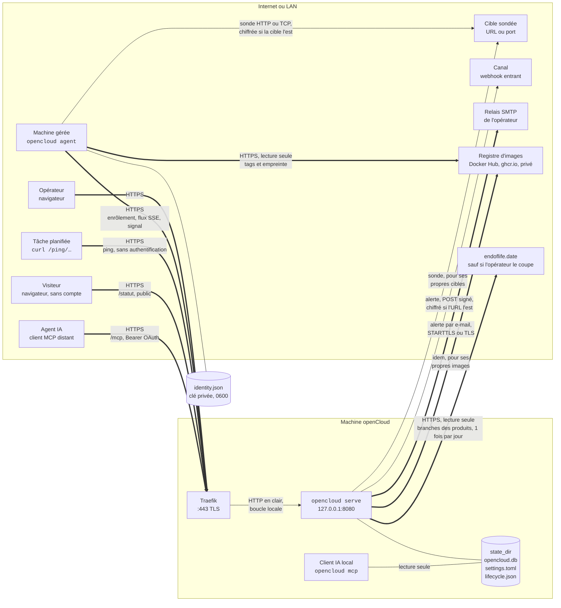

# Fonctionnement

> Ce document suit l'application. Chaque fonctionnalité intégrée y ajoute ce
> qu'elle change : un flux, un port, une donnée stockée. Dernière mise à jour :
> fin de support activée par défaut, deux lectures par jour au plus,
> 12 octobre 2026.

## Les acteurs

| Acteur | Ce que c'est | Ce qu'il fait tourner |
| --- | --- | --- |
| L'opérateur | L'opérateur, dans un navigateur | Le front React, chargé une fois avec la page, qui lit l'API JSON et affiche |
| La machine openCloud | Le VPS où openCloud est installé | `opencloud serve` : l'API, le front embarqué, la base, et le rôle d'agent pour elle-même |
| Une machine | Un VPS, une VM, un NAS, que openCloud gère sans l'héberger | `opencloud agent` : le démon qui parle à openCloud, mesure la machine et veille son Docker |
| Docker | Le démon de conteneurs d'une machine, s'il y en a un | Les services et leurs réseaux : l'agent le lit par sa socket, en lecture seule, et ne lui demande jamais rien d'autre |
| Traefik | Le proxy de la machine openCloud | Termine TLS et transmet à openCloud sur la boucle locale |
| Une tâche | Un cron, une sauvegarde, un script, n'importe où | Un `curl` sur son URL de ping quand elle démarre ou finit |
| Une cible | Une URL ou un port qu'une sonde vérifie, dedans comme dehors | Rien : elle reçoit une requête et répond, c'est tout ce qu'on lui demande |
| Un visiteur | N'importe qui, dans un navigateur, sans compte | La page de statut publique sous `/statut` : un petit bundle à part, qui lit un instantané et un direct publics |
| Un canal | Une URL entrante : Discord, Slack, Mattermost, ntfy, un récepteur à soi ; un salon Matrix ; ou des adresses e-mail | Rien : il reçoit un POST signé, un message du bot dans le salon, ou un e-mail, quand une alerte s'ouvre, s'aggrave ou se résout |
| Un relais SMTP | Celui de l'opérateur : Gmail, Brevo, l'hébergeur, un Postfix local | Rien : il reçoit d'openCloud les e-mails des canaux e-mail, avec l'identifiant réglé sous Paramètres, et les livre |
| Un registre | Docker Hub, ghcr.io, un registre privé : là d'où les images ont été tirées | Rien : il répond en lecture à l'agent de chaque machine, qui lui demande les tags d'un dépôt et l'empreinte d'un tag, jamais une image |
| endoflife.date | Un service public et gratuit qui tient, produit par produit, les branches maintenues et leur date de fin | Rien : il répond en lecture à la machine openCloud, une fois par jour, deux au plus, **tant que l'opérateur n'a pas coupé la fin de support** sous Paramètres. Les agents ne l'appellent jamais |
| Un agent IA | Claude, Cursor, l'inspecteur MCP, un script : un client MCP, distant en HTTPS ou local sur stdin/stdout | Des appels d'outils sous `/mcp`, derrière un jeton : seize lectures qui rendent les faits de l'API, neuf écritures que l'interface a déjà, dont la publication d'un incident sur la page de statut publique. Jamais une action sur une machine, jamais un secret d'openCloud ; en revanche les journaux bruts d'un conteneur, qui peuvent en contenir un |

Un seul binaire, `opencloud`, deux rôles. La machine openCloud est une Machine
comme les autres dans l'interface, sans démon à part.

## Le schéma

Trait double : chiffré. Trait simple : en clair, mais sans quitter la machine.

## Ce qui est chiffré, ce qui ne l'est pas

| Flux | D'où à où | Chiffrement | Qui prouve quoi |
| --- | --- | --- | --- |
| Interface | navigateur → Traefik | TLS de Traefik | L'opérateur, par HTTP Basic, quand l'authentification est activée sous Paramètres (mode `basic`) : identifiant et mot de passe, renvoyés par le navigateur à chaque requête, `/api/events` et les flux de journaux compris. En mode `forward`, le mandataire qui authentifie (Authelia derrière Traefik) : openCloud ne croit l'en-tête d'identité (`Remote-User` par défaut) que d'un pair de `trusted_proxies`, et répond `401` à tout le reste ; c'est au mandataire d'écraser l'en-tête envoyé par le client. Mode `none` par défaut : personne, une ligne `WARN` au démarrage et une bannière dans l'interface le rappellent. Le front charge la page, puis parle à `/api/…` en JSON |
| Interface | Traefik → openCloud | En clair, sur `127.0.0.1` de la même machine | Toute écriture de l'API exige `Content-Type: application/json`, même sans corps, et un `Sec-Fetch-Site` présent doit valoir `same-origin` ou `none`. Toute requête sous `/api/…` et sur `/oauth/authorize` exige un `Host` reconnu (hôte de `public_url`, `localhost`, IP littérale, hôte de `listen`), contre le DNS rebinding : sinon `403 bad_host`. Pas de cookie, mais le navigateur joint aussi les identifiants Basic à une requête partie d'une page tierce : c'est cette garde qui l'arrête |
| Direct | navigateur → `/api/events`, une connexion par onglet | TLS de Traefik | L'opérateur, par HTTP Basic ou par le mandataire, quand l'authentification est activée, comme l'interface ; personne en mode `none`. Le flux ne dit que « les machines ont changé », « les tâches ont changé », jamais lesquelles. Plafond de 64 onglets, comptés par le serveur et non par les abonnés du bus (la page de statut y est abonnée aussi), `503` au-delà |
| Agent | machine → Traefik | TLS de Traefik, ou empreinte épinglée par `-pin` si pas de domaine | Ed25519 : l'agent signe un défi, openCloud vérifie avec la clé enrôlée. Le signal porte les mesures de la machine et ce que son Docker a montré ; les journaux d'un conteneur remontent par `POST /agent/logs/…`, jeton de session |
| Agent, sens retour | openCloud → machine, sur le flux ouvert | Le même flux | Le serveur pousse « suis les journaux du conteneur X », « arrête » ; l'agent ne reçoit que ce que le serveur a tiré, jamais une entrée du navigateur |
| Journaux | navigateur → `/api/services/{id}/logs/stream` | TLS de Traefik | L'opérateur, par HTTP Basic ou par le mandataire, quand l'authentification est activée. En mode `none`, personne : qui atteint le port lit les journaux de n'importe quel conteneur, le même trou que l'interface, en plus lourd. Une seconde connexion par onglet ; seize lectures de journaux en tout, tirages et outil MCP compris |
| Sonde | machine qui sonde → la cible | Celui de la cible : TLS si la sonde est en `https://` ou si une sonde TCP demande la poignée de main, rien sinon | Personne : une sonde n'est pas authentifiée, elle regarde du dehors comme n'importe qui. Un certificat refusé rend l'essai **dégradé**, jamais hors ligne, et la requête n'est pas rejouée. La chaîne est jugée par la machine qui sonde, avec les autorités qu'elle connaît |
| Docker | agent → `/var/run/docker.sock` | Aucun : une socket Unix de la machine | Les droits Unix : l'agent est root, `opencloud serve` doit lire la socket lui aussi (root, ou le groupe `docker`, qui vaut root). Le client ne connaît aucun verbe qui écrit |
| Agent | Traefik → openCloud | En clair, boucle locale | `X-Forwarded-*` cru seulement depuis `trusted_proxies`. `X-Forwarded-For` se lit de la droite : la source est la dernière entrée qui n'est pas un mandataire de confiance, ce que le client écrit à gauche ne compte pas |
| Agent en dev | machine → `http://127.0.0.1` | Aucun, et c'est accepté : rien ne sort de la machine | Idem |
| Agent sur un LAN | machine → `http://192.168.…` | **Refusé** par l'agent, sauf `-allow-plain` | Réservé à un réseau déjà chiffré, WireGuard par exemple |
| Ping | tâche → Traefik → `/ping/{jeton}` | TLS de Traefik | Personne : le jeton dans l'URL est le secret. Qui l'a peut faire passer une tâche pour faite |
| Statut | visiteur → Traefik → `/statut`, `/statut/api/…` | TLS de Traefik | Personne, par conception : la page est publique. Elle ne dit que le nom des composants et ce que l'opérateur a écrit ; jamais un identifiant d'objet, un nom de machine, de conteneur ou de sonde, une cible, un port. Un test le prouve sur la réponse réelle |
| Registre | agent → le registre de l'image | TLS, sauf vers la boucle locale (un registre sur `localhost:5000`, comme Docker le fait) | L'agent s'authentifie par un jeton anonyme, ou signé des identifiants en clair du `config.json` de Docker de la machine ; le registre ne prouve rien de plus que son certificat. Rien ne sort qu'un nom de dépôt et un tag ; l'agent ne tire jamais une image. Aucune redirection suivie |
| Agent IA | client MCP → Traefik → `/mcp` | TLS de Traefik | Un Bearer, indépendant de l'authentification de l'interface : jeton d'accès OAuth d'une heure, obtenu par code et PKCE S256 puis le secret du client, ou jeton d'API créé sous Paramètres, à échéance de 30, 90 (défaut) ou 365 jours, ou sans échéance si l'opérateur le choisit. Le jeton porte une portée : `read` (défaut d'un jeton d'API) ou `write` (un jeton OAuth, toujours) ; une écriture la juge à chaque requête et refuse un `read` par `mcp.read_only`. Activer l'authentification de l'interface révoque tous les jetons. Sans en-tête, `401` avec l'adresse des métadonnées, c'est ainsi qu'un client découvre OAuth ; MCP désactivé, `404` partout. Le jeton est haché avant d'être cherché, et son dernier usage noté |
| Agent IA | client MCP → `/oauth/authorize`, `/oauth/token` | TLS de Traefik | Le `redirect_uri` est jugé avant tout redirect, y compris pour dire une erreur : la boucle locale toujours, n'importe quel port, sinon une adresse déclarée sous Paramètres, comparée telle quelle. Pas de page de consentement : le secret du client, jamais envoyé à l'autorisation, est vérifié à l'échange en temps constant. Un code sert une fois, dix minutes ; un rafraîchissement rejoué révoque toute sa famille. Débit borné par adresse, plus serré sur `/oauth/token` |
| Agent IA local | `opencloud mcp` ↔ le client, sur stdin/stdout | Aucun : deux processus de la même machine, rien ne passe par le réseau | Les droits Unix sur `state_dir`, en 0700 : il faut tourner sous le compte du service. Lecture seule : les écritures répondent `mcp.read_only`, ce processus ne tient ni le bus du direct ni les flux des agents |
| Alerte par e-mail | openCloud → le relais SMTP | STARTTLS exigé (défaut, 587) ou TLS dès la connexion (465), certificat vérifié contre le magasin du système ; `none` seulement si l'adresse jointe est sur la boucle locale ou un réseau privé, vérifié à la connexion | openCloud s'authentifie par AUTH PLAIN ou LOGIN, après le chiffrement. Un relais qui ne propose pas STARTTLS est refusé : jamais de repli en clair. Au-delà du relais, le message voyage comme tout courrier, et son destinataire le garde |
| Alerte Matrix | openCloud → le serveur d'accueil | TLS : le serveur d'accueil est exigé en `https://` | openCloud écrit au nom du bot par `Authorization: Bearer <jeton>`, le jeton du canal ; qui a ce jeton parle au nom du bot partout où il est invité. Le serveur d'accueil prouve qui il est par son certificat. Le message dit ce que dit le corps d'un webhook, et le salon le garde |
| Alerte | openCloud → le canal | Celui de l'URL : TLS si elle est en `https://`, rien sinon, et l'interface le dit | openCloud prouve au récepteur que c'est lui, par `OpenCloud-Signature`, HMAC-SHA256 du corps avec le secret du canal, quand il y en a un. Le récepteur ne prouve rien : un 2xx suffit. Le corps dit le nom de l'objet, de la machine, la cible d'une sonde, le point de montage : ce qu'un canal reçoit, son service le garde |

Donc non, rien ne passe en clair sur le LAN de l'infra : le seul clair est sur
la boucle locale de la machine openCloud, entre Traefik et le processus. Entre
deux machines, l'agent exige HTTPS, ou qu'on lui dise explicitement que le
réseau est déjà chiffré.

## Ce qui est stocké, et où

| Où | Fichier | Contenu | Protection |
| --- | --- | --- | --- |
| Machine openCloud, `state_dir` | `opencloud.db` | Les machines, les jetons d'enrôlement | Jetons stockés hachés : une copie de la base n'enrôle personne |
| Machine openCloud, `state_dir` | `opencloud.db` | Les tâches surveillées et leur jeton de ping, **en clair** : la page doit le réafficher | Une copie de la base donne les URL de ping ; on peut supprimer et recréer une tâche |
| Machine openCloud, `state_dir` | `opencloud.db` | Les pings bruts (forme, source, méthode, corps tronqué à 10 Kio) et les exécutions (début, fin, durée, code) | Purgés : pings après 7 jours, exécutions après 90 jours |
| Machine openCloud, `state_dir` | `opencloud.db` | Les ressources mesurées par machine : le brut toutes les 10 s dans `machine_samples`, ses volumes dans `machine_disks`, les moyennes horaires dans `machine_samples_hourly`, les journalières dans `machine_samples_daily` | Purgés : brut et volumes après 48 h, horaire après 90 jours, journalier après un an. La machine retirée emporte tout |
| Machine openCloud, `state_dir` | `opencloud.db` | Les services : une fiche par conteneur dans `services` (nom, projet Compose, image, état Docker, code de sortie, tué faute de mémoire, tué sans arrêt demandé, santé, ports publiés, mode réseau, privilégié, dépendances déclarées, dates), ses transitions dans `service_transitions`, ses mesures dans `service_samples`, ce que chaque machine dit de son Docker dans `machine_engines` | Purgés : transitions après 90 jours, fiche d'un conteneur détruit après 30 jours avec ses transitions et mesures, mesures après 48 h. **L'extrait de journal** d'un arrêt anormal (50 lignes, 10 Kio) est stocké en clair sur la transition : ce qu'une application écrit dans ses logs peut s'y trouver |
| Machine openCloud, `state_dir` | `opencloud.db` | Le réseau des services : les réseaux Docker de chaque machine dans `machine_networks` (nom, pilote, interne, projet Compose), l'appartenance de chaque fiche à ses réseaux dans `service_networks` (adresse, alias) | Remplacés à chaque inventaire ; la fiche supprimée emporte ses appartenances, la machine retirée emporte tout. Les adresses sont celles des réseaux internes de Docker, pas des adresses publiques |
| Machine openCloud, `state_dir` | `opencloud.db` | Les sondes dans `probes` (nom, type, cible, machine qui sonde, service surveillé, état, cadence, seuils, attentes HTTP, poignée de main TLS demandée, dernier essai), chaque essai dans `probe_results`, l'agrégat par jour UTC dans `probe_days` | Purgés : essais après 7 jours, agrégat après un an. La machine retirée emporte ses sondes et leur histoire ; le service effacé laisse la sonde et perd son rattachement. La cible est écrite en clair : une copie de la base dit ce qui est surveillé, pas comment y entrer |
| Machine openCloud, `state_dir` | `opencloud.db` | Le dernier certificat vu par chaque sonde, dans les colonnes `cert_*` de `probes` : sujet, émetteur, dates, empreinte SHA-256, chaîne valide, nom correspondant, agrafe OCSP | Écrasé à chaque essai qui en voit un ; un essai muet n'efface rien. **Aucun historique, aucune chaîne complète** : le renouvellement se lit au changement d'empreinte, l'âge sur la date de début. Rien de secret : un certificat serveur est public par construction |
| Machine openCloud, `state_dir` | `opencloud.db` | La page de statut : les composants dans `status_components` (nom public, ordre), leurs objets dans `status_component_members` (quatre clés étrangères, exactement une remplie), les incidents dans `incidents` (titre, impact, statut, fenêtre d'une maintenance, dates), leurs composants dans `incident_components`, leur fil dans `incident_updates` | L'objet supprimé retire le lien tout seul ; le composant supprimé emporte ses liens et ses rattachements aux incidents, l'incident reste. Incidents résolus purgés après un an. Tout est écrit par l'opérateur pour être lu par le public : rien de secret |
| Machine openCloud, `state_dir` | `opencloud.db` | Le dernier constat sur chaque image d'une machine dans `image_checks` (issue, empreinte tirée, empreinte publiée, tag plus récent et son empreinte, type déduit) ; sur la fiche `services`, ce que Compose dit du service (`compose_service`, `compose_dir`, `compose_file`) et la politique de l'opérateur (`update_policy`) | Écrasé à chaque vérification ; purgé après 30 jours sans vérification ; la machine retirée emporte tout. Le dossier du projet Compose est un chemin de la machine, en clair |
| Machine openCloud, `state_dir` | `opencloud.db` | Les alertes dans `alerts` (type, gravité, objet et son nom, machine, détails en JSON, dates dont le début du calme, acquittement, silencieuse), les canaux dans `alert_channels` (URL, format, destinataires d'un e-mail ou salon Matrix dans `destination`, **secret en clair** — le jeton du bot pour Matrix —, gravité minimale), les livraisons dans `alert_deliveries` (événement, essais, motif, code, ou retenue par la limite du canal), les silences dans `alert_silences` | Résolues purgées après 90 jours, livraisons avec leur alerte, canaux et silences sans purge. **Le secret d'un canal est lisible dans une copie de la base** : c'est une clé de signature, pas un mot de passe, et le récepteur peut la changer ; l'API ne le renvoie jamais. Pour Matrix, c'est le jeton d'accès du bot : il faut le rejouer au serveur d'accueil, un haché ne servirait à rien ; le déconnecter du compte du bot le révoque |
| Machine openCloud, `state_dir` | `opencloud.db` | L'accès d'un agent IA : le client OAuth dans `mcp_clients` (une ligne, secret **haché**, préfixe affiché, adresses de retour déclarées), les codes d'autorisation dans `mcp_codes` (hachés, dix minutes, servis une fois), les jetons dans `mcp_tokens` (hachés ; portée `read` ou `write` ; accès 1 h, rafraîchissement 30 j, API 30, 90 ou 365 j ou sans échéance au choix ; famille, dernier usage, révocation) | Rien n'est en clair : une copie de la base n'ouvre rien. Purge toutes les 15 minutes des codes et jetons échus, jetons d'API compris ; un révoqué reste jusqu'à son échéance, c'est lui qui trahit un rejeu (un jeton d'API sans échéance révoqué reste donc, inerte). Désactiver MCP efface le client et tous les jetons ; activer l'authentification de l'interface les révoque tous et garde le client. Les jetons d'API d'avant la portée sont passés en `write` par la migration 017 |
| Machine openCloud, `state_dir` | `opencloud.db` | L'accès de l'opérateur à l'interface dans `auth_settings` (une ligne, migration `012_auth.sql`) : le mode (`none`, `basic`, `forward`), l'identifiant, l'empreinte **bcrypt** du mot de passe (coût 12), le nom de l'en-tête d'identité du mode `forward` (`forward_header`, migration `018_auth_forward.sql`), la date d'activation | Le mot de passe n'est jamais stocké ni renvoyé ; une copie de la base donne l'identifiant, pas l'accès. L'identité transmise par le mandataire n'est jamais stockée : elle arrive avec chaque requête. Désactiver efface identifiant, empreinte et en-tête |
| Machine openCloud, `state_dir` | `settings.toml` | La langue de l'interface ; le titre, l'annonce en texte brut et la langue de la page de statut ; les seuils d'alerte du disque (`disk_attention_percent`, `disk_danger_percent`, absents tant que rien n'est réglé) ; le relais d'e-mails (`mail_host`, `mail_port`, `mail_tls`, `mail_username`, `mail_from`, et **`mail_password` en clair** : il faut le rejouer au relais, un haché ne servirait à rien ; fichier en 0600, l'API ne le renvoie jamais, `has_password` dit seulement qu'il y en a un) ; la fin de support (`lifecycle_disabled`, absent tant qu'elle est activée) | Écriture atomique ; un seul propriétaire, `internal/settings`, qui relit, modifie sa clé et réécrit sous un verrou : la langue et la page de statut changées en même temps survivent toutes deux |
| Machine openCloud, `state_dir` | `lifecycle.json` | La dernière lecture d'endoflife.date : quel dépôt d'images est quel produit, et les branches des produits que les services utilisent (nom, maintenue ou non, date de fin, dernière version). Absent tant que la fin de support n'a jamais été activée | Données publiques, 0600, écriture atomique, remplacé d'un bloc à chaque lecture réussie ; l'effacer coûte une lecture de la source |
| Machine gérée, `/var/lib/opencloud/agent` | `identity.json` | Clé privée Ed25519, identifiant, adresse d'openCloud, empreinte, langue | Mode 0600 ; le perdre impose un ré-enrôlement |

Le jeton en clair n'existe qu'à deux endroits, un instant : l'écran qui l'affiche
une fois, et la commande qui le passe à l'agent. Le secret du client MCP et un
jeton d'API n'existent en clair qu'à l'écran qui les montre une fois, puis chez
le client qui les garde.

## Comment une machine entre

1. L'opérateur nomme la machine. openCloud tire un jeton, en garde l'empreinte,
   affiche le clair une seule fois avec la commande à coller.
2. Sur la machine : `sudo opencloud agent -server https://… -token oc_…`. L'agent
   tire une clé Ed25519 et un identifiant, envoie sa clé publique et le jeton.
   Il joint l'empreinte (SHA-256, préfixée) de l'identifiant de la machine
   (`/etc/machine-id`, sinon `/var/lib/dbus/machine-id`) **et** de
   l'identifiant du démarrage (`/proc/sys/kernel/random/boot_id`) ; jamais
   les identifiants bruts, et rien s'il en manque un. Le démarrage compte
   parce qu'une image clonée (modèle de VPS, clone Proxmox) garde le
   machine-id de son modèle : vérifié le 10 octobre 2026, deux clones
   étaient pris l'un pour l'autre et le second refusé à tort.
3. `opencloud serve` fait la même empreinte au démarrage. Même empreinte :
   l'agent tourne sur la machine openCloud, qui se supervise déjà (machine
   `local`) ; un agent doublerait services et alertes. Refus 409
   `machine_is_opencloud`, avant la base : **le jeton n'est pas consommé**,
   il sert à une autre machine. Sans empreinte d'un côté ou de l'autre
   (agent plus vieux, machine sans identifiant), pas de contrôle. Un agent
   enrôlé avant ce refus présente l'empreinte à l'ouverture du flux
   (en-tête `OpenCloud-Host-Fingerprint`) : openCloud l'accepte mais écrit
   un avertissement au journal, qui dit de retirer la machine et
   de désinstaller l'agent. Rien n'est stocké.
   Sinon, openCloud consomme le jeton et crée la machine dans une seule transaction :
   deux agents avec le même jeton, un seul passe. Le jeton ne sert plus jamais.
4. À chaque connexion, l'agent demande un défi, le signe, ouvre un flux qui reste
   ouvert. En ligne, c'est ce flux. « Vu il y a », c'est le dernier signal,
   envoyé toutes les 30 s.
5. Flux coupé : l'agent revient avec un délai croissant, 1 s à 60 s. Machine
   retirée (`machine_not_found`) ou clé qui n'est plus celle enrôlée
   (`bad_proof`) : l'agent s'arrête et le dit. Ré-enrôler garde
   l'identifiant et l'historique, seule la clé change.
6. Serveur redémarré avant que l'agent ait vu la coupure : son signal arrive
   avec une session que le serveur ne connaît plus (`no_session`), l'agent
   relève aussitôt un nouveau défi. Horloge de la machine à plus de 5 min de
   celle d'openCloud (`clock_skew`) : la preuve est refusée, la machine reste
   hors ligne, l'agent écrit dans son journal, dans la langue de l'opérateur,
   de régler l'heure par NTP, et réessaie avec le même délai croissant. Tout
   autre refus (un 404 d'un proxy en plein redéploiement, un 5xx) se réessaie
   aussi ; seul un refus d'enrôlement arrête l'agent au premier lancement.

## Comment une tâche est surveillée

1. L'opérateur crée une tâche : un nom, un intervalle, une grâce, une
   machine facultative. openCloud tire un identifiant pour la page et un
   jeton `hb_…` pour l'URL de ping. Son état est « Nouveau », avec déjà une
   première échéance : création + intervalle + grâce. Passé ce délai sans
   aucun ping, elle passe « En retard » et l'alerte « Tâche en retard »
   s'ouvre, avec sa propre phrase : « n'a jamais signalé de passage depuis sa
   création il y a … : vérifiez que la commande de ping est bien branchée ».
   Une sauvegarde mal branchée ne reste donc pas « Nouveau » pour toujours.
   Les tâches créées avant ce correctif reçoivent la même échéance au
   démarrage de la boucle des tâches (un rattrapage dans le composant, pas
   une migration : la règle reste en Go, à un seul endroit, et se rejoue
   sans effet) ; déjà dépassée, elles passent en retard au premier
   contrôle.
2. La tâche appelle l'URL, en GET ou en POST, sans authentification :
   `/ping/{jeton}` quand elle a fini, `/ping/{jeton}/start` quand elle
   démarre, `/ping/{jeton}/{code}` quand elle finit avec ce code de sortie.
   Chaque ping repousse l'échéance à maintenant + intervalle + grâce.
3. Un `start` ouvre une exécution ; la fin la clôt avec sa durée et son code.
   Un `start` sans fin est clos en « Dépassée » par le `start` suivant ou par
   l'échéance. Un code de sortie autre que 0 met la tâche « En échec ».
4. Toutes les 15 s, une boucle passe « En retard » les tâches dont
   l'échéance est dépassée. Le prochain ping les remet « À l'heure ».
5. En pause, une tâche n'a plus d'échéance ; un ping le reprend. La reprise
   rouvre une échéance complète ; une tâche qui n'a jamais pingé redevient
   « Nouveau » avec cette échéance. Supprimé,
   son URL répond 404 et son historique disparaît avec lui.

Le ping est écrit en une seule transaction : ping brut, exécution, état de la
tâche. La source notée est l'adresse résolue par `trusted_proxies` ; un
relais par l'agent, s'il vient un jour, y écrira `agent:<machine>` sans
changer le schéma.

## Comment une machine est mesurée

1. L'agent lit `/proc/stat`, `/proc/meminfo`, `/proc/loadavg`, `/proc/net/dev`
   et `/proc/mounts` toutes les 10 s, puis fait un `statfs` par volume. Le
   processeur et le réseau sont des deltas entre deux lectures : un
   pourcentage actif, un débit en octets par seconde hors boucle locale. La
   mémoire, le swap, la charge sur une minute, le nombre de cœurs et les
   volumes sont instantanés.
2. Un volume est un système de fichiers de disque monté : ext2 à ext4, xfs,
   btrfs, zfs, f2fs, jfs, vfat, exfat, ntfs, ntfs3, fuseblk. Le reste ne
   compte pas : les pseudo-systèmes du noyau et les tmpfs, l'overlay des
   conteneurs, les images en boucle (`/dev/loop…`, dont les snaps), les
   montages réseau (nfs, cifs), et tout ce qui est monté sous `/boot`,
   `/snap`, `/var/lib/docker` et `/var/lib/containers`. Un même
   périphérique monté plusieurs fois, `/` et `/home` sur un btrfs par
   exemple, fait un seul volume, nommé par son point de montage le plus
   court. Un volume qui ne se mesure pas est laissé de côté, jamais montré à
   zéro. `disk_used` et `disk_total` font la somme des volumes.
3. Les lectures attendent dans un tampon en mémoire d'une heure au plus. Le
   signal de toutes les 30 s les emporte dans son corps, par lots de 120 ; un
   rattrapage après une coupure enchaîne les signaux jusqu'à vider le tampon.
   Un redémarrage de l'agent perd le tampon : pas de spool sur disque.
4. La machine openCloud se mesure elle-même dans `opencloud serve`, à la même
   cadence, sans passer par le réseau : c'est son rôle d'agent.
5. openCloud refuse en bloc un lot dont une lecture est hors de mesure
   (pourcentage hors de 0 à 100, nombre négatif, date à plus de cinq minutes
   dans le futur ou plus vieille que le brut gardé, volume sans point de
   montage absolu ou compté deux fois, plus de 32 volumes) ; le signal de
   vie compte quand même. Une lecture déjà en base, rejouée, est ignorée,
   ses volumes avec. Chaque section du signal (lectures, services, sondes,
   images) s'écrit seule : une section refusée n'emporte pas les autres.
   Le serveur journalise le refus et répond `200` avec
   `{"rejected":{"<section>":"<clé>"}}` ; l'agent jette la section refusée
   et ne rejoue pas ce qui a été accepté. Seul un corps illisible vaut un
   `400` global. Un agent plus vieux, qui ne pose pas l'en-tête
   `OpenCloud-Signal-Sections`, reçoit toujours le `400` de la première
   section refusée, les autres étant écrites ; face à un serveur plus
   vieux, l'agent remet dans son tampon les sections qui suivaient la
   refusée.
6. Toutes les 5 min, le rollup rejoue tous les seaux horaires que le brut
   couvre encore, puis les seaux journaliers, en une instruction SQL par seau
   qui réécrit le seau s'il existe. Pas de curseur : un redémarrage ou un
   rattrapage se corrige seul. Le journalier est pondéré par le nombre
   d'échantillons de chaque heure.
7. La purge, au départ puis une fois par jour, efface chaque étage au-delà de
   sa rétention. Chaque fenêtre lit une table gardée strictement plus
   longtemps qu'elle : une purge ne tronque jamais une lecture en cours.

| Fenêtre | Table lue | Pas des points |
| --- | --- | --- |
| 1 h | brut | 10 s |
| 24 h | brut, groupé | 5 min |
| 7 j, 30 j | horaire | 1 h |
| 90 j | journalier | 1 jour, en UTC |

La valeur courante est le dernier échantillon en base. Passé 90 s sans
échantillon, la machine est « indisponible » : l'API dit `available: false`
et le front affiche un tiret et l'âge de la dernière mesure, jamais un zéro.
L'API rend des faits : octets, octets par seconde, pourcentage processeur ;
les pourcentages de mémoire et de disque et les unités lisibles se
calculent dans le navigateur.

## Comment les services sont suivis

Un service est une application qui tourne sur une machine. Aujourd'hui,
un service est un conteneur Docker ; la fiche porte un genre pour qu'une
application native en soit un aussi plus tard. Le projet Compose est un
groupe, pas une entité : `nextcloud` et `nextcloud-db` sont deux services
du groupe `nextcloud`, comme sur la planche « Machine ».

1. L'agent sonde la socket Docker au départ puis toutes les 60 s tant
   qu'elle ne répond pas, en lecture seule, API Engine épinglée à `1.41`
   (Docker 20.10, celui de Debian 12) ; un démon plus vieux est refusé. Il
   dit à openCloud si Docker est présent, sinon pourquoi : pas de socket,
   pas le droit, démon muet, trop vieux. Ce n'est pas une erreur : la
   machine n'a aucun service, et l'interface l'écrit.
2. Docker répond : l'agent liste et inspecte chaque conteneur (un
   `docker compose run` est laissé de côté), envoie l'inventaire complet,
   puis le redonne toutes les 5 min. Une fiche que l'inventaire ne nomme
   plus est archivée. Un conteneur qui réapparaît avec le même id
   retrouve sa fiche.
3. Entre deux inventaires, l'agent suit le flux d'événements de Docker et
   traduit `create`, `start`, `die`, `pause`, `unpause`, `destroy`,
   `health_status`, `rename` ; `kill` et `stop` ne changent rien par
   eux-mêmes, le `die` qui suit porte l'état et le code de sortie. Ils
   disent seulement qu'un arrêt est **demandé** : `docker stop`, `restart`
   et `compose down` envoient d'abord le signal d'arrêt (un `kill` dont le
   signal n'est pas 9), puis SIGKILL au bout du délai, et Docker émet
   `stop` ; `docker kill` n'envoie que SIGKILL. Un `die` en 137 sans
   demande d'arrêt dans le délai d'arrêt du conteneur plus une minute
   (10 s par défaut), sans manque de mémoire, et sur un conteneur qui
   n'est pas en train d'être retiré (`rm -f`, `compose down`), est
   marqué **tué** (`killed`). Un `start` efface la demande en attente.
   Chaque événement repart avec le conteneur réinspecté. Sur un `die` à
   code hors 0, 137 ou 143, tué faute de mémoire ou tué, l'agent capture les 50
   dernières lignes du journal. Une coupure du flux repart de l'horodatage
   du dernier événement reçu.
4. Toutes les 30 s, l'agent mesure chaque conteneur qui tourne en un appel
   (`stats?one-shot`) : le processeur est un delta entre deux mesures, en
   pourcentage d'un cœur (200 % = deux cœurs), la mémoire est l'usage moins
   le cache de fichiers, comme `docker stats`. Un compteur qui recule
   (conteneur relancé) vaut une première mesure : rien ce tour.
5. Tout attend dans un tampon en mémoire et part dans le corps du signal,
   section `services` à côté des lectures. Après une reconnexion, ce qui
   attendait est marqué **rejoué** : le serveur l'écrit, mais la feature
   alertes n'y verra pas du neuf. Un agent plus vieux n'envoie pas de
   section : le serveur l'accepte.
6. openCloud refuse en bloc un rapport de forme absurde (plus de 256
   conteneurs, 512 événements ou 1 024 mesures, un Docker absent sans
   raison) ; le signal de vie compte quand même, et les autres sections du
   signal s'écrivent (« Comment une machine est mesurée », point 5). Un
   élément seul hors de mesure (un id qui n'est pas un id Docker, un état
   inconnu, une date dans le futur, un port hors bornes, un rattachement
   réseau sans id : Docker n'en donne pas encore à un conteneur tout juste
   créé) est écarté, avec une ligne de journal qui le nomme et dit
   pourquoi ; le reste du rapport passe. Un conteneur écarté d'un
   inventaire complet est archivé comme absent, il revient au rapport
   suivant. Sinon il
   écrit tout en une transaction : fiches, transitions (une par changement
   d'état ou de santé, jamais par événement sans changement), mesures, état
   du Docker.
   La machine openCloud fait tout cela dans `opencloud serve`, sans réseau.
7. Le serveur rend des faits : l'état Docker brut, le code de sortie, la
   santé, `oom_killed` et `killed`. Le navigateur en fait les pastilles :
   Actif, Démarre, Défaillant, Manque de mémoire, Tué, Redémarre, En pause,
   Arrêté ; un
   `exited` à 0, 137 ou 143 est « Arrêté », tout autre code « Défaillant ».
   Un conteneur tué par le noyau faute de mémoire sort aussi en 137 :
   Docker le dit par `State.OOMKilled`, l'agent le remonte avec l'état
   (`oom_killed`, absent chez un agent plus vieux, lu comme faux), et la
   pastille est « Manque de mémoire », jamais « Arrêté ». Un conteneur
   tué sans arrêt demandé (point 3) est « Tué » ; un agent plus vieux ne
   le dit pas, et 137 reste « Arrêté ». Docker ne garde pas ce fait :
   l'inventaire le conserve tant que la fiche reste sur le même arrêt
   (même état, même fin). Le compteur de la barre
   latérale passe en rouge dès qu'un service est défaillant ou redémarre.
8. Les journaux : l'opérateur ouvre une fiche, le serveur tire un
   identifiant de requête et pousse `logs` sur le flux de l'agent ; l'agent
   ouvre le journal (100 lignes par défaut, 500 au plus) et livre des lots
   toutes les secondes ou toutes les 64 lignes par `POST /agent/logs/{id}`,
   que le serveur relaie au navigateur en SSE. Un lot n'est accepté que
   de la machine à qui la requête a été poussée, et ne compte pas comme
   signe de vie : seul le signal publie `machines`. L'onglet fermé, le
   serveur pousse `logs_stop`. Quatre suivis par machine ; seize lectures
   en tout, suivis, tirages uniques et `get_service_logs` confondus ;
   au-delà, refusé avec la clé du catalogue. Une file de commandes pleine
   est refusée aussi (`service.machine_busy`, 503). Le navigateur garde 1 200 lignes et
   retombe sur un tirage unique si le direct échoue avant la première
   ligne. Une machine hors ligne le dit, sans attendre.
9. La purge, au départ puis une fois par jour, efface les transitions de
   plus de 90 jours, les fiches archivées depuis plus de 30 jours (leurs
   transitions et mesures partent avec) et les mesures de plus de 48 h.

| Ce que l'agent lit | Où | Ce qu'il en garde |
| --- | --- | --- |
| `GET /_ping` | en-têtes `Api-Version`, `Server` | présent, version, version d'API |
| `GET /containers/json?all=1` | liste | id, labels Compose, état |
| `GET /containers/{id}/json` | inspect | nom, image et son empreinte, état, code de sortie, `OOMKilled`, délai d'arrêt (`Config.StopTimeout`), santé, redémarrages, ports publiés, dates |
| `GET /events?filters=container` | flux | action, id, instant, code de sortie, signal d'un `kill` (pour savoir si un arrêt était demandé) |
| `GET /containers/{id}/stats?one-shot` | mesure | compteurs processeur, mémoire, limite |
| `GET /containers/{id}/logs` | journal multiplexé | lignes horodatées, stdout et stderr |
| `GET /images/{nom}/json` | inspect d'une image | `RepoDigests` : l'empreinte que la machine a tirée, pour les mises à jour |

Pas de label `opencloud.*` : openCloud déclarera ses services plus tard,
les labels viendront avec. Les labels de Compose, eux, sont lus : le
projet, le service, le dossier et le fichier du projet. Les ports publiés
s'affichent dans la colonne Domaine en attendant les domaines.

## Comment le réseau des services se lit

L'onglet Réseau d'une machine dessine ce qui relie ses services et ce
qui est exposé au monde. Le serveur rend des faits : les services, les
groupes, les arêtes, les constats ; le navigateur place et trace.

1. À chaque inventaire, l'agent lit sur chaque conteneur son mode réseau
   (`bridge`, `host`, `none`, `container:<id>`, ou le nom du premier
   réseau joint), s'il est privilégié, les réseaux qu'il joint avec son
   adresse et ses alias (l'id court du conteneur est écarté des alias),
   et ses dépendances déclarées : le label Compose
   `com.docker.compose.depends_on`, puis les liens hérités de `--link`.
   Il liste aussi les réseaux de la machine en un appel : nom, pilote,
   interne ou non, projet Compose. Les deux listes complètes voyagent
   avec l'inventaire.
2. Entre deux inventaires, le flux d'événements porte aussi les réseaux :
   un `connect` ou un `disconnect` réinspecte le conteneur concerné et
   repart avec ses réseaux du moment, sans transition ; un `create` ou un
   `destroy` de réseau fait relire la liste, qui repart seule.
3. openCloud refuse en bloc un rapport hors de mesure (plus de 256
   réseaux par machine ou 32 par conteneur, un id qui n'est pas un id
   Docker, une adresse qui n'en est pas une, plus de 16 alias, plus de 64
   dépendances, une dépendance d'une source inconnue) ; sinon il écrit
   tout dans la même transaction que les fiches : la liste des réseaux
   remplace la précédente, les appartenances d'une fiche remplacent les
   siennes.
4. Les constats d'exposition sont calculés à la lecture, jamais stockés,
   jamais alertés : la fonctionnalité alertes ne les a pas repris, c'est à
   décider. Le mode `host` court-circuite l'analyse des ports. C'est le
   port du conteneur qui compte, pas celui de l'hôte.
5. La topologie se calcule à la lecture, sur `GET /api/machines/{id}/network`.
   Un groupe est un réseau créé par l'opérateur ou par Compose ; `bridge`,
   `host` et `none` n'en font jamais. Un réseau qu'un service dit joindre
   compte même si la machine ne l'a pas encore listé. Un service dans
   plusieurs réseaux va dans celui où il a le plus de voisins, le premier
   par le nom à égalité ; ses autres réseaux se lisent dans l'inspecteur.
   Une arête publique va d'Internet à chaque port publié sur toutes les
   interfaces (`0.0.0.0`, `::` ou une adresse vide ; les deux sur le même
   port n'en font qu'une). Une arête de dépendance va d'un service à
   celui qu'il déclare : une dépendance Compose se résout dans le même
   projet, un lien par le nom du conteneur ; ce qui ne se résout pas n'a
   pas d'arête, la fiche le dit. Ce qu'un réseau partagé laisse deviner
   n'est pas une dépendance : c'est une joignabilité, l'inspecteur
   l'écrit « joint par le réseau X ».
6. Le navigateur place en trois colonnes : Internet ; ce qu'Internet
   atteint, services publiés hors groupe puis groupes qui en abritent un ;
   puis le reste. Une route publique ne traverse donc jamais un nœud. Le
   point d'un nœud dit le danger d'abord, puis l'attention d'un constat
   ou d'un redémarrage, puis l'état. Le filtre Tous, Actifs, Arrêtés cache
   des nœuds, les arêtes et les groupes vides avec eux. Le sujet
   `services` du direct relit la topologie ; la sélection tient par
   identifiant.

| Constat | Règle | Niveau |
| --- | --- | --- |
| `host_network` | mode réseau `host` | attention |
| `privileged` | conteneur privilégié | attention |
| `database_port_public` | port de conteneur 3306, 5432, 6379 ou 27017 publié sur toutes les interfaces | attention |
| `port_public` | tout autre port publié sur toutes les interfaces | information |

| Ce que l'agent lit en plus | Où | Ce qu'il en garde |
| --- | --- | --- |
| `GET /containers/{id}/json` | `HostConfig` | mode réseau, privilégié, liens |
| `GET /containers/{id}/json` | `NetworkSettings.Networks` | par réseau : id, adresse, alias |
| `GET /containers/{id}/json` | label `com.docker.compose.depends_on` | les noms de services, dans l'ordre du label |
| `GET /networks` | liste | id, nom, pilote, interne, projet Compose |
| `GET /events?filters=container,network` | flux | `connect`, `disconnect`, `create`, `destroy` |

Le nœud proxy attend le proxy ; l'inspecteur dit maintenant le certificat
du service, quand une sonde en surveille un. Une sonde se lit sur la fiche
du service qu'elle surveille, pas encore sur le graphe ; les alertes
d'exposition, à décider ; le bouton Redémarrer, les actions : le client
Docker ne connaît aucun verbe qui écrit.

## Comment une image est comparée à son registre

openCloud dit quand l'image d'un service a quelque chose de plus récent à
offrir. Il ne tire rien et ne relance rien : il fabrique la commande, et
c'est l'opérateur qui la joue. Ce que le module d'origine faisait de plus,
les CVE, le changelog, le score de risque, n'a pas été repris.

1. **L'agent de chaque machine interroge lui-même** les registres de ses
   images : il a le trousseau Docker de la machine, et un registre privé
   joignable seulement depuis elle. La machine openCloud le fait dans
   `opencloud serve`, sans réseau vers elle-même. Le premier passage
   attend 2 min après le démarrage ; ensuite, toutes les 5 min, l'agent
   liste ses conteneurs (arrêtés compris, jetables exclus) et vérifie les
   images jamais vues ; chaque image se revérifie **toutes les 24 h**.
   Une pause de 2 s sépare deux images.
2. **Pour une image**, l'agent lit dans Docker l'empreinte tirée
   (`RepoDigests`), demande au registre la liste des tags du dépôt
   (`/v2/<dépôt>/tags/list`, 1 000 par page, 10 pages au plus) puis
   l'empreinte que le tag courant pointe aujourd'hui (`HEAD
   /v2/<dépôt>/manifests/<tag>`). Le jeton vient du `realm` que le registre
   annonce, anonyme ou signé des `auths` en clair du `config.json` de
   Docker ; les assistants (`credHelpers`) ne sont pas lus. Sur Docker
   Hub, un `HEAD` ne compte pas dans le quota de pulls (100 par heure et
   par adresse, anonyme) ; la liste des tags non plus. La cadence et la
   pause tiennent ce quota loin.
3. **La comparaison de versions tourne chez l'agent**, en fonction pure :
   un tag se lit comme des composants numériques, un « v » facultatif et
   une variante d'une liste fermée (`-alpine`, `-bookworm`, `-slim`…). Le
   tag plus récent retenu est **écrit de la même façon** : même variante,
   même « v », même nombre de composants. `3.20` va vers `3.24`, jamais
   vers `3.22.1` ; `postgres:16` va vers `17` et se suit au digest en
   attendant ; `latest`, `lts`, `1.2-rc1` ne sont pas des versions. Le
   signal ne porte que des faits par image : issue, empreinte tirée,
   empreinte publiée, tag plus récent et son empreinte ; jamais la liste
   des tags, qui dépasse 10 000 entrées pour `node`.
4. **Le serveur écrit le dernier constat** par (machine, image) et en
   déduit le type : majeure, mineure ou correctif d'après le premier
   composant qui bouge ; **digest** quand le même tag pointe une autre
   empreinte que celle tirée. Comparer à l'empreinte tirée, et non à une
   référence mémorisée, fait que le premier passage dit déjà la vérité.
   Un rapport hors de mesure (plus de 256 résultats, une empreinte qui
   n'en est pas une, une date dans le futur) est refusé en bloc.
5. **La commande est fabriquée, jamais exécutée.** Sous Compose : `cd
   <dossier> && docker compose pull <service> && docker compose up -d
   <service>` ; pour un tag plus récent, l'interface montre la ligne
   `image:` du service avant et après, avec le fichier Compose concerné :
   l'opérateur la change dans son dépôt, la commande tire ce que le
   fichier écrit. La ligne d'avant est celle que Docker rend, variables
   résolues : elle peut s'écrire autrement dans le fichier.
   Pour un conteneur lancé à la main : `docker pull <image:tag>` seul, et
   la fiche dit de le recréer avec ses options, qu'openCloud ne connaît
   pas. Une rétrogradation est impossible par construction : seul un tag
   strictement plus récent est nommé.
6. **La politique se règle sur la fiche** : suivre (par défaut),
   **épingler** (vérifié, ni montré ni compté), **exclure** (le registre
   n'est jamais interrogé). Le serveur pousse à l'agent la liste des
   images exclues par la commande `image_checks` du flux, à l'ouverture
   et à chaque changement ; « Vérifier maintenant » pousse la même
   commande avec `now`, et l'agent repasse sur toutes ses images. Une
   machine hors ligne refuse, et l'interface le dit.
7. **Les issues se lisent** : `ok` ; `local` (pas d'empreinte tirée, image
   construite sur place) ; `unauthorized` (le registre refuse : image
   privée, ou construite sur place et inconnue du Hub, qui répond 401 et
   non 404) ; `not_found` ; `unreachable` ; `unsupported` (référence
   illisible ou désignée par son empreinte). Un refus d'authentification
   n'est pas une erreur : on passe.
8. **Aucune alerte** : une version disponible n'est pas une panne. La
   ligne du tableau porte une pastille accent dans la colonne Image (le
   tag trouvé, ou « reconstruite »), la fiche une carte Mise à jour
   (constat, empreintes, commande à copier, actions), la vue d'ensemble
   compte les services à jour à faire, `/api/counts` porte le chiffre.
   Un constat écrit publie le sujet `services` du direct.
9. Un constat qu'aucun passage n'a rafraîchi depuis 30 jours est purgé,
   au départ puis une fois par jour.

| Ce que l'agent demande | Où | Ce qu'il en garde |
| --- | --- | --- |
| `GET /v2/<dépôt>/tags/list?n=1000` | le registre | les tags, page après page par l'en-tête `Link` |
| `HEAD /v2/<dépôt>/manifests/<tag>` | le registre | `Docker-Content-Digest` : l'empreinte que le tag pointe, celle que Docker note en tirant ; en `GET` avec l'empreinte calculée si l'en-tête manque |
| `GET <realm>?service&scope` | le serveur de jetons annoncé | un jeton Bearer, gardé le temps d'un dépôt |
| `GET /images/<nom>/json` | Docker, sur la socket | `RepoDigests` |

## Comment la fin de support se lit

Le constat sur l'image dit s'il existe plus récent. Il ne dit pas si la
version qui tourne est encore maintenue : c'est une autre question, et une
autre source. openCloud la lit sur endoflife.date, **activée par défaut**
(décidé par Lucas le 12 octobre 2026) ; l'opérateur la coupe sous
Paramètres, et plus rien ne sort. C'est, avec la comparaison des images à
leur registre, ce qu'openCloud appelle à l'extérieur sans qu'on le lui ait
demandé : la carte des Paramètres le dit.
Elle vaut pour l'image d'un service et pour le système d'une machine. Pour
le système c'est une information seule : aucune commande n'est proposée.

| Ce que ça rapporte | Ce que ça coûte |
| --- | --- |
| La fiche d'un service et celle d'une machine disent la branche qui tourne, jusqu'à quand elle est maintenue, et les branches maintenues au-dessus | Une fois par jour, deux au plus, la machine openCloud appelle un tiers, dès l'installation : il voit son adresse et le nom des produits demandés (« postgresql », « traefik », « debian ») |
| Un correctif proposé dans une branche morte se voit comme tel | Ce que la source ne suit pas reste « support inconnu » ; ses dates sont celles d'une base tenue par des bénévoles |

1. **Seule la machine openCloud appelle**, par `internal/lifecycle`. Les
   agents n'appellent rien : la source apprend une adresse, pas la liste des
   machines.
2. Une lecture fait `1 + N` requêtes : la table des identifiants, puis un
   produit par requête, pour les `N` produits des images présentes et des
   systèmes des machines
   (64 au plus : au-delà, les suivants par ordre alphabétique restent
   « en attente »), avec une demi-seconde entre deux. La sortie passe par
   `internal/egress`, comme les canaux d'alerte.
3. **La cadence** : une lecture par jour, **deux au plus**. Jamais deux
   lectures à moins de douze heures. La seconde ne sert qu'à rejouer un
   essai raté, ou à lire le produit d'un service ou d'une machine arrivés
   depuis. La boucle regarde chaque heure s'il est l'heure de lire ; ce
   regard ne sort pas de la machine. Rallumer le réglage lance une
   lecture aussitôt. Le prix : un nouveau service attend jusqu'à douze
   heures son support, un essai raté aussi.
4. **Du dépôt au produit** : la source publie des identifiants
   `pkg:docker/library/postgres` ; openCloud compare le dépôt de l'image,
   sans l'hôte du registre. Un dépôt absent de cette table : « support
   inconnu ». Aucune correspondance n'est devinée.
   **Du système au produit** : l'agent nomme son système comme
   os-release (« Debian GNU/Linux 12 ») ; une table courte de
   `internal/lifecycle/system.go` relie ce nom à un produit (Debian,
   Ubuntu, Alpine, Rocky, AlmaLinux, Fedora, CentOS, RHEL, Oracle, Amazon,
   openSUSE Leap, SLES, Linux Mint). C'est la seule correspondance tenue
   ici : la source n'en publie pas. Un système absent de la table :
   « support inconnu ». Proxmox VE se présente comme Debian : c'est le
   support de sa base qui est dit.
5. **Du tag à la branche** : les nombres en tête du tag, du plus précis au
   plus large : `16.4` est de la branche `16`, `v3.1.4-alpine` de la `3.1`.
   `latest`, ou un tag sans version : « branche inconnue ».
6. **Fin de support** : la source le dit, ou la date de fin est passée. La
   date compte aussi parce qu'une lecture gardée vieillit, et la date non.
7. **Vers quoi monter** : les branches maintenues au-dessus de celle qui
   tourne, les quatre plus proches, avec leur dernière version et leur date
   de fin.
8. **Une panne de la source ne casse rien** : la lecture précédente reste
   affichée, l'essai se rejoue douze heures après. Un produit qui ne répond pas
   garde ses branches et leur date de lecture ; au-delà de 30 jours, sa
   fiche dit que ces dates ont pu changer. Un produit que la source annonce
   sans l'avoir (404) n'est pas une panne : « support inconnu ».
9. **Aucune alerte, aucun compteur** : une pastille sur la fiche du service,
   dans la carte « Mise à jour de l'image », sous un trait, et sur le
   résumé d'une machine, sous son système. Les listes ne la portent pas
   encore. `GET /api/machines` et `GET /api/machines/{id}` portent
   `lifecycle` quand le réglage est activé. `GET /api/services/{id}` porte `lifecycle` quand le
   réglage est activé, et rien sinon ; l'outil MCP `get_service` rend la
   même fiche.
10. **Le réglage** : `GET`/`PUT /api/settings/lifecycle`, la clé
    `lifecycle_disabled` de `settings.toml` (absente : activée). La carte
    « Fin de support » des Paramètres dit ce qui sort, la date de la
    dernière lecture, ou qu'elle a échoué, et porte le bouton « Couper ». Le client MCP
    local (`opencloud mcp`) relit `lifecycle.json` et n'appelle jamais la
    source.

| Ce que la machine openCloud demande | Ce qu'elle en garde |
| --- | --- |
| `GET https://endoflife.date/api/v1/identifiers/purl/` | les identifiants `pkg:docker/…` : dépôt → produit ; réponse bornée à 4 Mio |
| `GET https://endoflife.date/api/v1/products/<produit>/` | par branche : nom, maintenue, fin de support, date de fin, dernière version ; réponse bornée à 1 Mio, 200 branches au plus |

**Le système d'une machine reste à jour** : l'enrôlement le note, puis
l'agent le redit à chaque ouverture du flux, par l'en-tête
`OpenCloud-Agent-OS`. Une montée de version se voit au redémarrage de
l'agent, sans ré-enrôler. Un agent plus ancien ne le redit pas : la
machine garde le système de son enrôlement.

Ce qu'openCloud n'envoie jamais : un nom de service, un tag, une
empreinte, un nom de machine, une version de système. Ce que la fin de support n'est pas : une
recherche de failles. Une branche maintenue peut porter une CVE non
corrigée ; une branche morte en porte sûrement qu'on ne corrigera plus.

## Comment une cible est sondée

Une sonde vérifie qu'une URL ou qu'un port répond, à intervalle régulier.
Elle ne naît que de l'interface : aucun label, aucune découverte. C'est
**la machine qui la porte** qui l'exécute, et la machine openCloud par
défaut, qui voit la cible depuis l'extérieur ; confiée à l'agent de la
machine du service, la même sonde la voit depuis l'intérieur, ce qui
marche derrière un NAT.

1. L'opérateur crée la sonde : un nom, un type (HTTP ou TCP), une cible,
   une machine, un service facultatif, un intervalle, un délai et deux
   seuils. Venue d'une fiche de service, elle arrive pré-remplie sur le
   premier port publié. La sonde est « Nouveau » : rien n'est su tant
   qu'aucun essai n'est revenu.
2. Le serveur pousse à cette machine **le jeu complet de ses sondes**, sur
   le flux déjà ouvert, à chaque changement et à chaque connexion. Le jeu
   remplace le précédent ; une sonde en pause n'y est pas. Une machine
   hors ligne le reçoit en revenant. Une file de commandes pleine (16 en
   attente) le dit au journal et le jeu repart dans les 30 s. La machine
   openCloud reçoit le sien sans passer par le réseau : c'est son rôle
   d'agent.
3. L'agent tient une goroutine par sonde. Une sonde part tout de suite,
   puis suit son intervalle ; une sonde dont rien n'a changé garde sa
   goroutine et son horloge quand le jeu est repoussé.
4. La sonde résout le nom elle-même, écarte les adresses de **lien-local**
   (dont `169.254.169.254`, celle des métadonnées d'hébergeur, qui livre
   les identifiants de l'instance) et les deux adresses de métadonnées qui
   n'en sont pas, `fd00:ec2::254` (AWS en IPv6) et `100.100.100.200`
   (Alibaba Cloud), puis compose vers l'adresse retenue :
   ce que le nom répondrait au deuxième appel ne change pas la
   destination. La boucle locale et les adresses privées restent ouvertes,
   c'est l'usage voulu.
5. Une sonde HTTP envoie un GET, HEAD ou POST — jamais une méthode qui
   écrit —, lit au plus 64 Kio du corps, et juge le code reçu puis le
   texte attendu. Une sonde TCP ouvre la connexion et la referme.
6. **Un certificat refusé n'est pas une panne.** Quand la requête HTTPS
   échoue sur la chaîne, la sonde ouvre une poignée de main nue pour
   savoir si l'hôte répond et lire ce qu'il présente : **la requête n'est
   jamais rejouée**, rien de ce qu'elle portait ne part vers un pair non
   vérifié. L'essai est alors **dégradé** : un succès partout où cela
   compte, l'uptime n'en est pas entamé, seul l'état change.
7. Les essais attendent dans un tampon en mémoire et partent dans le corps
   du signal, section `probes`. Après une reconnexion, ce qui attendait est
   marqué **rejoué** : le serveur l'écrit dans l'histoire, mais ni l'état,
   ni les compteurs, ni le direct n'y voient du neuf.
8. openCloud refuse en bloc un rapport hors de mesure (plus de 512 essais,
   une date à plus de cinq minutes dans le futur ou plus vieille que le
   brut gardé, une durée négative, un code hors de 100 à 599, un motif
   inconnu) ; le signal de vie compte quand même. Une sonde que la machine
   ne porte plus est ignorée, ses essais avec. Un essai déjà en base,
   rejoué, tombe sur la même clé et ne compte pas deux fois.
9. L'état ne bascule **qu'au seuil atteint** : trois échecs de suite par
   défaut pour passer Hors ligne, deux succès pour revenir. Trois
   exceptions : le premier essai fixe l'état tout de suite, parce qu'une
   sonde qui répond n'a pas à rester « Nouveau » ; Dégradé et En ligne
   sont deux nuances d'un même succès et passent de l'une à l'autre sans
   seuil ; une sonde en pause ne bouge pas, même si un essai parti avant
   la pause arrive après.
10. Toutes les 5 min, le rollup réécrit chaque jour UTC **entièrement**
    couvert par le brut, en une instruction par jour. Le jour que la
    rétention entame n'est pas rejoué : il a déjà été agrégé quand il
    était entier. Pas de curseur : un redémarrage ou un rattrapage se
    corrige seul. La purge, au départ puis une fois par jour, efface les
    essais de plus de sept jours et l'agrégat de plus d'un an.

| Fenêtre | Table lue | Pourquoi |
| --- | --- | --- |
| 24 h | `probe_results` | Le brut est gardé sept jours, strictement plus longtemps |
| 7 j, 30 j, 90 j | `probe_days` | L'agrégat garde des comptes, pas un pourcentage : les jours s'additionnent |

Le serveur rend des faits : des essais et des succès, jamais un
pourcentage ; le navigateur divise, et affiche un tiret quand la fenêtre
est vide, jamais un zéro qui ferait croire à une panne. Les motifs d'échec
voyagent en un mot d'une liste fermée (`timeout`, `refused`, `dns`,
`unreachable`, `address`, `status`, `body`, `redirect`, `tls_untrusted`,
`tls_expired`, `tls_hostname`), que le front traduit : le navigateur ne lit
jamais le texte d'une erreur Go.

Une machine porte 64 sondes au plus ; au-delà, la création est refusée avec
la clé du catalogue. Le compte et l'insertion se font sous un même verrou :
deux créations simultanées ne passent pas toutes deux sur la dernière
place, et il en va de même des composants, des canaux et des jetons d'API.
L'intervalle va de 30 s à 24 h, le délai de 1 s à 30 s sans dépasser
l'intervalle. Le service surveillé, quand il est donné, doit exister et
tourner sur la machine qui sonde : sinon la création est refusée
(`probe.service_invalid`, 422), jamais en erreur interne. Une sonde ne
s'édite pas : on la supprime et on la recrée, comme une tâche.

## Comment un certificat est jugé

Un certificat n'est pas un objet d'openCloud : c'est **un fait de la
sonde**. Aucune liste à tenir, aucune cadence de plus, aucun écran de
création. Surveiller l'échéance d'un domaine, c'est créer une sonde
dessus ; une sonde HTTPS en voit un sans qu'on demande rien, et une sonde
TCP en voit un quand on lui demande la poignée de main — ce qui couvre un
port chiffré qui ne parle pas HTTP, SMTP ou IMAP.

1. **Qui vérifie** : la machine qui porte la sonde, la même qui sonde, avec
   les autorités qu'elle connaît. Le serveur ne juge jamais une chaîne à sa
   place : il ne l'a pas vue.
2. **Quand** : à chaque essai, à la cadence de la sonde. Même quand la
   requête vient d'aboutir, la chaîne et le nom sont revérifiés : tenir
   pour vrai ce qu'on n'a pas vérifié, c'est ne jamais voir une chaîne
   cassée.
3. **Ce qui est vérifié, séparément** : que la chaîne remonte à une
   autorité connue de cette machine, dates comprises ; que le certificat
   couvre le nom demandé. Les deux ne se déduisent pas l'un de l'autre —
   une chaîne impeccable peut servir le mauvais domaine.
4. **Ce qui est lu sans rien demander** : l'agrafe OCSP que la cible remet
   pendant la poignée de main. **Aucun répondeur n'est contacté.** Ce qui
   n'est pas agrafé n'est pas su, et se dit en ne disant rien. Une agrafe
   périmée ne prouve plus rien : elle vaut « sans réponse exploitable ».
5. **Ce qui est stocké** : le dernier certificat vu, et lui seul. Pas
   d'historique des vérifications, pas de chaîne complète. Un
   renouvellement se reconnaît au changement d'empreinte, l'âge se lit sur
   la date de début. Un essai qui ne voit rien n'efface pas ce qu'on
   savait : une coupure ne fait pas disparaître ce que la cible sert.
6. **Une autorité interne** se déclare par `ca_file` dans la configuration,
   ou `-ca-file` sur l'agent : le paquet PEM s'**ajoute** au magasin du
   système, il ne le remplace pas, donc les autorités publiques continuent
   de marcher. Un chemin faux, un fichier illisible ou un PEM sans
   certificat **arrêtent le démarrage** — sans quoi `crypto/x509` rendrait
   un magasin vide sans une ligne de journal, et toutes les chaînes
   deviendraient « autorité inconnue ». À poser sur **chaque machine qui
   sonde** : la régler sur la machine openCloud ne change rien pour une
   sonde portée par un agent.

**L'échéance et la confiance sont deux faits, jamais fusionnés.** Un
certificat d'autorité interne, ou qui couvre le mauvais nom, garde une date
parfaitement lisible — et c'est justement le cas où l'opérateur se fait
avoir. L'interface les montre côte à côte : une pastille pour l'échéance,
une pour la confiance quand il y a un doute, et jamais l'une à la place de
l'autre.

| État | Ce qu'il dit | Seuil |
| --- | --- | --- |
| Valide | L'échéance est loin | plus de 30 jours |
| À renouveler | L'échéance approche | 30 jours, puis danger à 7 |
| Expiré | L'échéance est passée | — |
| Non vérifié | La chaîne ne remonte à aucune autorité connue de la machine qui sonde, ou le certificat ne couvre pas le nom demandé | — |
| Révoqué | L'agrafe dit que l'émetteur l'a révoqué avant son échéance | — |

Les seuils sont ceux du produit, tenus à un seul endroit et servis au
navigateur par `/api/session` : le compteur de la vue d'ensemble et la
couleur d'une ligne basculent sur le même chiffre. Le serveur rend des
faits — des dates, deux booléens, un mot pour l'agrafe — et compte ce qui
approche ; l'état, la couleur et les jours restants se font dans le
navigateur. Les jours restants s'arrondissent **vers le haut** : douze
heures font encore un jour, et ce qui est passé s'arrondit vers le bas,
pour que « 1 jour » et « −1 jour » ne se confondent jamais.

**Une sonde dégradée et un certificat expiré ne se contredisent pas** : la
sonde parle de disponibilité, le certificat parle de confiance. Le service
répond parfaitement ; on ne peut simplement plus prouver à qui on parle.
C'est pourquoi un certificat refusé laisse l'uptime intact. Et une chaîne
refusée **parce que** le certificat est expiré ne se compte pas deux fois :
« Expiré » le dit déjà.

Une sonde en pause ne compte pas : elle ne regarde plus, et ce qu'elle a vu
ne dit plus rien de la cible.

## Comment la page de statut est publiée

Un visiteur ne connaît pas openCloud. La page sous `/statut` est servie par
le même binaire, sur le même port, derrière Traefik, sans compte : un
bundle à part, sans une ligne de l'administration. Elle porte les jetons,
la typographie et les pastilles de la direction artistique, sans la barre
latérale, dans la langue que l'opérateur a réglée — un visiteur ne
choisit pas —, en clair ou en sombre selon son système.

1. **Un composant** a un nom public et regroupe des objets qu'openCloud
   surveille déjà : une machine, un service, une tâche, une sonde. Le
   certificat n'est pas un objet, c'est un fait de la sonde : rattacher
   une sonde rattache son certificat. Le nom est le seul mot d'openCloud
   qui sort en public.
2. **Son état se dérive** de ses objets, à la lecture, jamais stocké : le
   pire l'emporte. Un objet qui ne dit rien de la cible ne compte pas ;
   un composant dont aucun objet ne compte est **caché du public** et
   signalé à l'opérateur.
3. **L'état global** est le pire des composants visibles. Sans composant,
   la page dit « rien à afficher », jamais « tout fonctionne » à vide.
4. **Un incident** est ce que l'opérateur dit au public : un titre, un
   impact, un fil d'entrées datées qui portent chacune le statut qu'elles
   donnent, et les composants touchés. **Tant qu'il est ouvert, son impact
   remplace l'état dérivé de ses composants** : l'opérateur en sait plus
   que la sonde, et dire « maintenance » quand la sonde dit « hors ligne »
   est tout l'intérêt. Résolu, l'état dérivé reprend.
5. **Une maintenance** est un incident d'impact « maintenance » avec une
   fenêtre. Planifiée, elle s'affiche sans rien changer ; la boucle la
   passe « en cours » à l'heure du début et la résout à l'heure de la fin,
   en écrivant chaque passage dans le fil. Une fenêtre déjà ouverte à la
   création commence tout de suite ; une fenêtre déjà finie est refusée.
   Une entrée du fil sans message, qui ne change pas le statut, est
   refusée aussi : elle ne dirait rien au public.
6. **Le public voit** : le titre, l'annonce, l'état global, les composants
   visibles avec leur état et, pour ceux qui ont une sonde, la somme des
   jours de leurs sondes sur 90 jours ; les incidents ouverts, les
   maintenances planifiées, et ce qui a été résolu dans les 14 derniers
   jours. **Il ne voit jamais** un identifiant d'objet, un nom de machine,
   de conteneur, d'image ou de sonde, une cible, une adresse, un port.
7. **Le direct public** est un second bus, à part des onglets de
   l'administration, qui ne porte que « status ». Le composant statut
   écoute le bus interne : à chaque sujet, il relit son instantané public
   et ne publie **que si quelque chose de visible a changé** — vingt sondes
   à la minute ne font pas relire vingt fois chaque visiteur. Le même
   sujet part sur le bus interne pour l'administration. Relecture à la
   reconnexion, pas de rejeu. Cet abonnement interne occupe une des 64
   places du bus.
8. **La page se met dans un cadre** : seule la page HTML publique sert
   `frame-ancestors *` sans `X-Frame-Options`, par une fonction testée ;
   elle ne porte aucun bouton, il n'y a rien à y détourner. Son API et
   tout le reste gardent la politique stricte.

| Objet | Son état | Ce que le composant en fait |
| --- | --- | --- |
| Sonde | hors ligne | panne |
| Sonde | dégradée, ou en ligne avec un certificat à renouveler ou expiré | dégradé |
| Sonde | nouvelle, en pause | ne compte pas |
| Tâche | en retard, en échec | dégradé |
| Tâche | nouvelle, en pause | ne compte pas |
| Service | arrêté, défaillant, mort, en pause, disparu | panne |
| Service | redémarre, démarre | dégradé |
| Service | créé sans avoir tourné | ne compte pas |
| Machine | hors ligne | panne |

Quatre états et pas cinq : un composant est une chose pour le visiteur,
s'il est en panne il est en panne. Une maintenance passe devant un dégradé,
jamais devant une panne.

| Route publique | Sert à | Limite |
| --- | --- | --- |
| `GET /statut` | La page | 10 par seconde, rafale 20, par adresse résolue |
| `GET /statut/api/status` | L'instantané public, en faits | la même |
| `GET /statut/api/i18n` | Les seules clés `status.*` du catalogue, dans la langue de la page | la même |
| `GET /statut/api/events` | Le direct public | 1 ouverture par seconde, rafale 5, par adresse ; 256 visiteurs en direct au plus, comptés à part |

Au-delà : `429` avec `Retry-After`. Les seaux sont balayés au passage,
comme ceux de `/ping`, et l'adresse est celle que `trusted_proxies`
résout : un en-tête forgé n'ouvre pas un seau neuf.

L'administration vit dans la coquille, sous l'entrée « Page de statut », à
l'adresse `/page-statut` : composants, incidents, réglages. Le compteur
rouge de la barre latérale est le nombre d'incidents ouverts. Elle est
protégée par l'authentification de l'interface quand elle est activée,
comme le reste ; la page publique, elle, est publique par conception. Un titre fait 120 caractères
au plus, une annonce 500, un message 2 000, en texte brut échappé par le
navigateur ; 64 composants au plus, 64 objets par composant.

## Comment une alerte naît, se tait et part

Une alerte est un fait qu'un composant constate, gardé par objet : une
seule ouverte par clé (type, objet). Elle dit le fait, la cause, puis ce
qu'on peut faire, dans la langue de l'interface, à l'écran comme dans le
canal. Rien n'est recalculé par un moteur qui relirait la base : c'est le
composant qui sait, lui qui parle.

1. **Chaque composant donne ses faits** au moteur, par une interface
   déclarée chez lui (`machine.Alerter`, `service.Alerter`,
   `probe.Alerter`, `heartbeat.Listener`, `resource.Alerter`) : après
   chaque rapport écrit, chaque ping, chaque échéance, chaque passe des
   machines perdues. Ce qui est **rejoué** après une reconnexion est de
   l'histoire, jamais un fait neuf.
2. **Le moteur déduplique** : un fait sur une clé déjà ouverte met à jour
   ses détails sans prévenir personne ; une gravité qui monte **aggrave**
   l'alerte, la renvoie aux canaux et annule l'acquittement ; une gravité
   qui redescend ne change rien. Un fait sans objet est refusé et
   journalisé : c'est une source qui oublie l'identifiant, et deux objets
   se partageraient une alerte.
3. **La reprise vient du même composant** : le service qui tourne, le ping
   à l'heure, la sonde revenue au seuil, le volume sous le seuil de retour,
   la machine qui rouvre son flux. Un objet supprimé, archivé ou mis en
   pause **emporte ses alertes** ; une machine retirée, tout ce qui vivait
   sur elle. Les clés étrangères passent à NULL et le balayage, toutes les
   30 s et au démarrage, résout ce qui n'a plus d'objet.
4. **Un silence** vise un type, un objet, ou un type sur un objet, pendant
   une fenêtre de sept jours au plus ; une règle sans filtre est refusée.
   Une alerte ouverte sous un silence, ou sur un objet rattaché à un
   composant sous **maintenance en cours** de la page de statut, est
   **silencieuse** : montrée, jamais envoyée, même quand le silence tombe.
5. **Acquitter** ne ferme rien : l'alerte sort du compteur rouge et reste
   ouverte jusqu'à sa reprise. Une aggravation la ré-arme. L'onglet
   Ouvertes regroupe les alertes par machine (en-tête avec leur nombre) et
   porte une case par alerte, une par machine et « Tout sélectionner » ;
   « Acquitter la sélection » ou « Acquitter tout ce qui est affiché »
   partent en une requête, `POST /api/alerts/actions/acknowledge` avec
   `{"ids":[…]}` : 200 identifiants au plus, une seule instruction SQL donc
   une transaction, refus `alert.selection_empty` ou
   `alert.selection_too_large`. Une alerte déjà acquittée, résolue ou
   disparue entre l'affichage et le clic est passée sans refus ; la
   réponse dit combien ont changé, et la page l'écrit (« 4 alertes
   acquittées »). L'acquittement unitaire reste.
6. **Un canal est un webhook** : une URL, un format de corps, un secret de
   signature facultatif, une gravité minimale, et s'il veut aussi la
   résolution. Chaque envoi est un POST qui porte `OpenCloud-Event` et,
   quand il y a un secret, `OpenCloud-Signature: sha256=<HMAC du corps>`.
   La livraison est **réservée en base avant d'être envoyée** : une
   coupure entre les deux laisse une ligne en attente que le démarrage
   rejoue, et l'index unique (alerte, canal, événement) empêche d'envoyer
   deux fois. Une alerte fait donc au plus **une ouverture, une
   aggravation, une résolution** par canal. Trois essais, après 5 s puis
   30 s, 10 s par requête ; au-delà, la livraison est en échec et la fiche
   de l'alerte le montre. Un canal qui a reçu l'ouverture reçoit aussi la
   résolution s'il la veut, même quand la gravité est redescendue sous son
   seuil entre-temps.
   **Limite de débit** : un canal reçoit au plus **10 envois sur 5 min**
   glissantes (`ChannelRateLimit`, `ChannelRateWindow`). Au-delà, la
   livraison est notée « Retenu (limite du canal) » sur la fiche de son
   alerte et n'est jamais envoyée ; dès que la fenêtre a de la place, à la
   livraison suivante ou au balayage de 30 s, un seul message part :
   « N alertes de plus, voir openCloud » (événement `summary`, lien vers
   la page des alertes, aucune ligne en base). La limite vit en mémoire :
   un redémarrage d'openCloud la remet à zéro et perd un résumé en attente.
7. **La sortie passe par la garde `internal/egress`**, la même que les
   sondes : le nom est résolu par openCloud, le lien-local écarté, la
   connexion faite sur l'adresse retenue, à chaque saut. Une redirection
   n'est **jamais suivie** : un 3xx est un échec. La boucle locale et les
   adresses privées restent ouvertes, un ntfy sur le LAN est l'usage voulu ;
   une URL en `http://` est acceptée et l'interface l'écrit.
8. **Un canal e-mail** n'a ni URL ni secret : il vise de 1 à 10
   adresses nues (`nom@domaine`, sans nom affiché ; virgules,
   points-virgules ou espaces ; un doublon compte une fois, refus
   `channel.recipients_invalid`), et part par le relais SMTP réglé sous
   Paramètres, carte « Envoi d'e-mails » (`GET`/`PUT /api/settings/mail`,
   essai par `POST /api/settings/mail/actions/test` vers une adresse
   saisie). Le relais est relu à chaque envoi : un changement vaut dès
   l'alerte suivante. Même file, mêmes trois essais, même historique ; le
   délai est de 20 s pour tout le dialogue (connexion, STARTTLS, AUTH,
   enveloppe, corps). Un refus devient un motif : `mail_not_configured`,
   `smtp_auth_failed`, `smtp_refused`, `smtp_tls`, `smtp_plain`, avec le
   code SMTP reçu. Sortie par `internal/egress`, comme un webhook.
9. **Un canal Matrix** n'est pas un webhook : un bot (un compte Matrix
   ordinaire, invité dans le salon) écrit par l'API client-serveur,
   `PUT <serveur d'accueil>/_matrix/client/v3/rooms/<salon>/send/m.room.message/<transaction>`,
   jeton du bot dans `Authorization: Bearer`. Le canal tient le serveur
   d'accueil (URL, **`https://` exigé**, sans paramètre, refus
   `channel.matrix_homeserver_invalid`), l'identifiant du salon
   (`!opaque:serveur` ; un alias `#salon:serveur` est refusé, il peut
   changer de salon : `channel.matrix_room_invalid`) et le jeton, dans le
   champ du secret, jamais réaffiché ; un canal Matrix sans jeton est
   refusé (`channel.matrix_token_missing`), le formulaire ne propose donc
   que de le remplacer. L'**identifiant de transaction** est
   `opencloud-<livraison>-<réservation>` : les reprises et le rejeu au
   démarrage gardent le même, et le serveur d'accueil n'écrit qu'un
   message ; un test en tire un neuf (`opencloud-test-<aléa>`). Même file,
   mêmes essais, même historique ; un jeton refusé se lit « code HTTP
   401 ». Pas de signature `OpenCloud-Signature` : le jeton authentifie.
10. **Le test d'un canal** part tout de suite, sans essai de plus ni ligne
   en base, et rend le code reçu ou le motif d'échec. Il se lance depuis la
   fiche du canal ou depuis sa ligne dans la liste, qui affiche le résultat
   sur place ; un canal tout juste créé ouvre sa fiche, qui invite à
   l'essayer.

| Alerte | Source | S'ouvre quand | Se résout quand | Gravité |
| --- | --- | --- | --- | --- |
| Machine perdue | `machine`, toutes les 15 s | flux fermé et dernier signal de plus de **2 min** ; jamais la machine openCloud | l'agent rouvre son flux | danger |
| Service arrêté sans qu'on l'ait demandé | `service`, après chaque rapport | état final `exited` avec un code hors 0, 137 et 143, ou tué faute de mémoire (motif `oom` : « arrêté par manque de mémoire »), ou tué en SIGKILL sans arrêt demandé (motif `killed` : « arrêté brutalement (signal KILL), sans arrêt demandé » ; chercher un `docker kill`, un `kill -9` sur l'hôte, un outil d'administration), ou `dead`. Un `docker stop` dont le délai expire (137) et le 143 (SIGTERM) restent des arrêts demandés | il tourne de nouveau depuis **2 min**, ou devient « redémarrage non demandé » s'il a été relancé (la même alerte) ; fiche archivée | danger |
| Service défaillant | `service` | `running` avec santé `unhealthy` | santé revenue depuis **2 min**, ou arrêt ; un échec qui revient avant reprend la même alerte | attention |
| Redémarrage non demandé | `service` | un arrêt non demandé suivi d'un `start`, dans le rapport ou depuis le précédent, ou un passage par `restarting` | **10 min** sans nouveau redémarrage ; un nouvel arrêt la repasse en « arrêté » sans en ouvrir une autre | attention |
| Boucle de redémarrage | `service` | **3** redémarrages non demandés en 10 min : la même alerte, aggravée une seule fois, le compteur dans ses détails ; à l'arrêt comme relancé, elle se dit « Boucle de redémarrage » | idem | danger |
| Tâche en retard | `heartbeat` | échéance dépassée, la première comprise pour une tâche qui n'a jamais pingé (motif `never_pinged`, avec sa date de création) | prochaine fin, réussie ou en échec ; un `start` seul ne lève rien ; pause ; suppression | attention |
| Tâche en échec | `heartbeat` | code de sortie hors 0 | prochaine fin réussie, après un `start` ou non ; pause ; suppression | danger |
| Sonde hors ligne | `probe` | état passé à `down`, donc au seuil | état `up` ou `degraded` ; pause ; suppression | danger |
| Certificat qui expire | `probe`, à chaque essai et toutes les 5 min | échéance à moins de **30 j** ; aggravée à **7 j** | renouvelé ; pause ; suppression | attention → danger |
| Certificat expiré | `probe` | échéance passée | renouvelé | danger |
| Certificat non vérifié | `probe` | agrafe « révoqué », nom qui ne correspond pas, ou chaîne refusée d'un certificat pas encore expiré | chaîne et nom valides | attention |
| Disque presque plein | `resource`, par volume, à chaque lecture | **85 %** par défaut, réglable ; aggravée à **95 %** par défaut, réglable | sous le seuil d'attention **moins 5 points** (80 % par défaut), ou volume disparu | attention → danger |
| Sauvegarde en échec | aucune | **à venir** avec les sauvegardes | | |

**L'anti-rebond des services.** Un conteneur en boucle de redémarrage
(mémoire épuisée, tué, code d'erreur) n'ouvre et ne résout plus une alerte
à chaque tour : un service n'a **qu'une alerte vivante de plantage**, dont
le type suit l'état du moment, « arrêté » tant qu'il est à l'arrêt,
« redémarrage non demandé » une fois relancé. Elle compte les
redémarrages de la fenêtre de 10 min dans ses détails (`count`) et
s'aggrave en « Boucle de redémarrage » au troisième, une seule fois ; le
dernier code et le motif (`oom`, `killed`) restent dans ses détails.
L'état redevenu bon ne résout pas tout de suite : la date est notée
(`clear_since`) et le balayage résout après **2 min** de calme
(`ServiceClearDelay`) pour un arrêt ou une santé qui échouait, après
**10 min** pour un redémarrage. Si le problème revient avant, c'est la même
alerte qui continue. Mesuré sur un vrai conteneur limité à 8 Mio en
`--restart always` pendant 3 min : **25 webhooks avant** (12 ouvertures,
12 résolutions, 1 aggravation), **2 après** (ouverture, aggravation), puis
la résolution une fois la boucle finie. Les alertes ouvertes avant cette
version gardent leur comportement : un redémarrage ouvert prend son
`updated_at` comme début de calme (migration 016), et si une base porte à
la fois un arrêt et un redémarrage ouverts pour un service, le plus récent
reste et l'autre est résolu au rapport suivant.

Deux gravités et pas trois : un ton de plus ne dirait rien de plus à qui
doit agir. Les seuils sont ceux du produit, tenus dans `internal/alert`,
sauf ceux du disque, réglables.

**Les seuils du disque** se règlent sous Paramètres, carte « Alertes
disque » (`GET`/`PUT /api/settings/disk`) : attention et danger, entiers,
**50 ≤ attention < danger ≤ 99**, sinon refus `settings.disk_invalid`. Le
retour n'est pas un champ : il suit l'attention, cinq points dessous, ce
qui garde l'hystérésis sans troisième règle à valider. Ils vivent dans
`settings.toml` ; le moteur les relit à chaque lecture de ressources, un
changement vaut donc dès la mesure suivante, sans redémarrage. Une valeur
hors bornes écrite à la main dans le fichier est ignorée : le moteur
reprend 85 et 95. Chaque alerte note dans ses détails le seuil
d'attention en vigueur à la dernière lecture qui l'a jugée (`threshold`),
et la phrase « Seuil d'alerte fixé à … » cite celui-là, au navigateur
comme au canal ; une alerte d'avant le réglage, sans ce détail, cite 85.
`/api/session` sert les seuils réglés : les jauges de disque changent de
couleur sur les mêmes chiffres que l'alerte.

| Ce qui part vers un canal | Ce qui n'en part jamais |
| --- | --- |
| L'ouverture, l'aggravation, et la résolution si le canal la veut ; le test | Une alerte silencieuse, sous silence ou sous maintenance |
| Le fait, la cause et le geste rendus dans la langue de l'interface au moment de l'envoi | Un détail qui change sans aggravation : le disque qui passe de 86 à 88 % |
| Les faits de l'alerte : type, gravité, objet et son identifiant, machine, chiffres, dates | Le secret du canal, ni dans l'API ni dans le journal : `has_secret` dit seulement qu'il y en a un |
| L'en-tête `Title` et `Priority` pour le format texte, ce que ntfy lit | Une alerte sous la gravité minimale du canal, ou vers un canal désactivé |
| Pour un e-mail : le titre en sujet (encodé RFC 2047), le fait, la cause et le geste en texte brut et en HTML simple, `Date`, `Message-ID` sur le domaine de l'expéditeur, `Auto-Submitted: auto-generated` | Pour un e-mail : le mot de passe du relais, l'identifiant de l'alerte hors du lien, les détails en JSON |
| Quand `public_url` est renseigné, le lien vers la fiche de l'alerte, `<public_url>/alertes/alerte/<id>` : `alert.url` en JSON, titre cliquable et lien « Ouvrir dans openCloud » pour Discord, Slack et Mattermost, en-tête `Click` pour ntfy, dernière ligne et lien du HTML pour un e-mail et pour Matrix ; la signature couvre le corps qui le porte | Un lien deviné : sans `public_url`, aucun lien ; un test n'en porte jamais |

| Format | Corps | Pour |
| --- | --- | --- |
| `json` | `{event, sent_at, language, title, text{fact, cause, action}, alert{…, url}}` | Un récepteur à soi, Gotify par un relais, n'importe quoi qui lit du JSON |
| `text` | Trois lignes : titre, cause, geste ; le lien dans l'en-tête `Click` | ntfy, et tout ce qui affiche un texte |
| `discord` | Un embed : titre (cliquable), description, couleur de la gravité | Discord |
| `slack` | `text` et un attachement coloré, `title_link` vers la fiche | Slack, Mattermost, Rocket.Chat |
| `email` | Un e-mail `multipart/alternative` : texte brut (titre, cause, geste, lien) et HTML sans style ni image, UTF-8 en quoted-printable | Toute boîte e-mail, par le relais de l'opérateur |
| `matrix` | Un `m.room.message` : `msgtype: m.text`, `body` en texte brut (titre, cause, geste, lien), `format: org.matrix.custom.html` et `formatted_body` (titre en gras, lien « Ouvrir dans openCloud ») | Un salon Matrix, Element ou tout client, par un bot |

La page Alertes vit sous `/alertes` : ouvertes, acquittées, résolues,
puis Canaux et Silences. Le compteur de la barre latérale compte les
ouvertes, en rouge tant qu'une n'est pas acquittée ; la carte de la vue
d'ensemble montre les trois premières. Le sujet `alerts` du direct relit
tout. 200 alertes par liste, 32 canaux au plus.

## Comment l'opérateur entre dans l'interface

L'accès est un **mode**, stocké dans `auth_settings` et relu à chaque
requête : `none` (par défaut), `basic` et `forward`.

- **`none`** : qui atteint le port est l'opérateur. `serve` écrit une
  ligne `WARN` au démarrage, en majuscules quand `listen` n'est pas sur la
  boucle locale ; l'interface affiche une bannière vers Paramètres, et la
  barre latérale dit « Accès ouvert ».
- **`basic`** : HTTP Basic, realm `openCloud`, UTF-8. Activé sous
  Paramètres, carte « Accès à l'interface » : identifiant (64 caractères,
  sans `:`), mot de passe de 12 caractères au moins et 72 octets au plus
  (au-delà, bcrypt ne lit plus). Sans identifiants justes, `401` avec
  `WWW-Authenticate` ; hors `/api/`, le corps dit en une ligne (français si
  `Accept-Language` commence par `fr`, anglais sinon) que le mot de passe
  perdu se lève par `opencloud auth disable -config <chemin de la config>`,
  ce que le navigateur montre si l'on annule sa fenêtre. Le navigateur demande alors dans sa propre fenêtre
  et renvoie seul les identifiants, `EventSource` compris. La barre
  latérale dit « Accès protégé · identifiant ».
- **`forward`** : openCloud derrière un mandataire qui authentifie
  (Authelia en `forwardAuth` de Traefik) et lui transmet l'identité dans
  un en-tête, `Remote-User` par défaut (lettres, chiffres et `-`, 64
  caractères au plus). Passe seulement une requête venue d'un pair de
  `trusted_proxies` **et** qui porte cet en-tête non vide ; tout le reste
  répond `401`, sans `WWW-Authenticate` : pas de fenêtre Basic, pas de
  double connexion. Hors `/api/`, le corps dit en une ligne de passer par
  le mandataire, et que `opencloud auth disable -config …` rouvre l'accès.
  L'identité voyage dans le contexte de la requête jusqu'à `/api/auth`, et
  la barre latérale dit « Accès protégé · mandataire · identité ». Tout
  repose sur deux réglages hors d'openCloud : `trusted_proxies` limité à
  l'adresse du mandataire seul, et un mandataire qui écrase l'en-tête
  envoyé par le client (Traefik `authResponseHeaders`). Un voisin qui
  joint le port en direct, ou un mandataire qui laisse passer l'en-tête du
  client, ouvre tout. Un mode inconnu trouvé dans la base ferme encore
  l'interface en `503`.

Gardé : le front, tout `/api/…`, `/api/events`, les flux de journaux et
`/oauth/authorize`, où l'opérateur consent pour un agent IA. Ouverts,
chacun avec sa propre preuve ou par conception : `/agent/…` (la clé de
l'agent), `/ping/…` (le jeton), `/statut…` (public), `/mcp` (Bearer),
`/oauth/token` (le secret du client) et les trois `/.well-known/…`. Le
jugement porte sur le motif de route enregistré, et le test
`TestAuthBasic_GuardsEveryOperatorRouteAndLeavesTheOthersOpen` fige la
liste des ouvertes ; son jumeau `TestAuthForward_…` vérifie la même liste
en mode `forward`.

Vérifier coûte un bcrypt (~100 ms) : une seule vérification lente à la
fois, et les derniers identifiants justes sont retenus en mémoire sous
forme d'un HMAC à clé tirée au démarrage, comparé en temps constant et lié
à l'empreinte du moment. Changer le mot de passe ou désactiver les rend
caducs, même depuis la commande de secours. Les échecs sont limités par
adresse (celle que `trusted_proxies` résout) : rafale de 10, puis un essai
toutes les 6 s, `429` au-delà ; des identifiants retenus ne comptent pas.

L'API : `GET /api/auth` (mode, identifiant — en `forward`, l'identité de
la requête —, en-tête en `forward`, date d'activation, longueur minimale ;
jamais l'empreinte), `POST /api/auth/actions/enable`
`{username,password}` ou `{mode:"forward",header}`,
`POST /api/auth/actions/disable`, `PUT /api/auth/password` `{password}`
(`409 auth.no_password` en `forward`) ; refus en clés `auth.*`. **Garde-fou
du mode `forward`** : l'activation est refusée (`422
auth.forward_header_missing`) si la requête qui active ne porte pas déjà
l'en-tête, non vide, depuis un pair de confiance ; on ne peut donc pas
s'enfermer dehors depuis l'interface. Mot de passe perdu ou mandataire en
panne : `opencloud auth disable -config …` sous le compte du service, que
`serve` suit à la requête suivante sans redémarrer ; `opencloud auth
status` dit le mode et l'identifiant, ou l'en-tête en `forward`.

## Comment un agent IA lit openCloud

MCP, *Model Context Protocol*, est ce qu'un client IA parle pour appeler des
outils. openCloud en sert un, sur le SDK officiel épinglé
(`github.com/modelcontextprotocol/go-sdk`), avec deux transports.

1. L'opérateur active MCP sous Paramètres. Activer crée le secret du
   client OAuth, montré une seule fois : il n'existe pas d'état « activé
   sans identifiants », donc pas d'échappatoire à protéger. Tant que MCP
   est désactivé, `/mcp`, `/oauth/…` et les deux métadonnées répondent `404`.
2. Un client distant reçoit l'adresse (`https://…/mcp`), l'identifiant
   `opencloud` et le secret. Il appelle `/mcp` sans jeton, reçoit `401` et
   l'adresse de `/.well-known/oauth-protected-resource`, qui le mène à
   `/.well-known/oauth-authorization-server` : les points d'autorisation et
   de jeton, `S256` seul, `client_secret_post` ou `client_secret_basic`.
3. `GET /oauth/authorize` : le `redirect_uri` est jugé d'abord ; refusé,
   c'est un `400` sans redirect. Puis `response_type=code`, le client, un
   `code_challenge` en S256. Aucune page de consentement : le code part
   tout de suite dans le redirect, avec le `state` du client. Il vit dix
   minutes, haché en base.
4. `POST /oauth/token` avec `grant_type=authorization_code` : le secret du
   client, comparé en temps constant à son empreinte ; le code, consommé
   par un `UPDATE … WHERE used = 0`, un seul échange concurrent gagne ; le
   `redirect_uri` rejoué ; le `code_verifier` contre le défi. En retour un
   accès d'une heure et un rafraîchissement de trente jours, une **famille**.
5. Chaque appel d'outil porte `Authorization: Bearer …`. Le serveur hache,
   cherche, refuse un jeton révoqué, échu ou de rafraîchissement, note le
   dernier usage. Le SDK tient la session MCP ; elle se ferme après
   trente minutes sans requête.
6. `grant_type=refresh_token` consomme le rafraîchissement, même `UPDATE`
   conditionnel, et rend une nouvelle paire de la même famille. Le même
   rafraîchissement présenté deux fois révoque **toute la famille**,
   accès compris : celui qui l'a volé est coupé, qu'il ait rafraîchi le
   premier ou non. Les sessions se lisent et se coupent sous Paramètres.
7. Un script ou un client sans OAuth passe par un **jeton d'API** créé sous
   Paramètres, montré une fois, révocable ; 16 au plus. L'opérateur choisit
   sa **portée** — `read` par défaut, lectures seules ; `write`, lectures et
   écritures — et son **échéance** : 30, 90 (défaut) ou 365 jours, ou sans
   échéance, explicitement (`POST /api/mcp/tokens` `{name, scope, expires_in_days}`, 0 pour sans échéance ; une autre valeur : `mcp.scope_invalid`, `mcp.lifetime_invalid`). Échu, il est refusé, sort de la liste et la
   purge l'efface. Un jeton OAuth a toujours la portée `write` : l'opérateur
   l'a obtenu derrière `/oauth/authorize`. La portée voyage avec la requête
   (`TokenInfo` du SDK, posé par la vérification du Bearer) et chaque
   écriture la juge : un `read` reçoit `mcp.read_only`, comme le mode local.
   Régénérer le secret coupe les familles OAuth et garde les jetons d'API.
   **Activer l'authentification de l'interface** (`none` → `basic` ou
   `forward`) révoque
   tous les jetons, d'API et OAuth : tant que l'interface était ouverte,
   n'importe qui pouvait en tirer. La réponse de
   `POST /api/auth/actions/enable` dit combien (`mcp_revoked` : jetons
   d'API, sessions OAuth), l'interface l'affiche. Le client et son secret
   restent : une nouvelle autorisation passe désormais par les
   identifiants. Changer le mot de passe ou désactiver ne révoque rien, la
   commande `opencloud auth disable` non plus.
8. Un client local (Claude Code, Claude Desktop) lance `opencloud mcp
   -config …` et lui parle en JSON-RPC sur stdin/stdout, les journaux sur
   stderr. Ce processus ouvre la même base, sans socket ni identifiant, et
   ne tient ni le bus du direct ni les flux des agents : il est en
   **lecture seule**, les écritures restent listées et répondent
   `mcp.read_only`.

### Ce que le mode local voit

L'état en ligne d'une machine vient des flux que **serve** tient en mémoire ;
`opencloud mcp` n'en a aucun. Il lit donc la même présence autrement : le
dernier signal en base, que serve y écrit toutes les 30 s.

| Question | Réponse en mode local |
| --- | --- |
| Une machine est-elle en ligne ? | Oui si son dernier signal date de moins de 2 minutes (`machine.OnlineWindow`, la règle qui la déclare perdue), non sinon ou si elle n'a jamais signalé |
| La machine openCloud ? | Toujours en ligne : c'est l'hôte qui fait tourner le processus |
| `machine_online` des sondes, état de `get_status_page` | Dérivés de la même règle, pas d'une panne fantôme |
| `get_service_logs` | `service.logs_unavailable_locally` : les journaux passent par l'agent, que ce processus ne tient pas ; utiliser le MCP HTTP |

Le coût : si serve est arrêté, les signaux cessent et les machines passent
hors ligne au bout de 2 minutes, ce qui est vrai. Un signal tout juste manqué
laisse une machine en ligne jusqu'à 2 minutes de trop.

### Le catalogue

Chaque lecture rend les faits de l'API, sous le même JSON, par les mêmes
fonctions, bornée dans le handler puisqu'un client MCP n'a pas
d'interface devant lui. Les descriptions sont en anglais : c'est un
modèle qui les lit. Un test énumère les outils, un autre fige chaque
lecture dans `testdata/mcp_*.golden.json` sur les données des tests de l'API.

| Lectures (`ReadOnlyHint`) | Rend | Borne |
| --- | --- | --- |
| `get_overview` | La version et les compteurs de `/api/counts` | |
| `list_machines`, `get_machine`, `get_machine_network` | Les machines sans leurs jetons en attente ; une machine avec sa dernière mesure et son Docker ; la topologie et les constats d'exposition | |
| `list_services`, `get_service`, `get_service_logs` | Les services, filtrés par machine ou projet, paginés ; la fiche avec ses transitions ; les journaux bruts tirés de l'agent, mêmes bornes que l'interface, **sans filtre : ils partent chez le fournisseur du modèle** | 100 par page, 500 au plus ; 50 transitions ; 100 lignes, 500 au plus |
| `list_jobs`, `get_job` | Les tâches et une tâche avec ses exécutions et ses pings, **jamais l'URL de ping** | 20 et 20 |
| `list_probes`, `get_probe` | Les sondes avec leurs jours sur 30 jours et le certificat vu ; une sonde avec ses fenêtres, 90 jours, ses essais | 50 essais |
| `get_status_page`, `list_incidents` | Les composants avec leurs objets et l'état effectif, les incidents ouverts ; les incidents avec leur fil, ouverts ou résolus | |
| `list_alerts`, `get_alert`, `list_alert_channels` | Les alertes ouvertes ou résolues avec les compteurs ; une alerte et ses livraisons ; les canaux avec **l'URL réduite à son hôte**, un webhook Discord porte son jeton dans son chemin | 200 |

| Écritures (`DestructiveHint: false`) | Ce que fait aussi l'interface | Refus |
| --- | --- | --- |
| `acknowledge_alert` | Acquitter | `alert.already_resolved` |
| `pause_probe`, `resume_probe`, `pause_job`, `resume_job` | Mettre en pause, reprendre | `probe.not_paused`, `job.not_paused` |
| `open_incident`, `add_incident_update` | Ouvrir un incident public, ajouter au fil, résoudre | les clés de l'API : `incident.impact_invalid`, `incident.already_resolved`… |
| `create_silence` | Faire taire un type, un objet, ou les deux, pendant une durée | `silence.invalid`, `silence.duration_invalid` |
| `set_update_policy` | Suivre, épingler ou exclure une image | `update.policy_invalid` |

**Ce que MCP ne peut jamais faire** : agir sur une machine (aucune
commande, aucun redémarrage, aucun déploiement), créer ou modifier un
canal (une URL de webhook y passerait), tester un canal (un envoi réseau
déclenché par un modèle), créer ou supprimer une machine, un jeton, une
sonde, une tâche, un composant, changer un réglage, lire un secret d'openCloud : ni
l'URL de ping, ni le secret d'un canal, ni un jeton, ni le secret du
client. Les journaux d'un conteneur, eux, sortent bruts et peuvent en contenir un ; la carte Paramètres le dit, comme elle dit que `open_incident` et `add_incident_update` publient pour le public. Un refus est le même mot que dans l'API, `not_found`, `internal`
ou une clé de catalogue ; le détail d'une erreur reste au journal.

### Limitation de débit sur `/mcp` et `/oauth/…`

| Routes | Clé | Débit continu | Rafale |
| --- | --- | --- | --- |
| `/mcp`, `/oauth/authorize`, les métadonnées | Adresse source résolue | 10 par seconde | 20 |
| `/oauth/token` | Adresse source résolue | 1 par seconde | 10 |

Au-delà : `429` avec `Retry-After`. La protection du SDK contre le DNS
rebinding est levée : derrière Traefik, la requête arrive sur la boucle
locale avec l'hôte public, et c'est le Bearer qui garde. `/oauth/authorize`,
appelé par le navigateur, exige en revanche un `Host` reconnu, comme `/api/…`.

### Ce qui vient du module d'étude, et ce qui n'en vient pas

Gardé, réécrit à nos conventions : le SDK officiel et son transport
streamable ; l'atomicité dans le `WHERE` avec `RowsAffected`, testée en
concurrence réelle sur SQLite ; la détection de rejeu par famille ; codes,
jetons et secret hachés SHA-256, sans sel, l'entrée est un aléa de 256
bits ; le `redirect_uri` jugé avant tout redirect, boucle locale acceptée ;
les journaux sur stderr en stdio ; le plafond dans le handler. Retiré : le
gate d'édition et ses plafonds, les 31 outils hors périmètre, `test_channel`
et `create_maintenance`, la variable d'échappatoire non authentifiée et
son avertissement permanent, `google/uuid`, l'enrichissement par
marshal/unmarshal, le CORS sur les métadonnées. Changé : un seul client
au lieu de variables d'environnement, le secret et les adresses de retour
sous Paramètres, le stdio en lecture seule, le jeton d'API en plus, les
faits identiques à l'API par construction.

## Comment l'interface se met à jour sans recharger

1. La coquille React ouvre `/api/events` en `EventSource` ; le serveur
   répond `connected`, puis un commentaire toutes les 15 s pour tenir la
   connexion derrière Traefik.
2. `machine`, `heartbeat`, `resource`, `service`, `update`, `probe`,
   `status` et `alert` publient sur le bus interne (`internal/live`) à chaque
   changement visible : jeton, enrôlement, connexion, signal, déconnexion,
   retrait ; création, ping, échéance dépassée, pause, reprise,
   suppression ; lot de mesures écrit ; rapport de services ou de réseaux
   écrit ; constat d'image écrit ou politique changée, sur le sujet des
   services ; essais de sondes écrits ; instantané public changé ; alerte
   ouverte, aggravée, acquittée, résolue, canal ou silence changé. Le bus
   ne porte que sept sujets, `machines`, `jobs`, `resources`, `services`,
   `probes`, `status` et `alerts`.
3. Chaque onglet reçoit le sujet, et le front relit la ressource qui va
   avec par l'API : la liste, la fiche, les compteurs. Rien d'autre ne
   voyage dans le flux.
4. Un onglet lent voit ses sujets fusionnés : cent signaux non lus font un
   seul `machines`. Rien ne se perd, rien ne s'accumule.
5. Connexion coupée : le navigateur revient seul après 5 s avec
   `Last-Event-ID` ; le serveur répond `reconnected` et le front relit tout.
   **Rien n'est rejoué** : ce qui s'est passé pendant la coupure se voit au
   retour, pas événement par événement.

L'agent garde son propre flux `/agent/stream`, authentifié, qui porte
aussi les commandes du serveur ; le journal d'un service ouvre un
troisième flux, `/api/services/{id}/logs/stream`, un par fiche ouverte.
Tous traversent la même chaîne de middlewares (panique, identifiant de
requête, journal, limite de corps à 1 Mio), qui relaie `Flush`.

### Ce qui n'est pas encore livré ne s'affiche pas

La barre latérale et les onglets d'une machine ne montrent que des écrans
qui marchent : ni page « Bientôt », ni onglet vide. Les adresses déjà
connues restent valides et renvoient au parent : `/sauvegardes` à la vue
d'ensemble ; `/machines/{id}/sauvegardes` et `/reglages` au résumé de la
machine. L'onglet Journaux est un raccourci : les services de la machine
(`/api/machines/{id}/services`), chacun avec son état et un bouton vers
`/services/{id}#journaux`, la carte des journaux de sa fiche ; sans
conteneur, il dit pourquoi (Docker absent, sans droit, arrêté). Aucune API
de plus.

### Sur un téléphone

Sous 860 px de large, la barre latérale devient un tiroir : un en-tête
compact porte la marque et le bouton menu, le tiroir s'ouvre par-dessus la
page derrière un voile et se ferme au clic sur le voile, sur `Échap`, à
chaque navigation et au retour en écran large ; fermé par l'utilisateur, il
rend le focus au bouton. Aucune page ne déborde en largeur : les listes
principales (machines, services, sondes, tâches) ne gardent que le nom,
l'état et le dernier moment, les autres tableaux défilent dans leur carte,
une commande à coller défile dans son bloc, les tuiles passent sur une
colonne. Les boutons y font 44 px de haut (40 px dans une ligne), pour
acquitter ou faire taire une alerte au pouce. La page de statut publique a
sa propre mise en page et n'est pas concernée.

### Limitation de débit sur `/ping`

| Clé | Débit continu | Rafale | Sert à |
| --- | --- | --- | --- |
| Adresse source résolue | 10 par seconde | 20 | Freiner l'énumération de jetons : les 404 comptent |
| Jeton | 1 toutes les 2 s | 30 | Qu'un jeton fuité ne remplisse pas la base |

Au-delà : `429` avec `Retry-After`. Derrière Traefik sans `trusted_proxies`,
tous les pings semblent venir de la boucle locale et partagent un seul seau.

Le journal des requêtes, en `log_level = "debug"`, écrit `/ping/[redacted]`
au lieu du jeton, et `/oauth/authorize?[redacted]` au lieu de sa requête
(`state`, défi PKCE) : un secret n'entre pas dans les journaux.

### Limitation de débit sur `/agent/challenge`

| Clé | Débit continu | Rafale | Sert à |
| --- | --- | --- | --- |
| Adresse source résolue | 1 par seconde | 10 | Qu'on ne devine pas les identifiants de machine à la chaîne |

Au-delà : `429 too_many_requests` avec `Retry-After`. La table des défis
reste bornée : une machine garde au plus quatre défis en attente, un
nouveau remplace le plus ancien, et les défis expirés (deux minutes) sont
balayés toutes les trente secondes au plus. Derrière Traefik sans
`trusted_proxies`, tous les agents partagent un seul seau.

## Ports

| Port | Où | Sert à |
| --- | --- | --- |
| 8080 | `127.0.0.1` de la machine openCloud, réglable par `listen` | Tout : interface et agents, derrière Traefik |
| 443 | Traefik | L'entrée publique, interface et agents sur le même nom |

Un seul port derrière Traefik : les agents appellent `/agent/…`, les tâches
`/ping/…`, les visiteurs `/statut`, les agents IA `/mcp` et `/oauth/…`,
l'opérateur le reste. Pas de port à part. `/mcp` est un flux SSE aussi :
Traefik doit le laisser durer et ne pas le mettre en tampon, comme
`/agent/stream`.

À l'arrêt (`SIGTERM`, `SIGINT`), `opencloud serve` annule le contexte de
toutes les requêtes en cours : les flux en direct (`/agent/stream`,
`/api/events`, journaux, `/statut/api/events`, `/mcp`) se ferment aussitôt,
l'agent et le navigateur se reconnectent au retour, et le processus sort en
`0`. Une connexion gardée ouverte sans requête se ferme après 2 min. Pas de
délai de lecture du corps : net/http couperait aussi les flux ; un corps
reste borné à 1 Mio et Traefik tient ses propres délais.

## Vérifié le 13 septembre 2026

Traefik v3 en Docker, certificat auto-signé, agent lancé avec `-pin` : enrôlement,
flux et signaux passent en HTTP/2 sur TLS. Le flux a tenu 201 s sans coupure,
6 signaux, au-delà du `readTimeout` de 60 s et de l'`idleTimeout` de 180 s de
Traefik, parce que c'est la réponse qui dure, pas la requête. Une mauvaise
empreinte, un auto-signé sans empreinte, `http://` vers une adresse de LAN :
refusés avant d'envoyer quoi que ce soit.

## Ce qui manque encore

| Manque | Conséquence aujourd'hui | Quand |
| --- | --- | --- |
| Authentification de l'interface désactivée par défaut | Tant que l'opérateur ne l'active pas sous Paramètres, qui atteint le port web peut tout faire ; un `WARN` au démarrage et une bannière le rappellent. En `basic` : ni comptes multiples, ni déconnexion (le navigateur garde les identifiants jusqu'à sa fermeture), ni second facteur ; le mode `forward` les délègue au SSO devant openCloud | Par conception : `forward` derrière Authelia pour les comptes et le second facteur |
| Pas d'enregistrement dynamique de client OAuth | Un client MCP qui exige la RFC 7591 ne se connecte pas ; Claude, Cursor et l'inspecteur acceptent l'identifiant et le secret saisis à la main | À décider, le jour où un client le demande |
| Pas de page de consentement OAuth | Qui a le secret du client obtient un jeton sans écran de consentement ; avec l'authentification activée, `/oauth/authorize` exige au moins les identifiants de l'opérateur, ou l'identité transmise par le mandataire | À décider |
| Les journaux de conteneur partent chez le fournisseur du modèle | Ce qu'un agent IA lit par `get_service_logs` quitte la machine, comme tout ce qu'il lit ; c'est le choix de l'opérateur qui active MCP et donne un jeton | Par conception |
| Une écriture par stdio n'est pas relayée | Le client local est en lecture seule : mettre en pause, acquitter, ouvrir un incident demandent le transport HTTP | Par conception, tant que `serve` seul tient les flux |
| TLS servi par openCloud lui-même | Sans Traefik ni domaine, il faut `-pin` sur un certificat tiers | À part |
| Téléchargement du binaire | La commande d'installation suppose le binaire présent : il se compile et se copie à la main. Des unités systemd d'exemple sont dans `docs/installation/`, non testées sous systemd | À part, avec `make release` |
| Spool côté agent | Une coupure de plus d'une heure, ou un redémarrage de l'agent, perd des mesures : un trou dans l'historique | Avec les premiers événements à rejouer |
| Pas d'historique par volume | Les graphes et la vue d'ensemble montrent la somme des volumes ; le détail par volume n'existe que pour la valeur courante | À décider |
| Pas d'historique par service | La mesure d'un service ne vit que 48 h, sans graphe ; la fiche montre la valeur courante | À décider |
| Pas de spool des services | Un redémarrage de l'agent perd les événements en attente ; l'inventaire suivant remet les fiches d'aplomb, sans les transitions manquées | Avec le spool des mesures |
| `serve` sans accès à la socket | La machine openCloud dit « Docker absent » alors qu'il tourne ; l'unité d'exemple `docs/installation/opencloud.service` met le service dans le groupe `docker` | Fait par l'unité d'exemple, à vérifier sous systemd |
| Alerte sur le processeur ou la mémoire | Seul le disque alerte ; une machine saturée se voit en jauge, personne n'est prévenu | À décider |
| Seuils fixes, hors disque | 2 min, 3 redémarrages en 10 min, 30 et 7 jours : constantes du produit, sans réglage ; seuls ceux du disque se règlent sous Paramètres | À décider |
| Pas de Telegram | Un canal est un webhook ou un e-mail ; un récepteur sans URL entrante passe par un relais (ntfy, Gotify) | Plus tard |
| L'e-mail dépend d'un relais | openCloud ne signe rien (DKIM, SPF) et ne gère aucune réputation : la délivrabilité est celle du relais choisi, ses quotas aussi | Voulu |
| Une livraison échouée trois fois est perdue | Le récepteur en panne plus d'une minute ne reçoit pas l'alerte ; la fiche de l'alerte le montre | À décider |
| Rotation du jeton de ping | Un jeton fuité impose de supprimer et recréer la tâche | À décider |
| Pas de « vérifier maintenant » | Un correctif se voit au prochain essai, dans les 30 s à 24 h de l'intervalle. La création, elle, sonde tout de suite | À décider, par une commande sur le flux de l'agent |
| Pas d'édition d'une sonde | Changer une cadence impose de supprimer et recréer, ce qui perd l'historique | À décider |
| Pas d'incident compté par jour | La barre dit qu'un jour a eu des échecs, pas combien de fois la cible est tombée ; l'historique des alertes résolues le dit sur 90 jours | À décider |
| Pas de spool des sondes | Un redémarrage de l'agent perd les essais en attente : un trou dans l'historique, et l'agrégat de ce jour le dit | Avec le spool des mesures |
| Pas de renouvellement | openCloud observe un certificat, il ne le renouvelle pas et ne sait rien d'un renouvellement qui a échoué | À décider, avec le proxy |
| Pas d'historique des certificats | Un renouvellement se reconnaît au changement d'empreinte, mais on ne sait pas quand il a eu lieu si openCloud était coupé, ni combien de fois | À décider |
| Un domaine sans sonde n'est pas surveillé | Surveiller l'échéance d'un domaine impose de créer une sonde dessus ; pour un domaine qu'on ne veut pas sonder chaque minute, il faut régler l'intervalle à 24 h | À décider |
| L'autorité interne se pose machine par machine | `ca_file` n'est pas distribuée par le serveur : chaque machine qui sonde porte la sienne | À décider |
| Pas d'incident automatique | Une sonde qui tombe change l'état du composant et ouvre une alerte ; personne n'ouvre l'incident public ni ne le résout | À décider, retouche après la 11 : ouvrir un incident public demande une règle, et une erreur se lit en public |
| Constats d'exposition non alertés | Un port de base publié se voit sur le graphe, personne n'est prévenu | À décider |
| Sauvegarde en échec | Notée au catalogue, sans source : les sauvegardes sont dans le backlog | Avec les sauvegardes |
| Pas de Sauvegardes, ni d'onglets machine Sauvegardes, Réglages | Entrées masquées tant qu'elles ne sont pas livrées ; leurs adresses mènent au parent. L'onglet Journaux est un raccourci vers la fiche de chaque service, pas une vue unifiée des journaux de la machine | Une par une, sur décision |
| Pas d'abonnement à la page de statut | Un visiteur revient voir ; rien ne le prévient | Avec un canal e-mail, plus tard |
| Appliquer une mise à jour | openCloud montre la ligne `image:` à changer et fabrique la commande ; l'opérateur les applique, et openCloud ne le sait qu'au passage suivant, quand le constat ne nomme plus rien. Décidé le 12 octobre 2026 (issue #125) : openCloud reste observateur pour l'instant, et devra pouvoir agir plus tard | Avec les actions : « Services : déployer et mettre à jour », aux conditions posées dans l'issue #125 |
| Une image en retard se voit jusqu'à 24 h après | La cadence tient le quota du Hub ; « Vérifier maintenant » raccourcit à la demande | À décider, avec un écran de réglages |
| Pas d'assistant d'identifiants | Un registre dont les identifiants passent par `credHelpers` ou `credsStore` répond « refusé » ; seuls les `auths` en clair du `config.json` sont lus | À décider |
| Dix mille tags au plus | Un dépôt qui en publie plus est lu jusqu'à la dixième page ; un tag plus récent au-delà n'est pas vu | À décider |
| Pas de notification de mise à jour | Aucune alerte, aucun canal : la pastille, la carte et le compteur | À décider, si l'usage le demande |
| Fin de support : pas de produit choisi à la main | Une image que la source ne relie à aucun produit (Forgejo, Vaultwarden, une image maison) reste « support inconnu », même si la source suit le produit | À décider (issue #132) |
| Fin de support : systèmes absents de la table | Raspbian, Arch, NixOS, un BSD, Windows : « support inconnu ». Proxmox VE dit le support de sa base Debian, pas le sien | À décider, au cas par cas |
| Fin de support : un agent ancien ne redit pas son système | Après une montée de version, la machine affiche le support de l'ancien système jusqu'à la mise à jour de l'agent | Se règle en mettant l'agent à jour |
| Fin de support : ni liste, ni vue d'ensemble, ni alerte | Une branche morte se voit en ouvrant la fiche du service, nulle part ailleurs | À décider (issue #132) |
| Pas de recherche de failles (CVE) | openCloud dit qu'une branche ne reçoit plus de correctifs, pas quelles failles touchent l'image qui tourne | À décider : demande une autre source et une autre lecture de l'image |
| Pas de sous-domaine dédié | La page vit sous `/statut` du même nom ; Traefik peut réécrire la racine d'un `status.exemple.fr` vers elle | À décider, avec le proxy |

## Par fonctionnalité

| Fonctionnalité | Ce qu'elle a ajouté ici |
| --- | --- |
| 2 · multihost | Tout ce document : machines, agent, enrôlement, flux, signal, base et migrations |
| 3 · heartbeats | Les routes publiques `/ping/…`, les tables `heartbeats`, `heartbeat_pings`, `heartbeat_runs`, la rétention, la limitation de débit, la boucle d'échéance |
| Front React | L'API JSON sous `/api/…`, le front embarqué dans le binaire, la garde même-origine à la place du cookie anti-CSRF ; les temps relatifs se calculent dans le navigateur |
| 4 · direct | Le bus `internal/live`, le flux `/api/events`, la chaîne de middlewares et `X-Request-ID`, la clé `log_level` de la configuration |
| 5 · ressources | La mesure par l'agent et par `serve`, le corps du signal, les tables `machine_samples*` et `machine_disks`, le rollup et la purge, les routes `/api/resources` et `/api/machines/{id}/resources[/history]`, le sujet `resources` |
| 6 · services | Le veilleur Docker de l'agent et de `serve`, la section `services` du signal, les commandes sur `/agent/stream` et `POST /agent/logs/{request}`, les tables `services`, `service_transitions`, `service_samples`, `machine_engines`, la clé `docker_socket` et le drapeau `-docker-socket`, les routes `/api/services…` et `/api/machines/{id}/services`, le sujet `services` |
| 7 · réseau | Les réseaux et l'exposition lus par l'agent, la liste `networks` et les événements réseau dans la section `services` du signal, les colonnes `network_mode`, `privileged`, `depends_on` et les tables `machine_networks`, `service_networks`, les constats calculés à la lecture, la route `/api/machines/{id}/network`, l'onglet Réseau |
| 8 · sondes | Le paquet `internal/probe`, le moteur de sondes de l'agent et de `serve`, la commande `probes` sur `/agent/stream`, la section `probes` du signal, les tables `probes`, `probe_results`, `probe_days`, le rollup journalier et la purge, les routes `/api/probes…` et `/api/machines/{id}/probes`, le sujet `probes`, l'entrée Domaines et l'onglet Domaines et certificats |
| 9 · certificats | Le paquet `internal/trust` et la clé `ca_file` / `-ca-file`, le jugement de la chaîne et du nom à chaque essai, la lecture de l'agrafe OCSP, la poignée de main TLS d'une sonde TCP, les colonnes `tls`, `cert_chain_valid`, `cert_hostname_match`, `cert_ocsp` de `probes`, les seuils servis par `/api/session`, le compte des certificats dans `/api/counts`, la carte Domaines de la vue d'ensemble, le bloc Certificats de l'onglet machine et la ligne Certificat de l'inspecteur |
| 11 · alertes | Les paquets `internal/alert` et `internal/egress`, les tables `alerts`, `alert_channels`, `alert_deliveries`, `alert_silences`, les crochets `Alerter` des composants et le `Listener` des tâches, la boucle des machines perdues, le balayage et la purge des alertes, le notifieur et ses ouvriers, les routes `/api/alerts…`, les seuils du disque dans `/api/session`, le sujet `alerts`, l'entrée Alertes, la fiche d'une alerte, les pages Canaux et Silences, la carte de la vue d'ensemble |
| 12 · mises à jour | Les paquets `internal/registry` et `internal/update`, la lecture des labels Compose et de `RepoDigests` par l'agent, la commande `image_checks` sur `/agent/stream`, la section `images` du signal, la table `image_checks` et les colonnes `compose_*` et `update_policy` de `services`, la purge, les routes `PUT /api/services/{id}/update-policy` et `POST /api/machines/{id}/actions/check-updates`, le champ `image_check` des services et `services.updates` de `/api/counts`, la pastille de la colonne Image, la carte de la fiche, la ligne de la vue d'ensemble |
| 10 · page de statut | Le paquet `internal/status`, les tables `status_components`, `status_component_members`, `incidents`, `incident_components`, `incident_updates`, les réglages `status_title`, `status_announcement`, `status_language`, les routes publiques `/statut…` limitées en débit, le second bus du direct et le sujet `status`, la boucle des fenêtres de maintenance et la purge, les routes `/api/status…`, l'entrée Statut et la seconde entrée Vite `statut.html`, le relâchement de `frame-ancestors` sur la seule page publique |
| 14 · MCP | Le paquet `internal/mcp` et la migration `011_mcp.sql` (`mcp_clients`, `mcp_codes`, `mcp_tokens`), le serveur MCP et ses 25 outils dans `internal/server` (`mcp.go`, `mcp_tools_read.go`, `mcp_tools_write.go`), les routes `/mcp`, `/oauth/authorize`, `/oauth/token`, les deux `/.well-known/oauth-*`, l'API `/api/mcp…`, la purge toutes les 15 minutes, la sous-commande `opencloud mcp`, la page Paramètres (activer, secret montré une fois, adresses de retour, jetons d'API, sessions, commande du client local), la dépendance `github.com/modelcontextprotocol/go-sdk`, les goldens `mcp_*.golden.json` |
| Authentification de l'interface | Le paquet `internal/auth` et la migration `012_auth.sql` (`auth_settings`), le middleware `internal/server/auth.go`, l'API `/api/auth…`, la sous-commande `opencloud auth status` et `disable`, l'avertissement au démarrage, la carte « Accès à l'interface » de Paramètres, la bannière et la ligne d'accès de la barre latérale, le golden `auth.golden.json`. Puis le mode `forward` : la migration `018_auth_forward.sql` (`forward_header`), `EnableForward` et `ValidateHeader`, `checkForward` et l'identité dans le contexte de la requête, le garde-fou d'activation, le choix du mode dans la carte de Paramètres |
| Canal e-mail | Le paquet `internal/mail` (relais, message RFC 5322, dialogue SMTP par `net/smtp`, faux relais `internal/mail/smtptest`), le format `email` et la colonne `destination` par la migration `015_alert_channels.sql` (qui sort aussi le format du `CHECK`), les motifs `mail_not_configured` et `smtp_*`, les clés `mail_*` de `settings.toml`, l'API `/api/settings/mail` et son essai, la carte « Envoi d'e-mails » des Paramètres |
| Canal Matrix | Le format `matrix` (`internal/alert/matrix.go`), la colonne `destination` par la migration `015_alert_channels.sql` (qui sort aussi le format du `CHECK`), l'envoi par `PUT` avec identifiant de transaction stable, les champs serveur d'accueil, salon et jeton du formulaire de canal |
| Fin de support | Le paquet `internal/lifecycle` (source endoflife.date, correspondance dépôt → produit et tag → branche, cache `lifecycle.json`), la quinzième boucle de fond, la clé `lifecycle_disabled` de `settings.toml`, l'API `/api/settings/lifecycle`, le champ `lifecycle` de la fiche d'un service et d'une machine, le bloc « Support de la version » de la carte Mise à jour et « Support du système » du résumé d'une machine, la table système → produit, l'en-tête `OpenCloud-Agent-OS` qui tient le système à jour, la carte « Fin de support » des Paramètres |
| 13 · editions | Rien à intégrer : le module est le verrou commercial de Projet_M (trois éditions, licence vérifiée en ligne, télémétrie horaire), sans objet dans un openCloud gratuit où rien ne sort sans demande. Retenu de sa lecture : tester l'accord entre deux lectures d'une même table. Vérifié ici : les seuils servis par `/api/session`, les refus en clés, l'inconnu refusé au fil. Ajouté : chaque liste fermée du serveur s'expose (`probe.Reasons()`, `alert.Formats()`…) et un test exige sa clé de catalogue par valeur dans chaque langue, ce qui a fait apparaître `silence.object_kind_volume` ; un test du front rejoue ses règles « demande attention » sur les fixtures figées de l'API et les compare aux compteurs du serveur |
