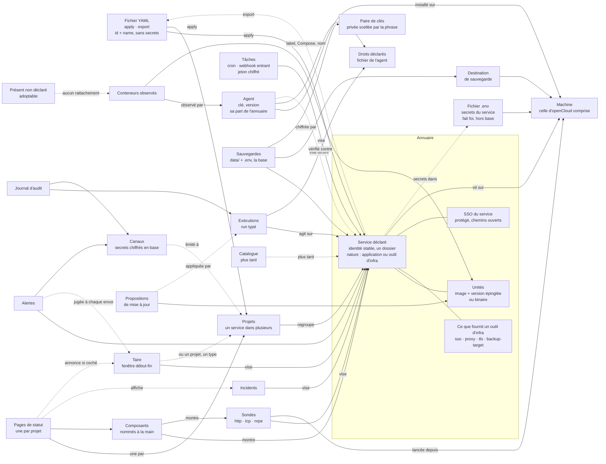

# Modèle de données cible

> **Cible, pas l'existant.** Ce document décrit le modèle de données vers
> lequel openCloud va, après les décisions du 17 octobre 2026. Les décisions
> elles-mêmes sont dans [`23-direction.md`](23-direction.md) ; ce qui n'y est
> pas reste une proposition du modèle. L'application telle qu'elle tourne est
> décrite dans [`22-fonctionnement.md`](22-fonctionnement.md).
>
> **Le schéma vivant est [`migrations/001_schema.sql`](../../migrations/001_schema.sql)**
> (21 octobre 2026 : les 33 migrations y sont écrasées). Ce document dit où il
> va ; les sections 10 à 15 gardent l'historique des décisions, et les
> numéros de migration qu'elles citent datent ce qui a été fait.

## Règles du modèle

| Règle | Pourquoi | Coût |
| --- | --- | --- |
| Le service déclaré a un identifiant à lui, jamais dérivé de Docker | Recréer un conteneur ne casse ni sonde, ni composant, ni politique | Un rapprochement conteneur → service à chaque inventaire |
| Un service = un dossier `<racine>/<service>/` ; il contient une ou plusieurs **unités** (un service Compose, un conteneur seul ou un binaire) | Décision 7 : une sauvegarde, une adresse, une version épinglée par image | Deux niveaux à afficher (service, unité) |
| Un service a une **nature** : application ou outil d'infra (libellé provisoire, dans les catalogues). Un outil d'infra déclare ce qu'il **fournit** : `sso`, `proxy`, `tls`, `backup-target` | C'est sur quoi les modules se branchent ; séparés dans l'interface et le catalogue | Une liste fermée dans le code, à étendre par migration de code, pas de table |
| Un **projet** regroupe des services ; un service peut être dans plusieurs projets | Le socle (proxy, SSO) paraît sur la page de chaque site qui en dépend | Une table de liaison ; un service sans projet reste valide |
| Le projet porte sa page de statut, limite les canaux, filtre l'interface ; plus tard les droits | Un seul regroupement pour tout | Supprimer un projet passe par un plan (page, canaux) |
| Entre objets déclarés : `restrict`. La suppression passe par un **plan** qui liste ce qu'elle emporte, puis supprime dans l'ordre | Aucune perte silencieuse, même par MCP ou l'API | Chaque suppression écrit son plan ; plus de code qu'un `cascade` |
| D'un objet vers **son propre** historique : `cascade`, chiffré dans le plan | L'historique n'a pas de sens sans son objet | Le plan le dit en nombre de lignes |
| Alertes, exécutions, audit vers un objet : `set null` + nom recopié | La trace survit à l'objet | Une colonne de nom en double |
| Supprimer un service de l'annuaire ne touche jamais la machine | Retirer un déploiement est une action typée à part | Les conteneurs restent et passent « présent non déclaré » |
| `apply` modifie sur place, ne recrée jamais (décision 3) | Historique et jetons gardés | Chaque objet éditable champ par champ (sondes et tâches : faites, PR « édition sur place ») |
| Secrets saisis dans l'interface (URL et secret des canaux, mot de passe du relais, jetons de tâche, secret OIDC) : **chiffrés en base** par la clé du serveur, colonnes `*_sealed` | Une base volée sans la clé ne livre rien ; la sauvegarde chiffrée les emporte | Un jeton cherché par valeur a besoin d'une empreinte à côté (`token_lookup`) |
| Secrets des services : **le `.env` sur la machine fait foi**. Ni en base, ni dans l'export | Une seule source de vérité | Restaurer un service passe par sa sauvegarde (`data/` + `.env`, chiffrés) |
| La machine openCloud est une machine comme les autres, avec un agent | Un seul mécanisme ; le chemin intégré à `serve` disparaît | Le serveur seul ne voit rien de sa machine tant que l'agent n'est pas installé. **Fait** (section 13) |
| Ni silence, ni maintenance : un seul objet **« taire »**, jugé à chaque envoi. Le moteur d'alertes ne lit plus les pages de statut | Trois notions au lieu de quatre : alerte, acquitter, taire | Une annonce publique de maintenance porte son propre titre |

## 1. Entités cibles et liens

### Diagramme des entités

Tables nouvelles : `agents`, `agent_capabilities`, `projects`, `project_services`, `declared_services`, `service_units`, `service_provides`, `service_open_paths`, `ignored_keys`, `update_proposals`, `service_samples_hourly`, `backup_destinations`, `backup_plans`, `backup_keyring`, `status_pages`, `incident_targets`, `mutes`, `channel_projects`, `action_runs`, `run_logs`, `applies`, `audit_events`, `audit_deliveries`, `settings`, `accounts`, `sessions`, `templates` (plus tard). Non dessinées, inchangées : `machine_disks`, `machine_rollups` (les agrégats par heure et par jour, comme `machine_samples`, plus un agrégat horaire par volume), `probe_certificates` (le dernier certificat vu par une sonde), `mcp_clients`, `mcp_codes`, `mcp_tokens`, `schema_migrations`.

```mermaid
erDiagram
    %% ===== Machine, agent, droits =====
    machines {
        TEXT id PK
        TEXT name UK
        TEXT os
        INTEGER created_at
    }
    agents {
        TEXT id PK
        TEXT machine_id FK
        BLOB public_key
        TEXT version
        TEXT root_dir "defaut /srv/workspace"
        TEXT server_key_fingerprint
        INTEGER last_order_seq
        INTEGER desired_revision "sa part de l annuaire"
        INTEGER acked_revision
        INTEGER last_seen_at
        INTEGER revoked_at
    }
    agent_capabilities {
        TEXT agent_id PK, FK
        TEXT capability PK "decision 9, prise le 21/10"
        TEXT scope "chemins, comptes"
        INTEGER reported_at "lu dans le fichier de l agent"
    }
    enrollment_tokens {
        TEXT id PK
        TEXT machine_id FK "re-enrolement"
        TEXT agent_id FK "consomme par"
        TEXT token_hash UK
        TEXT requested_capabilities "forme texte, cochee a l installation"
        TEXT root_dir
        INTEGER expires_at
        INTEGER consumed_at
    }
    machines ||--o{ agents : "cascade"
    agents ||--o{ agent_capabilities : "cascade"
    machines |o--o{ enrollment_tokens : "cascade"
    agents |o--o| enrollment_tokens : "set null"

    %% ===== Observe =====
    machine_samples {
        TEXT machine_id PK, FK
        INTEGER sampled_at PK
        REAL cpu_percent
        INTEGER mem_used
    }
    machine_engines {
        TEXT machine_id PK, FK
        INTEGER present
        TEXT version
    }
    machine_networks {
        TEXT machine_id PK, FK
        TEXT network_id PK
        TEXT name
    }
    image_checks {
        TEXT machine_id PK, FK
        TEXT image PK
        INTEGER checked_at
        TEXT newer_tag
    }
    containers {
        TEXT id PK "machine:id Docker"
        TEXT machine_id FK
        TEXT unit_id FK "NULL = present non declare"
        TEXT match_level "label, compose, name"
        TEXT compose_project
        TEXT compose_service
        TEXT name
        TEXT image
        TEXT state
        INTEGER archived_at
    }
    container_samples {
        TEXT container_id PK, FK
        INTEGER sampled_at PK
        REAL cpu_percent
        INTEGER mem_used
    }
    container_networks {
        TEXT container_id PK, FK
        TEXT network_id PK
        TEXT ip
    }
    container_events {
        INTEGER id PK
        TEXT container_id FK
        TEXT unit_id FK "survit au conteneur"
        INTEGER at
        TEXT action
        TEXT new_state
    }
    service_samples_hourly {
        TEXT service_id PK, FK
        INTEGER hour PK
        REAL cpu_percent
        INTEGER mem_used
        INTEGER net_bytes "hors veth et ponts"
    }
    ignored_keys {
        TEXT machine_id PK, FK
        TEXT match_key PK "projet Compose ou nom"
        TEXT reason
    }
    machines ||--o{ machine_samples : "cascade"
    machines ||--o| machine_engines : "cascade"
    machines ||--o{ machine_networks : "cascade"
    machines ||--o{ image_checks : "cascade"
    machines ||--o{ containers : "cascade"
    machines ||--o{ ignored_keys : "cascade"
    containers ||--o{ container_samples : "cascade"
    containers ||--o{ container_networks : "cascade"
    containers |o--o{ container_events : "set null"

    %% ===== Projets et annuaire =====
    projects {
        TEXT id PK "stable"
        TEXT name UK
        TEXT title
        INTEGER updated_at
    }
    project_services {
        TEXT project_id PK, FK
        TEXT service_id PK, FK
    }
    declared_services {
        TEXT id PK "stable, jamais derive de Docker"
        TEXT name "unique par machine"
        TEXT machine_id FK
        TEXT nature "application ou infra, libelle provisoire"
        TEXT origin "deployed, compose, container, binary"
        TEXT declared_by "operator, discovery plus tard"
        TEXT compose_project "niveau 2"
        TEXT public_url
        INTEGER protected "1 par defaut"
        TEXT template_id FK "plus tard"
        INTEGER updated_at
    }
    service_provides {
        TEXT service_id PK, FK
        TEXT capability PK "sso, proxy, tls, backup-target"
    }
    service_open_paths {
        TEXT service_id PK, FK
        TEXT path PK "affiche comme public"
        TEXT source "modele ou operateur"
    }
    service_units {
        TEXT id PK
        TEXT service_id FK
        TEXT name "unique dans le service"
        TEXT kind "container ou binary"
        TEXT image
        TEXT version "epinglee, jamais latest"
        TEXT digest "facultatif"
        TEXT container_name "niveau 3, faible"
        TEXT systemd_unit "binaire"
        TEXT ports "JSON"
        TEXT update_policy "watch, hold, ignore"
        TEXT eol_product "fin de support, choisi a la main"
    }
    update_proposals {
        INTEGER id PK
        TEXT unit_id FK
        TEXT from_version
        TEXT to_version
        TEXT status "open, dismissed, applied"
        TEXT run_id FK
        INTEGER found_at
    }
    projects ||--o{ project_services : "cascade, lien seul"
    declared_services ||--o{ project_services : "cascade, lien seul"
    machines ||--o{ declared_services : "restrict"
    declared_services ||--o{ service_provides : "cascade"
    declared_services ||--o{ service_open_paths : "cascade"
    declared_services ||--|{ service_units : "cascade"
    declared_services ||--o{ service_samples_hourly : "cascade"
    service_units |o--o{ containers : "set null"
    service_units |o--o{ container_events : "set null"
    service_units ||--o{ update_proposals : "cascade"

    %% ===== Sauvegarde =====
    backup_destinations {
        TEXT id PK
        TEXT name UK
        TEXT kind "agent, externe plus tard"
        TEXT machine_id FK
        TEXT path
    }
    backup_plans {
        TEXT id PK
        TEXT subject "database ou service"
        TEXT service_id FK "NULL pour la base"
        TEXT destination_id FK
        TEXT schedule
        INTEGER keep
    }
    backup_keyring {
        INTEGER id PK "toujours 1"
        TEXT public_key "chiffre chaque nuit"
        BLOB private_key_sealed "scellee par la phrase"
        TEXT fingerprint
        INTEGER created_at
    }
    machines ||--o{ backup_destinations : "restrict"
    declared_services |o--o{ backup_plans : "cascade"
    backup_destinations ||--o{ backup_plans : "restrict"

    %% ===== Sondes et taches =====
    probes {
        TEXT id PK
        TEXT name UK
        TEXT runner_machine_id FK "n importe quelle machine"
        TEXT service_id FK "facultatif"
        TEXT kind "http, tcp, nrpe"
        TEXT target "URL ou hote et port"
        TEXT check_name "nrpe : nom dans le fichier de l agent"
        INTEGER interval_seconds
        TEXT status "up, warning, degraded, down"
    }
    probe_certificates {
        TEXT probe_id PK, FK
        TEXT fingerprint
        INTEGER not_after
    }
    probe_results {
        TEXT probe_id PK, FK
        INTEGER checked_at PK
        TEXT outcome
    }
    probe_days {
        TEXT probe_id PK, FK
        INTEGER day PK
        INTEGER success
    }
    heartbeats {
        TEXT id PK
        TEXT name UK
        TEXT kind "cron ou webhook"
        TEXT token_sealed "reaffichable, forme v1 des chiffres"
        TEXT token_lookup UK "HMAC du jeton"
        TEXT service_id FK "facultatif"
        TEXT machine_id FK "facultatif"
        INTEGER interval_seconds "pas d horaire cron"
        INTEGER grace_seconds
        TEXT status
    }
    heartbeat_pings {
        INTEGER id PK
        TEXT heartbeat_id FK
        INTEGER received_at
    }
    heartbeat_runs {
        INTEGER id PK
        TEXT heartbeat_id FK
        TEXT outcome
    }
    machines ||--o{ probes : "restrict"
    declared_services |o--o{ probes : "restrict"
    probes ||--o| probe_certificates : "cascade"
    probes ||--o{ probe_results : "cascade"
    probes ||--o{ probe_days : "cascade"
    machines |o--o{ heartbeats : "restrict"
    declared_services |o--o{ heartbeats : "restrict"
    heartbeats ||--o{ heartbeat_pings : "cascade"
    heartbeats ||--o{ heartbeat_runs : "cascade"

    %% ===== Pages de statut et incidents =====
    status_pages {
        TEXT id PK
        TEXT project_id FK, UK "une page par projet"
        TEXT slug UK "adresse publique"
        TEXT title
        TEXT announcement
        TEXT language
        INTEGER published
    }
    status_components {
        TEXT id PK
        TEXT page_id FK
        TEXT name "libre, ex. Authentification"
        INTEGER position
    }
    status_component_members {
        TEXT component_id FK
        TEXT service_id FK "un seul des quatre"
        TEXT probe_id FK
        TEXT heartbeat_id FK
        TEXT machine_id FK
    }
    incidents {
        TEXT id PK
        TEXT title
        TEXT impact "degraded, down"
        TEXT status
        INTEGER created_at
        INTEGER resolved_at
    }
    incident_targets {
        TEXT incident_id FK
        TEXT service_id FK "un seul des quatre"
        TEXT probe_id FK
        TEXT heartbeat_id FK
        TEXT machine_id FK
    }
    incident_updates {
        INTEGER id PK
        TEXT incident_id FK
        TEXT status
        TEXT message
    }
    projects ||--o| status_pages : "restrict"
    status_pages ||--o{ status_components : "cascade"
    status_components ||--o{ status_component_members : "cascade"
    declared_services |o--o{ status_component_members : "restrict"
    probes |o--o{ status_component_members : "restrict"
    heartbeats |o--o{ status_component_members : "restrict"
    machines |o--o{ status_component_members : "restrict"
    incidents ||--o{ incident_targets : "cascade"
    incidents ||--o{ incident_updates : "cascade"
    declared_services |o--o{ incident_targets : "cascade, lien seul"
    probes |o--o{ incident_targets : "cascade, lien seul"
    heartbeats |o--o{ incident_targets : "cascade, lien seul"
    machines |o--o{ incident_targets : "cascade, lien seul"

    %% ===== Taire =====
    mutes {
        TEXT id PK
        TEXT reason
        INTEGER starts_at "immediat ou planifie"
        INTEGER ends_at
        TEXT alert_kind "type vise, ou NULL"
        TEXT project_id FK "un objet au plus"
        TEXT service_id FK
        TEXT machine_id FK
        TEXT container_id FK "conteneur non declare"
        TEXT probe_id FK
        TEXT heartbeat_id FK
        INTEGER announce "maintenance publique, 0 par defaut"
        TEXT public_title "si annoncee"
        TEXT created_by
    }
    projects |o--o{ mutes : "cascade"
    declared_services |o--o{ mutes : "cascade"
    machines |o--o{ mutes : "cascade"
    containers |o--o{ mutes : "cascade"
    probes |o--o{ mutes : "cascade"
    heartbeats |o--o{ mutes : "cascade"

    %% ===== Executions et audit =====
    action_runs {
        TEXT id PK "run_id"
        TEXT action "liste fermee, typee"
        TEXT params "JSON sans secret"
        TEXT machine_id FK
        TEXT machine_name "recopie"
        TEXT agent_id FK
        TEXT service_id FK
        TEXT state "queued, sent, accepted, refused, succeeded, failed, expired"
        TEXT refusal_reason
        INTEGER not_after
        INTEGER seq
        TEXT requested_by
        INTEGER requested_at
        INTEGER finished_at
    }
    run_logs {
        TEXT run_id PK, FK
        INTEGER seq PK
        INTEGER at
        TEXT stream
        TEXT line
    }
    applies {
        TEXT id PK
        TEXT file_hash
        INTEGER prune
        TEXT plan "JSON"
        TEXT state "planned, confirmed, applied, failed"
        TEXT actor_name
        INTEGER at
    }
    audit_events {
        INTEGER id PK
        INTEGER at
        TEXT actor_kind "operator, mcp, cli, rule, agent, unknown"
        TEXT actor_name
        TEXT action
        TEXT object_kind "sans FK"
        TEXT object_id "sans FK"
        TEXT object_name
        TEXT details "JSON sans secret"
        TEXT run_id FK
        TEXT apply_id FK
    }
    machines |o--o{ action_runs : "set null"
    agents |o--o{ action_runs : "set null"
    declared_services |o--o{ action_runs : "set null"
    action_runs ||--o{ run_logs : "cascade"
    action_runs |o--o{ update_proposals : "set null"
    action_runs |o--o{ audit_events : "set null"
    applies |o--o{ audit_events : "set null"

    %% ===== Alertes et canaux =====
    alerts {
        INTEGER id PK
        TEXT kind
        TEXT object_kind "sans CHECK"
        TEXT object_id
        TEXT object_name "recopie"
        TEXT machine_id FK
        TEXT service_id FK
        TEXT container_id FK "present non declare"
        TEXT probe_id FK
        TEXT heartbeat_id FK
        TEXT run_id FK
    }
    alert_channels {
        INTEGER id PK
        TEXT name UK
        TEXT format
        BLOB url_sealed
        BLOB secret_sealed "signature ou jeton Matrix"
        TEXT min_severity
        INTEGER receives_audit
    }
    channel_projects {
        INTEGER channel_id PK, FK
        TEXT project_id PK, FK
    }
    alert_deliveries {
        INTEGER id PK
        INTEGER alert_id FK
        INTEGER channel_id FK
        TEXT status "pending, delivered, failed, held, muted"
        INTEGER next_attempt_at "essais jusqu a une heure"
    }
    audit_deliveries {
        INTEGER id PK
        INTEGER audit_id FK
        INTEGER channel_id FK
        TEXT status "pending, delivered, failed"
        INTEGER next_attempt_at "essais jusqu a 24 h"
    }
    machines |o--o{ alerts : "set null"
    declared_services |o--o{ alerts : "set null"
    containers |o--o{ alerts : "set null"
    probes |o--o{ alerts : "set null"
    heartbeats |o--o{ alerts : "set null"
    action_runs |o--o{ alerts : "set null"
    alerts ||--o{ alert_deliveries : "cascade"
    alert_channels ||--o{ alert_deliveries : "cascade"
    alert_channels ||--o{ channel_projects : "cascade"
    projects ||--o{ channel_projects : "restrict"
    alert_channels ||--o{ audit_deliveries : "cascade"
    audit_events ||--o{ audit_deliveries : "cascade"

    %% ===== Acces, reglages, catalogue =====
    accounts {
        TEXT id PK
        TEXT username UK
        TEXT password_hash "bcrypt"
        INTEGER created_at
    }
    sessions {
        TEXT id_hash PK
        TEXT account_id FK
        INTEGER expires_at
    }
    auth_settings {
        INTEGER id PK "toujours 1"
        TEXT forward_header
        TEXT oidc_issuer
        TEXT oidc_client_id
        BLOB oidc_secret_sealed
    }
    settings {
        INTEGER id PK "une seule ligne"
        TEXT language
        INTEGER disk_attention_percent
        TEXT mail_password_sealed "chiffre"
        INTEGER lifecycle_disabled
        INTEGER updated_at
    }
    templates {
        TEXT id PK
        TEXT name
        TEXT version
        TEXT source "depot Git"
    }
    accounts ||--o{ sessions : "cascade"
    templates |o..o{ declared_services : "set null, plus tard"
```



### Vue de haut niveau

Flèche `A --> B` : A dépend de B. Pointillé : lien hors clé étrangère, ou plus tard.



### Entités

| Entité | Rôle | État |
| --- | --- | --- |
| `machines` | L'hôte : nom, système. Survit à un ré-enrôlement. Plus de genre `local` : la machine openCloud a un agent comme les autres | Transformée : clé et `last_seen_at` passent à l'agent, `kind` disparaît. **Faite** (`030`) |
| `agents` | Le logiciel installé : clé, version, racine, empreinte de la clé du serveur, révision d'état désiré envoyée et accusée | Nouvelle, faite (migration `030_agents.sql`, section 14) ; `server_key_fingerprint` et `last_order_seq` remis par `002_actions.sql` (section 16), les révisions attendent l'état désiré |
| `agent_capabilities` | Droits **lus dans le fichier de l'agent** et rapportés à la connexion. Le demandé reste dans le jeton : l'écart se voit | Nouvelle, faite (`030`) ; liste : décision 9, prise le 21 octobre 2026 |
| `projects` | Regroupe des services. Sert à la page de statut, au routage des canaux, au filtre de l'interface, plus tard aux droits | Nouvelle, faite |
| `project_services` | Appartenance d'un service à un projet ; un service peut être dans plusieurs | Nouvelle, faite |
| `declared_services` | L'annuaire. Une ligne = un dossier `<racine>/<service>/`, ou un projet Compose observé, ou un conteneur seul, ou un binaire supervisé. Porte la nature, l'adresse, « protégé » | Nouvelle, faite (sans « protégé ») |
| `service_provides` | Ce que fournit un outil d'infra : `sso`, `proxy`, `tls`, `backup-target`. Admis seulement si la nature est « outil d'infra » (contrôlé par le code) | Nouvelle, faite |
| `service_open_paths` | SSO du service : tout est protégé par défaut, sauf ces chemins. Pré-remplis par le modèle, modifiables, affichés comme publics | Nouvelle |
| `service_units` | Ce qui tourne dans le service : un service Compose, un conteneur ou un binaire. Image, version épinglée, ports, politique de mise à jour, produit de fin de support | Nouvelle, faite (sans produit de fin de support) |
| `containers` | Le conteneur vu par Docker, plus son rattachement (`unit_id`, `match_level`) | Ex-`services`, faite ; `kind` retiré par le schéma unique |
| `container_events` | Transitions d'état, rattachées aussi à l'unité : l'historique traverse les recréations | Ex-`service_transitions`, renommée ; `unit_id` à faire |
| `service_samples_hourly` | Historique long des mesures par service, sur l'identité stable | Nouvelle |
| `ignored_keys` | « Présent non déclaré, et c'est voulu » : clé (projet Compose ou nom), jamais un id Docker | Nouvelle, faite |
| `update_proposals` | Montée proposée (de, vers) ; jamais appliquée seule (décision 6) ; l'application est un run | Nouvelle |
| `backup_destinations` | Une machine avec agent et un chemin ; plus tard un stockage externe | **Faite** (`006`, section 20) |
| `backup_plans` | Une sauvegarde : la base ou un service (`data/` + `.env`), destination, rythme, nombre gardé. Sans ligne `database`, l'interface dit que la base n'est pas sauvegardée | **Faite** (`006`, section 20) |
| `backup_keyring` | La paire de clés : la publique chiffre chaque nuit ; la privée, scellée par la phrase de passe, est déposée avec chaque sauvegarde. La phrase n'est jamais en base | **Faite** (`006`, section 20) |
| `probes` | Sonde `http`, `tcp` ou `nrpe` ; lancée par n'importe quelle machine, rattachée au service où qu'il tourne. « Dedans » ou « dehors » se calcule (même machine ou non) | Transformée, en partie : `restrict`, service déclaré, certificat dans `probe_certificates` (schéma unique) ; `nrpe`, `warning`, `runner_machine_id` à faire |
| `probe_certificates` | Le dernier certificat vu par une sonde : sujet, émetteur, dates, empreinte, chaîne valide, nom, agrafe OCSP. Pas d'historique | Nouvelle, faite (schéma unique : les huit `cert_*` de `probes`) |
| `heartbeats` | Tâche `cron` ou `webhook` entrant. Jeton chiffré, réaffichable, régénérable ; `token_lookup` sert à trouver la tâche sur un ping | Transformée, en partie : `token_sealed` et `token_lookup` (schéma unique), `restrict` vers la machine ; `kind`, `service_id` à faire |
| `status_pages` | Une par projet, créée à la main. Titre, annonce, langue, publiée ou non | Nouvelle ; **faite** (migration `034_status_pages.sql`), `project_id` facultatif, sans `published` (section 15) |
| `status_components` | Composé à la main, nommé librement, pré-rempli depuis les services du projet ; un outil d'infra y paraît sous un nom générique | Transformée, faite (`page_id`, `034`) |
| `incidents`, `incident_targets` | Ce que l'opérateur écrit au public, sur des objets de l'annuaire. Chaque page montre ceux qui touchent ses composants | Transformées (`incident_targets` nouvelle) ; **faites** (`005`, section 19) |
| `mutes` | « Taire » : fenêtre début-fin, immédiate ou planifiée, sur un objet, un type d'alerte ou les deux ; case « annoncer comme maintenance » décochée par défaut | Nouvelle (remplace `alert_silences` et les incidents `maintenance`) ; **faite** (migration `032_alerts_directory.sql`) ; `announce` et `public_title` **faits** (`005`, section 19) ; `project_id` à faire |
| `channel_projects` | Projets auxquels un canal est limité. Aucune ligne = canal global | Nouvelle |
| `action_runs`, `run_logs` | Une exécution typée : identifiant, action, paramètres sans secret, état, échéance, journal | Nouvelles, faites (`002_actions.sql`, section 16), sans `service_id` |
| `applies` | Un passage d'`apply` : empreinte du fichier, plan confirmé, acteur, `prune` ou non, état (`confirmed`, `applied`, `failed`), combien de changements sont écrits et pourquoi il s'est arrêté. Migration `026_applies.sql` (annuaire 4b/7) | Nouvelle, faite |
| `audit_events` | Qui, quoi, quand, sur quoi, les champs du geste sans secret. Sans clé étrangère vers l'objet : survit à tout. Ajout seul, purgé à un an | Nouvelle, faite (migration `029_audit.sql`, sans `run_id` : voir la section 12) |
| `audit_deliveries` | Envoi de l'audit vers les canaux marqués `receives_audit` | Nouvelle, **faite** (`004`, section 18) |
| `accounts`, `sessions` | Compte local créé au premier démarrage ; page de connexion avec déconnexion. Comptes multiples et rôles plus tard | Nouvelles |
| `auth_settings` | SSO de l'interface : forward-auth (existe), OIDC (à ajouter), secret chiffré | Transformée |
| `settings` | Tout ce que l'interface change (décision 1), une seule ligne à colonnes typées (comme `auth_settings`), dont les seuils d'alerte et de certificat, l'interrupteur de fin de support, le relais e-mail chiffré | Nouvelle, remplace `settings.toml` ; **faite** (`019`) |
| `templates` | Catalogue : nom, version, dépôt ; pré-règle nature, fournitures, chemins ouverts | Plus tard |

### Rattachement d'un conteneur à une unité

Calculé par le serveur à chaque inventaire. Le niveau le plus fort gagne. Jamais d'id Docker dans l'annuaire.

| Niveau | Clé | Pour | Force | Conteneur recréé |
| --- | --- | --- | --- | --- |
| 1 · label | `<préfixe>.service=<id>` + `<préfixe>.unit=<nom>` (préfixe tiré du paquet de constantes), **sur la machine de l'agent**, vers une unité conteneur d'un service déclaré | ce que l'opérateur étiquette (et, plus tard, ce qu'openCloud déploiera) | forte, **sans repli** | même label : même unité |
| 2 · Compose | machine + `com.docker.compose.project` + `com.docker.compose.service` | Compose observé | forte tant que le projet garde son nom | même couple : même unité |
| 3 · nom | machine + nom du conteneur | conteneur seul | **faible, signalée** | tant que le nom reste |
| aucun | — | — | `unit_id` NULL : **présent non déclaré** | — |

| Cas | Ce qui arrive |
| --- | --- |
| Présent non déclaré | Observé et alerté comme aujourd'hui (alerte sur `container_id`). Fiche « non déclaré », deux gestes dans la vue écart : « Adopter » (formulaire pré-rempli depuis les labels Compose) ou « Ignorer » (ligne `ignored_keys`) |
| Label vers un service inconnu, une unité inconnue, une unité binaire, un service d'une autre machine, ou incomplet | Traité comme non déclaré, signalé « label orphelin » avec son motif (`invalid`, `incomplete`, `service_unknown`, `unit_unknown`, `unit_binary`) ; jamais rattaché par Compose ni par le nom ; « Adopter » refusé |
| Deux conteneurs pour une unité | Admis (réplicas, `scale`), montrés tous les deux |
| Unité sans conteneur | Écart « déclaré et absent » |
| Image ou version différente de l'épinglée | Écart « divergent » |
| Conteneur rattaché, unité supprimée | `set null` : il redevient « présent non déclaré » |

L'écart n'est pas stocké : il se calcule à la lecture, par service et par unité (conforme, absent, divergent, faible, non observé pour un binaire, version non vérifiable sur `latest` ou sans tag) et par conteneur (non déclaré).

Ce que l'annuaire 2/5 livre de ce modèle, et comment (le détail est dans `22-fonctionnement.md`, « Comment un conteneur se rattache à l'annuaire ») :

- Les niveaux 2 et 3 seulement (le niveau 1 est venu avec l'annuaire 7/7, voir la section 10). Les niveaux 2 et 3 sont **disjoints par l'origine du service** (Compose ou conteneur seul), le niveau fort gagnant si un conteneur répond aux deux.
- Une fiche archivée **garde son dernier rattachement** et n'est plus recalculée : l'historique d'un conteneur dit à quelle unité il appartenait.
- `ignored_keys` porte deux genres : `compose_project` (tout le projet) et `container_name` ; la clé est une observation, jamais un id Docker.
- Le verdict d'un conteneur suit dix règles ordonnées : image observée illisible, image déclarée illisible, autre image, autre empreinte, empreinte épinglée que l'image écrit elle-même (conforme, quel que soit le tag), `latest` ou sans tag, version non déclarée, autre tag, empreinte épinglée inconnue, conforme. Tout verdict autre que « conforme » porte l'un des sept motifs nommés (`image_unreadable`, `image_differs`, `digest_differs`, `tag_latest`, `version_unpinned`, `tag_differs`, `digest_unknown`).
- L'empreinte observée est celle que l'image écrit, à défaut celle du dernier constat sur l'image ; seule la première fait conclure à « conforme » (un tag mobile peut avoir bougé). Un conteneur arrêté compte comme présent.
- Le motif « label orphelin » est venu avec le niveau 1 (annuaire 7/7).

### Projets, canaux, taire : règles de lecture

| Question | Règle |
| --- | --- |
| Projets d'une alerte | Ceux du service visé (directement, ou par la sonde ou la tâche rattachée). Alerte de machine : les projets qui ont un service sur cette machine. Conteneur non déclaré : aucun |
| Canal limité | Reçoit une alerte si l'un de ses projets est parmi ceux de l'alerte. Une alerte sans projet ne va qu'aux canaux globaux |
| Taire | Jugé à chaque envoi : une alerte ouverte avant la fenêtre se tait aussi ; la fenêtre finie, l'envoi suivant repart. Taire un projet tait ses services, leurs sondes et leurs tâches |
| Annoncer comme maintenance | La page d'un projet montre la fenêtre si l'objet visé touche un de ses composants ; titre public dans `public_title` |
| Page de statut | Montre l'état dérivé de ses composants, les incidents et les maintenances annoncées qui les touchent. Le moteur d'alertes ne lit plus aucune page |
| Filtre de l'interface | Choix de l'opérateur, gardé dans le navigateur ; rien en base |

### Liens, cardinalité, suppression

| De → vers | Cardinalité | À la suppression du parent | Pourquoi |
| --- | --- | --- | --- |
| `agents` → `machines` | 1 machine, 0..n agents (un seul actif) | cascade | Ré-enrôler, réinstaller ou tourner la clé ajoute un agent, garde la machine et son historique |
| `agent_capabilities` → `agents` | 0..n | cascade | Simple reflet du fichier de l'agent |
| `enrollment_tokens` → `machines` | 0..n | cascade | Jeton de ré-enrôlement sans objet sans sa machine |
| `enrollment_tokens` → `agents` (consommé par) | 0..1 | set null | Garder la trace du jeton consommé |
| mesures, moteur, réseaux, `image_checks` → `machines` | 0..n | cascade | Historique et cache propres à la machine ; le plan les compte |
| `containers` → `machines` | 0..n | cascade | Observé, sans configuration |
| `containers` → `service_units` | 0..1 unité, 0..n conteneurs | **set null** | Le conteneur redevient « présent non déclaré » |
| `container_events` → `containers` et `service_units` | 0..n | set null (les deux) | L'historique survit au conteneur ; purge à l'âge |
| `container_samples`, `container_networks` → `containers` | 0..n | cascade | Brut de 48 h, propre au conteneur |
| `project_services` → `projects` et `declared_services` | 0..n | cascade (lien seul) | Le service reste sans le projet, le projet sans le service ; le plan le dit |
| `declared_services` → `machines` | 1 machine, 0..n services | **restrict** | Supprimer une machine qui porte des services passe par un plan |
| `service_provides`, `service_open_paths`, `service_units`, `service_samples_hourly` → `declared_services` | 0..n (unités : 1..n) | cascade | Partie de la définition ou de l'historique du service |
| `update_proposals` → `service_units` | 0..n | cascade | Sans unité, rien à proposer |
| `update_proposals` → `action_runs` | 0..1 | set null | Le run peut être purgé, la proposition reste « appliquée » |
| `backup_plans` → `declared_services` | 0..n | cascade | Réglage du service ; les fichiers déjà envoyés restent |
| `backup_plans` → `backup_destinations` | 0..n | **restrict** | On ne retire pas une destination qui reçoit encore |
| `backup_destinations` → `machines` | 0..n | **restrict** | Retirer la machine qui garde les sauvegardes : plan obligatoire |
| `probes` → `machines` (qui sonde) | 1 | **restrict** | Était cascade : 90 jours partaient sans prévenir (**fait**, `028_restrict.sql`). Le plan propose de changer de machine |
| `probes` → `declared_services` | 0..1 | **restrict** | Le plan demande : supprimer la sonde ou la détacher |
| `probe_results`, `probe_days` → `probes` | 0..n | cascade | Historique propre ; le plan dit combien de jours |
| `heartbeats` → `declared_services`, `machines` | 0..1 chacun | **restrict** | Une tâche porte un jeton utilisé par un cron ou un émetteur distant |
| `heartbeat_pings`, `heartbeat_runs` → `heartbeats` | 0..n | cascade | Historique propre |
| `status_pages` → `projects` | 0..1 page par projet | **restrict** | Une page publique ne disparaît pas avec son projet sans le dire |
| `status_components` → `status_pages` | 0..n | cascade | Un composant n'existe que sur sa page |
| `status_component_members` → `status_components` | 0..n | cascade | Lien de présentation |
| `status_component_members` → service, sonde, tâche, machine | 0..n | **restrict** | Était cascade : un objet disparaissait d'une page publique sans prévenir (**fait**, `024` pour le service, `028_restrict.sql` pour les trois autres) |
| `incident_targets` → `incidents` | 0..n | cascade | Partie de l'incident |
| `incident_targets` → service, sonde, tâche, machine | 0..n | cascade (lien seul) | L'incident et son texte restent ; le plan dit « retiré de N incidents » |
| `incident_updates` → `incidents` | 0..n | cascade | Fil de l'incident |
| `mutes` → projet, service, machine, sonde, tâche | 0..1 objet | cascade | Objet temporaire ; le plan dit « N fenêtres pour taire supprimées » |
| `channel_projects` → `alert_channels` | 0..n | cascade | Partie du canal |
| `channel_projects` → `projects` | 0..n | **restrict** | Sinon un canal limité à ce seul projet deviendrait global sans prévenir. Le plan le dit |
| `alerts` → objets, conteneur, run | 0..1 chacun | set null + `object_name` | Historique lisible ; le `set null` résout l'alerte ouverte |
| `alert_deliveries`, `audit_deliveries` → `alert_channels` | 0..n | cascade | Annoncé : « N envois en attente perdus » |
| `action_runs` → machine, agent, service | 0..1 chacun | set null + `machine_name` | Un run est une trace : il survit à sa cible |
| `run_logs` → `action_runs` | 0..n | cascade | Purge du run seulement par âge |
| `audit_events` → `action_runs`, `applies` | 0..1 | set null | L'audit ne dépend de rien |
| `audit_events` → objet | aucune clé | — | `object_kind` + id + nom : survit à tout, append-only |
| `sessions` → `accounts` | 0..n | cascade | Supprimer un compte le déconnecte |
| `declared_services` → `templates` | 0..1 | set null | Plus tard ; un service déployé reste valide sans son modèle |

### Ce qu'une suppression emporte

| Supprimer | Bloqué tant que (restrict) | Emporte (cascade, chiffré dans le plan) | Détache (set null ou lien seul) | Sur la machine |
| --- | --- | --- | --- | --- |
| Machine | services déclarés, sondes qu'elle exécute, tâches, destinations, membres de page | agents et droits, jetons de ré-enrôlement, mesures, réseaux, conteneurs et leur brut, `image_checks`, clés ignorées, fenêtres pour taire | alertes, runs ; retirée des incidents | rien ; l'agent ne peut plus se connecter |
| Projet | sa page de statut, canaux limités à lui | fenêtres pour taire | ses services (liens seuls) | rien |
| Service déclaré | sondes, tâches, membres de page | unités, propositions, fournitures, chemins ouverts, plans de sauvegarde, historique horaire, fenêtres pour taire | projets (liens), conteneurs (→ non déclarés), alertes, runs, événements ; retiré des incidents | **rien** : ni conteneur, ni `.env`, ni `data/`. Retirer le déploiement = action `service.remove`, à part |
| Unité | — | propositions | conteneurs, événements | rien |
| Sonde | membres de page | résultats, jours, certificat, fenêtres pour taire | alertes ; retirée des incidents | jeu de sondes renvoyé à l'agent |
| Tâche | membres de page | pings, exécutions, fenêtres pour taire | alertes ; retirée des incidents | l'URL de ping ne répond plus |
| Page de statut | — | composants, membres | — | l'adresse publique répond 404 |
| Destination | plans qui l'utilisent | — | — | les fichiers déjà envoyés restent |
| Canal | — | limites par projet, envois d'alerte et d'audit, en attente compris | — | — |

## 2. De l'existant à la cible

| Table actuelle | Verdict | Ce qui change | Historique |
| --- | --- | --- | --- |
| `machines` | Transformée | `public_key`, `last_seen_at` vers `agents` ; `kind` disparaît. La machine `local` garde son id et son historique ; elle attend un agent, installé par une ligne de ré-enrôlement. Le chemin intégré à `serve` est retiré (**fait**, `030_agents.sql`) | Gardé |
| `enrollment_tokens` | Transformée | `consumed_by` (texte) → `agent_id` (FK set null) ; ajout des droits demandés (**fait**, `030`) et de la racine (à faire, avec le premier déploiement) | Gardé |
| `machine_samples`, `machine_disks`, `machine_samples_hourly`, `machine_samples_daily` | Gardées | `machine_samples_hourly` et `_daily`, aux colonnes identiques, réunies en `machine_rollups` (granularité `hour` ou `day`, **fait**, schéma unique) ; interfaces virtuelles (veth, ponts) écartées du trafic ; agrégat horaire par volume | Gardé |
| `machine_engines` | Gardée | — | — |
| `machine_networks` | Gardée | — | — |
| `services` | **Remplacée** | Devient `containers` (ids et lignes gardés ; **fait, annuaire 3b**, migration `025_containers.sql` ; `kind`, une seule valeur, retiré par le schéma unique) ; `update_policy` passe sur l'unité (**fait, annuaire 3/6** : `watch`/`hold`/`ignore`, `services.update_policy` supprimée). Pour chaque conteneur qui porte de la configuration (membre, sonde, politique), la migration crée un service déclaré (nature `application`, origine `compose` si labels Compose, sinon `container`) et une unité, et y repointe les liens (**fait pour les sondes, les membres et la politique, annuaire 3/6** ; restent les alertes, les silences et l'historique). Le reste : « présent non déclaré », adoptable dans la vue écart | Gardé ; les liens portés par d'anciennes fiches archivées sont repris par la nouvelle unité |
| `service_transitions` | Transformée | Renommée `container_events` (**fait, annuaire 3b**), + `unit_id` ; FK en set null ; purge à l'âge (90 j proposé) | Gardé, rattaché à l'unité quand elle existe |
| `service_samples` | Gardée | Renommée `container_samples` (**fait, annuaire 3b**) ; alimente `service_samples_hourly` | Gardé (48 h) |
| `service_networks` | Gardée | Renommée `container_networks` (**fait, annuaire 3b**) | — |
| `heartbeats` | Transformée | + `service_id`, + `kind` (`cron` pour l'existant, `webhook`) ; `token` → `token_sealed` + `token_lookup` (les URL de ping ne changent pas ; **fait**, schéma unique) ; `machine_id` passe de set null à restrict (**fait**, `028_restrict.sql`) ; édition sur place, régénération, pause qui tient | Gardé |
| `heartbeat_pings`, `heartbeat_runs` | Gardées | — | Gardé |
| `probes` | Transformée | Éditable sur place ; `machine_id` → `runner_machine_id` en restrict (restrict **fait**, `028_restrict.sql` ; le renommage reste à faire) ; `service_id` → service déclaré, sur n'importe quelle machine, restrict (**fait, annuaire 3/6**) ; le certificat dans `probe_certificates` (**fait**, schéma unique) ; + genre `nrpe`, `check_name`, état `warning` | Gardé |
| `probe_results`, `probe_days` | Gardées | Issue `warning` ajoutée | Gardé |
| `image_checks` | Gardée | Reste un cache (machine, image) ; les montées trouvées deviennent des `update_proposals` | Cache |
| `status_components` | Transformée | + `page_id`. La page unique actuelle devient une page (titre repris de `settings`) ; l'ancienne adresse `/statut` renvoie vers elle tant qu'elle est la seule. **Fait** (`034`) : la page reprise n'est rangée dans aucun projet (section 15) | Gardé |
| `status_component_members` | Transformée | `service_id` → service déclaré (**fait, annuaire 3/6**, en restrict, doublons d'un même projet réunis en un membre) ; les trois autres FK passent en restrict avec les plans de suppression (**fait**, `028_restrict.sql`) | Gardé |
| `incidents` | Transformée | Ne dépend plus des composants. Impact `maintenance` retiré : une maintenance à venir ou en cours devient une ligne `mutes` (annoncée) ; une maintenance passée reste comme incident, en lecture. **Fait en partie** (032) : une maintenance ne tait plus rien, celles pas encore résolues ont donné leurs lignes `mutes` ; l'impact `maintenance` reste, c'est l'annonce publique tant que `announce` n'existe pas. **Fait** (`005`) : ne dépend plus des composants, il vise des objets (`incident_targets`) ; l'impact `maintenance` reste, à retirer sur décision de Lucas | Gardé |
| `incident_components` | **Remplacée** | Par `incident_targets` : chaque composant visé est déplié en ses membres. **Fait** (`005`) : chaque composant visé est déplié en ses membres, la table est supprimée | Gardé |
| `incident_updates` | Gardée | — | Gardé |
| `alerts` | Transformée | `service_id` → service déclaré ; + `container_id`, `run_id` ; CHECK sur `object_kind` retiré ; `silenced` (figé à l'ouverture) retiré, taire est jugé à chaque envoi. **Fait** (032), sauf `run_id` | Gardé |
| `alert_channels` | Transformée | `url` et `secret` chiffrés (`*_sealed`) ; + `receives_audit` (**fait**, `004`) ; `name` unique (clé du YAML) ; + `channel_projects` | — |
| `alert_deliveries` | Transformée | + `next_attempt_at` (essais espacés jusqu'à une heure, rejoués par la boucle de fond) ; état `muted` ; `PendingRetryAfter` mort retiré. **Fait** (032) | Gardé |
| `alert_silences` | **Remplacée** | Par `mutes` (`announce` = 0) ; `object_id` réécrits vers les ids stables. **Fait** (032) | Gardé |
| `mcp_clients`, `mcp_codes`, `mcp_tokens` | Gardées | Désactivation en une transaction ; `mcp_codes.client_id` en FK ; `mcp_codes.scope`, la portée consentie sur la page de consentement (migration 033). Les demandes qui attendent le consentement restent en mémoire, pas en base | — |
| `auth_settings` | Transformée | Mode `none` retiré : un compte local (`accounts`) est créé au premier démarrage, avant tout ; Basic remplacé par une page de connexion (`sessions`) ; + OIDC | Compte Basic repris dans `accounts` |
| `schema_migrations` | Gardée | Part de `001_schema.sql` (schéma unique) ; une version que le binaire n'embarque pas est refusée au démarrage | — |
| `settings.toml` (fichier) | **Supprimé** | Vers `settings` : seuils (page Alertes), relais e-mail (mot de passe chiffré), interrupteur de fin de support ; les clés `status_*` vers la page du projet migré | Réglages repris |
| `config.toml` (fichier) | Gardé | Lecture seule pour le serveur (décision 1). `ca_file` va dans le fichier de l'agent | — |
| `lifecycle.json` (fichier) | Gardé | Cache, hors export (décision 1) | — |

Les tables nouvelles sont listées au-dessus du [diagramme](#diagramme-des-entités).

## 3. Le fichier d'apply et l'export

Cet exemple dit la cible. L'export et l'application de l'annuaire (4a/7 et 4b/7,
voir « 8. Ce que l'annuaire (4a/7) a fixé » et « 9. Ce que l'annuaire (4b/7) a
fixé ») n'en portent que `machines`, `projects`, `services`,
`probes`, `heartbeats` et `ignored` ; `status_pages`, `channels`,
`backup_destinations`, `backups`, `settings`, ainsi que `protected`,
`open_paths`, `eol_product` et le genre d'une tâche, attendent les
fonctionnalités qui les créent, et la lecture les refuse d'ici là. Deux écarts
à la table des règles ci-dessous, tranchés par la 4b : l'application **n'est pas
une transaction unique** (voir la section 9) ; chaque objet écrit va au
journal d'audit par le geste de son domaine (section 12).

```yaml
version: 1
machines:                        # référencées par nom, jamais créées par apply
  - name: app-1
  - name: edge-1
  - name: store-1
projects:
  - id: prj_4m8d1x               # écrit par export ; absent = création
    name: docs
    title: Documentation
services:
  - id: svc_7f3k2q
    name: wiki
    machine: app-1
    projects: [docs]             # l'appartenance se lit sur le service, par nom de projet
    nature: application          # application | infra
    origin: deployed             # deployed | compose | container | binary
    public_url: https://wiki.example.org
    protected: true              # SSO devant tout le service
    open_paths: [/api, /healthz] # affichés comme publics
    units:
      - name: app
        image: ghcr.io/example/wiki
        version: "2.4.1"         # jamais latest
        ports: ["8080:3000/tcp"]
        updates: watch           # watch | hold | ignore
      - name: db
        image: docker.io/library/postgres
        version: "16.4"
        updates: hold
        eol_product: postgresql
  - id: svc_2p9w6n
    name: auth
    machine: edge-1
    projects: [docs]
    nature: infra
    provides: [sso]              # sso | proxy | tls | backup-target
    public_url: https://auth.example.org
    protected: false
    units:
      - name: idp
        image: ghcr.io/example/idp
        version: "4.38.0"
  - name: proxy
    machine: edge-1
    projects: [docs]
    nature: infra
    origin: compose
    compose_project: edge
    provides: [proxy, tls]
    protected: false
    units:
      - name: proxy
        image: docker.io/library/example-proxy
        version: "3.1.2"
probes:
  - name: wiki-http
    service: app-1/wiki          # machine/nom : deux machines peuvent avoir un « wiki »
    runner: edge-1               # n'importe quelle machine : ici, vue de dehors
    kind: http                   # http | tcp | nrpe
    target: https://wiki.example.org/healthz
    interval: 60s
  - name: wiki-disk
    service: app-1/wiki
    runner: app-1
    kind: nrpe
    check: disk_data             # commande définie dans le fichier de l'agent
    interval: 5m
heartbeats:
  - name: wiki-dump
    machine: app-1               # la tâche n'a pas encore de service ; ni de genre cron | webhook
    every: 24h
    grace: 1h
    token: { secret: kept }      # chiffré en base, jamais exporté
status_pages:
  - project: docs
    slug: docs
    title: Documentation
    components:                  # pré-remplis depuis le projet, nommés à la main
      - name: Wiki
        members: [service/wiki, probe/wiki-http]
      - name: Authentification
        members: [service/auth]
channels:
  - name: ops
    format: discord
    url: { secret: kept }
    min_severity: danger
    receives_audit: true         # pas de projects : canal global
  - name: docs-team
    format: json
    url: { secret: kept }
    secret: { secret: kept }
    min_severity: attention
    projects: [docs]
backup_destinations:
  - name: store-1-backups
    machine: store-1
    path: backups
backups:
  - subject: database
    destination: store-1-backups
    schedule: daily
    keep: 14
  - subject: service/wiki        # data/ + .env, chiffrés
    destination: store-1-backups
    schedule: daily
    keep: 7
settings:
  language: fr
  disk_attention_percent: 80
  disk_danger_percent: 90
# clé de sauvegarde : jamais dans le fichier, l'export en donne l'empreinte en commentaire
```

| Règle d'apply | Détail |
| --- | --- |
| Reconnaissance | Par `id` s'il est là, sinon par `name` (unique par type ; pour un service, machine + nom). Deux fois le même `id` (copier-coller) : refus du fichier |
| Plan | Créé, modifié champ par champ, inchangé ; affiché, confirmé, puis écrit objet par objet par le geste de son domaine (pas de transaction unique, voir la section 9) ; une ligne `applies` par passage, un `audit_events` par objet écrit, lié à elle par `apply_id` |
| Jamais | Recréer un objet ; toucher un jeton, un id, un historique ; créer ou enrôler une machine ; agir sur une machine (apply écrit l'annuaire, les runs viennent après) |
| `--prune` | Seul chemin de suppression de ce qui n'est pas déclaré ; le plan dit ce que chaque suppression emporte |
| Fichier invalide | Refusé en entier ; rien n'est écrit |
| Machine inconnue | Erreur dans le plan, pas de création |
| `provides` sur une application | Erreur dans le plan |
| Secret `{ secret: kept }` | Garde la valeur en base ; sur une base vide, le plan le signale « à saisir » |
| `.env` d'un service | N'apparaît jamais : il vit sur la machine |

| `export` sort | `export` ne sort pas |
| --- | --- |
| Machines (nom ; droits rapportés en commentaire, lecture seule) | Clés, identités, jetons d'enrôlement, agents |
| Projets et leurs services | Conteneurs observés (sauf `--propose` : les non déclarés en blocs commentés, prêts à adopter) |
| Services : nature, fournitures, chemins ouverts, unités | Mesures, résultats, pings, alertes, runs, audit |
| Sondes, tâches (jeton marqué « conservé ») | Incidents (historique) et fenêtres pour taire (temporaires) |
| Pages, composants, membres | Tout secret : URL et secret des canaux, jetons, mot de passe du relais, secret OIDC, `.env` |
| Canaux et leurs projets, destinations, plans de sauvegarde | `config.toml`, `lifecycle.json`, comptes, sessions, `auth_settings`, MCP |
| Réglages de `settings` ; empreinte de la clé de sauvegarde en commentaire | La paire de clés de sauvegarde (créée dans l'interface, jamais par apply) |
| Clés ignorées (`ignored_keys`) | — |

Restaurer après la perte de la machine openCloud : la sauvegarde chiffrée de la base, avec la phrase de passe. L'export sert à relire, versionner dans Git, reproduire.

## 4. Où chaque décision entre dans le modèle

Le texte de chaque décision est dans [`23-direction.md`](23-direction.md).

| Décision | Dans le modèle | Où dans `23-direction.md` |
| --- | --- | --- |
| Service = dossier avec unités ; id jamais tiré de Docker | `declared_services` + `service_units` | [Points techniques](23-direction.md#points-techniques-tranchés), « Service déclaré » ; [actée](23-direction.md#autres-décisions-actées) « Identité de service » |
| `restrict` + plan ; historique propre en cascade ; alertes, runs, audit en `set null` | Tableaux « Liens » et « Ce qu'une suppression emporte » | Points techniques, « Suppressions » |
| Incidents et taire visent l'annuaire ; le moteur d'alertes ne lit plus les pages | `incident_targets`, `mutes` | Points techniques, « Incidents et taire » |
| Paire de clés pour la sauvegarde ; seule la phrase est à garder | `backup_keyring` | [Décision 12 bis](23-direction.md#décisions) ; points techniques, « Chiffrement de la sauvegarde » |
| Pas de copie locale de la base ; destination choisie | `backup_destinations`, `backup_plans` | Décision 12 |
| `.env` fait foi ; sauvegarde d'un service = `data/` + `.env` | `backup_plans`, aucune table de secrets de service | Décision 7 ; points techniques, « Secrets des services » |
| Export sans secrets, marqueur « conservé » | `{ secret: kept }` | Points techniques, « Export » |
| `id` + `name` dans le YAML ; id dupliqué refusé | Règle « Reconnaissance » | Points techniques, « Identité dans le YAML » |
| Machine et agent séparés | `machines` + `agents` | Points techniques, « Machine et agent » |
| Machine openCloud = agent comme les autres | `kind` retiré, `LocalID` gardé (**fait**, section 13) | Points techniques, « Machine openCloud » |
| Racine `/srv/workspace`, droits cochés à l'installation | `agents.root_dir`, `enrollment_tokens.requested_capabilities`, `agent_capabilities` | Actées « Racine », « Droits », « Installation » ; liste des droits : décision 9, prise le 21 octobre 2026 |
| Mesures : historique long par service, veth écartées, agrégat par volume | `service_samples_hourly` | Points techniques, « Mesures » |
| Migration : service créé d'office seulement pour un conteneur déjà lié | Tableau « De l'existant à la cible », ligne `services` | Points techniques, « Migration de l'existant » |
| Unités binaires déclarables, écart « non observé » | `service_units.kind` = `binary` | Points techniques, « Unités binaires » |
| `latest` ou sans tag : écart « version non vérifiable » | Écart calculé à la lecture | Points techniques, « Conteneur sur `latest` » ; décision 6 |
| Un service par machine à l'étape 1, regroupés par un projet | `declared_services.machine_id` | Points techniques, « Service sur plusieurs machines identiques » |
| Projets dans l'annuaire, un service dans plusieurs | `projects`, `project_services` | [Tri](23-direction.md#décisions-du-tri-des-fonctionnalités), « Projets » |
| Nature et fournitures d'un outil d'infra | `nature`, `service_provides` | Tri, « Nature d'un service », « Terme » |
| Pages multiples, une par projet, composants à la main | `status_pages.project_id`, `status_components` | Actée « Statut » ; tri, « Page de statut d'un projet » |
| Taire remplace silence et maintenance ; plus de CHECK sur les genres | `mutes` ; `alerts.object_kind` libre | Tri, « Alertes » |
| Sondes depuis n'importe quelle machine ; NRPE = genre de sonde, état avertissement | `probes.kind`, `check_name`, `warning` | Tri, « Sondes » ; actée « Contrôles » |
| Tâches : jeton chiffré réaffichable, régénérable ; webhooks entrants | `token_sealed`, `token_lookup`, `heartbeats.kind` | Décision 13 ; tri, « Tâches » |
| Canaux limitables à des projets ; essais jusqu'à une heure | `channel_projects`, `next_attempt_at` | Tri, « Canaux » |
| SSO des services : protégé par défaut, chemins ouverts | `protected`, `service_open_paths` | Tri, « SSO des services » |
| Secrets saisis dans l'interface chiffrés en base | colonnes `*_sealed` | Tri, « Paramètres » ; points techniques, « E-mail » |
| Compte local au premier démarrage, connexion avec déconnexion, OIDC | `accounts`, `sessions`, `auth_settings` | Tri, « Authentification » |
| Fin de support : produit à la main sur l'unité, interrupteur en base | `service_units.eol_product`, `settings` | Tri, « Fin de support » |
| Conteneur non couvert adoptable d'un clic | Vue écart, `ignored_keys` | Tri, « Conteneur non couvert » |

## 5. Propositions du modèle

Les six propositions que le modèle ajoutait ont été tranchées par Lucas le
17 octobre 2026, une par une : voir
[23-direction.md, « Propositions du modèle »](23-direction.md#propositions-du-modèle).
Ce document en tient compte : nom unique par machine, `declared_by` sur
le service déclaré ; « à vérifier » a été retiré le 21 octobre 2026
(section 17).

## 6. Ce que l'annuaire (1/5) a fixé

La migration `022_directory.sql` crée cinq tables du modèle. Ce que le code a
tranché en l'écrivant, et que les migrations suivantes prolongent :

| Décision | Pourquoi |
| --- | --- |
| Pas de `CHECK` sur la nature, l'origine, `declared_by` et le genre d'unité ; le code valide, la liste est exposée (`Natures()`, `Origins()`, `Provenances()`, `Capabilities()`) et un test exige la clé de catalogue de chaque valeur | SQLite ne modifie pas un `CHECK` sans reconstruire la table ; les listes grandiront (`deployed`, `discovery`). `needs_review` garde son `CHECK 0/1` *(retiré le 21/10, section 17)* |
| `title` sur `declared_services` et `position` sur `service_units` | Le titre est le nom affiché ; la position garde l'ordre saisi par l'opérateur |
| Le genre de l'unité se déduit de l'origine du service : `container` pour Compose comme pour un conteneur seul, `binary` pour un binaire ; une unité Compose est un service du projet | L'opérateur ne le saisit pas ; le rattachement de niveau 2 s'appuie sur le nom |
| Identifiants préfixés : `svc_`, `unit_`, `prj_` + 16 caractères hexadécimaux tirés par le serveur | Lisibles dans un journal, jamais confondus entre objets |
| Unicité en base : `(machine_id, name)`, et `(machine_id, compose_project)` pour l'origine `compose` ; en code, dans la même transaction : nom de conteneur et unité systemd uniques par machine | La clé (`container_name`, `systemd_unit`) est dans `service_units` et la machine dans `declared_services` : un index unique ne porte pas sur deux tables |
| L'origine `deployed` est réservée et refusée ; `declared_by` vaut `operator` (`migration` à venir) *(retiré le 21/10, section 17)* | Le déploiement par l'application et la migration de l'existant arrivent plus tard |
| `latest` est refusé ; l'image s'écrit sans étiquette ni empreinte ; la version est facultative (sans elle, l'écart dira « version non vérifiable ») ; l'empreinte ne s'attache pas à un binaire | La déclaration ne ment pas sur ce qui tourne, et ne force pas à épingler ce qu'on ne sait pas encore |
| Retirer un service supprime ses unités, ses fournitures et ses liens de projet ; retirer un projet ne retire que les liens ; retirer une machine qui porte un service est refusé (409) | `restrict` entre objets déclarés, `cascade` pour ce qui fait partie du service |
| Ce qui n'est pas encore là : `protected`, `service_open_paths`, `update_policy`, `eol_product`, `template_id`, les ports lus du réel | Chacun arrive avec la migration de la PR qui s'en sert |

## 7. Ce que l'annuaire (3/6) a fixé

La migration `024_directory_links.sql` repointe les liens du conteneur observé
vers l'annuaire. Ce que le code a tranché en l'écrivant :

| Décision | Pourquoi |
| --- | --- |
| **Les migrations tournent hors clés étrangères**, toutes : le runner coupe `foreign_keys` sur une connexion dédiée, hors transaction (le PRAGMA n'a aucun effet dedans), applique le fichier, lance `PRAGMA foreign_key_check` **avant le COMMIT**, puis les remet avant de rendre la connexion. Tout ou rien | Reconstruire `probes` avec les clés actives emporterait `probe_results`, `probe_days` et les membres du composant (le `DROP TABLE` cascade). Un lien perdu en silence est pire qu'un refus de démarrer. Une base neuve rejoue toutes les migrations et doit donner le même schéma : un test compare `sqlite_master` d'une base neuve et d'une base montée depuis la 023 |
| **L'étape Go** `store.linkContainersToDirectory` s'exécute dans la même transaction que le SQL, juste avant lui. Elle lit et écrit avec des requêtes **figées sur le schéma de sa version**, jamais celles du store, et dépose sa table de correspondance dans `temp.link_migration` | Le nommage et le rapprochement sont ceux du code (`directory.PlanLinks`, pur et déterministe) ; les écrire en SQL les dédoublerait. Les requêtes du store changeront avec les PR suivantes, la migration ne doit pas les suivre. Après le SQL, `verifyContainerLinks` compte ce qui devait survivre (sondes et celles qui ont un service, résultats, jours, alertes des sondes, membres sans les doublons, unités qui portent une politique) |
| `''` / `pinned` / `excluded` deviennent `watch` / `hold` / `ignore`, sur `service_units.update_policy` | La politique suit le service, pas l'identifiant Docker ; trois mots qui disent ce que l'opérateur veut plutôt que ce que l'ancien code faisait. Plusieurs fiches pour une unité : la plus récente qui portait une politique, une vivante avant une archivée. Pas de `CHECK` : le code valide, comme pour les autres listes de l'annuaire. Un binaire n'admet que `watch` |
| **Seuls les conteneurs liés** reçoivent un service, et le projet Compose de ce conteneur devient **un** service : une unité par service Compose **lié ou qui tourne** (`running`, `restarting`), au plus 32. Un conteneur arrêté que rien ne vise (l'`init`) n'a pas d'unité et reste non déclaré. Un projet que l'opérateur a déjà déclaré n'est jamais recréé : ce qui n'y tient pas (32 unités) devient un conteneur seul | Un service d'origine Compose est le projet, pas un conteneur : n'en créer qu'une unité ferait « absentes » les autres au prochain rapprochement. Mais l'état d'un service étant le pire de ses unités, un `init` arrêté en 0 devenu unité ferait passer le composant de statut en panne le jour de la montée : on ne crée d'unité que pour ce qui est lié ou tourne. Le projet de plus de 32 unités, ou dont le nom est refusé, retombe sur un service par conteneur lié ; créer un second service Compose pour (machine, projet) violerait l'unicité et `serve` ne démarrerait plus. Un nom de conteneur déjà porté par une unité déclarée rejoint cette unité (aucun index unique ne garde cette clé) |
| `declared_by` vaut `migration` et `needs_review` est levé sur ce qu'elle a créé ; **Valider** est la seule façon de le lever *(retiré le 21/10, section 17)* | La migration devine (noms, images lues sur Docker) : l'opérateur relit. Modifier le service ne le valide pas |
| Les membres d'un même composant qui visent deux conteneurs d'un même projet **sont réunis en un seul** (le premier dans l'ordre), sans `OR IGNORE` | Un seul service déclaré ; l'index unique `(component, service)` l'exige. `OR IGNORE` taisait aussi un `CHECK` violé, donc un lien perdu : on déduplique explicitement et le compte le dit |
| **La règle d'état** d'un service déclaré dans un composant : le pire de ses unités conteneur ; une unité sans conteneur vivant est en panne ; un binaire ne compte pas | L'état ne dépend plus d'un identifiant Docker. Le prix : une unité qui n'a jamais eu de conteneur compte comme en panne |
| `probes.service_id` et `status_component_members.service_id` : **restrict**. `DELETE` d'un service lié répond 409 `directory.service_linked`, avec la liste | On ne retire pas sans le dire un service qu'une sonde surveille ou qu'une page publique affiche. Les trois autres clés du membre (machine, tâche, sonde) **restent en cascade** jusqu'aux plans de suppression (passées en restrict depuis, section 11) |
| `object_kind 'service'` des alertes et des silences **désigne encore le conteneur** ; la maintenance se lit par l'unité (conteneur → unité → service déclaré → composant) | Les alertes passent sur l'annuaire avec leur propre migration ; d'ici là, une alerte continue de dire le conteneur qui l'a levée. **Réglé par la 032** (section 13) |
| Une sonde peut viser un service de **n'importe quelle machine** | Sonder depuis l'extérieur un service d'une autre machine est le cas courant ; le service existe, c'est tout ce que la création vérifie |
| Pas de retour arrière par le binaire seul | Rien n'est détruit, mais l'ancien binaire ne marche pas sur cette base : son inventaire écrit `services.update_policy`, colonne supprimée, donc tout rapport de conteneurs échoue ; créer une sonde sur un identifiant de conteneur échoue contre la clé vers `declared_services`. Revenir, c'est remettre l'ancien binaire **et** la copie faite avant la montée (`installation.md`) |

## 8. Ce que l'annuaire (4a/7) a fixé

Le paquet `internal/manifest` écrit et relit le fichier de la section 3, sans
rien appliquer. Ce que le code a tranché en l'écrivant, et que la 4b lit :

| Décision | Pourquoi |
| --- | --- |
| **L'appartenance à un projet s'écrit sur le service** (`projects: [docs]`, des noms), pas sur le projet | La base la tient sur le service (`project_services`) ; une seule écriture, pas deux listes à accorder |
| **Une sonde vise `machine/nom`** (`service: app-1/wiki`) ; le `runner` est toujours écrit, la machine openCloud y a son nom | Un nom de service n'est unique que par machine ; le fichier ne cite jamais l'identifiant interne d'une machine |
| **Les tâches n'ont ni `service` ni genre** (`cron`, `webhook`) pour l'instant | `heartbeats` n'a pas encore de `service_id` (annuaire 5) ; le fichier n'écrit pas ce que la base ne tient pas |
| **Les identifiants sont toujours écrits** ; la 4b refusera un identifiant inconnu et demandera l'identifiant pour un nom ambigu ; les unités n'en ont pas | L'identifiant rattache à l'objet quand on renomme ; une unité se reconnaît à son nom dans son service |
| **Un champ absent veut dire la valeur par défaut**, un champ nul aussi (sauf `token:`, nul = refusé) | Un fichier écrit à la main n'a pas à répéter les défauts ; l'export, lui, écrit tout ce qui a une valeur |
| **L'état n'est jamais dans le fichier** : pause, essais, conteneurs rattachés, « à vérifier » (commentaire seulement ; *retiré le 21/10, section 17*), historique | Le fichier dit ce que l'opérateur déclare ; l'état est ce que le système observe |
| **Un secret ne s'écrit que `{secret: kept}`** | Garder la valeur du serveur ; le fichier peut aller dans Git |
| **Sections refusées** : tout ce qui n'est pas dans la liste de la section 3 ci-dessus (canaux, pages, réglages, sauvegardes), avec sa ligne | Mieux vaut refuser que lire en ignorant : un fichier qui semble tout dire et ne dit pas tout |
| **Durées avec unité** (`60s`, `5m`, `24h`) ; une sonde en secondes entières, une tâche en minutes entières | Ce que la base sait stocker ; une durée ronde sinon refusée plutôt qu'arrondie |
| **Lecture par nœuds, pas décodée d'un coup** : clé inconnue, clé répétée, alias, plusieurs documents, type inattendu, plus de 256 Kio sont refusés à leur ligne | Un refus cite une ligne ; le décodage direct ne voit pas les doublons et lit `"1"` comme `1` |
| **La socket `state_dir/control.sock`** (0600, `state_dir` fermé au groupe et aux autres, jamais prise à un `serve` vivant) sert `/api/manifest/…` et rien d'autre ; la commande `opencloud export` passe par elle | Pas d'identifiants à saisir sur une machine où l'on est déjà le compte du service ; la commande n'ouvre pas la base et ne crée donc pas de fichier au nom de root |

## 9. Ce que l'annuaire (4b/7) a fixé

L'application du fichier, le journal et la commande `opencloud apply`. Ce que
le code a tranché, et que la suite (4c, l'audit, les runs) lit :

| Décision | Pourquoi |
| --- | --- |
| **Pas de transaction unique** : chaque objet passe par le geste de son domaine (`CreateService`, `Update` d'une sonde, d'une tâche…), dans sa propre transaction | Ces gestes poussent aux agents leurs sondes, refont le rattachement des conteneurs, déplacent les échéances et préviennent les alertes ; une transaction qui les contournerait les ferait dériver de l'interface. Ce qui tient lieu de garantie : fichier jugé en entier avant d'écrire, plan rejoué sous verrou et comparé à l'empreinte confirmée, exécution détachée du client, arrêt au premier refus avec une ligne `failed` qui dit où, relance qui reprend (ce qui est fait ressort « inchangé ») |
| **L'empreinte du plan couvre `--prune` et les changements avec leurs valeurs d'avant**, pas ce qu'une suppression emporte | L'historique d'une sonde grossit pendant qu'on lit le plan : il ne doit pas le périmer. Une édition faite dans l'interface entre le plan et l'écriture, elle, le périme |
| **Reconnaissance : l'`id` d'abord (inconnu = refus), puis le nom parmi les objets qu'aucune entrée ne réclame** ; les références (projet d'un service, service d'une sonde) se résolvent sur l'état visé, fichier plus objets restants | Un renommage par `id` garde l'objet ; deux sondes de même nom, dont une réclamée, ne sont pas ambiguës ; un projet, un service et sa sonde naissent dans le même fichier |
| **Les validations sont celles des domaines** (`Complete` puis `Validate`), appelées sur les seules entrées que le plan écrirait ; un refus de domaine garde la clé de son domaine (`directory.*`, `probe.*`, `job.*`, `project.*`) | Un seul jeu de règles, et un plan qui refuse ce que l'interface refuserait ; une entrée inchangée n'est pas re-jugée, une base qui a des écarts anciens ne bloque pas un fichier qui n'y touche pas |
| **`--prune` ne touche jamais une machine** et un service visé par un composant de statut ne se supprime pas (le plan le refuse, avec la liste) | Le fichier ne porte ni les machines ni les composants : il ne peut pas les détacher ; supprimer sans détacher ferait disparaître un composant de la page publique |
| **Les clés d'unicité se libèrent avant d'être reprises** ; un échange de clés (`swap_refused`) et la reprise d'une clé que `--prune` libère dans le même passage (`key_from_pruned`) sont refusés | Aucun ordre d'écriture ne réussit l'échange, et la suppression vient en dernier : « en deux fois » |
| **Chaque objet est relu juste avant son écriture** et comparé à la définition que le plan a vue ; s'il diffère (édition de l'interface pendant l'application), l'application s'arrête en `manifest.plan_changed`. La clé de nom d'une création prise entre-temps est le même arrêt. **`-yes` ne confirme jamais un plan qu'il n'a pas montré** : sous `-yes`, un `409` affiche le nouveau plan et sort en `1` | Sans transaction unique, l'empreinte ne couvre que l'instant du rejeu ; la garde par objet couvre les secondes d'écriture. Redemander sous `-yes` ferait passer une suppression que personne n'a lue |
| **Un jeton existant n'est jamais régénéré** ; une tâche créée reçoit le jeton que le serveur tire, et le plan le note (`token_generated`) sans le montrer | Le fichier va dans Git et ne porte aucun secret ; l'URL de ping se lit dans l'interface |
| **La cible d'une sonde est masquée dans le plan et le journal** (`user:…@hôte`) ; un mot de passe retiré est un changement, noté `password_changed` | Le plan va à l'écran et dans `applies.plan`. Le fichier, comme l'interface, refuse les identifiants dans une cible (`probe.target_credentials`) : le masque ne vaut plus que pour les sondes d'avant ce refus |
| **Acteur : `cli` sur la socket, sous le compte que la commande déclare ; `operator` sur le port web** | Indicatif, jamais une preuve : qui atteint la socket peut déjà lire la base. Le champ est `actor_kind`, les agents et les règles auront le leur |
| **Pas de CHECK sur `state` ni `actor_kind`** dans `applies` ; `planned` est réservé | Le code valide la liste ; ajouter un état ne demande pas de reconstruire la table |
| **Une ligne `confirmed` au démarrage est un arrêt brutal** : `serve` la passe `failed` (`manifest.interrupted`) ; l'arrêt propre du serveur ne coupe pas un changement, il empêche le suivant et le journalise | Le journal dit vrai après n'importe quelle fin de processus |
| **Un fichier refusé est une réponse, pas une panne** : `POST /api/manifest/plan` rend `200` avec `applicable: false` et les refus, chacun avec sa ligne | La commande et l'interface montrent tous les refus d'un coup |
| **Pas d'apply depuis l'interface** ; elle lit le journal et le plan de chaque passage (`PlanView`, prêt pour la 4c) | Le chemin de l'opérateur est Git puis la commande ; la 4c attendra l'usage |

## 10. Ce que l'annuaire (7/7) a fixé

Le niveau de rattachement par label, et l'export avec propositions. Ce que le
code a tranché :

| Décision | Pourquoi |
| --- | --- |
| **Un label ne crée ni ne modifie jamais rien dans l'annuaire** ; il choisit, parmi les unités conteneur déjà déclarées sur la machine de l'agent, celle d'un conteneur. `TestLabels_NeverWriteTheDirectory` (vrai store) compare l'annuaire avant et après | Le conteneur est sous la main de qui contrôle la machine, et l'image peut porter des labels : ce qu'il écrit ne doit pas pouvoir fabriquer un service, une unité ou un projet |
| **Un label ne vise que la machine de l'agent** : l'index est clé de (machine du service déclaré, service, unité) et la recherche part de la machine de l'agent | Un agent compromis ne rattache pas à un service d'une autre machine, ni n'en trouble l'état |
| **Un conteneur qui porte un label ne cherche que par label, sans repli sur Compose ni sur le nom** ; les motifs d'un orphelin sont `invalid`, `incomplete`, `service_unknown`, `unit_unknown`, `unit_binary` | Un label faux qui retomberait en silence sur Compose cacherait l'erreur à l'opérateur |
| **Un label de la marque que l'agent ou le serveur ont dû écarter rend le conteneur « label orphelin » (`invalid`), il ne le replie pas** : l'agent ajoute la clé réservée `invalid` (nombre de clés écartées) quand il ne reste pas la paire service et unité, que l'image ne peut pas écrire ; le serveur la stocke (`containers.label_invalid`) et refait la garde (carte hors bornes, `service` hors de la forme `svc_` + 16 hexadécimaux, `unit` hors de la forme d'un nom d'unité, caractère de contrôle) | Une clé en majuscules (`opencloud.Service`) ou une valeur trop longue ne doit pas rétrograder en silence un conteneur sur son projet Compose ou son nom : la faute se voit. Le préfixe se compare sans tenir compte de la casse pour qu'une casse fausse compte comme une tentative |
| **La clé de l'index est une structure, pas une concaténation** | La valeur d'un label est libre : `a/b` + `c` ne doit pas valoir `a` + `b/c` |
| **L'agent ne transmet que les clés qui commencent par `brand.LabelPrefix`**, préfixe retiré, bornées (suffixe `^[a-z0-9][a-z0-9_.-]{0,62}$`, valeur de 255 octets, 16 clés, `service` et `unit` avant la coupe) ; le serveur borne encore à la réception et n'en garde que `service`, `unit` et le signe `invalid` | Un label de Traefik (règles d'hôtes) ou de Compose ne doit pas quitter la machine ; la borne est reposée côté serveur parce qu'un agent n'est pas une preuve |
| **Compatibilité du protocole** : le champ `labels` d'un conteneur du signal est nouveau et optionnel, aucune clé existante ne change ; un agent plus ancien contre ce serveur ne l'envoie pas, un agent nouveau contre un serveur plus ancien est ignoré (le décodeur est tolérant, `TestAgentSignal_UnknownFieldInAContainerIsIgnored`) | Mise à jour du serveur d'abord, puis des agents, sans coupure |
| **Un groupe fait seulement d'orphelins n'est pas adoptable** ; `Propose` répond `ErrContainerLabelled` (409) et le représentant d'un groupe mixte est le premier conteneur sans label | L'unité qu'on créerait pour lui ne le rattacherait pas : le label continuerait de gagner |
| **`ProposeAll` ne construit que le socle d'une découverte** : un service par groupe adoptable non ignoré, nom unique par machine, `needs_review` *(retiré le 21/10, section 17)* et `declared_by` ne sont pas construits | L'export avec propositions s'en sert aujourd'hui ; la découverte qui écrirait toute seule viendra plus tard et devra refaire le même calcul |
| **`export -propose` est un fichier à relire, jamais une écriture** : les entrées nouvelles sont sans `id`, commentées, triées ; sans `-propose`, les octets sont ceux d'avant | `TestExport_ProposedFileGivesAnApplicablePlan` : le fichier proposé donne un plan applicable avec le vrai `BuildPlan` |
| **Le préfixe des labels dérive de `ID`** ; le catalogue le dit par `{label_prefix}`, jamais en littéral | `TestNameOnlyInBrand` interdit le nom hors de `internal/brand` ; un renommage coûte un changement dans chaque Compose étiqueté |
| **Trois colonnes, pas une table** : `containers.label_service`, `label_unit` et `label_invalid`, vides par défaut (migration `027_container_labels.sql`) | Seuls ces deux labels servent au rapprochement ; garder tous les labels stockerait ce que l'opérateur n'a pas demandé |

## 11. Ce que les plans de suppression ont fixé

La migration `028_restrict.sql` et le plan de chaque suppression (le détail
est dans `22-fonctionnement.md`, « Comment une suppression se décide »). Ce que
le code a tranché :

| Décision | Pourquoi |
| --- | --- |
| **Le `DELETE` relit le plan dans sa transaction** ; il ne reçoit pas le plan que l'opérateur a lu. Le geste garde sa forme `Delete(ctx, id)` | Un plan reçu serait périmé (l'historique grossit pendant qu'on lit) ou redondant ; relu sous la transaction, un lien posé entre la lecture et l'écriture ne passe pas. La clé étrangère reste le filet |
| **La clé du 409 est celle du premier genre qui retient**, dans un ordre fixe (services, sondes, tâches, composants) ; le plan entier suit dans le corps | Une clé par réponse, comme tout refus ; la liste complète est dans le plan |
| **Un service garde sa clé** `directory.service_linked` pour ses sondes comme pour ses composants ; le corps du 409 porte désormais `plan` à la place de `links` | Une seule forme de refus pour toutes les suppressions ; la fiche du service garde `links` |
| **Projet et composant ne sont retenus par rien** aujourd'hui : leur plan informe, leur `DELETE` ne change pas | `status_pages` et `channel_projects`, qui retiendront un projet, ne sont pas encore là. Depuis la `034`, la page de statut d'un projet le retient (section 15) |
| **Le plan compte les silences**, qui n'ont pas de clé étrangère | Le moteur des alertes les retire avec leur objet : c'est une perte, elle se dit. Depuis la 032, ils en ont une (`mutes`, `cascade`) ; le plan les compte toujours, ceux des conteneurs d'une machine compris |
| **Pas compté** : le moteur Docker d'une machine, les mesures et réseaux d'un conteneur (partent avec lui), les fournitures d'un service (partie de sa définition) | Le plan dit ce qui compte pour l'opérateur ; le reste suit une ligne déjà comptée |
| **Le plan d'`apply` lit celui du domaine**, et refuse dans le plan (`prune_blocked`) la suppression d'une sonde ou d'une tâche qu'un composant montre, comme celle d'un service | Le fichier ne porte pas les composants : sans ce refus, l'application s'arrêterait au milieu, sur le refus du geste |
| **Pas de « tout supprimer »** : le bouton de la boîte de confirmation reste fermé tant que le plan retient | Décision 17/10 : aucune perte silencieuse, même d'un clic |


## 12. Ce que le journal d'audit a fixé

La table `audit_events` et le paquet `internal/audit` (migration
`029_audit.sql`). Le fonctionnement est dans `22-fonctionnement.md`, « Le
journal d'audit ». Ce que le code a tranché, et ses écarts au diagramme :

| Décision | Pourquoi |
| --- | --- |
| **`details`, pas `changes`** : les champs utiles du geste, à plat, en texte | Un avant/après demanderait de relire chaque objet avant chaque geste ; le plan d'un apply porte déjà le sien dans `applies.plan` |
| **Acteurs : `operator`, `mcp`, `cli`, `rule`, `agent`, plus `unknown`** ; `system` n'existe pas | Ce que serve fait de lui-même (boucles, démarrage) est une `rule` ; la commande locale a son mot, comme dans `applies` ; `unknown` montre un geste appelé sans acteur au lieu de le taire |
| **L'acteur voyage dans le contexte**, posé par qui le connaît, lu par le `Recorder` | Les quelque quarante gestes gardent leur signature ; un oubli s'écrit `unknown` et se voit |
| **Pas encore de `run_id`** | `action_runs` n'existe pas ; la colonne viendra avec elle (`ALTER TABLE … ADD COLUMN run_id TEXT REFERENCES action_runs (id) ON DELETE SET NULL`, que SQLite accepte sans reconstruire) |
| **Pas encore d'`audit_deliveries` ni de `receives_audit`** *(fait depuis : `004`, section 18)* | Le journal d'abord : l'envoi aux canaux (rendu par format, essais, case du canal) est une PR à lui. D'ici là, une base effacée efface la trace |
| **Ajout seul, tenu par la base** : un déclencheur refuse toute modification d'une ligne, hors la mise à nul de `apply_id` par sa clé étrangère ; la seule suppression est la purge à un an (`audit.Retention`) | Un défaut de code ne réécrit pas l'histoire ; qui a la base en main la réécrit quand même, d'où l'envoi aux canaux à venir |
| **Écrit après le geste, hors de sa transaction** ; un échec d'écriture est journalisé en erreur et ne défait pas le geste | Ne pas toucher aux transactions de chaque domaine ; les actions typées écriront leur `action_runs` avant d'envoyer l'ordre |

## 13. Ce que l'alerte sur l'annuaire a fixé

Migration `032_alerts_directory.sql` (`alerts` reconstruite, `mutes`,
`alert_deliveries.next_attempt_at`). Le fonctionnement est dans
`22-fonctionnement.md`, « Comment une alerte naît ». Ce que le code a tranché,
et ses écarts au diagramme :

| Décision | Pourquoi |
| --- | --- |
| **L'objet d'une alerte de conteneur reste le conteneur** (`object_kind 'container'`, `container_id`) ; `service_id` dit le service déclaré de son unité, ou celui que surveille une sonde, sans faire l'objet | La clé de dédup est (type, genre, identifiant). Un service à plusieurs unités a un conteneur par unité, chacun avec son état de plantage : une clé par service mêlerait les deux, et le calme de l'un résoudrait l'alerte de l'autre. Écart au diagramme, qui ne met `container_id` que pour « présent non déclaré » |
| **`object_kind 'service'` devient `'container'`** pour toutes les alertes de conteneur, rattachées ou non | « service » ne désigne plus jamais une fiche ; le genre `service` reste libre pour une alerte qui viserait le service lui-même |
| **`mutes.container_id`** (cascade), en plus du diagramme | Un conteneur présent non déclaré a ses alertes ; le faire taire sans taire toute sa machine demande une cible. Un silence d'avant sur un conteneur est recopié tel quel, rattaché ou non : même effet qu'avant |
| **Un silence sur un volume** devient un silence `disk_full` sur sa machine | La fenêtre vise un objet de l'annuaire, pas un point de montage ; c'est plus large (tous les volumes de la machine), jamais plus étroit |
| **Une machine tait ce qui vit dessus** (`alerts.machine_id`), **un service déclaré ses conteneurs et ses sondes** (`alerts.service_id`) | La règle des silences d'avant pour la machine ; pour le service, ce que la direction prévoit pour un projet, un cran plus bas |
| **Une maintenance pas encore résolue** donne un silence par membre de ses composants, sur sa fenêtre, à son titre ; l'incident reste | Ce qu'elle taisait la veille de la montée, elle le tait le lendemain. Un membre machine tait désormais tout ce qui vit dessus, plus que la maintenance (qui ne taisait que la machine et ses volumes) |
| **Pas encore de `project_id`, `announce` ni `public_title`** sur `mutes` *(fait depuis : `005`, section 19, pour `announce` et `public_title`)* | Pas de page par projet ni d'incidents par cible : la maintenance publique reste un incident d'impact `maintenance`, qui ne tait plus rien ; `ApplyWindows` garde son rôle de fil public (planifiée, en cours, résolue) |
| **Taire se juge à chaque envoi** ; une livraison tue s'écrit `muted`, sans prendre à la limite du canal ni compter comme annoncée | La fiche dit pourquoi rien n'est parti ; la part (canal, machine) reste aux alertes qui partent |
| **Essais** : trois tout de suite (0, 5 s, 30 s) dans l'ouvrier, puis 2 min, 10 min, 30 min et toutes les heures, **jusqu'à 24 h** après la réservation, rejoués par le balayage de 30 s, un essai à la fois | Une heure d'écart au plus entre deux essais (direction) ; au-delà d'un jour, l'alerte a été résolue ou lue sur la page, la rejouer ne dit plus rien |
| **Une ouverture ou une aggravation encore en échec n'est plus rejouée une fois l'alerte résolue** | Elle arriverait après la résolution |
| **Les refus gardent le mot de l'écran** : `silence.invalid`, `silence.duration_invalid`, `silence.start_invalid`, `silence.target_unknown` ; l'audit dit `mute.create`, `mute.delete` | « Silence » reste le mot de l'interface ; les lignes `silence.*` d'avant restent dans le journal, qui ne se réécrit pas |

## 14. Ce que les agents ont fixé

La migration `030_agents.sql` sépare la machine de son agent ; le
fonctionnement est dans `22-fonctionnement.md`, « Comment une machine entre »,
« Les droits d'un agent », « Révoquer un agent ». Ce que le code a tranché, et
ses écarts au diagramme :

| Décision | Pourquoi |
| --- | --- |
| **`agents.machine_id` en cascade**, comme le tableau des liens ; le plan de retrait d'une machine compte ses agents (`deletion.KindAgents`) | Un agent n'a pas de sens sans sa machine ; le retrait passe déjà par le plan, qui le dit. Un `restrict` forcerait à supprimer les agents à la main avant la machine, sans rien protéger |
| **Un seul agent actif par machine, tenu par la base** (`agents_one_active`, index unique partiel sur `revoked_at IS NULL`) ; l'**agent courant** est l'actif, sinon le dernier révoqué | Ré-enrôler révoque l'ancien et inscrit le nouveau dans la même transaction ; la fiche montre un agent révoqué au lieu de faire comme s'il n'y en avait jamais eu |
| **La preuve reste celle de la machine** (`OpenCloud-Machine`, défi lié à l'identifiant de la machine ; depuis le protocole 2 (#146), un aléa tiré par l'agent et signé avec l'identifiant et l'heure), vérifiée avec la clé de l'agent courant | Aucun agent installé ne change : le protocole de l'enrôlement et du flux est le même. Un agent révoqué reçoit encore son défi ; c'est sa preuve, vérifiée, qui lui répond `401 revoked`. Sans sa clé, on n'apprend rien de plus qu'avant. *Protocole 2 : plus de défi à recevoir, la règle reste : c'est la preuve vérifiée qui répond `401 revoked`* |
| **Une machine sans agent actif n'est jamais « perdue »** | Révoquée ou en attente de son agent, il n'y a rien à perdre ; une alerte serait du bruit |
| **Les droits demandés restent sur le jeton**, sous leur forme texte (`observe,files.write=/a:/b`), pas en JSON ; **le jeton d'un agent actif n'est plus purgé** à 90 jours | Une seule forme pour la ligne, le fichier de l'agent, l'en-tête et la base ; sans le jeton, l'écart ne se lirait plus après trois mois |
| **`agent_capabilities` est le dernier rapport**, remplacé à chaque connexion, `scope` porte les chemins séparés par `:` | Le reflet du fichier, pas un historique ; une ligne par droit garde la clé (agent, droit) du diagramme |
| **Ré-enrôler reprend les droits que le jeton de l'agent courant demandait** ; `observe` seul s'il n'en demandait aucun | **Décision prise, à valider par Lucas** : le plus simple qui ne fait pas perdre ses droits à un agent qu'on réinstalle ; qui les change ensuite reste la décision 10 |
| **`agent.enroll` et `agent.revoke` au journal d'audit** ; l'objet est l'agent, nommé par sa machine. `machine.reenroll` (l'émission du jeton) et `machine.delete` restent sur la machine | Les lignes déjà écrites sous `machine.enroll` le gardent : le journal ne se réécrit pas |
| **Pas encore** : `root_dir` sur le jeton, `server_key_fingerprint`, `desired_revision`, `acked_revision` utilisés | Les colonnes sont là, à leur valeur par défaut ; elles viennent avec le premier déploiement, la vérification réciproque et l'état désiré (#146). *Schéma unique (21/10) : les trois dernières, que rien ne lisait ni n'écrivait, sont retirées ; `server_key_fingerprint` est revenue avec les ordres signés (`002_actions.sql`, section 16), les révisions attendent l'état désiré* |
| **`machines` perd `kind`, `public_key`, `agent_version`, `enrolled_at`, `last_seen_at`** ; la machine openCloud se reconnaît à son identifiant stable, `local` | La clé, la version, l'enrôlement et le signe de vie sont ceux de l'agent ; un genre de machine n'a plus de raison d'être |
| **La machine openCloud n'a plus de chemin intégré** : `serve` ne mesure, ne veille, ne sonde ni ne vérifie rien de sa machine ; elle se retire, se révoque et se ré-enrôle comme les autres | Un seul mécanisme. Le prix, dit par le modèle : sans son agent, elle ne se voit pas ; ses sondes attendent |
| **L'empreinte du serveur ne sert qu'à l'enrôlement** : l'agent qui la présente prend `local` et reprend sa ligne (créée si elle manque, reprise si elle est sans agent actif) ; un second, par un jeton de machine neuve, est refusé tant que le premier est actif (`local_agent_active`, jeton non consommé) | C'est ce qui reconnaît la machine openCloud et lui rend son historique. Remplacer son agent passe par Ré-enrôler, comme ailleurs |
| **Le jeton de son agent est émis au démarrage tant qu'elle n'a jamais eu d'agent**, `observe` seul, nommé d'après le nom d'hôte ; la ligne s'affiche à la première configuration (`POST /api/machines/local-enrollment`), le journal dit seulement qu'un jeton attend | Décision de Lucas : l'agent s'installe dès la première étape. Un agent révoqué ne se réinstalle pas de lui-même : la révocation est un geste voulu |
| **`config.toml` perd `docker_socket` et `ca_file`** ; l'unité du serveur perd le groupe `docker` et `AF_NETLINK` | Le serveur ne lit plus rien de sa machine : ce sont des réglages de l'agent (`-docker-socket`, `-ca-file`). Une configuration d'avant les garde, avec l'avertissement « clé inconnue » |
| **Les formulaires de sonde et de service proposent la première machine de la liste**, plus la machine openCloud | Elle n'a plus rien qui la distingue dans l'API ; le fichier de l'annuaire garde son défaut (une sonde sans `runner` court sur `local`) |

## 15. Ce que les pages de statut multiples ont fixé

Migration `034_status_pages.sql` (`status_pages`, `status_components.page_id`,
`settings` sans `status_*`). Le fonctionnement est dans
`22-fonctionnement.md`, « Comment une page de statut est publiée ». Ce que le
code a tranché, et ses écarts au diagramme :

| Décision | Pourquoi |
| --- | --- |
| **`project_id` facultatif** (unique, `restrict`) : une page peut n'être rangée dans aucun projet | La page d'avant n'a pas de projet ; en créer un pour elle inventerait un regroupement que l'opérateur n'a pas fait. Un projet n'a qu'une page ; il refuse d'être supprimé tant qu'elle existe (`project.has_status_page`, et `manifest.prune_status_page` dans le plan d'`apply`) |
| **La page d'avant devient la page `statut`**, sans projet, avec tous les composants, son titre, son annonce et sa langue, **seulement si elle montrait quelque chose** (un composant, un titre ou une annonce) | Une page se crée à la main ; une page vide reprise ne dirait rien. `/statut` mène à la seule page, ce qui garde les liens donnés |
| **Pas de `published`** | Rien ne le lit encore : une page existe ou non ; une page sans composant visible dit « rien à afficher » |
| **`incident_components` reste** ; `incident_targets` est un chantier à part *(fait depuis : `005`, section 19)* | Viser les objets plutôt que les composants change ce que l'opérateur choisit dans le formulaire d'un incident et la règle « une page montre ce qui touche ses composants » ; ici, une page montre les incidents qui touchent l'un de ses composants, **réduits à ceux-là** : jamais le nom d'un composant d'une autre page |
| **`mutes.announce` et `public_title` ne sont pas ajoutés** *(faits depuis : `005`, section 19)* | Les brancher, c'est montrer une fenêtre de silence comme maintenance sur les pages dont un composant est visé ; la maintenance publique reste un incident d'impact `maintenance` jusque-là |
| **Un composant ne change pas de page** ; le plafond de 64 composants vaut par page, 64 pages au plus | « Un composant n'existe que sur sa page » ; le recréer ailleurs est un geste clair. Chaque page se relit à chaque changement : le nombre est borné |
| **Limites publiques et direct partagés** par toutes les pages : seaux par source, 4 flux par source, pool de 256, un seul bus public « status » | Une source ne multiplie pas sa part en ouvrant dix pages ; un événement ne dit pas quelle page a changé, chaque visiteur relit la sienne. En échange, une page très lue peut prendre les places d'une autre |
| **`/statut` seul** : `302` vers la seule page, sinon `404` ; jamais une liste | Une page de statut ne révèle pas les autres ; un slug inconnu répond `404` comme tout chemin inconnu |
| **Slug** : minuscules, chiffres, tirets, 63 au plus, `api` réservé | Un seul segment d'URL, rien à échapper ; `api` était le chemin de l'API publique sous `/statut` |
| **Les composants de statut restent hors du fichier d'`apply`** | L'export ne porte encore ni pages ni composants ; la section `status_pages` reste refusée à la lecture |

## 16. Ce que les ordres signés ont fixé

La migration `002_actions.sql` (`action_runs`, `run_logs`,
`agents.server_key_fingerprint`, `agents.last_order_seq`) et le paquet
`internal/action`. Le fonctionnement est dans `22-fonctionnement.md`,
« Comment un ordre part et revient ». Ce que le code a tranché, et ses
écarts au diagramme :

| Décision | Pourquoi |
| --- | --- |
| **`agents.last_order_seq`**, en plus du diagramme : le rang d'un ordre se prend sur l'agent, dans la transaction qui écrit le run | Tiré de `MAX(action_runs.seq)`, il reculerait à la purge des runs (90 jours) ou à la suppression d'une machine, et l'agent refuserait tout comme un rejeu. Un index unique (`agent_id`, `seq`) le tient en plus |
| **`requested_at`**, en plus du diagramme | Une liste se lit du plus récent au plus ancien, la purge se fait à l'âge : il faut l'instant de la demande |
| **Pas de `service_id`** sur `action_runs` | Aucun ordre ne vise encore un service (`agent.ping` vise la machine) ; la colonne viendra avec le premier qui le fait, comme le veut le garde-fou du schéma |
| **Pas de `audit_events.run_id`** | L'événement `action.order` a le run pour objet (`object_kind 'action'`, `object_id` = le run) : le lien existe sans colonne. La colonne servira quand un geste d'un autre objet sera lié à un run (une proposition de mise à jour appliquée) ; elle demande aussi de rouvrir le déclencheur d'ajout seul |
| **`server_key_fingerprint` dit ce que l'agent a épinglé**, redit à chaque ouverture du flux, pas ce que le serveur a livré | C'est ce que l'agent vérifiera qui compte : une empreinte différente de celle du serveur dit d'avance que les ordres seront refusés |
| **`desired_revision`, `acked_revision` ne reviennent pas** | Rien ne les lit encore : elles viendront avec l'état désiré |
| **`refusal_reason` porte aussi `undelivered`** | Le serveur pose `failed` quand le flux ne prend pas l'ordre ; une seule colonne dit pourquoi un run n'a pas abouti |
| **Les états sont une liste du code**, sans CHECK | La règle du schéma : une liste fermée qui grandira se valide dans le code |
| **`agent_capabilities` sert aussi au refus côté serveur** : un ordre dont l'agent a rapporté ses droits sans celui-là ne s'écrit pas (`409 action.right_missing`) | L'agent le refuserait ; un run de plus ne dirait rien. Tant que l'agent n'a rien rapporté, l'ordre part et l'agent juge : c'est son fichier qui fait foi |
| **Changer les droits = un jeton de ré-enrôlement qui les porte** (décision 10) ; `enrollment_tokens.requested_capabilities` dit les nouveaux, l'ancien agent est révoqué à l'enrôlement | Pas de table d'historique des droits : le journal d'audit garde `machine.reenroll` avec les droits demandés |
| **`server_key_fingerprint` choisit aussi la clé qui signe**, le temps d'une rotation : le serveur signe chaque ordre avec la clé que l'agent a épinglée, et note la neuve quand l'agent a réussi `agent.server_key` | Pas de colonne de plus : l'empreinte que l'agent redit est déjà ce que l'agent vérifiera. La fin de la rotation se juge sur elle (`finish-server-key` refuse tant qu'un agent actif a la précédente) |
| **Les aléas vus de la preuve vivent en mémoire**, pas en base | Dix minutes de vie, des dizaines d'entrées : une table ajouterait une écriture par connexion pour ne fermer qu'un rejeu de moins de 5 min après un redémarrage, que seul le proxy qui termine TLS peut tenter |
| **`secret.key` reste un fichier**, à plusieurs lignes pendant une rotation ; aucune colonne ne dit quelle clé a scellé quoi | L'identifiant de la clé est déjà dans chaque chiffré ; la rotation rescelle tout dans une transaction, puis le fichier ne garde que la neuve |

## 17. Ce que le retrait de « à vérifier » a fixé

La migration `003_needs_review.sql` retire `declared_services.needs_review`.
Le fonctionnement est dans `22-fonctionnement.md`, « Comment l'annuaire se
déclare ». Ce que le code a tranché :

| Décision | Pourquoi |
| --- | --- |
| `needs_review` et `declared_by = migration` sont retirés (migration `003`) ; la valeur `migration` est réécrite en `operator` avant que la colonne tombe | Plus rien ne crée un service sans l'opérateur depuis le schéma unique : le drapeau, l'action **Valider**, le commentaire d'export et la ligne du journal ne servaient plus qu'à une reprise qui n'existe plus |
| `declared_by` est gardé, avec une seule valeur : `operator` | La découverte automatique l'étendra, sans reconstruire la table (pas de `CHECK`) ; en attendant, c'est une colonne quasi constante |

## 18. Ce que l'envoi du journal a fixé

La migration `004_audit_deliveries.sql` (`alert_channels.receives_audit`,
`audit_deliveries`). Le fonctionnement est dans `22-fonctionnement.md`, « Le
journal d'audit › Envoi aux canaux ». Ce que le code a tranché, et son écart
au diagramme :

| Décision | Pourquoi |
| --- | --- |
| **`audit_deliveries` porte les colonnes d'essai d'`alert_deliveries`** (`attempts`, `reason`, `code`, `updated_at`, `next_attempt_at`), en plus du diagramme | Le même notifieur note l'issue de la même façon ; un `UNIQUE (audit_id, channel_id)` remplace l'index à trois colonnes (pas d'événement par livraison) |
| **Réservée dans la transaction de l'événement** (`InsertAuditEvent`) | Rien ne se perd à une coupure ; les lignes `pending` sont rejouées au démarrage, sans doubler celles que le processus a déjà confiées |
| **Même notifieur, même `alert.Delivery`** (un `AuditID`), `alert.EventAudit` hors de `alert.Events()` | Une file, des ouvriers, des essais ; le journal n'est la livraison d'aucune alerte, et `alert_deliveries.event` garde son CHECK |
| **Un seul essai dans l'ouvrier**, les suivants par la base, jusqu'à 24 h | Un `apply` de 200 objets ne doit pas retarder les alertes |
| **Ni silence, ni limite de débit, ni seuil** | « Taire » et la limite visent les alertes ; le journal part entier |
| **Pas de rattrapage du passé** | Un canal coché reçoit ce qui s'écrit après ; renvoyer un an de journal serait un autre geste |
| **Sans notifieur, les livraisons attendent** (`opencloud mcp`, commandes hors ligne) | Le prochain `serve` les rejoue ; aucune écriture n'est perdue |
| **Identifiant de transaction Matrix préfixé `audit-`** | Deux tables, deux suites : sans le préfixe, deux livraisons pourraient s'appeler pareil et Matrix jetterait la seconde |
| **L'état se lit au journal** (`GET /api/audit/forwarding`), sans fiche par livraison | Deux nombres suffisent à dire « aucun canal » et « des envois échouent » ; le détail est au journal du serveur |

## 19. Ce que les incidents par objets ont fixé

Migration `005_incident_targets.sql` (`incident_targets` à la place de
`incident_components`, `mutes.announce` et `mutes.public_title`). Le
fonctionnement est dans `22-fonctionnement.md`, « Comment une page de statut
est publiée » et « Comment une alerte naît, se tait et part ». Ce que le code
a tranché, et ses écarts au diagramme :

| Décision | Pourquoi |
| --- | --- |
| **Les cibles sont les quatre genres du modèle** : machine, service déclaré, tâche, sonde. Ni `container` ni `project` | Un composant n'existe que sur une page : viser un composant ferait d'un incident un objet de page. Un conteneur non déclaré n'a aucun lien avec un composant. Un projet n'est pas encore une cible de silence non plus |
| **La migration déplie chaque composant visé en ses membres** | Ce que l'incident disait en visant un composant, il le dit en visant ses objets. Un incident dont les composants n'ont aucun membre garde son texte et son fil, sans cible : il ne paraît plus sur aucune page, l'administration le liste toujours |
| **Une cible touche un membre** selon une table fixe (machine : elle-même, ses services, ses tâches, les sondes de ses services ; service : lui-même et ses sondes ; tâche et sonde : elles-mêmes) | Jamais la machine qui lance une sonde, jamais le service touchant sa machine. La même fonction `touches` sert les incidents et les silences annoncés |
| **L'état d'un composant** est le pire des impacts qui le touchent, puis l'état dérivé | La règle d'avant, alimentée par une liste calculée à la lecture. « Maintenance » passe devant « dégradé », jamais devant « panne » |
| **Un silence annoncé est une maintenance synthétique** (`mute-<id>`), jamais écrite dans `incidents` | Aucune seconde source de vérité : la fenêtre du silence fait foi. Planifiée, en cours, terminée (14 jours), fil vide ; le JSON public ne change pas |
| **Annoncer exige** une cible machine, service, tâche ou sonde et un titre public de 1 à 120 caractères | Un titre sans la case, ou la case sans titre, est refusé (`silence.announce_invalid`). Un silence ne se modifie pas |
| **Délai** : la relecture de 30 s de la page publique | Pas d'abonnement au sujet `alerts` : le moteur des alertes ne passe pas par la page |
| **Plafond** : 64 cibles par incident, refus `incident.target_invalid` | Vide, trop, genre inconnu, identifiant vide, doublon, objet inconnu |
| **L'impact `maintenance` des incidents et `ApplyWindows` restent** | Deux façons d'annoncer une maintenance pendant un temps. Les retirer change le formulaire d'incident et reconstruit `incidents` : décision de Lucas |

## 20. Ce que la sauvegarde de la base a fixé

La migration `006_backups.sql` (`backup_keyring`, `backup_destinations`,
`backup_plans`) et le paquet `internal/backup`. Le fonctionnement est dans
`22-fonctionnement.md`, « Comment la base est sauvegardée ». Ce que le code a
tranché, et ses écarts au diagramme :

| Décision | Pourquoi |
| --- | --- |
| **`filippo.io/age`** pour le chiffrement, plutôt que le format écrit à la main | Le format est lu par l'outil `age` courant : on restaure sans openCloud. L'écrire (X25519, scrypt, STREAM ChaCha20-Poly1305, en-tête HMAC) coûterait environ 500 lignes de cryptographie à maintenir et à éprouver. Licence BSD-3-Clause, Go pur |
| **`public_key` devient `recipient`, `private_key_sealed` devient `identity_sealed`** | Les mots d'age. La privée est `AGE-SECRET-KEY-1…` chiffrée par un destinataire scrypt (facteur 2^18) ; l'empreinte est les 16 premiers hexadécimaux du SHA-256 de la publique |
| **Pas de `kind` sur la destination** | Un seul genre, l'agent ; il viendra avec SFTP ou S3 |
| **Pas de `service_id` sur le plan** | La base seule pour l'instant (`subject` vaut `database`, unique) ; les services viendront avec le déploiement, et avec eux la ligne `declared_services → backup_plans` en `cascade` |
| **`last_attempt_at`, `last_error`, `last_run_id`**, en plus du diagramme | La nuit se joue sur « aucune tentative depuis 3 h » ; une tentative qui n'a pas pu partir (pas de clé, machine hors ligne) n'a pas d'ordre, sa raison se garde sur le plan. `last_run_id` est en `set null` : la purge des runs peut l'emporter |
| **Pas de copie locale** : l'instantané `VACUUM INTO` vit le temps de l'emballer dans `state_dir/outgoing/<colis>/`, l'archive chiffrée y attend l'agent le temps de vie de son ordre au plus (`OrderLifetime` + `MaxRunDuration`, un peu plus d'une heure : un colis ne survit pas à son ordre), le dossier est vidé au démarrage | Une sauvegarde gardée sur la machine qu'elle protège ne protège de rien |
| **Un colis, pas le flux** : l'ordre signé porte l'identifiant du colis et la taille et le SHA-256 de chaque fichier, l'agent les télécharge sous son jeton de session | Un événement du flux est borné à 1 Mio ; une base fait des dizaines de Mio. Le même mécanisme servira à `agent.update` |
| **`backup.prune` est un ordre à part**, envoyé juste après `backup.receive` ; l'agent exécute ses ordres longs un à la fois, dans l'ordre du rang | L'élagage passe après la réception sans que le serveur attende la fin de l'une pour envoyer l'autre. Il ne supprime que la forme exacte `<id>-AAAAMMJJ-HHMMSS.tar.age` |
| **Un plan, le rythme `daily`, après 3 h de l'horloge du serveur** | Une tentative par jour, DST sans surprise (une heure de l'horloge, pas une durée depuis minuit) ; « sauvegarder maintenant » pour le reste |
| **Un run `accepted` depuis plus d'une heure passe `failed`, raison `timeout`** | Avant, un run accepté n'expirait jamais : un ordre long dont l'agent ne répond plus restait « accepté » à jamais |
| **`OrderBody.Secret`**, signé avec l'ordre, jamais écrit dans `action_runs.params`, l'audit ou un journal | Préparé ici, servi par le déploiement (le `.env` d'un service). La colonne `params` n'a jamais à garder un secret |
| **La phrase de passe n'est écrite nulle part** (`passphrase` rejoint les noms de détail interdits de l'audit) | Sans elle, aucune sauvegarde ne se relit : c'est à l'opérateur de la garder, ailleurs que les sauvegardes |
