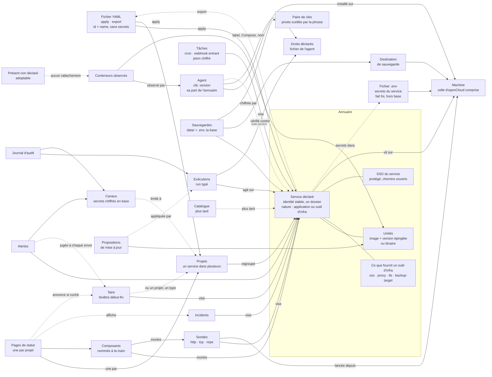

# Modèle de données cible

> **Cible, pas l'existant.** Ce document décrit le modèle de données vers
> lequel openCloud va, après les décisions du 17 octobre 2026. Les décisions
> elles-mêmes sont dans [`23-direction.md`](23-direction.md) ; ce qui n'y est
> pas reste une proposition du modèle. L'application telle qu'elle tourne est
> décrite dans [`22-fonctionnement.md`](22-fonctionnement.md).

## Règles du modèle

| Règle | Pourquoi | Coût |
| --- | --- | --- |
| Le service déclaré a un identifiant à lui, jamais dérivé de Docker | Recréer un conteneur ne casse ni sonde, ni composant, ni politique | Un rapprochement conteneur → service à chaque inventaire |
| Un service = un dossier `<racine>/<service>/` ; il contient une ou plusieurs **unités** (un service Compose, un conteneur seul ou un binaire) | Décision 7 : une sauvegarde, une adresse, une version épinglée par image | Deux niveaux à afficher (service, unité) |
| Un service a une **nature** : application ou outil d'infra (libellé provisoire, dans les catalogues). Un outil d'infra déclare ce qu'il **fournit** : `sso`, `proxy`, `tls`, `backup-target` | C'est sur quoi les modules se branchent ; séparés dans l'interface et le catalogue | Une liste fermée dans le code, à étendre par migration de code, pas de table |
| Un **projet** regroupe des services ; un service peut être dans plusieurs projets | Le socle (proxy, SSO) paraît sur la page de chaque site qui en dépend | Une table de liaison ; un service sans projet reste valide |
| Le projet porte sa page de statut, limite les canaux, filtre l'interface ; plus tard les droits | Un seul regroupement pour tout | Supprimer un projet passe par un plan (page, canaux) |
| Entre objets déclarés : `restrict`. La suppression passe par un **plan** qui liste ce qu'elle emporte, puis supprime dans l'ordre | Aucune perte silencieuse, même par MCP ou l'API | Chaque suppression écrit son plan ; plus de code qu'un `cascade` |
| D'un objet vers **son propre** historique : `cascade`, chiffré dans le plan | L'historique n'a pas de sens sans son objet | Le plan le dit en nombre de lignes |
| Alertes, exécutions, audit vers un objet : `set null` + nom recopié | La trace survit à l'objet | Une colonne de nom en double |
| Supprimer un service de l'annuaire ne touche jamais la machine | Retirer un déploiement est une action typée à part | Les conteneurs restent et passent « présent non déclaré » |
| `apply` modifie sur place, ne recrée jamais (décision 3) | Historique et jetons gardés | Chaque objet éditable champ par champ (sondes et tâches : faites, PR « édition sur place ») |
| Secrets saisis dans l'interface (URL et secret des canaux, mot de passe du relais, jetons de tâche, secret OIDC) : **chiffrés en base** par la clé du serveur, colonnes `*_sealed` | Une base volée sans la clé ne livre rien ; la sauvegarde chiffrée les emporte | Un jeton cherché par valeur a besoin d'une empreinte à côté (`token_lookup`) |
| Secrets des services : **le `.env` sur la machine fait foi**. Ni en base, ni dans l'export | Une seule source de vérité | Restaurer un service passe par sa sauvegarde (`data/` + `.env`, chiffrés) |
| La machine openCloud est une machine comme les autres, avec un agent | Un seul mécanisme ; le chemin intégré à `serve` disparaît | Le serveur seul ne voit rien de sa machine tant que l'agent n'est pas installé |
| Ni silence, ni maintenance : un seul objet **« taire »**, jugé à chaque envoi. Le moteur d'alertes ne lit plus les pages de statut | Trois notions au lieu de quatre : alerte, acquitter, taire | Une annonce publique de maintenance porte son propre titre |

## 1. Entités cibles et liens

### Diagramme des entités

Tables nouvelles : `agents`, `agent_capabilities`, `projects`, `project_services`, `declared_services`, `service_units`, `service_provides`, `service_open_paths`, `ignored_keys`, `update_proposals`, `service_samples_hourly`, `backup_destinations`, `backup_plans`, `backup_keyring`, `status_pages`, `incident_targets`, `mutes`, `channel_projects`, `action_runs`, `run_logs`, `applies`, `audit_events`, `audit_deliveries`, `settings`, `accounts`, `sessions`, `templates` (plus tard). Non dessinées, inchangées : `machine_disks`, `machine_samples_hourly`, `machine_samples_daily` (comme `machine_samples`, plus un agrégat horaire par volume), `mcp_clients`, `mcp_codes`, `mcp_tokens`, `schema_migrations`.

```mermaid
erDiagram
    %% ===== Machine, agent, droits =====
    machines {
        TEXT id PK
        TEXT name UK
        TEXT os
        INTEGER created_at
    }
    agents {
        TEXT id PK
        TEXT machine_id FK
        BLOB public_key
        TEXT version
        TEXT root_dir "defaut /srv/workspace"
        TEXT server_key_fingerprint
        INTEGER desired_revision "sa part de l annuaire"
        INTEGER acked_revision
        INTEGER last_seen_at
        INTEGER revoked_at
    }
    agent_capabilities {
        TEXT agent_id PK, FK
        TEXT capability PK "liste reportee, decision 9"
        TEXT scope "chemins, comptes"
        INTEGER reported_at "lu dans le fichier de l agent"
    }
    enrollment_tokens {
        TEXT id PK
        TEXT machine_id FK "re-enrolement"
        TEXT agent_id FK "consomme par"
        TEXT token_hash UK
        TEXT requested_capabilities "JSON, coche a l installation"
        TEXT root_dir
        INTEGER expires_at
        INTEGER consumed_at
    }
    machines ||--o{ agents : "cascade"
    agents ||--o{ agent_capabilities : "cascade"
    machines |o--o{ enrollment_tokens : "cascade"
    agents |o--o| enrollment_tokens : "set null"

    %% ===== Observe =====
    machine_samples {
        TEXT machine_id PK, FK
        INTEGER sampled_at PK
        REAL cpu_percent
        INTEGER mem_used
    }
    machine_engines {
        TEXT machine_id PK, FK
        INTEGER present
        TEXT version
    }
    machine_networks {
        TEXT machine_id PK, FK
        TEXT network_id PK
        TEXT name
    }
    image_checks {
        TEXT machine_id PK, FK
        TEXT image PK
        INTEGER checked_at
        TEXT newer_tag
    }
    containers {
        TEXT id PK "machine:id Docker"
        TEXT machine_id FK
        TEXT unit_id FK "NULL = present non declare"
        TEXT match_level "label, compose, name"
        TEXT compose_project
        TEXT compose_service
        TEXT name
        TEXT image
        TEXT state
        INTEGER archived_at
    }
    container_samples {
        TEXT container_id PK, FK
        INTEGER sampled_at PK
        REAL cpu_percent
        INTEGER mem_used
    }
    container_networks {
        TEXT container_id PK, FK
        TEXT network_id PK
        TEXT ip
    }
    container_events {
        INTEGER id PK
        TEXT container_id FK
        TEXT unit_id FK "survit au conteneur"
        INTEGER at
        TEXT action
        TEXT new_state
    }
    service_samples_hourly {
        TEXT service_id PK, FK
        INTEGER hour PK
        REAL cpu_percent
        INTEGER mem_used
        INTEGER net_bytes "hors veth et ponts"
    }
    ignored_keys {
        TEXT machine_id PK, FK
        TEXT match_key PK "projet Compose ou nom"
        TEXT reason
    }
    machines ||--o{ machine_samples : "cascade"
    machines ||--o| machine_engines : "cascade"
    machines ||--o{ machine_networks : "cascade"
    machines ||--o{ image_checks : "cascade"
    machines ||--o{ containers : "cascade"
    machines ||--o{ ignored_keys : "cascade"
    containers ||--o{ container_samples : "cascade"
    containers ||--o{ container_networks : "cascade"
    containers |o--o{ container_events : "set null"

    %% ===== Projets et annuaire =====
    projects {
        TEXT id PK "stable"
        TEXT name UK
        TEXT title
        INTEGER updated_at
    }
    project_services {
        TEXT project_id PK, FK
        TEXT service_id PK, FK
    }
    declared_services {
        TEXT id PK "stable, jamais derive de Docker"
        TEXT name "unique par machine"
        TEXT machine_id FK
        TEXT nature "application ou infra, libelle provisoire"
        TEXT origin "deployed, compose, container, binary"
        TEXT declared_by "operator, migration, discovery"
        INTEGER needs_review "a verifier, jamais bloquant"
        TEXT compose_project "niveau 2"
        TEXT public_url
        INTEGER protected "1 par defaut"
        TEXT template_id FK "plus tard"
        INTEGER updated_at
    }
    service_provides {
        TEXT service_id PK, FK
        TEXT capability PK "sso, proxy, tls, backup-target"
    }
    service_open_paths {
        TEXT service_id PK, FK
        TEXT path PK "affiche comme public"
        TEXT source "modele ou operateur"
    }
    service_units {
        TEXT id PK
        TEXT service_id FK
        TEXT name "unique dans le service"
        TEXT kind "container ou binary"
        TEXT image
        TEXT version "epinglee, jamais latest"
        TEXT digest "facultatif"
        TEXT container_name "niveau 3, faible"
        TEXT systemd_unit "binaire"
        TEXT ports "JSON"
        TEXT update_policy "watch, hold, ignore"
        TEXT eol_product "fin de support, choisi a la main"
    }
    update_proposals {
        INTEGER id PK
        TEXT unit_id FK
        TEXT from_version
        TEXT to_version
        TEXT status "open, dismissed, applied"
        TEXT run_id FK
        INTEGER found_at
    }
    projects ||--o{ project_services : "cascade, lien seul"
    declared_services ||--o{ project_services : "cascade, lien seul"
    machines ||--o{ declared_services : "restrict"
    declared_services ||--o{ service_provides : "cascade"
    declared_services ||--o{ service_open_paths : "cascade"
    declared_services ||--|{ service_units : "cascade"
    declared_services ||--o{ service_samples_hourly : "cascade"
    service_units |o--o{ containers : "set null"
    service_units |o--o{ container_events : "set null"
    service_units ||--o{ update_proposals : "cascade"

    %% ===== Sauvegarde =====
    backup_destinations {
        TEXT id PK
        TEXT name UK
        TEXT kind "agent, externe plus tard"
        TEXT machine_id FK
        TEXT path
    }
    backup_plans {
        TEXT id PK
        TEXT subject "database ou service"
        TEXT service_id FK "NULL pour la base"
        TEXT destination_id FK
        TEXT schedule
        INTEGER keep
    }
    backup_keyring {
        INTEGER id PK "toujours 1"
        TEXT public_key "chiffre chaque nuit"
        BLOB private_key_sealed "scellee par la phrase"
        TEXT fingerprint
        INTEGER created_at
    }
    machines ||--o{ backup_destinations : "restrict"
    declared_services |o--o{ backup_plans : "cascade"
    backup_destinations ||--o{ backup_plans : "restrict"

    %% ===== Sondes et taches =====
    probes {
        TEXT id PK
        TEXT name UK
        TEXT runner_machine_id FK "n importe quelle machine"
        TEXT service_id FK "facultatif"
        TEXT kind "http, tcp, nrpe"
        TEXT target "URL ou hote et port"
        TEXT check_name "nrpe : nom dans le fichier de l agent"
        INTEGER interval_seconds
        TEXT status "up, warning, degraded, down"
        INTEGER cert_not_after
    }
    probe_results {
        TEXT probe_id PK, FK
        INTEGER checked_at PK
        TEXT outcome
    }
    probe_days {
        TEXT probe_id PK, FK
        INTEGER day PK
        INTEGER success
    }
    heartbeats {
        TEXT id PK
        TEXT name UK
        TEXT kind "cron ou webhook"
        BLOB token_sealed "reaffichable"
        TEXT token_lookup UK "HMAC du jeton"
        TEXT service_id FK "facultatif"
        TEXT machine_id FK "facultatif"
        INTEGER interval_seconds "pas d horaire cron"
        INTEGER grace_seconds
        TEXT status
    }
    heartbeat_pings {
        INTEGER id PK
        TEXT heartbeat_id FK
        INTEGER received_at
    }
    heartbeat_runs {
        INTEGER id PK
        TEXT heartbeat_id FK
        TEXT outcome
    }
    machines ||--o{ probes : "restrict"
    declared_services |o--o{ probes : "restrict"
    probes ||--o{ probe_results : "cascade"
    probes ||--o{ probe_days : "cascade"
    machines |o--o{ heartbeats : "restrict"
    declared_services |o--o{ heartbeats : "restrict"
    heartbeats ||--o{ heartbeat_pings : "cascade"
    heartbeats ||--o{ heartbeat_runs : "cascade"

    %% ===== Pages de statut et incidents =====
    status_pages {
        TEXT id PK
        TEXT project_id FK, UK "une page par projet"
        TEXT slug UK "adresse publique"
        TEXT title
        TEXT announcement
        TEXT language
        INTEGER published
    }
    status_components {
        TEXT id PK
        TEXT page_id FK
        TEXT name "libre, ex. Authentification"
        INTEGER position
    }
    status_component_members {
        TEXT component_id FK
        TEXT service_id FK "un seul des quatre"
        TEXT probe_id FK
        TEXT heartbeat_id FK
        TEXT machine_id FK
    }
    incidents {
        TEXT id PK
        TEXT title
        TEXT impact "degraded, down"
        TEXT status
        INTEGER created_at
        INTEGER resolved_at
    }
    incident_targets {
        TEXT incident_id FK
        TEXT service_id FK "un seul des quatre"
        TEXT probe_id FK
        TEXT heartbeat_id FK
        TEXT machine_id FK
    }
    incident_updates {
        INTEGER id PK
        TEXT incident_id FK
        TEXT status
        TEXT message
    }
    projects ||--o| status_pages : "restrict"
    status_pages ||--o{ status_components : "cascade"
    status_components ||--o{ status_component_members : "cascade"
    declared_services |o--o{ status_component_members : "restrict"
    probes |o--o{ status_component_members : "restrict"
    heartbeats |o--o{ status_component_members : "restrict"
    machines |o--o{ status_component_members : "restrict"
    incidents ||--o{ incident_targets : "cascade"
    incidents ||--o{ incident_updates : "cascade"
    declared_services |o--o{ incident_targets : "cascade, lien seul"
    probes |o--o{ incident_targets : "cascade, lien seul"
    heartbeats |o--o{ incident_targets : "cascade, lien seul"
    machines |o--o{ incident_targets : "cascade, lien seul"

    %% ===== Taire =====
    mutes {
        TEXT id PK
        TEXT reason
        INTEGER starts_at "immediat ou planifie"
        INTEGER ends_at
        TEXT alert_kind "type vise, ou NULL"
        TEXT project_id FK "un objet au plus"
        TEXT service_id FK
        TEXT machine_id FK
        TEXT probe_id FK
        TEXT heartbeat_id FK
        INTEGER announce "maintenance publique, 0 par defaut"
        TEXT public_title "si annoncee"
        TEXT created_by
    }
    projects |o--o{ mutes : "cascade"
    declared_services |o--o{ mutes : "cascade"
    machines |o--o{ mutes : "cascade"
    probes |o--o{ mutes : "cascade"
    heartbeats |o--o{ mutes : "cascade"

    %% ===== Executions et audit =====
    action_runs {
        TEXT id PK "run_id"
        TEXT action "liste fermee, typee"
        TEXT params "JSON sans secret"
        TEXT machine_id FK
        TEXT machine_name "recopie"
        TEXT agent_id FK
        TEXT service_id FK
        TEXT state "queued, sent, accepted, refused, succeeded, failed, expired"
        TEXT refusal_reason
        INTEGER not_after
        INTEGER seq
        TEXT requested_by
        INTEGER finished_at
    }
    run_logs {
        TEXT run_id PK, FK
        INTEGER seq PK
        INTEGER at
        TEXT stream
        TEXT line
    }
    applies {
        TEXT id PK
        TEXT file_hash
        INTEGER prune
        TEXT plan "JSON"
        TEXT state "planned, confirmed, applied, failed"
        TEXT actor_name
        INTEGER at
    }
    audit_events {
        INTEGER id PK
        INTEGER at
        TEXT actor_kind "operator, mcp, rule, agent, system"
        TEXT actor_name
        TEXT action
        TEXT object_kind "sans FK"
        TEXT object_id "sans FK"
        TEXT object_name
        TEXT changes "JSON sans secret"
        TEXT run_id FK
        TEXT apply_id FK
    }
    machines |o--o{ action_runs : "set null"
    agents |o--o{ action_runs : "set null"
    declared_services |o--o{ action_runs : "set null"
    action_runs ||--o{ run_logs : "cascade"
    action_runs |o--o{ update_proposals : "set null"
    action_runs |o--o{ audit_events : "set null"
    applies |o--o{ audit_events : "set null"

    %% ===== Alertes et canaux =====
    alerts {
        INTEGER id PK
        TEXT kind
        TEXT object_kind "sans CHECK"
        TEXT object_id
        TEXT object_name "recopie"
        TEXT machine_id FK
        TEXT service_id FK
        TEXT container_id FK "present non declare"
        TEXT probe_id FK
        TEXT heartbeat_id FK
        TEXT run_id FK
    }
    alert_channels {
        INTEGER id PK
        TEXT name UK
        TEXT format
        BLOB url_sealed
        BLOB secret_sealed "signature ou jeton Matrix"
        TEXT min_severity
        INTEGER receives_audit
    }
    channel_projects {
        INTEGER channel_id PK, FK
        TEXT project_id PK, FK
    }
    alert_deliveries {
        INTEGER id PK
        INTEGER alert_id FK
        INTEGER channel_id FK
        TEXT status "pending, delivered, failed, held, muted"
        INTEGER next_attempt_at "essais jusqu a une heure"
    }
    audit_deliveries {
        INTEGER id PK
        INTEGER audit_id FK
        INTEGER channel_id FK
        TEXT status
    }
    machines |o--o{ alerts : "set null"
    declared_services |o--o{ alerts : "set null"
    containers |o--o{ alerts : "set null"
    probes |o--o{ alerts : "set null"
    heartbeats |o--o{ alerts : "set null"
    action_runs |o--o{ alerts : "set null"
    alerts ||--o{ alert_deliveries : "cascade"
    alert_channels ||--o{ alert_deliveries : "cascade"
    alert_channels ||--o{ channel_projects : "cascade"
    projects ||--o{ channel_projects : "restrict"
    alert_channels ||--o{ audit_deliveries : "cascade"
    audit_events ||--o{ audit_deliveries : "cascade"

    %% ===== Acces, reglages, catalogue =====
    accounts {
        TEXT id PK
        TEXT username UK
        TEXT password_hash "bcrypt"
        INTEGER created_at
    }
    sessions {
        TEXT id_hash PK
        TEXT account_id FK
        INTEGER expires_at
    }
    auth_settings {
        INTEGER id PK "toujours 1"
        TEXT forward_header
        TEXT oidc_issuer
        TEXT oidc_client_id
        BLOB oidc_secret_sealed
    }
    settings {
        INTEGER id PK "une seule ligne"
        TEXT language
        INTEGER disk_attention_percent
        TEXT mail_password_sealed "chiffre"
        INTEGER lifecycle_disabled
        INTEGER updated_at
    }
    templates {
        TEXT id PK
        TEXT name
        TEXT version
        TEXT source "depot Git"
    }
    accounts ||--o{ sessions : "cascade"
    templates |o..o{ declared_services : "set null, plus tard"
```



### Vue de haut niveau

Flèche `A --> B` : A dépend de B. Pointillé : lien hors clé étrangère, ou plus tard.



### Entités

| Entité | Rôle | État |
| --- | --- | --- |
| `machines` | L'hôte : nom, système. Survit à un ré-enrôlement. Plus de genre `local` : la machine openCloud a un agent comme les autres | Transformée : clé et `last_seen_at` passent à l'agent, `kind` disparaît |
| `agents` | Le logiciel installé : clé, version, racine, empreinte de la clé du serveur, révision d'état désiré envoyée et accusée | Nouvelle |
| `agent_capabilities` | Droits **lus dans le fichier de l'agent** et rapportés à la connexion. Le demandé reste dans le jeton : l'écart se voit | Nouvelle (liste : décision 9 reportée) |
| `projects` | Regroupe des services. Sert à la page de statut, au routage des canaux, au filtre de l'interface, plus tard aux droits | Nouvelle |
| `project_services` | Appartenance d'un service à un projet ; un service peut être dans plusieurs | Nouvelle |
| `declared_services` | L'annuaire. Une ligne = un dossier `<racine>/<service>/`, ou un projet Compose observé, ou un conteneur seul, ou un binaire supervisé. Porte la nature, l'adresse, « protégé » | Nouvelle |
| `service_provides` | Ce que fournit un outil d'infra : `sso`, `proxy`, `tls`, `backup-target`. Admis seulement si la nature est « outil d'infra » (contrôlé par le code) | Nouvelle |
| `service_open_paths` | SSO du service : tout est protégé par défaut, sauf ces chemins. Pré-remplis par le modèle, modifiables, affichés comme publics | Nouvelle |
| `service_units` | Ce qui tourne dans le service : un service Compose, un conteneur ou un binaire. Image, version épinglée, ports, politique de mise à jour, produit de fin de support | Nouvelle |
| `containers` | Le conteneur vu par Docker, plus son rattachement (`unit_id`, `match_level`) | Ex-`services` |
| `container_events` | Transitions d'état, rattachées aussi à l'unité : l'historique traverse les recréations | Ex-`service_transitions` |
| `service_samples_hourly` | Historique long des mesures par service, sur l'identité stable | Nouvelle |
| `ignored_keys` | « Présent non déclaré, et c'est voulu » : clé (projet Compose ou nom), jamais un id Docker | Nouvelle |
| `update_proposals` | Montée proposée (de, vers) ; jamais appliquée seule (décision 6) ; l'application est un run | Nouvelle |
| `backup_destinations` | Une machine avec agent et un chemin ; plus tard un stockage externe | Nouvelle |
| `backup_plans` | Une sauvegarde : la base ou un service (`data/` + `.env`), destination, rythme, nombre gardé. Sans ligne `database`, l'interface dit que la base n'est pas sauvegardée | Nouvelle |
| `backup_keyring` | La paire de clés : la publique chiffre chaque nuit ; la privée, scellée par la phrase de passe, est déposée avec chaque sauvegarde. La phrase n'est jamais en base | Nouvelle |
| `probes` | Sonde `http`, `tcp` ou `nrpe` ; lancée par n'importe quelle machine, rattachée au service où qu'il tourne. « Dedans » ou « dehors » se calcule (même machine ou non) | Transformée |
| `heartbeats` | Tâche `cron` ou `webhook` entrant. Jeton chiffré, réaffichable, régénérable ; `token_lookup` sert à trouver la tâche sur un ping | Transformée |
| `status_pages` | Une par projet, créée à la main. Titre, annonce, langue, publiée ou non | Nouvelle |
| `status_components` | Composé à la main, nommé librement, pré-rempli depuis les services du projet ; un outil d'infra y paraît sous un nom générique | Transformée |
| `incidents`, `incident_targets` | Ce que l'opérateur écrit au public, sur des objets de l'annuaire. Chaque page montre ceux qui touchent ses composants | Transformées (`incident_targets` nouvelle) |
| `mutes` | « Taire » : fenêtre début-fin, immédiate ou planifiée, sur un objet, un type d'alerte ou les deux ; case « annoncer comme maintenance » décochée par défaut | Nouvelle (remplace `alert_silences` et les incidents `maintenance`) |
| `channel_projects` | Projets auxquels un canal est limité. Aucune ligne = canal global | Nouvelle |
| `action_runs`, `run_logs` | Une exécution typée : identifiant, action, paramètres sans secret, état, échéance, journal | Nouvelles |
| `applies` | Un passage d'`apply` : empreinte du fichier, plan, confirmé ou non, `prune` ou non | Nouvelle |
| `audit_events` | Qui, quoi, quand, sur quoi, diff sans secret. Sans clé étrangère vers l'objet : survit à tout | Nouvelle |
| `audit_deliveries` | Envoi de l'audit vers les canaux marqués `receives_audit` | Nouvelle |
| `accounts`, `sessions` | Compte local créé au premier démarrage ; page de connexion avec déconnexion. Comptes multiples et rôles plus tard | Nouvelles |
| `auth_settings` | SSO de l'interface : forward-auth (existe), OIDC (à ajouter), secret chiffré | Transformée |
| `settings` | Tout ce que l'interface change (décision 1), une seule ligne à colonnes typées (comme `auth_settings`), dont les seuils d'alerte et de certificat, l'interrupteur de fin de support, le relais e-mail chiffré | Nouvelle, remplace `settings.toml` |
| `templates` | Catalogue : nom, version, dépôt ; pré-règle nature, fournitures, chemins ouverts | Plus tard |

### Rattachement d'un conteneur à une unité

Calculé par le serveur à chaque inventaire. Le niveau le plus fort gagne. Jamais d'id Docker dans l'annuaire.

| Niveau | Clé | Pour | Force | Conteneur recréé |
| --- | --- | --- | --- | --- |
| 1 · label | `<préfixe>.service=<id>` + `<préfixe>.unit=<nom>` (préfixe tiré du paquet de constantes) | ce qu'openCloud déploie | forte | même label : même unité |
| 2 · Compose | machine + `com.docker.compose.project` + `com.docker.compose.service` | Compose observé | forte tant que le projet garde son nom | même couple : même unité |
| 3 · nom | machine + nom du conteneur | conteneur seul | **faible, signalée** | tant que le nom reste |
| aucun | — | — | `unit_id` NULL : **présent non déclaré** | — |

| Cas | Ce qui arrive |
| --- | --- |
| Présent non déclaré | Observé et alerté comme aujourd'hui (alerte sur `container_id`). Fiche « non déclaré », deux gestes dans la vue écart : « Adopter » (formulaire pré-rempli depuis les labels Compose) ou « Ignorer » (ligne `ignored_keys`) |
| Label vers un service inconnu | Traité comme non déclaré, signalé « label orphelin » |
| Deux conteneurs pour une unité | Admis (réplicas, `scale`), montrés tous les deux |
| Unité sans conteneur | Écart « déclaré et absent » |
| Image ou version différente de l'épinglée | Écart « divergent » |
| Conteneur rattaché, unité supprimée | `set null` : il redevient « présent non déclaré » |

L'écart n'est pas stocké : il se calcule à la lecture, par service et par unité (conforme, absent, divergent, faible, non observé pour un binaire, version non vérifiable sur `latest` ou sans tag) et par conteneur (non déclaré).

Ce que l'annuaire 2/5 livre de ce modèle, et comment (le détail est dans `22-fonctionnement.md`, « Comment un conteneur se rattache à l'annuaire ») :

- Les niveaux 2 et 3 seulement ; le niveau 1 (label) viendra avec ce qu'openCloud déploiera. Les niveaux 2 et 3 sont **disjoints par l'origine du service** (Compose ou conteneur seul), le niveau fort gagnant si un conteneur répond aux deux.
- Une fiche archivée **garde son dernier rattachement** et n'est plus recalculée : l'historique d'un conteneur dit à quelle unité il appartenait.
- `ignored_keys` porte deux genres : `compose_project` (tout le projet) et `container_name` ; la clé est une observation, jamais un id Docker.
- Le verdict d'un conteneur suit dix règles ordonnées : image observée illisible, image déclarée illisible, autre image, autre empreinte, empreinte épinglée que l'image écrit elle-même (conforme, quel que soit le tag), `latest` ou sans tag, version non déclarée, autre tag, empreinte épinglée inconnue, conforme. Tout verdict autre que « conforme » porte l'un des sept motifs nommés (`image_unreadable`, `image_differs`, `digest_differs`, `tag_latest`, `version_unpinned`, `tag_differs`, `digest_unknown`).
- L'empreinte observée est celle que l'image écrit, à défaut celle du dernier constat sur l'image ; seule la première fait conclure à « conforme » (un tag mobile peut avoir bougé). Un conteneur arrêté compte comme présent.
- Pas de motif « label orphelin » tant que le niveau 1 n'existe pas.

### Projets, canaux, taire : règles de lecture

| Question | Règle |
| --- | --- |
| Projets d'une alerte | Ceux du service visé (directement, ou par la sonde ou la tâche rattachée). Alerte de machine : les projets qui ont un service sur cette machine. Conteneur non déclaré : aucun |
| Canal limité | Reçoit une alerte si l'un de ses projets est parmi ceux de l'alerte. Une alerte sans projet ne va qu'aux canaux globaux |
| Taire | Jugé à chaque envoi : une alerte ouverte avant la fenêtre se tait aussi ; la fenêtre finie, l'envoi suivant repart. Taire un projet tait ses services, leurs sondes et leurs tâches |
| Annoncer comme maintenance | La page d'un projet montre la fenêtre si l'objet visé touche un de ses composants ; titre public dans `public_title` |
| Page de statut | Montre l'état dérivé de ses composants, les incidents et les maintenances annoncées qui les touchent. Le moteur d'alertes ne lit plus aucune page |
| Filtre de l'interface | Choix de l'opérateur, gardé dans le navigateur ; rien en base |

### Liens, cardinalité, suppression

| De → vers | Cardinalité | À la suppression du parent | Pourquoi |
| --- | --- | --- | --- |
| `agents` → `machines` | 1 machine, 0..n agents (un seul actif) | cascade | Ré-enrôler, réinstaller ou tourner la clé ajoute un agent, garde la machine et son historique |
| `agent_capabilities` → `agents` | 0..n | cascade | Simple reflet du fichier de l'agent |
| `enrollment_tokens` → `machines` | 0..n | cascade | Jeton de ré-enrôlement sans objet sans sa machine |
| `enrollment_tokens` → `agents` (consommé par) | 0..1 | set null | Garder la trace du jeton consommé |
| mesures, moteur, réseaux, `image_checks` → `machines` | 0..n | cascade | Historique et cache propres à la machine ; le plan les compte |
| `containers` → `machines` | 0..n | cascade | Observé, sans configuration |
| `containers` → `service_units` | 0..1 unité, 0..n conteneurs | **set null** | Le conteneur redevient « présent non déclaré » |
| `container_events` → `containers` et `service_units` | 0..n | set null (les deux) | L'historique survit au conteneur ; purge à l'âge |
| `container_samples`, `container_networks` → `containers` | 0..n | cascade | Brut de 48 h, propre au conteneur |
| `project_services` → `projects` et `declared_services` | 0..n | cascade (lien seul) | Le service reste sans le projet, le projet sans le service ; le plan le dit |
| `declared_services` → `machines` | 1 machine, 0..n services | **restrict** | Supprimer une machine qui porte des services passe par un plan |
| `service_provides`, `service_open_paths`, `service_units`, `service_samples_hourly` → `declared_services` | 0..n (unités : 1..n) | cascade | Partie de la définition ou de l'historique du service |
| `update_proposals` → `service_units` | 0..n | cascade | Sans unité, rien à proposer |
| `update_proposals` → `action_runs` | 0..1 | set null | Le run peut être purgé, la proposition reste « appliquée » |
| `backup_plans` → `declared_services` | 0..n | cascade | Réglage du service ; les fichiers déjà envoyés restent |
| `backup_plans` → `backup_destinations` | 0..n | **restrict** | On ne retire pas une destination qui reçoit encore |
| `backup_destinations` → `machines` | 0..n | **restrict** | Retirer la machine qui garde les sauvegardes : plan obligatoire |
| `probes` → `machines` (qui sonde) | 1 | **restrict** | Aujourd'hui cascade : 90 jours partent sans prévenir. Le plan propose de changer de machine |
| `probes` → `declared_services` | 0..1 | **restrict** | Le plan demande : supprimer la sonde ou la détacher |
| `probe_results`, `probe_days` → `probes` | 0..n | cascade | Historique propre ; le plan dit combien de jours |
| `heartbeats` → `declared_services`, `machines` | 0..1 chacun | **restrict** | Une tâche porte un jeton utilisé par un cron ou un émetteur distant |
| `heartbeat_pings`, `heartbeat_runs` → `heartbeats` | 0..n | cascade | Historique propre |
| `status_pages` → `projects` | 0..1 page par projet | **restrict** | Une page publique ne disparaît pas avec son projet sans le dire |
| `status_components` → `status_pages` | 0..n | cascade | Un composant n'existe que sur sa page |
| `status_component_members` → `status_components` | 0..n | cascade | Lien de présentation |
| `status_component_members` → service, sonde, tâche, machine | 0..n | **restrict** | Aujourd'hui cascade : un objet disparaît d'une page publique sans prévenir |
| `incident_targets` → `incidents` | 0..n | cascade | Partie de l'incident |
| `incident_targets` → service, sonde, tâche, machine | 0..n | cascade (lien seul) | L'incident et son texte restent ; le plan dit « retiré de N incidents » |
| `incident_updates` → `incidents` | 0..n | cascade | Fil de l'incident |
| `mutes` → projet, service, machine, sonde, tâche | 0..1 objet | cascade | Objet temporaire ; le plan dit « N fenêtres pour taire supprimées » |
| `channel_projects` → `alert_channels` | 0..n | cascade | Partie du canal |
| `channel_projects` → `projects` | 0..n | **restrict** | Sinon un canal limité à ce seul projet deviendrait global sans prévenir. Le plan le dit |
| `alerts` → objets, conteneur, run | 0..1 chacun | set null + `object_name` | Historique lisible ; le `set null` résout l'alerte ouverte |
| `alert_deliveries`, `audit_deliveries` → `alert_channels` | 0..n | cascade | Annoncé : « N envois en attente perdus » |
| `action_runs` → machine, agent, service | 0..1 chacun | set null + `machine_name` | Un run est une trace : il survit à sa cible |
| `run_logs` → `action_runs` | 0..n | cascade | Purge du run seulement par âge |
| `audit_events` → `action_runs`, `applies` | 0..1 | set null | L'audit ne dépend de rien |
| `audit_events` → objet | aucune clé | — | `object_kind` + id + nom : survit à tout, append-only |
| `sessions` → `accounts` | 0..n | cascade | Supprimer un compte le déconnecte |
| `declared_services` → `templates` | 0..1 | set null | Plus tard ; un service déployé reste valide sans son modèle |

### Ce qu'une suppression emporte

| Supprimer | Bloqué tant que (restrict) | Emporte (cascade, chiffré dans le plan) | Détache (set null ou lien seul) | Sur la machine |
| --- | --- | --- | --- | --- |
| Machine | services déclarés, sondes qu'elle exécute, tâches, destinations, membres de page | agents et droits, jetons de ré-enrôlement, mesures, réseaux, conteneurs et leur brut, `image_checks`, clés ignorées, fenêtres pour taire | alertes, runs ; retirée des incidents | rien ; l'agent ne peut plus se connecter |
| Projet | sa page de statut, canaux limités à lui | fenêtres pour taire | ses services (liens seuls) | rien |
| Service déclaré | sondes, tâches, membres de page | unités, propositions, fournitures, chemins ouverts, plans de sauvegarde, historique horaire, fenêtres pour taire | projets (liens), conteneurs (→ non déclarés), alertes, runs, événements ; retiré des incidents | **rien** : ni conteneur, ni `.env`, ni `data/`. Retirer le déploiement = action `service.remove`, à part |
| Unité | — | propositions | conteneurs, événements | rien |
| Sonde | membres de page | résultats, jours, certificat, fenêtres pour taire | alertes ; retirée des incidents | jeu de sondes renvoyé à l'agent |
| Tâche | membres de page | pings, exécutions, fenêtres pour taire | alertes ; retirée des incidents | l'URL de ping ne répond plus |
| Page de statut | — | composants, membres | — | l'adresse publique répond 404 |
| Destination | plans qui l'utilisent | — | — | les fichiers déjà envoyés restent |
| Canal | — | limites par projet, envois d'alerte et d'audit, en attente compris | — | — |

## 2. De l'existant à la cible

| Table actuelle | Verdict | Ce qui change | Historique |
| --- | --- | --- | --- |
| `machines` | Transformée | `public_key`, `last_seen_at` vers `agents` ; `kind` disparaît. La machine `local` garde son id et son historique ; elle attend un agent, installé par une ligne de ré-enrôlement. Le chemin intégré à `serve` est retiré | Gardé |
| `enrollment_tokens` | Transformée | `consumed_by` (texte) → `agent_id` (FK set null) ; ajout des droits demandés et de la racine | Gardé |
| `machine_samples`, `machine_disks`, `machine_samples_hourly`, `machine_samples_daily` | Gardées | Interfaces virtuelles (veth, ponts) écartées du trafic ; agrégat horaire par volume | Gardé |
| `machine_engines` | Gardée | — | — |
| `machine_networks` | Gardée | — | — |
| `services` | **Remplacée** | Devient `containers` (ids et lignes gardés ; **fait, annuaire 3b**, migration `025_containers.sql`) ; `update_policy` passe sur l'unité (**fait, annuaire 3/6** : `watch`/`hold`/`ignore`, `services.update_policy` supprimée). Pour chaque conteneur qui porte de la configuration (membre, sonde, politique), la migration crée un service déclaré (nature `application`, origine `compose` si labels Compose, sinon `container`) et une unité, et y repointe les liens (**fait pour les sondes, les membres et la politique, annuaire 3/6** ; restent les alertes, les silences et l'historique). Le reste : « présent non déclaré », adoptable dans la vue écart | Gardé ; les liens portés par d'anciennes fiches archivées sont repris par la nouvelle unité |
| `service_transitions` | Transformée | Renommée `container_events` (**fait, annuaire 3b**), + `unit_id` ; FK en set null ; purge à l'âge (90 j proposé) | Gardé, rattaché à l'unité quand elle existe |
| `service_samples` | Gardée | Renommée `container_samples` (**fait, annuaire 3b**) ; alimente `service_samples_hourly` | Gardé (48 h) |
| `service_networks` | Gardée | Renommée `container_networks` (**fait, annuaire 3b**) | — |
| `heartbeats` | Transformée | + `service_id`, + `kind` (`cron` pour l'existant, `webhook`) ; `token` → `token_sealed` + `token_lookup` (les URL de ping ne changent pas) ; `machine_id` passe de set null à restrict ; édition sur place, régénération, pause qui tient | Gardé |
| `heartbeat_pings`, `heartbeat_runs` | Gardées | — | Gardé |
| `probes` | Transformée | Éditable sur place ; `machine_id` → `runner_machine_id` en restrict ; `service_id` → service déclaré, sur n'importe quelle machine, restrict (**fait, annuaire 3/6**) ; + genre `nrpe`, `check_name`, état `warning` | Gardé |
| `probe_results`, `probe_days` | Gardées | Issue `warning` ajoutée | Gardé |
| `image_checks` | Gardée | Reste un cache (machine, image) ; les montées trouvées deviennent des `update_proposals` | Cache |
| `status_components` | Transformée | + `page_id`. La page unique actuelle devient un projet (titre repris de `settings.toml`) qui contient les services de ses composants, et sa page ; l'ancienne adresse `/statut` renvoie vers elle tant qu'elle existe | Gardé |
| `status_component_members` | Transformée | `service_id` → service déclaré (**fait, annuaire 3/6**, en restrict, doublons d'un même projet réunis en un membre) ; les trois autres FK restent en cascade jusqu'aux plans de suppression, puis passent en restrict | Gardé |
| `incidents` | Transformée | Ne dépend plus des composants. Impact `maintenance` retiré : une maintenance à venir ou en cours devient une ligne `mutes` (annoncée) ; une maintenance passée reste comme incident, en lecture | Gardé |
| `incident_components` | **Remplacée** | Par `incident_targets` : chaque composant visé est déplié en ses membres | Gardé |
| `incident_updates` | Gardée | — | Gardé |
| `alerts` | Transformée | `service_id` → service déclaré ; + `container_id`, `run_id` ; CHECK sur `object_kind` retiré ; `silenced` (figé à l'ouverture) retiré, taire est jugé à chaque envoi | Gardé |
| `alert_channels` | Transformée | `url` et `secret` chiffrés (`*_sealed`) ; + `receives_audit` ; `name` unique (clé du YAML) ; + `channel_projects` | — |
| `alert_deliveries` | Transformée | + `next_attempt_at` (essais espacés jusqu'à une heure, rejoués par la boucle de fond) ; état `muted` ; `PendingRetryAfter` mort retiré | Gardé |
| `alert_silences` | **Remplacée** | Par `mutes` (`announce` = 0) ; `object_id` réécrits vers les ids stables | Gardé |
| `mcp_clients`, `mcp_codes`, `mcp_tokens` | Gardées | Désactivation en une transaction ; `mcp_codes.client_id` en FK | — |
| `auth_settings` | Transformée | Mode `none` retiré : un compte local (`accounts`) est créé au premier démarrage, avant tout ; Basic remplacé par une page de connexion (`sessions`) ; + OIDC | Compte Basic repris dans `accounts` |
| `schema_migrations` | Gardée | — | — |
| `settings.toml` (fichier) | **Supprimé** | Vers `settings` : seuils (page Alertes), relais e-mail (mot de passe chiffré), interrupteur de fin de support ; les clés `status_*` vers la page du projet migré | Réglages repris |
| `config.toml` (fichier) | Gardé | Lecture seule pour le serveur (décision 1). `ca_file` va dans le fichier de l'agent | — |
| `lifecycle.json` (fichier) | Gardé | Cache, hors export (décision 1) | — |

Les tables nouvelles sont listées au-dessus du [diagramme](#diagramme-des-entités).

## 3. Le fichier d'apply et l'export

Cet exemple dit la cible. L'export de l'annuaire (4a/7, voir « 8. Ce que
l'annuaire (4a/7) a fixé ») n'en écrit que `machines`, `projects`, `services`,
`probes`, `heartbeats` et `ignored` ; `status_pages`, `channels`,
`backup_destinations`, `backups`, `settings`, ainsi que `protected`,
`open_paths`, `eol_product` et le genre d'une tâche, attendent les
fonctionnalités qui les créent, et la lecture les refuse d'ici là.

```yaml
version: 1
machines:                        # référencées par nom, jamais créées par apply
  - name: app-1
  - name: edge-1
  - name: store-1
projects:
  - id: prj_4m8d1x               # écrit par export ; absent = création
    name: docs
    title: Documentation
services:
  - id: svc_7f3k2q
    name: wiki
    machine: app-1
    projects: [docs]             # l'appartenance se lit sur le service, par nom de projet
    nature: application          # application | infra
    origin: deployed             # deployed | compose | container | binary
    public_url: https://wiki.example.org
    protected: true              # SSO devant tout le service
    open_paths: [/api, /healthz] # affichés comme publics
    units:
      - name: app
        image: ghcr.io/example/wiki
        version: "2.4.1"         # jamais latest
        ports: ["8080:3000/tcp"]
        updates: watch           # watch | hold | ignore
      - name: db
        image: docker.io/library/postgres
        version: "16.4"
        updates: hold
        eol_product: postgresql
  - id: svc_2p9w6n
    name: auth
    machine: edge-1
    projects: [docs]
    nature: infra
    provides: [sso]              # sso | proxy | tls | backup-target
    public_url: https://auth.example.org
    protected: false
    units:
      - name: idp
        image: ghcr.io/example/idp
        version: "4.38.0"
  - name: proxy
    machine: edge-1
    projects: [docs]
    nature: infra
    origin: compose
    compose_project: edge
    provides: [proxy, tls]
    protected: false
    units:
      - name: proxy
        image: docker.io/library/example-proxy
        version: "3.1.2"
probes:
  - name: wiki-http
    service: app-1/wiki          # machine/nom : deux machines peuvent avoir un « wiki »
    runner: edge-1               # n'importe quelle machine : ici, vue de dehors
    kind: http                   # http | tcp | nrpe
    target: https://wiki.example.org/healthz
    interval: 60s
  - name: wiki-disk
    service: app-1/wiki
    runner: app-1
    kind: nrpe
    check: disk_data             # commande définie dans le fichier de l'agent
    interval: 5m
heartbeats:
  - name: wiki-dump
    machine: app-1               # la tâche n'a pas encore de service ; ni de genre cron | webhook
    every: 24h
    grace: 1h
    token: { secret: kept }      # chiffré en base, jamais exporté
status_pages:
  - project: docs
    slug: docs
    title: Documentation
    components:                  # pré-remplis depuis le projet, nommés à la main
      - name: Wiki
        members: [service/wiki, probe/wiki-http]
      - name: Authentification
        members: [service/auth]
channels:
  - name: ops
    format: discord
    url: { secret: kept }
    min_severity: danger
    receives_audit: true         # pas de projects : canal global
  - name: docs-team
    format: json
    url: { secret: kept }
    secret: { secret: kept }
    min_severity: attention
    projects: [docs]
backup_destinations:
  - name: store-1-backups
    machine: store-1
    path: backups
backups:
  - subject: database
    destination: store-1-backups
    schedule: daily
    keep: 14
  - subject: service/wiki        # data/ + .env, chiffrés
    destination: store-1-backups
    schedule: daily
    keep: 7
settings:
  language: fr
  disk_attention_percent: 80
  disk_danger_percent: 90
# clé de sauvegarde : jamais dans le fichier, l'export en donne l'empreinte en commentaire
```

| Règle d'apply | Détail |
| --- | --- |
| Reconnaissance | Par `id` s'il est là, sinon par `name` (unique par type ; pour un service, machine + nom). Deux fois le même `id` (copier-coller) : refus du fichier |
| Plan | Créé, modifié champ par champ, inchangé ; affiché, confirmé, puis écrit dans une transaction ; une ligne `applies` et un `audit_events` par objet |
| Jamais | Recréer un objet ; toucher un jeton, un id, un historique ; créer ou enrôler une machine ; agir sur une machine (apply écrit l'annuaire, les runs viennent après) |
| `--prune` | Seul chemin de suppression de ce qui n'est pas déclaré ; le plan dit ce que chaque suppression emporte |
| Fichier invalide | Refusé en entier ; rien n'est écrit |
| Machine inconnue | Erreur dans le plan, pas de création |
| `provides` sur une application | Erreur dans le plan |
| Secret `{ secret: kept }` | Garde la valeur en base ; sur une base vide, le plan le signale « à saisir » |
| `.env` d'un service | N'apparaît jamais : il vit sur la machine |

| `export` sort | `export` ne sort pas |
| --- | --- |
| Machines (nom ; droits rapportés en commentaire, lecture seule) | Clés, identités, jetons d'enrôlement, agents |
| Projets et leurs services | Conteneurs observés (sauf `--propose` : les non déclarés en blocs commentés, prêts à adopter) |
| Services : nature, fournitures, chemins ouverts, unités | Mesures, résultats, pings, alertes, runs, audit |
| Sondes, tâches (jeton marqué « conservé ») | Incidents (historique) et fenêtres pour taire (temporaires) |
| Pages, composants, membres | Tout secret : URL et secret des canaux, jetons, mot de passe du relais, secret OIDC, `.env` |
| Canaux et leurs projets, destinations, plans de sauvegarde | `config.toml`, `lifecycle.json`, comptes, sessions, `auth_settings`, MCP |
| Réglages de `settings` ; empreinte de la clé de sauvegarde en commentaire | La paire de clés de sauvegarde (créée dans l'interface, jamais par apply) |
| Clés ignorées (`ignored_keys`) | — |

Restaurer après la perte de la machine openCloud : la sauvegarde chiffrée de la base, avec la phrase de passe. L'export sert à relire, versionner dans Git, reproduire.

## 4. Où chaque décision entre dans le modèle

Le texte de chaque décision est dans [`23-direction.md`](23-direction.md).

| Décision | Dans le modèle | Où dans `23-direction.md` |
| --- | --- | --- |
| Service = dossier avec unités ; id jamais tiré de Docker | `declared_services` + `service_units` | [Points techniques](23-direction.md#points-techniques-tranchés), « Service déclaré » ; [actée](23-direction.md#autres-décisions-actées) « Identité de service » |
| `restrict` + plan ; historique propre en cascade ; alertes, runs, audit en `set null` | Tableaux « Liens » et « Ce qu'une suppression emporte » | Points techniques, « Suppressions » |
| Incidents et taire visent l'annuaire ; le moteur d'alertes ne lit plus les pages | `incident_targets`, `mutes` | Points techniques, « Incidents et taire » |
| Paire de clés pour la sauvegarde ; seule la phrase est à garder | `backup_keyring` | [Décision 12 bis](23-direction.md#décisions) ; points techniques, « Chiffrement de la sauvegarde » |
| Pas de copie locale de la base ; destination choisie | `backup_destinations`, `backup_plans` | Décision 12 |
| `.env` fait foi ; sauvegarde d'un service = `data/` + `.env` | `backup_plans`, aucune table de secrets de service | Décision 7 ; points techniques, « Secrets des services » |
| Export sans secrets, marqueur « conservé » | `{ secret: kept }` | Points techniques, « Export » |
| `id` + `name` dans le YAML ; id dupliqué refusé | Règle « Reconnaissance » | Points techniques, « Identité dans le YAML » |
| Machine et agent séparés | `machines` + `agents` | Points techniques, « Machine et agent » |
| Machine openCloud = agent comme les autres | `kind` retiré | Points techniques, « Machine openCloud » |
| Racine `/srv/workspace`, droits cochés à l'installation | `agents.root_dir`, `enrollment_tokens.requested_capabilities`, `agent_capabilities` | Actées « Racine », « Droits », « Installation » ; liste des droits : décision 9, reportée |
| Mesures : historique long par service, veth écartées, agrégat par volume | `service_samples_hourly` | Points techniques, « Mesures » |
| Migration : service créé d'office seulement pour un conteneur déjà lié | Tableau « De l'existant à la cible », ligne `services` | Points techniques, « Migration de l'existant » |
| Unités binaires déclarables, écart « non observé » | `service_units.kind` = `binary` | Points techniques, « Unités binaires » |
| `latest` ou sans tag : écart « version non vérifiable » | Écart calculé à la lecture | Points techniques, « Conteneur sur `latest` » ; décision 6 |
| Un service par machine à l'étape 1, regroupés par un projet | `declared_services.machine_id` | Points techniques, « Service sur plusieurs machines identiques » |
| Projets dans l'annuaire, un service dans plusieurs | `projects`, `project_services` | [Tri](23-direction.md#décisions-du-tri-des-fonctionnalités), « Projets » |
| Nature et fournitures d'un outil d'infra | `nature`, `service_provides` | Tri, « Nature d'un service », « Terme » |
| Pages multiples, une par projet, composants à la main | `status_pages.project_id`, `status_components` | Actée « Statut » ; tri, « Page de statut d'un projet » |
| Taire remplace silence et maintenance ; plus de CHECK sur les genres | `mutes` ; `alerts.object_kind` libre | Tri, « Alertes » |
| Sondes depuis n'importe quelle machine ; NRPE = genre de sonde, état avertissement | `probes.kind`, `check_name`, `warning` | Tri, « Sondes » ; actée « Contrôles » |
| Tâches : jeton chiffré réaffichable, régénérable ; webhooks entrants | `token_sealed`, `token_lookup`, `heartbeats.kind` | Décision 13 ; tri, « Tâches » |
| Canaux limitables à des projets ; essais jusqu'à une heure | `channel_projects`, `next_attempt_at` | Tri, « Canaux » |
| SSO des services : protégé par défaut, chemins ouverts | `protected`, `service_open_paths` | Tri, « SSO des services » |
| Secrets saisis dans l'interface chiffrés en base | colonnes `*_sealed` | Tri, « Paramètres » ; points techniques, « E-mail » |
| Compte local au premier démarrage, connexion avec déconnexion, OIDC | `accounts`, `sessions`, `auth_settings` | Tri, « Authentification » |
| Fin de support : produit à la main sur l'unité, interrupteur en base | `service_units.eol_product`, `settings` | Tri, « Fin de support » |
| Conteneur non couvert adoptable d'un clic | Vue écart, `ignored_keys` | Tri, « Conteneur non couvert » |

## 5. Propositions du modèle

Les six propositions que le modèle ajoutait ont été tranchées par Lucas le
17 octobre 2026, une par une : voir
[23-direction.md, « Propositions du modèle »](23-direction.md#propositions-du-modèle).
Ce document en tient compte : nom unique par machine, `declared_by` et
`needs_review` sur le service déclaré.

## 6. Ce que l'annuaire (1/5) a fixé

La migration `022_directory.sql` crée cinq tables du modèle. Ce que le code a
tranché en l'écrivant, et que les migrations suivantes prolongent :

| Décision | Pourquoi |
| --- | --- |
| Pas de `CHECK` sur la nature, l'origine, `declared_by` et le genre d'unité ; le code valide, la liste est exposée (`Natures()`, `Origins()`, `Provenances()`, `Capabilities()`) et un test exige la clé de catalogue de chaque valeur | SQLite ne modifie pas un `CHECK` sans reconstruire la table ; les listes grandiront (`deployed`, `discovery`). `needs_review` garde son `CHECK 0/1` |
| `title` sur `declared_services` et `position` sur `service_units` | Le titre est le nom affiché ; la position garde l'ordre saisi par l'opérateur |
| Le genre de l'unité se déduit de l'origine du service : `container` pour Compose comme pour un conteneur seul, `binary` pour un binaire ; une unité Compose est un service du projet | L'opérateur ne le saisit pas ; le rattachement de niveau 2 s'appuie sur le nom |
| Identifiants préfixés : `svc_`, `unit_`, `prj_` + 16 caractères hexadécimaux tirés par le serveur | Lisibles dans un journal, jamais confondus entre objets |
| Unicité en base : `(machine_id, name)`, et `(machine_id, compose_project)` pour l'origine `compose` ; en code, dans la même transaction : nom de conteneur et unité systemd uniques par machine | La clé (`container_name`, `systemd_unit`) est dans `service_units` et la machine dans `declared_services` : un index unique ne porte pas sur deux tables |
| L'origine `deployed` est réservée et refusée ; `declared_by` vaut `operator` (`migration` à venir) | Le déploiement par l'application et la migration de l'existant arrivent plus tard |
| `latest` est refusé ; l'image s'écrit sans étiquette ni empreinte ; la version est facultative (sans elle, l'écart dira « version non vérifiable ») ; l'empreinte ne s'attache pas à un binaire | La déclaration ne ment pas sur ce qui tourne, et ne force pas à épingler ce qu'on ne sait pas encore |
| Retirer un service supprime ses unités, ses fournitures et ses liens de projet ; retirer un projet ne retire que les liens ; retirer une machine qui porte un service est refusé (409) | `restrict` entre objets déclarés, `cascade` pour ce qui fait partie du service |
| Ce qui n'est pas encore là : `protected`, `service_open_paths`, `update_policy`, `eol_product`, `template_id`, les ports lus du réel | Chacun arrive avec la migration de la PR qui s'en sert |

## 7. Ce que l'annuaire (3/6) a fixé

La migration `024_directory_links.sql` repointe les liens du conteneur observé
vers l'annuaire. Ce que le code a tranché en l'écrivant :

| Décision | Pourquoi |
| --- | --- |
| **Les migrations tournent hors clés étrangères**, toutes : le runner coupe `foreign_keys` sur une connexion dédiée, hors transaction (le PRAGMA n'a aucun effet dedans), applique le fichier, lance `PRAGMA foreign_key_check` **avant le COMMIT**, puis les remet avant de rendre la connexion. Tout ou rien | Reconstruire `probes` avec les clés actives emporterait `probe_results`, `probe_days` et les membres du composant (le `DROP TABLE` cascade). Un lien perdu en silence est pire qu'un refus de démarrer. Une base neuve rejoue toutes les migrations et doit donner le même schéma : un test compare `sqlite_master` d'une base neuve et d'une base montée depuis la 023 |
| **L'étape Go** `store.linkContainersToDirectory` s'exécute dans la même transaction que le SQL, juste avant lui. Elle lit et écrit avec des requêtes **figées sur le schéma de sa version**, jamais celles du store, et dépose sa table de correspondance dans `temp.link_migration` | Le nommage et le rapprochement sont ceux du code (`directory.PlanLinks`, pur et déterministe) ; les écrire en SQL les dédoublerait. Les requêtes du store changeront avec les PR suivantes, la migration ne doit pas les suivre. Après le SQL, `verifyContainerLinks` compte ce qui devait survivre (sondes et celles qui ont un service, résultats, jours, alertes des sondes, membres sans les doublons, unités qui portent une politique) |
| `''` / `pinned` / `excluded` deviennent `watch` / `hold` / `ignore`, sur `service_units.update_policy` | La politique suit le service, pas l'identifiant Docker ; trois mots qui disent ce que l'opérateur veut plutôt que ce que l'ancien code faisait. Plusieurs fiches pour une unité : la plus récente qui portait une politique, une vivante avant une archivée. Pas de `CHECK` : le code valide, comme pour les autres listes de l'annuaire. Un binaire n'admet que `watch` |
| **Seuls les conteneurs liés** reçoivent un service, et le projet Compose de ce conteneur devient **un** service : une unité par service Compose **lié ou qui tourne** (`running`, `restarting`), au plus 32. Un conteneur arrêté que rien ne vise (l'`init`) n'a pas d'unité et reste non déclaré. Un projet que l'opérateur a déjà déclaré n'est jamais recréé : ce qui n'y tient pas (32 unités) devient un conteneur seul | Un service d'origine Compose est le projet, pas un conteneur : n'en créer qu'une unité ferait « absentes » les autres au prochain rapprochement. Mais l'état d'un service étant le pire de ses unités, un `init` arrêté en 0 devenu unité ferait passer le composant de statut en panne le jour de la montée : on ne crée d'unité que pour ce qui est lié ou tourne. Le projet de plus de 32 unités, ou dont le nom est refusé, retombe sur un service par conteneur lié ; créer un second service Compose pour (machine, projet) violerait l'unicité et `serve` ne démarrerait plus. Un nom de conteneur déjà porté par une unité déclarée rejoint cette unité (aucun index unique ne garde cette clé) |
| `declared_by` vaut `migration` et `needs_review` est levé sur ce qu'elle a créé ; **Valider** est la seule façon de le lever | La migration devine (noms, images lues sur Docker) : l'opérateur relit. Modifier le service ne le valide pas |
| Les membres d'un même composant qui visent deux conteneurs d'un même projet **sont réunis en un seul** (le premier dans l'ordre), sans `OR IGNORE` | Un seul service déclaré ; l'index unique `(component, service)` l'exige. `OR IGNORE` taisait aussi un `CHECK` violé, donc un lien perdu : on déduplique explicitement et le compte le dit |
| **La règle d'état** d'un service déclaré dans un composant : le pire de ses unités conteneur ; une unité sans conteneur vivant est en panne ; un binaire ne compte pas | L'état ne dépend plus d'un identifiant Docker. Le prix : une unité qui n'a jamais eu de conteneur compte comme en panne |
| `probes.service_id` et `status_component_members.service_id` : **restrict**. `DELETE` d'un service lié répond 409 `directory.service_linked`, avec la liste | On ne retire pas sans le dire un service qu'une sonde surveille ou qu'une page publique affiche. Les trois autres clés du membre (machine, tâche, sonde) **restent en cascade** jusqu'aux plans de suppression |
| `object_kind 'service'` des alertes et des silences **désigne encore le conteneur** ; la maintenance se lit par l'unité (conteneur → unité → service déclaré → composant) | Les alertes passent sur l'annuaire avec leur propre migration ; d'ici là, une alerte continue de dire le conteneur qui l'a levée |
| Une sonde peut viser un service de **n'importe quelle machine** | Sonder depuis l'extérieur un service d'une autre machine est le cas courant ; le service existe, c'est tout ce que la création vérifie |
| Pas de retour arrière par le binaire seul | Rien n'est détruit, mais l'ancien binaire ne marche pas sur cette base : son inventaire écrit `services.update_policy`, colonne supprimée, donc tout rapport de conteneurs échoue ; créer une sonde sur un identifiant de conteneur échoue contre la clé vers `declared_services`. Revenir, c'est remettre l'ancien binaire **et** la copie faite avant la montée (`installation.md`) |

## 8. Ce que l'annuaire (4a/7) a fixé

Le paquet `internal/manifest` écrit et relit le fichier de la section 3, sans
rien appliquer. Ce que le code a tranché en l'écrivant, et que la 4b lit :

| Décision | Pourquoi |
| --- | --- |
| **L'appartenance à un projet s'écrit sur le service** (`projects: [docs]`, des noms), pas sur le projet | La base la tient sur le service (`project_services`) ; une seule écriture, pas deux listes à accorder |
| **Une sonde vise `machine/nom`** (`service: app-1/wiki`) ; le `runner` est toujours écrit, la machine openCloud y a son nom | Un nom de service n'est unique que par machine ; le fichier ne cite jamais l'identifiant interne d'une machine |
| **Les tâches n'ont ni `service` ni genre** (`cron`, `webhook`) pour l'instant | `heartbeats` n'a pas encore de `service_id` (annuaire 5) ; le fichier n'écrit pas ce que la base ne tient pas |
| **Les identifiants sont toujours écrits** ; la 4b refusera un identifiant inconnu et demandera l'identifiant pour un nom ambigu ; les unités n'en ont pas | L'identifiant rattache à l'objet quand on renomme ; une unité se reconnaît à son nom dans son service |
| **Un champ absent veut dire la valeur par défaut**, un champ nul aussi (sauf `token:`, nul = refusé) | Un fichier écrit à la main n'a pas à répéter les défauts ; l'export, lui, écrit tout ce qui a une valeur |
| **L'état n'est jamais dans le fichier** : pause, essais, conteneurs rattachés, « à vérifier » (commentaire seulement), historique | Le fichier dit ce que l'opérateur déclare ; l'état est ce que le système observe |
| **Un secret ne s'écrit que `{secret: kept}`** | Garder la valeur du serveur ; le fichier peut aller dans Git |
| **Sections refusées** : tout ce qui n'est pas dans la liste de la section 3 ci-dessus (canaux, pages, réglages, sauvegardes), avec sa ligne | Mieux vaut refuser que lire en ignorant : un fichier qui semble tout dire et ne dit pas tout |
| **Durées avec unité** (`60s`, `5m`, `24h`) ; une sonde en secondes entières, une tâche en minutes entières | Ce que la base sait stocker ; une durée ronde sinon refusée plutôt qu'arrondie |
| **Lecture par nœuds, pas décodée d'un coup** : clé inconnue, clé répétée, alias, plusieurs documents, type inattendu, plus de 256 Kio sont refusés à leur ligne | Un refus cite une ligne ; le décodage direct ne voit pas les doublons et lit `"1"` comme `1` |
| **La socket `state_dir/control.sock`** (0600, `state_dir` fermé au groupe et aux autres, jamais prise à un `serve` vivant) sert `/api/manifest/…` et rien d'autre ; la commande `opencloud export` passe par elle | Pas d'identifiants à saisir sur une machine où l'on est déjà le compte du service ; la commande n'ouvre pas la base et ne crée donc pas de fichier au nom de root |
