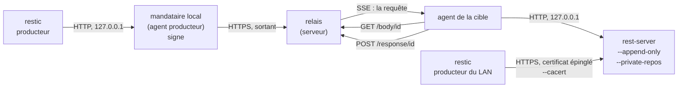

# Essai : restic orchestré par openCloud, en direct TLS et par un relais du serveur

> Ticket #367 (cadrage #366). Essai jetable : le code vit dans
> `internal/spike/resticrelay/` de la branche `spike/restic-relais` et ne sera
> pas fusionné. Ce rapport est la seule chose à reprendre. Mesures du
> 30 octobre 2026, sur une seule machine (boucle locale), avec les vrais
> binaires restic et rest-server.

## Verdict

**Go sous conditions.**

| Chemin | Verdict | Pourquoi, en chiffres |
| --- | --- | --- |
| **Direct TLS** (le producteur joint rest-server) | **Par défaut quand la cible est joignable** | 1 Gio : 7,3 s, 631 Mio stockés, rien entre le producteur et la cible que TLS. `forget`, `prune` et `DELETE` échouent par `--append-only` seul. Le plus simple, le moins de pièces mobiles. |
| **Relais** (producteur → serveur → agent de la cible) | **Pour les sources distantes seulement** | Même sauvegarde : 7,0 s, 662 175 470 octets de corps, 59 requêtes. Le relais pèse 17 Mio de mémoire et 280 ms de processeur pour 631 Mio. **Mais** chaque octet traverse le serveur deux fois, et il ajoute trois pièces (mandataire, relais, agent de la cible). |

Sur la boucle locale, **les deux chemins coûtent la même chose** (restic est
limité par son propre processeur : 18 s de temps utilisateur pour 7 s
d'horloge). La différence réelle viendra du réseau, pas du code : voir
« Ce qui reste à vérifier ».

Conditions pour le relais (toutes tiennent dans l'essai, aucune n'est
optionnelle) :

1. **Le mandataire local borne la patience de restic** (« Limites » n° 1) :
   sans cela, une cible hors ligne bloque une sauvegarde plus de 15 minutes.
2. **Une sauvegarde échouée se rejoue** (« Limites » n° 2) : en `--append-only`,
   le rejeu d'un envoi déjà stocké reçoit 403.
3. **Les verrous se nettoient avant la purge locale** (« Limites » n° 4).
4. **Qui détient le mot de passe de chaque dépôt restic** est à décider par
   Lucas (« Décisions »).

## Ce qui a été construit (jetable)

| Pièce | Fichier | Rôle |
| --- | --- | --- |
| Relais | `relay.go`, `relay_producer.go`, `relay_target.go` | Le serveur : reçoit la requête restic signée, la juge, la pousse à la cible par SSE, rend la réponse. Rien n'est stocké |
| Politique | `policy.go` | `Allow(méthode, chemin, requête)` : les routes de restic, et `DELETE` seulement sur `locks/` |
| Agent de la cible (simulé) | `target.go` | Flux SSE sortant, rejoue sur rest-server (`127.0.0.1`), pousse la réponse. Garde les mots de passe de rest-server |
| Mandataire local | `proxy.go` | Dans l'agent producteur : écoute `127.0.0.1`, signe chaque requête, la passe au relais |
| Preuve | `proof.go` | Réutilise `machine.SignedPayload`, `machine.Sign`, `machine.Verify`, `machine.NewNonce` et les en-têtes de `agentwire` |
| Certificat | `selfsigned.go` | Auto-signé ECDSA P-256, un an, SAN = adresses déclarées |
| Démo | `cmd/relais-demo/` | Un processus par pièce (`relay`, `target`, `proxy`), `gen`/`mutate` (données), `tcpcount` (compteur d'octets TLS), `measure` (durée, processeur, pic de mémoire) |
| Scripts | `fetch-tools.sh`, `run-measures.sh` | Téléchargement vérifié ; les mesures de 1 Gio |
| Tests | `*_test.go` (13) | Vrais binaires ; un binaire absent **échoue** avec le message « lancer fetch-tools.sh » (vérifié) |



### Ce qui diffère du vrai protocole agent

| Écart | Raison | Conséquence |
| --- | --- | --- |
| Le producteur **signe chaque requête** au lieu d'ouvrir une session | Pas de jeton à renouveler en pleine sauvegarde ; le relais retient les couples (machine, aléa) vus | La signature couvre (aléa, machine, heure), **pas** méthode, chemin ni corps : TLS est indispensable. Le vrai agent signe de même à l'ouverture du flux |
| `readEvent` recopié (`target.go`) | `agent.readEvent` n'est pas exporté | À factoriser à l'intégration |
| Agent de la cible et mandataire sont du code d'essai, pas `internal/agent` | Pas de compte, de droits ni d'enrôlement à monter | Les droits, ordres signés et enrôlement existants ne sont pas exercés |
| Les routes sont sous `/agent/relay/…` | Même espace que `/agent/stream` | À figer par `routes_test.go` à l'intégration |
| Un seul serveur HTTP sans Traefik | Aucune machine du homelab | Pas de test de tampon, de délai d'inactivité ni de TLS entre agent et serveur |

## Binaires

| | Version | Archive | Taille | Binaire extrait |
| --- | --- | --- | --- | --- |
| restic | 0.19.1 (go1.26.4, linux/amd64) | `restic_0.19.1_linux_amd64.bz2` | 10 107 515 o | 30 941 346 o |
| rest-server | 0.14.0 (go1.24.3, linux/amd64) | `rest-server_0.14.0_linux_amd64.tar.gz` | 3 799 947 o | 9 486 520 o |

Sources : `github.com/restic/restic` et `github.com/restic/rest-server`, pages
de releases, lecture anonyme. Cache : `~/.cache/opencloud-spike-restic/`, rien
dans le système.

| Vérification | Résultat |
| --- | --- |
| SHA-256 de l'archive contre la ligne de `SHA256SUMS` publié | OK pour les deux (`f4154156…585c` et `4c9c95bc…1c66`) |
| Signature GPG de `SHA256SUMS` (`SHA256SUMS.asc`, publié par les deux projets) | **Vérifiée** avec `sq verify`, signataire `CF8F18F2844575973F79D4E191A6868BD3F7A907` |
| La clé du signataire | Téléchargée sur `restic.net/gpg-key-alex.asc`. **Confiance à la première utilisation** : l'empreinte n'a pas été recoupée par un second canal |

Spécification suivie : « REST Backend », `doc/REST_backend.rst` du dépôt restic
à l'étiquette `v0.19.1`.

## Ce que le relais implémente

Liste établie sur la spécification, puis **confirmée par le trafic réel** : les
13 tests et le script n'en ont jamais demandé d'autre. restic 0.19.1 utilise
`/data/<nom>` à plat (pas de sous-dossiers `data/xx/`).

`{type}` ∈ `data`, `keys`, `locks`, `snapshots`, `index`. `{nom}` = 64 hexadécimaux.

| Méthode | Chemin | Passe ? | Pourquoi |
| --- | --- | --- | --- |
| `POST` | `/?create=true` | oui | `restic init` |
| `DELETE` | `/` | **non** (`delete_repository_refused`) | Supprimerait le dépôt |
| `HEAD`, `GET`, `POST` | `/config` | oui | |
| `DELETE` | `/config` | **non** | |
| `GET` | `/{type}/` | oui | Liste ; `Accept: application/vnd.x.restic.rest.v2` relayé |
| `HEAD`, `GET`, `POST` | `/{type}/{nom}` | oui | `GET` avec `Range` : 206 et `Content-Range` relayés (nécessaires à `check --read-data-subset` et à `restore`) |
| `DELETE` | `/locks/{nom}` | **oui** | restic libère son verrou à chaque fin de commande |
| `DELETE` | `/data/`, `/snapshots/`, `/keys/`, `/index/` `{nom}` | **non** (`delete_refused`) | Le cœur de l'essai |
| tout le reste | autre type, nom qui n'est pas 64 hexadécimaux, `..`, `//`, chemin ré-encodé, paramètre de requête inattendu | **non** (`path_refused`, `query_refused`, `method_refused`) | |

En-têtes de requête relayés : `Accept`, `Range`, `Content-Length`. En-têtes de
réponse relayés : `Content-Type`, `Content-Length`, `Content-Range`,
`Accept-Ranges`.

Les routes du relais lui-même :

| Route | Appelant | Rôle |
| --- | --- | --- |
| `GET/POST/HEAD/DELETE /agent/relay/rest/…` | mandataire du producteur | Les requêtes restic |
| `GET /agent/relay/stream` | agent de la cible | Flux SSE : événement `session`, puis un événement `rest` (JSON : id, dépôt, méthode, chemin, requête, `Accept`, `Range`, longueur) par requête ; `ping` toutes les 15 s |
| `GET /agent/relay/body/{id}` | agent de la cible | Tire le corps de la requête, au fil de l'eau |
| `POST /agent/relay/response/{id}` | agent de la cible | Pousse la réponse : tête dans l'en-tête `…-Relay-Head`, corps dans le corps |

Le dépôt est **posé par le relais d'après l'identité** (`Producer.Repo`) : le
producteur ne le nomme jamais. L'agent de la cible rejuge chaque requête avec la
même `Allow` avant de toucher rest-server (**non testé isolément** : voir
« Ce qui n'a pas été prouvé »).

## Mesures : 1 Gio, les deux chemins côte à côte

Commande : `internal/spike/resticrelay/run-measures.sh` (sortie complète
rejouable). Données : 6 520 fichiers, 1 020 080 346 octets (40 % de gros
fichiers aléatoires, 40 % de gros fichiers de texte compressible, 20 % de
petits fichiers d'environ 32 Kio, moitié aléatoires, moitié texte). Seconde
passe : `mutate -percent 2` (écrase une plage de 2 gros fichiers, remplace
des petits fichiers, en ajoute 20) : 20 nouveaux, 315 modifiés, 6 205 intacts.
Cache de restic chaud, machine à 4 cœurs, boucle locale, aucun retard réseau.

Trois dépôts distincts, un par mode, sur le **même** rest-server
(`--append-only --private-repos`, un utilisateur par dépôt) :

- **direct TLS** : `rest:https://…` avec `RESTIC_CACERT` (le certificat
  auto-signé) ;
- **direct TLS compté** : le même derrière un passe-plat TCP (`tcpcount`) qui
  compte les octets chiffrés des deux sens ;
- **relais** : restic → mandataire local → relais → agent de la cible →
  rest-server en HTTP sur `127.0.0.1`.

### Première sauvegarde (972,8 Mio lus)

| | Direct TLS | Direct TLS compté | **Relais** |
| --- | --- | --- | --- |
| Durée (horloge) | 7,3 s | 7,5 s | **7,0 s** |
| Temps processeur de restic (utilisateur + système) | 18,6 + 1,6 s | 18,6 + 1,7 s | 18,2 + 1,6 s |
| Mémoire de restic (pic) | 184 Mio | 191 Mio | 212 Mio |
| Ajouté / stocké (restic) | 975,158 / 631,156 Mio | 975,156 / 631,104 Mio | 975,158 / 631,166 Mio |
| Octets sur le fil, producteur → cible | — | **663 209 867** (TLS et en-têtes compris) | **662 175 470** (corps HTTP seulement) |
| Octets sur le fil, cible → producteur | — | 754 604 | 786 |
| Requêtes REST | — | — | 59 |
| Taille du dépôt sur la cible | 662 164 551 o | 662 108 851 o | 662 175 321 o |
| Processeur de rest-server | 3 580 ms | 3 500 ms | 2 740 ms |

### Sauvegarde incrémentale (+2 %)

| | Direct TLS | Direct TLS compté | **Relais** |
| --- | --- | --- | --- |
| Durée (horloge) | 1,2 s | 1,3 s | **1,1 s** |
| Temps processeur de restic | 1,6 + 0,2 s | 1,7 + 0,1 s | 1,5 + 0,1 s |
| Mémoire de restic (pic) | 141 Mio | 152 Mio | 150 Mio |
| Ajouté / stocké (restic) | 28,570 / 25,234 Mio | 27,999 / 22,874 Mio | 24,653 / 21,880 Mio |
| Octets producteur → cible | — | 24 051 367 | 22 962 626 |
| Octets cible → producteur | — | 35 427 | 957 |
| Requêtes REST | — | — | 15 |
| Taille du dépôt après | 688 644 230 o | 686 113 795 o | 685 137 797 o |
| Processeur de rest-server | 200 ms | 190 ms | 80 ms |

**Lecture honnête.**

- Les trois modes **ne sont pas comparables au dernier chiffre** : chaque dépôt
  a son propre polynôme de découpe, donc « ajouté » varie de 24,6 à 28,6 Mio
  pour les mêmes changements. Retenir l'ordre de grandeur (22 à 25 Mio stockés
  pour 2 % de changements).
- Les octets ne sont pas la même mesure : le direct compté inclut TLS et les
  en-têtes HTTP (le surcoût est de 0,16 % sur la première sauvegarde), le
  relais compte le corps des requêtes au mandataire local.
- Le relais n'est pas plus lent **ici** parce que restic est la limite (18 s de
  processeur pour 7 s d'horloge sur 4 cœurs). Il ne prouve rien sur un réseau
  réel.

### Coût du relais, processus par processus

| Processus | Première sauvegarde | Incrémentale | Mémoire (pic) |
| --- | --- | --- | --- |
| Relais (serveur) | 280 ms | 20 ms | **17 Mio** |
| Agent de la cible | 280 ms | 20 ms | 19 Mio |
| Mandataire local | 290 ms | 10 ms | 17 Mio |
| **Total de la chaîne** | **850 ms** | 50 ms | |
| restic (pour comparer) | 20 200 ms | 1 700 ms | 212 Mio |

Soit **environ 4 %** du processeur de restic pour la première sauvegarde. La
mémoire du relais est plate : le corps passe au fil de l'eau (`io.Copy`), aucun
tampon par requête. Résolution des mesures de processeur : 10 ms (ticks de
`/proc`).

Compteurs du relais en fin de passe complète (sauvegardes, `check`,
restaurations, flux, soit 253 requêtes) : 752 423 682 octets vers la cible,
102 746 358 vers les producteurs, pic de mémoire 17 Mio.

### Débit du tuyau seul, sans restic

`TestRawThroughput` : 64 blobs de 8 Mio nommés par leur somme, 4 connexions,
boucle locale.

| | Écriture (`POST`) | Lecture (`GET`) |
| --- | --- | --- |
| Par le relais | 710 Mio/s | 1 942 Mio/s |
| Direct TLS | 768 Mio/s | 2 788 Mio/s |

Le relais n'est pas un goulot sur la machine : plusieurs centaines de Mio/s,
bien au-dessus de n'importe quelle liaison réelle. Le débit utile sera celui de
la liaison la plus lente, divisé par deux au serveur (voir plus bas).

## Les points demandés, un par un

Commandes de restic lancées contre le mandataire local (`-r rest:http://127.0.0.1:<port>/`).
Sorties : `go test -v ./internal/spike/resticrelay/` (13 tests, tous verts,
108 s) et `run-measures.sh`.

| Point | Commande | Résultat |
| --- | --- | --- |
| `check` | `restic check` | `no errors were found`, 0,8 s, 73 Mio (restic) |
| `check` par échantillon | `restic check --read-data-subset=10%` | `read 10.0% of packfiles … no errors were found`, 1,1 s, 95 Mio ; en direct : 1,0 s, 110 Mio |
| Liste pour l'explorateur | `restic ls --json latest` | 6 600 lignes JSON (un en-tête de snapshot + un nœud par fichier et dossier : `name`, `type`, `path`, `size`, `mode`, `mtime`…), toutes valides ; un test les décode une à une |
| Restauration partielle | `restic restore latest --target … --include <un fichier>` | « Restored 9 / 1 files/dirs (27.113 KiB) » ; contenu identique (`cmp`) ; **1 seul fichier** écrit. 0,7 s |
| Restauration d'un gros fichier | `--include big/text-01.log` | 64 Mio restaurés par lectures à plages (`Range`/206), identiques, 1,0 s |
| Flux depuis un producteur | `restic backup --stdin-from-command --stdin-filename vm.vma -- sh -c '…'` | Sain : 47,684 Mio, instantané créé. `dump latest /vm.vma` redonne exactement les octets du producteur (comparé à `seq`) |
| Producteur en échec | `… -- sh -c 'head -c 50000000 /dev/urandom; exit 3'` | `Fatal: unable to save snapshot: … command failed: exit status 3`, code 1. **Instantanés avant : 2, après : 2.** Preuve par `restic snapshots --json`. Même résultat en direct |
| Verrous | `restic backup` normal, puis `ls locks/` sur la cible | 0 verrou restant : le `DELETE /locks/…` passe par le relais et par rest-server |

## Non-suppression (le cœur)

### Par le relais

| Tentative | Résultat |
| --- | --- |
| `restic forget --keep-last 1 --prune` | **échoue** (code 3) ; 3 instantanés avant, 3 après |
| `restic forget <id>` | **échoue** (code 3) |
| `restic prune` sans déchet | réussit : rien à supprimer, donc aucun `DELETE` |
| `restic prune` **avec** déchets (après un `forget` local) | **échoue** (code 1) ; le dépôt gagne 1 074 o (2 409 609 → 2 410 683) ; `check` vert ensuite ; la purge locale reprend |
| `DELETE /data/<nom>` brut | `403 {"error":"delete_refused"}` |
| `DELETE /snapshots/<id>`, `/keys/<id>`, `/index/<id>` bruts | `403 {"error":"delete_refused"}` |
| `DELETE /` | `403 {"error":"delete_repository_refused"}` |
| `DELETE /config` | `403 {"error":"delete_refused"}` |
| Fichiers présents après les tentatives | Identiques (compte vérifié par type) ; `restic check` vert |

### Contournement du relais : rest-server seul, `--append-only`

| Tentative (en TLS, avec les identifiants du producteur) | Résultat |
| --- | --- |
| `DELETE /repo/data/<nom>` | `403 Forbidden` |
| `DELETE /repo/snapshots/<id>`, `/keys/<id>`, `/index/<id>` | `403 Forbidden` |
| `DELETE /repo/config` | `403 Forbidden` |
| `DELETE /repo/` | `405 Method Not Allowed` (non implémenté en append-only) |
| `restic forget --keep-last 1 --prune` | **échoue** (code 3) |
| `restic forget <id>` | **échoue** (code 3) |
| Après tout cela | 2 instantanés, `restic check` vert, 0 verrou |

### Ce que le relais ajoute au direct

Rien contre la suppression : `--append-only` suffit déjà, et c'est lui qui
décide en dernier. Le relais est une **seconde barrière** (et l'agent de la
cible en est une troisième), utile si rest-server était mal lancé (sans
`--append-only`). Le prix : une pièce de plus à tenir juste.

## Purge côté cible

| Étape | Commande (en local, sur le dossier du dépôt) | Résultat |
| --- | --- | --- |
| 1 | `restic -r <dossier> check` | 3 instantanés, `no errors were found`, 0,7 s, 75 Mio |
| 2 | `restic -r <dossier> forget --keep-last 1 --prune` | « unused size after prune: 14.003 MiB (2.00 % of remaining size) », 0,8 s, **71 Mio**. Dépôt 752 421 287 → 734 740 241 o |
| 3 | `restic check` par le relais | `no errors were found` |

À noter : `--keep-last 1` garde **un instantané par groupe** (hôte et chemins) :
il en restait 2 (le dossier de données, et le flux `/vm-ok.vma`). La
politique de rétention d'openCloud devra grouper comme il le veut
(`--group-by`).

Le pic de 71 Mio vaut pour un dépôt de 750 Mo avec 14 Mio à rendre : **il ne
dit rien d'un dépôt de plusieurs téraoctets**, dont l'index grandit avec le
nombre de blobs. Non mesuré.

Les tests de petite taille confirment : le même `forget … --prune` local
fonctionne (3 213 107 → 1 606 711 o, 68 Mio de pic), puis `check --read-data`
local et `check` par le relais restent verts.

## Isolement entre producteurs

| Tentative de B sur le dépôt de A | Résultat |
| --- | --- |
| Par le relais : `restic snapshots` | B ne voit que son propre dépôt (0 instantané) |
| Par le relais : `GET /snapshots/<id d'A>` | 404 : le relais cherche dans le dépôt **de B** |
| Par le relais : `GET /repo-a/config` | `403 path_refused` |
| Par le relais : `GET /../repo-a/config`, `GET /%2e%2e/repo-a/config` | `403 path_refused` |
| Par le relais : B écrit (`backup`) | Atterrit chez B ; le nombre de paquets d'A ne bouge pas |
| Par le relais : B signe avec sa clé en se disant A | `401 bad_proof` |
| Par le relais : rejeu d'une requête signée | `401 bad_proof` (le couple machine/aléa est retenu) |
| En direct (rest-server) : `GET /repo-a/config` avec les identifiants de B | `401` |
| En direct : `GET /repo-a/snapshots/<id>` avec les identifiants de B | `401` |
| En direct : `restic snapshots` puis `restic backup` de B sur l'URL du dépôt d'A | **échouent** |
| Après tout cela | `restic check` d'A vert |

Chemin de l'isolement : **par le relais**, il tient à la table
identité → dépôt du relais ; **en direct**, à `--private-repos` (l'utilisateur
htpasswd doit porter le nom du premier segment de l'URL).

## Coupure du flux SSE de la cible

Deux scénarios, 40 fichiers de 1 Mio, coupure dès 5 Mo envoyés.

| Scénario | Ce qui s'est passé |
| --- | --- |
| **Coupure brève** (`CutStream` : le flux tombe, l'agent se reconnecte au bout de 0,5 s) | Le backup **échoue en 1,4 à 1,7 s** : `Save(<data/…>) returned error, retrying … 502`, puis `Save … failed: unexpected HTTP response (403)`. Le `Save` réessayé tombe sur un fichier **déjà stocké** par rest-server ; `--append-only` refuse de l'écraser. Le backup suivant repart (0,9 s), `check` vert, avec « 3 additional files were found in the repo, which likely contain duplicate data… `restic prune` » (déchets prunables en local) |
| **Coupure longue** (l'agent de la cible disparaît) | **Sans limite**, restic réessaie les 502/503 : observé encore en train de réessayer **à 15 min 16 s**. Avec `Patience = 15 s` dans le mandataire local (il répond 403 à restic après 15 s de 5xx continus), restic **échoue en 17,9 s** : `error while unlocking: … 403`, `Fatal: unable to save snapshot`. Reste **1 verrou** sur la cible. Après redémarrage de l'agent : le backup suivant réussit ; `restic unlock --remove-all` ; `check` vert ; 1 instantané |

Pourquoi un 403 : restic s'arrête au premier 401, 403 ou 404 mais réessaie un
5xx plus de quinze minutes. Pendant ses essais il intercale un `DELETE` de
nettoyage sur le fichier (refusé 403, sans effet) : un compteur de patience qui
se remettrait à zéro sur ce 403 ne servirait à rien (premier essai, corrigé :
seul un 2xx remet le compteur à zéro).

Aucun dépôt cassé dans aucun cas. **L'échec est propre, mais pas toujours
évité** : la coupure brève fait échouer la sauvegarde.

## Mémoire et processeur du relais pendant la sauvegarde

Voir « Coût du relais, processus par processus » : 17 Mio de pic, 280 ms de
processeur pour 631 Mio stockés. Mesuré par `/proc/<pid>/status` (`VmHWM`,
remis à zéro avant chaque passe par `clear_refs`) et `/proc/<pid>/stat`.
Mémoire de restic pendant la purge locale : 71 Mio (« Purge côté cible »).

## Limites découvertes

| N° | Limite | Effet | Parade |
| --- | --- | --- | --- |
| 1 | restic réessaie un 5xx plus de 15 minutes ; une erreur TLS aussi (vérifié : sans `--cacert`, il boucle sur `x509: certificate signed by unknown authority`) | Cible hors ligne = sauvegarde bloquée un quart d'heure | Le mandataire local répond 403 après une patience (`Proxy.Patience`). **Coût** : on renonce aux retries sur une vraie coupure longue |
| 2 | `--append-only` refuse d'écraser un fichier : le rejeu d'un `Save` déjà stocké reçoit 403 | Toute coupure qui perd la **réponse** d'un envoi réussi fait échouer la sauvegarde, en direct comme par le relais | Rejouer la sauvegarde (ce qui marche) ; l'orchestrateur doit relancer ; les paquets en double partent à la purge locale |
| 3 | restic tente un `DELETE` de nettoyage après un `Save` échoué | Bruit de refus 403 dans les journaux, aucun effet | Ne pas compter ces refus comme des attaques |
| 4 | Une commande restic **tuée** (SIGPIPE, `kill`) ou dont le `DELETE` du verrou échoue (cible coupée) laisse un verrou (vérifié par le relais dans les deux cas). Un producteur en échec propre, lui, le libère (0 verrou, relais et direct) | `check` et `prune` demandent un verrou **exclusif** et s'arrêtent (« repository is already locked ») ; un verrou périmé ne tombe qu'après 30 min | Avant la purge locale : s'assurer qu'aucun producteur ne tourne, puis `restic unlock --remove-all` (en local). Le premier essai du script est tombé là-dessus : un `restic ls | head` tué par SIGPIPE laisse un verrou |
| 5 | `check` (verrou exclusif) ne tient pas pendant un `backup` du même dépôt | | Sérialiser par dépôt : un seul producteur par dépôt (`--private-repos`) le permet |
| 6 | `prune` par le relais, avec déchets, écrit des paquets puis échoue au premier `DELETE` | Quelques Kio de plus | Ne jamais l'orchestrer par le relais ; purge locale seulement |
| 7 | `forget --keep-last N` s'applique par groupe (hôte, chemins) | Plus de N instantanés au total | Choisir `--group-by` |
| 8 | Chaque dépôt a son polynôme de découpe | Pas de déduplication entre dépôts | Sans objet avec un dépôt par producteur |
| 9 | Le relais fait traverser **chaque octet deux fois** le serveur (entrée, sortie) | 631 Mio stockés = 631 Mio entrants + 631 Mio sortants au serveur | Coût de bande passante du serveur, à comparer au quota de son hébergeur |
| 10 | Le mandataire local écoute en HTTP sur une boucle locale | Tout processus local de la machine peut s'en servir avec l'identité de l'agent | Socket Unix (`rest:http+unix://…`, **non testé**) ou authentification de l'écoute |
| 11 | rest-server journalise une fois `TLS handshake error … bad certificate` au début de chaque passe en TLS | Non expliqué (aucune sauvegarde ne l'a subi) | À comprendre sur la vraie cible |
| 12 | La file du relais est bornée à 256 requêtes par cible ; la tête de réponse attend 2 min | Au-delà : 503 `target_busy` / 504 | Valeurs d'essai |
| 13 | Une requête dont le producteur est parti pendant la réponse donne `410` côté cible (« relay refused the response ») | Message de journal bénin vu sur un `DELETE /locks/` | |

## Section « direct » : ce que rest-server doit exposer

### Lancement

```
rest-server --path <dossier des dépôts> \
  --listen <adresse LAN>:<port> \
  --tls --tls-cert <cert> --tls-key <clé> --tls-min-ver 1.3 \
  --append-only --private-repos \
  --htpasswd-file <fichier>
```

| Élément | Valeur | Remarque |
| --- | --- | --- |
| Port | Un port dédié (défaut de rest-server : 8000), à ouvrir **seulement** depuis les adresses des producteurs | Une règle de pare-feu par producteur, comme dans le cadrage |
| Écoute | L'adresse du LAN, **pas** `0.0.0.0` | |
| TLS | `--tls`, certificat auto-signé de la cible (ECDSA P-256), SAN = l'adresse ou le nom que le producteur utilisera | Testé : restic épingle par `--cacert` / `RESTIC_CACERT` ; sans lui il refuse (`x509`) et réessaie |
| Utilisateurs | Un par producteur, fichier **htpasswd** (bcrypt) ; `--private-repos` impose utilisateur = premier segment de l'URL | Nom : dérivé de l'identifiant de la machine |
| Rechargement du fichier | **`SIGHUP`** : vérifié sur 0.14.0 (un utilisateur ajouté : 401 avant le signal, 200 après, journal « Reloaded htpasswd file ») | Pas de redémarrage pour ajouter ou retirer un producteur |
| Écriture seule | `--append-only` | Verrous supprimables, rien d'autre |
| URL côté restic | `rest:https://<utilisateur>:<mot de passe>@<adresse>:<port>/<utilisateur>/` | Le dépôt est sous le nom de l'utilisateur |

Le second `rest-server` du banc d'essai (HTTP, `127.0.0.1`) n'existe que pour le
chemin du relais : sur une cible réelle, **un seul** `rest-server` suffit s'il
écoute aussi sur la boucle locale, ou deux instances sur les mêmes dossiers
(ce que fait l'essai).

### Comment le serveur distribuerait identifiants et certificat

Principe : **le serveur n'apprend jamais un mot de passe** ; il ne fait
passer que des informations publiques (empreinte de mot de passe, certificat)
sous la signature de sa clé, comme les ordres existants.

| Étape | Qui | Quoi | Canal existant |
| --- | --- | --- | --- |
| 1 | L'agent de la cible | Tire une fois sa clé et son certificat auto-signé (SAN = adresses déclarées), lance rest-server, **rapporte le certificat public et son empreinte** | Section du signal, comme `ssh_keys` ou `roles` |
| 2 | L'opérateur | Déclare le lien « producteur → cible » dans l'interface | |
| 3 | L'agent producteur | Tire un mot de passe de 32 octets **localement**, le garde (`0600`, dossier d'état de l'agent), et rapporte **seulement son empreinte bcrypt** | Section du signal |
| 4 | Le serveur → la cible | Ordre signé `restic.user.add {utilisateur, empreinte}` : l'agent de la cible ajoute la ligne htpasswd, envoie `SIGHUP` à rest-server | Ordres signés (liste fermée `agentwire.OrderKinds`) |
| 5 | Le serveur → le producteur | Ordre signé `restic.provision {adresse, port, utilisateur, certificat public}` : l'agent écrit l'URL et le certificat (`--cacert`) | Ordres signés |
| 6 | L'agent producteur | **Sonde** la cible avec le certificat épinglé : joignable → chemin direct ; sinon le serveur retient le chemin par le relais | Mécanisme de sondes existant |

Personne ne tape rien : ni mot de passe, ni certificat, ni empreinte. Un
producteur **révoqué** : ordre `restic.user.remove` (ligne retirée, `SIGHUP`) ;
les données restent. Rotation du certificat : l'agent de la cible en tire un
neuf, le rapporte, le serveur renvoie `restic.provision` à chaque producteur
lié. Les droits (`restic.target`, `restic.produce`) suivraient le modèle des
droits cochés.

Un point voisin à garder en tête : **le mandataire local peut aussi servir le
chemin direct** (`Proxy.Direct`, déjà dans l'essai, sans TLS vers rest-server).
Restic verrait alors toujours la même URL locale, et l'agent choisirait le
chemin. Coût : un saut local de plus. Non mesuré en TLS.

## Ce qui n'a pas été prouvé

| Sujet | État |
| --- | --- |
| L'agent de la cible rejuge `Allow` quand le relais est contourné ou compromis | Écrit (`Target.callRestServer`), **pas testé seul** |
| Les verbes d'ordres `restic.*`, les droits, l'enrôlement | **Non faits** : l'essai ne touche ni `internal/agent` ni `agentwire` |
| Un `rest-server` avec `--prometheus`, `--group-accessible-repos`, `--no-verify-upload` | Non essayés |
| `rest:http+unix://` pour le mandataire local | Non essayé |
| Plusieurs cibles, plusieurs producteurs en parallèle sur le même relais | Deux producteurs (isolement), jamais en charge |
| Échec de la signature GPG par un second canal | La clé vient de `restic.net`, sans recoupement |

## Ce qui reste à vérifier sur la vraie cible

| Sujet | Pourquoi ça compte |
| --- | --- |
| **arm64** | Les deux projets publient un binaire `linux_arm64` ; non téléchargé ni exécuté ici. Même protocole, mais la vitesse de chiffrement et de TLS change |
| **ZFS** | `rest-server` écrit un fichier par blob et renomme : comportement de `fsync`, `recordsize`, jeux de données par dépôt, et vitesse de la purge locale (`prune` réécrit des paquets) |
| **Débit à travers l'edge** | Mesuré ici : 700 Mio/s sans réseau. Réel : la liaison la plus lente, divisée par deux au serveur (entrée + sortie) ; latence de **trois échanges HTTP par requête restic** côté cible (événement SSE, tirage du corps, envoi de la réponse) ; chaque requête paie les RTT du producteur et de la cible. 59 requêtes pour 631 Mio rendent la première sauvegarde peu sensible, mais `check`, `restore` et `ls` font beaucoup plus de petites requêtes |
| **Tampons et délais du proxy** | Traefik ou tout mandataire qui tamponne un corps de plusieurs Mio, plafonne sa taille, ou coupe un flux SSE inactif au-delà de 15 s |
| **Purge d'un gros dépôt** | 71 Mio de pic pour 750 Mo ne se transpose pas à plusieurs To |
| **Pare-feu** | Une règle précise par producteur ; ce qui arrive quand l'adresse du producteur change |
| **TLS handshake error** (n° 11) | Cause inconnue |

## Décisions à prendre par Lucas

| Décision | Proposition | Contrepartie |
| --- | --- | --- |
| Chemin par défaut | Direct TLS quand joignable, relais pour le distant | Deux chemins à tenir et à tester ; le relais n'est exercé que pour les sources distantes |
| **Qui détient le mot de passe de chaque dépôt restic** (le chiffrement, pas htpasswd) | À trancher : si le producteur seul le sait, l'explorateur (`ls`, `restore`) ne peut pas tourner côté serveur ; s'il est scellé côté serveur, une compromission du serveur ouvre toutes les sauvegardes | L'essai l'a fixé en dur ; il n'est pas résolu |
| Patience du mandataire (15 s dans l'essai) | Une valeur à choisir | Trop courte : une coupure brève fait échouer ; trop longue : la sauvegarde pend (restic seul : > 15 min) |
| Rejeu après échec | L'orchestrateur relance une sauvegarde échouée une fois | Limite n° 2 : le rejeu d'un envoi stocké reçoit 403 en append-only |
| Purge | Locale, planifiée par l'agent de la cible, jamais par le relais | Il faut garantir qu'aucun producteur ne sauvegarde pendant la purge |

## Reproduire

```
internal/spike/resticrelay/fetch-tools.sh        # télécharge, vérifie sommes et signature
PATH=/usr/local/go/bin:$PATH go test ./internal/spike/resticrelay/ -count=1 -v
internal/spike/resticrelay/run-measures.sh       # 1 Gio, ~12 min
```

Variables : `RESTIC_RELAY_CACHE` (défaut `~/.cache/opencloud-spike-restic`),
`RESTIC_RELAY_WORK`, `DATA_MIB`.

## Écarts avec le brief

| Brief | Fait | Pourquoi |
| --- | --- | --- |
| Mesures « par le relais et en direct vers rest-server » | Trois modes : direct TLS, direct TLS compté, relais (précision de Lucas : direct en TLS, certificat épinglé par `--cacert`) | Le direct compté donne les octets sur le fil ; le direct simple, la durée sans saut intermédiaire |
| « Octets transférés » | Direct : octets TCP chiffrés (en-têtes compris). Relais : octets de corps au mandataire local | Pas de passe-plat côté relais (les octets du fil y sont ceux de TLS entre l'agent et le serveur, non montés) |
| Relais « dans le serveur » | Processus à part sur la même machine | Pas de binaire `opencloud serve` à modifier ; le réseau d'essai est la boucle locale |
| « Agent de la cible » | Code d'essai | Le vrai agent aurait demandé un enrôlement, des droits et des ordres |
| Producteur signe « comme l'agent » | Signature par requête, mêmes primitives (`machine.SignedPayload`) | Une session aurait exigé un renouvellement en pleine sauvegarde ; écart signalé plus haut |
| Mémoire de restic pendant le `prune` | 71 Mio (dépôt de 750 Mo) ; 68 Mio (test de 3 Mo) | Pas de dépôt volumineux disponible |
| Coupure du flux au milieu d'une sauvegarde | Deux scénarios, sur 40 Mo | 1 Gio aurait demandé 15 min d'attente restic dans le premier scénario |
| Pas de valeur réelle du homelab | Respecté : `127.0.0.1`, noms génériques (`repo-alice`) | |
