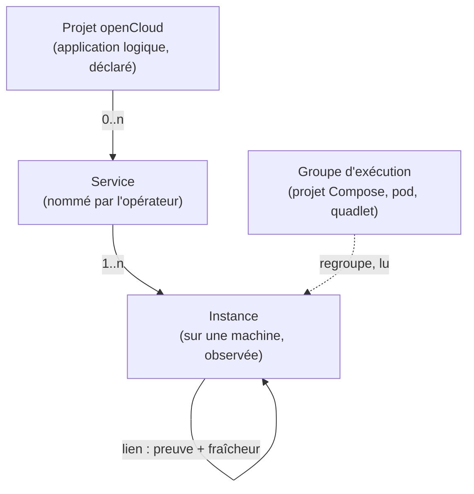

# Étude : le modèle de « service » et la découverte des liens

> Ticket #437. **Étude seule : aucun code, aucune migration écrite.** Les cinq
> questions ont été tranchées par Lucas le 01/11/2026 (« Décisions de Lucas ») ;
> le document les intègre. Relevé du 01/11/2026 sur `dev` à `db62e78`. Les sources externes sont citées avec leur adresse ; ce qui n'a
> pas pu être relu est dans « Non vérifié ».

## Résumé

| | |
| --- | --- |
| Constat de Lucas | Juste sur l'écran et sur une règle d'unicité, **pas sur le schéma** : l'annuaire a déjà « service > unités » |
| Cause | `ProposeAll` propose **un service par projet Compose** ; un index unique interdit deux services sur le même projet sur une machine ; un service tient à **une** machine |
| Trou majeur | Les **binaires systemd** (Forgejo, openCloud) ne sont **jamais observés** ; les liens lus aujourd'hui sont **déclarés** (`depends_on`, `--link`) ou de **joignabilité** (réseau partagé), jamais **observés** |
| Proposition | Trois niveaux : **instance** (observée, identité stable) · **service** (nommé par l'opérateur) · **regroupements** (groupe d'exécution lu, projet openCloud déclaré). Un **lien** porte sa **preuve** (observé, déclaré, déduit) et sa **fraîcheur** |
| Sans root | Réalisable : unités systemd, labels, réseaux, hôtes cités dans l'environnement, connexions **de l'hôte**. **Pas** les connexions entre conteneurs (voir §2.3) : décidé, pas de droit élevé |
| Décisions | Une ligne = un service Compose ; instances regroupées par nom et image ; environnement par liste blanche ; Traefik plus tard (#361) ; connexions sans root |
| Chantiers | 7, sans code ici (§4) |

---

## 1. Ce que les autres appellent « service »

### 1.1 Les runtimes

| Système | Ce qui s'appelle « service » | Instance | Regroupement | Liens | Source |
| --- | --- | --- | --- | --- | --- |
| **Compose** | Une entrée de `services:` ; peut donner **plusieurs conteneurs** (`scale`) | Un conteneur : label `container-number` | Le projet (`com.docker.compose.project`) | `depends_on` (ordre de démarrage), `links` ; alias réseau | `labels.go` de docker/compose (22 labels, dont `project`, `service`, `container-number`, `depends_on`, `oneoff`, `working_dir`, `config_files`) ; [référence services](https://docs.docker.com/reference/compose-file/services/) |
| **Docker Engine** | Pas de notion : des conteneurs, des réseaux | L'id du conteneur (change à la recréation) | Les labels, libres | `NetworkSettings.Networks.*.{Aliases,DNSNames}` ; `Config.Env` | [spec API v1.47](https://docs.docker.com/reference/api/engine/version/v1.47.yaml) |
| **Podman** | Idem ; le **pod** regroupe des conteneurs qui partagent des espaces de noms | Idem ; `PodName` dans `podman ps` | Pod ; `io.podman.compose.project` posé par podman-compose, avec `com.docker.compose.*` | Quadlet : `Requires=`/`Wants=` traduits entre unités ; `Network=x.network`, `Pod=x.pod` | [podman-systemd.unit(5)](https://docs.podman.io/en/latest/markdown/podman-systemd.unit.5.html) ; [podman-pod-create](https://raw.githubusercontent.com/containers/podman/main/docs/source/markdown/podman-pod-create.1.md.in) ; [podman_compose.py](https://raw.githubusercontent.com/containers/podman-compose/main/podman_compose.py) |
| **systemd** | Une **unité** `.service` | `MainPID`, `ControlGroup` | `PartOf=`, cibles (`.target`) | `Requires=`, `Wants=`, `BindsTo=`, `After=` (l'ordre est **séparé** de l'exigence) | [systemd.unit](https://www.freedesktop.org/software/systemd/man/latest/systemd.unit.html) ; [systemctl](https://www.freedesktop.org/software/systemd/man/latest/systemctl.html) |
| **Kubernetes** (vocabulaire) | **Service** = abstraction réseau stable devant un ensemble de Pods ; **Pod** = plus petite unité ; **Deployment** gère des Pods | Le Pod | Labels `app.kubernetes.io/{name,instance,part-of,component,managed-by}` | Sélecteur du Service → EndpointSlices | [labels recommandés](https://kubernetes.io/docs/concepts/overview/working-with-objects/common-labels/) ; [Service](https://kubernetes.io/docs/concepts/services-networking/service/) |
| **OpenTelemetry** | `service.name`, **identique pour toutes les instances** | `service.instance.id`, unique par `(namespace, name)` | `service.namespace` | — | [registre `service.*`](https://opentelemetry.io/docs/specs/semconv/registry/attributes/service/) |

À retenir pour openCloud :

- **Deux mots qui se séparent partout** : le service (nom commun à toutes les répliques) et l'instance (une réplique, un endroit). Kubernetes et OpenTelemetry le disent noir sur blanc ; le constat de Lucas (« ce ne sont pas les mêmes ») est exactement cette distinction.
- **Compose appelle « service » une ligne du fichier, pas le projet.** `edge` est un projet de trois services : la remarque de Lucas colle au vocabulaire de Compose.
- **Un pod ou un projet est un regroupement d'exécution**, pas un service : Podman et Kubernetes le disent (« unit of multiple containers »).
- **Un lien d'ordre n'est pas un lien de communication.** Compose : « Links are not required to enable services to communicate » ; `depends_on` règle l'ordre de démarrage.

### 1.2 Les outils qui affichent des services

| Outil | Unité de gestion | Même service sur plusieurs machines | Liens | Hors de sa gestion | Source |
| --- | --- | --- | --- | --- | --- |
| **Portainer** | Le **stack** (« a collection of services »), sous un *environment* | Un stack par environnement ; supprimer l'environnement orpheline les stacks | Aucun relevé dans les pages lues | Non établi | [stacks](https://docs.portainer.io/user/docker/stacks) |
| **Dockge** | Le stack Compose, rien d'autre | « Multiple agents support » (1.4.0+) ; clé d'identité non documentée | Aucun | Non géré : le README renvoie vers Portainer ou la CLI | [README](https://github.com/louislam/dockge) |
| **Komodo** | `Stack`, `Deployment` (un conteneur), `Server`, `Resource Sync` | Attaché à un `Server` | Ordre `after` de Resource Sync : **déclaré**, ordre seulement | Non établi | [resources](https://komo.do/docs/resources) |
| **Coolify** | *Resource* (application ou service) ; Project > Environment > Resource | Une *destination* = un réseau Docker d'**un** serveur | Même réseau : « reach one another by service name » ; rien de déduit | Non établi | [concepts](https://coolify.io/docs/get-started/concepts) ; [destinations](https://coolify.io/docs/knowledge-base/destinations) |
| **Backstage** | `Component` ; regroupé en `System` puis `Domain` ; `Resource`, `API` | Hors sujet (catalogue de logiciels, pas d'hôtes) | **Déclarés** : `dependsOn`, `providesApis`, `consumesApis`, `partOf` | Sans objet | [descripteur](https://backstage.io/docs/features/software-catalog/descriptor-format) ; [relations](https://backstage.io/docs/features/software-catalog/well-known-relations) |
| **Netdata** | La cible découverte (`docker`, `net_listeners`…) | Un agent par machine | **Observés** : fonction *Network Connections* (sens, processus, cgroup, RTT) | Le découvreur `docker` liste tout conteneur du démon | [découverte](https://learn.netdata.cloud/docs/collecting-metrics/service-discovery) ; [connexions](https://learn.netdata.cloud/docs/collecting-metrics/collectors/networking/network-connections) |
| **Cilium Hubble** | Hors sujet (Kubernetes) | — | **Observés** : « automatic discovery of the services dependency graph at the L3/L4 and even L7 layer » | — | [Hubble](https://docs.cilium.io/en/stable/observability/hubble/) |
| **Grafana Beyla** | Un processus instrumenté | — | Graphes de services par **eBPF** ; capabilities listées : `CAP_BPF`, `CAP_PERFMON`, `CAP_SYS_PTRACE`, `CAP_DAC_READ_SEARCH`, `CAP_NET_RAW` | — | [Beyla](https://grafana.com/docs/beyla/latest/) |

Ce que ça apprend :

| Constat | Conséquence pour openCloud |
| --- | --- |
| Les gestionnaires (Portainer, Dockge, Komodo, Coolify) n'ont **aucun lien observé** : au mieux un ordre ou un réseau commun | Un lien observé est un vrai différenciateur, mais il coûte des droits (§2) |
| Backstage sépare **déclaré** (le catalogue) de tout le reste et nomme les relations des deux sens (`dependsOn` / `dependencyOf`) | Le lien déclaré a sa place propre ; on écrit un sens, on lit les deux |
| Seuls les outils d'observation (Netdata, Hubble, Beyla) montrent des connexions réelles, et **tous** demandent des privilèges (Netdata : « needs privileged access to enumerate all process sockets ») | Le plafond « sans root » existe aussi chez eux (§2.3) |
| Aucun outil gestionnaire ne documente la clé d'identité d'une instance entre machines | Choix libre, donc à trancher (§3.1) |

---

## 2. Les signaux de liens

### 2.1 Ce que l'agent lit déjà, ce qu'openCloud sait déjà

| Fait | Où | Preuve |
| --- | --- | --- |
| L'agent lit Docker (`/containers/json`, inspection, réseaux, volumes) par la socket, via le **groupe `docker`** (équivaut à root sur l'hôte : « The `docker` group grants root-level privileges to the user », [doc Docker](https://docs.docker.com/engine/install/linux-postinstall/)) | `internal/dockerwatch/inventory.go` ; `docs/installation.md` (« par le groupe `docker`, la socket Docker ») | |
| Par conteneur : nom, projet et service Compose, ports publiés, mode réseau, réseaux joints **avec adresse et alias**, `depends_on` et `--link`, labels de **la marque seulement** | `internal/dockerwatch/inspect.go:16-52,192-230` | |
| **`Config.Env` n'est pas lu** : `dockerapi.ContainerConfig` ne déclare ni `Env` ni `Cmd`, le décodeur les ignore | `internal/dockerapi/containers.go:98-107` | |
| **Aucun label Traefik ou Compose ne part** (hors ceux ci-dessus), règle posée exprès | `internal/dockerwatch/inspect.go:68-80` ; `22-fonctionnement.md:2144` | |
| L'agent lit `/proc` (CPU, mémoire, réseau en octets), `systemd-detect-virt`, les cartes réseau (MAC), les montages | `internal/sampler`, `internal/hostinfo/detect.go` | |
| **Il ne lit ni systemd, ni sockets, ni connexions** | grep `systemctl`/`/proc/net/tcp` dans `internal/agent`, `hostinfo`, `sampler` : rien | |
| L'annuaire connaît des unités `binary` (`systemd_unit`) mais « une unité binaire ne rapproche jamais rien » | `internal/directory/match.go` (doc de `Match`) ; `22-fonctionnement.md:2278` | |
| La topologie d'une machine : arêtes `public` (port publié) et `depends` (Compose, `--link`) ; « ce qu'un réseau partagé laisse deviner n'est pas une dépendance : c'est une joignabilité » | `internal/container/topology.go` ; `22-fonctionnement.md:2703-2760` | |
| Capacités d'un service d'infra (`sso`, `proxy`, `tls`, `backup-target`) et `public_url` | `internal/directory/directory.go` ; `001_schema.sql:188-234` | |
| **Aucun lien n'est stocké** : `depends` est recalculé à chaque lecture, **entre conteneurs d'une même machine** | `BuildTopology` | |

Non lus : les tickets **#361** (module Traefik) et **#375** (vue des flux), absents du dépôt (voir « Non vérifié »).

### 2.2 Mesures faites pour l'étude

Sur la machine de l'étude, compte **non root** (`uid=1001`, sans groupe `docker`) :

| Essai | Résultat |
| --- | --- |
| `ss -tn` | Liste complète des connexions de l'espace de noms réseau de l'hôte |
| `ss -tnp` | Le **processus** n'apparaît que pour **ses propres** sockets ; le port 22 (sshd, root) est listé **sans processus** |
| `/proc/1/fd` | `Permission denied` |
| `/proc/net/nf_conntrack` | Mode `-r--r----- root root` : **illisible** |
| `systemctl show -p MainPID,ControlGroup,FragmentPath ssh.service` | Fonctionne ; `systemctl list-units` aussi |
| `systemctl show -p Requires,After …` | Fonctionne |
| `kernel.unprivileged_bpf_disabled` | `2` (eBPF refusé aux non-root) |
| `hidepid` | Aucun montage `/proc` concerné |

Limite : ni Docker ni Podman ne sont installés ici ; **rien n'a été essayé contre un démon de conteneurs**.

### 2.3 Les signaux, un par un

« Droit » = ce qu'il faut de plus que l'agent d'aujourd'hui (compte dédié, groupe `docker`).

| # | Signal | Preuve du lien | Droit nouveau | Fiabilité | Coût | Risque de sécurité |
| --- | --- | --- | --- | --- | --- | --- |
| 1 | **Réseaux Docker partagés** | Joignabilité (A *peut* parler à B) | Aucun (déjà lu) | Faible comme dépendance, bonne comme borne : deux conteneurs sans réseau commun **ne peuvent pas** se parler | Nul | Nul |
| 2 | **Alias / `DNSNames`** | Le nom sous lequel B s'appelle sur un réseau ; sert à **résoudre** les signaux 4 et 5 | Aucun (déjà lu) | Bonne pour nommer. [Sur le pont par défaut, pas de résolution par nom](https://docs.docker.com/engine/network/drivers/bridge/) | Nul | Nul |
| 3 | **`depends_on`, `--link`** | **Déclaré** : ordre de démarrage, pas communication | Aucun (déjà lu) | Moyenne : peut manquer (un lien réel non déclaré) ou sur-déclarer | Nul | Nul |
| 4 | **Variables d'environnement qui nomment un hôte** (`DB_HOST=db`, `REDIS_URL=redis://cache:6379`) | **Déduit** : A est configuré pour joindre B | Aucun : même appel d'inspection, mais il faut **déclarer `Env`** dans le décodeur | Moyenne à bonne pour les images à la douzaine-de-facteurs ; muette pour celles qui lisent un fichier de config | Faible | **Élevé** : `Config.Env` est « `["VAR=value", ...]` » en clair, secrets compris ; **les valeurs entreraient dans la mémoire de l'agent** (§2.4) |
| 5 | **Routes Traefik** (labels Docker) | **Déclaré** : `Host(…)` → service → port | Aucun, mais **la règle est maintenue** (décision 4) : aucun label Traefik ne part ; le lien viendra du module #361 | Excellente pour « public → service » : c'est la configuration réellement chargée par Traefik | Faible | Moyen : les labels contiennent aussi des **hachages de mots de passe** (`…basicauth.users`) et des domaines ; liste blanche de clés obligatoire |
| 6 | **Provider fichier de Traefik** | Idem | **Oui** : lire le fichier (souvent root) | Excellente | Moyen | Le fichier peut porter des secrets |
| 7 | **API Traefik** (`/api/http/routers`, `/services`) | Idem, **telle que chargée** | **Oui** : désactivée par défaut, à protéger ([doc](https://doc.traefik.io/traefik/reference/install-configuration/api-dashboard/)) ; l'agent aurait un accès et un secret en plus | Excellente | Moyen | Un secret de plus à garder ; c'est le terrain du module #361 |
| 8 | **Unités systemd** (`Requires`, `Wants`, `After`, `BindsTo`) | **Déclaré** entre unités ; donne aussi `MainPID`, `ControlGroup`, état | **Aucun** : lecture ouverte (mesuré ; la [doc D-Bus](https://www.freedesktop.org/software/systemd/man/latest/org.freedesktop.systemd1.html) : « Read access is generally granted to all clients ») | Bonne pour l'existence et l'état ; moyenne pour la communication (beaucoup d'unités d'ordre) | Faible | Faible : noms d'unités. Les `Environment=` d'une unité peuvent porter des secrets : on ne lit pas ces propriétés |
| 9 | **Connexions observées, hôte** (`/proc/net/tcp`, équivalent de `ss`) | **Observé** : A (port local, uid) → adresse:port distante | **Aucun** pour la table (mesuré) | Bonne pour ce qui passe dans l'espace de noms de l'hôte | Moyen (balayage périodique, instantané) | Faible : métadonnées de connexion. **Processus non attribué** pour les sockets d'un autre utilisateur (mesuré) |
| 10 | **Connexions entre conteneurs** | **Observé** | **Oui, non-trivial** : voir ci-dessous | Excellente | Élevé | Élevé |
| 11 | **conntrack** | **Observé**, y compris NAT | **Oui** : `/proc/net/nf_conntrack` illisible (mesuré) ; netlink demande `CAP_NET_ADMIN` sauf lecture de table ([libnetfilter_conntrack](https://netfilter.org/projects/libnetfilter_conntrack/doxygen/html/), résumé) | Excellente | Moyen | Élevé : tout le trafic de la machine |
| 12 | **eBPF** | **Observé**, fin (par connexion, par processus) | **Oui, lourd** : `CAP_BPF` + `CAP_PERFMON` (+ `CAP_SYS_PTRACE` chez Beyla) ; ici `unprivileged_bpf_disabled=2` | Excellente | Élevé (noyau ≥ 5.8, code à maintenir) | **Très élevé** : un agent qui charge du code noyau |
| 13 | **DNS** | Les requêtes d'un conteneur vers `127.0.0.11` | Capture de paquets (`CAP_NET_RAW`) | Bonne mais bruyante | Élevé | Élevé |

**Retenu (décisions 3 à 5) :** lignes 1 à 3, 4 (avec liste blanche et droit par machine), 8 et 9. Ligne 5 : plus tard, par #361 (lignes 6 et 7 avec elle). **Écartées : lignes 10 à 13** (droit élevé, jamais eBPF).

**Pourquoi la ligne 10 est la limite du « sans root ».** Un conteneur a son propre espace de noms réseau. Selon [proc_net(5)](https://man7.org/linux/man-pages/man5/proc_net.5.html), le contenu de `/proc/net/tcp` reflète celui du processus qui lit. Pour lire celui d'un conteneur, il faudrait entrer dans `/proc/<pid>/net/` d'un processus qui n'est pas à l'agent, donc passer le contrôle `PTRACE_MODE_READ_FSCREDS` ([proc_pid_fd(5)](https://man7.org/linux/man-pages/man5/proc_pid_fd.5.html)), soit `CAP_SYS_PTRACE` ou root. La table de l'hôte, elle, ne montre pas le trafic pont-à-pont (déduit de ces pages, **non essayé avec Docker**). Netdata l'avoue : « needs privileged access to enumerate all process sockets », et ses plugins demandent `cap_sys_ptrace` et `cap_dac_read_search`.

**Ce que le signal 9 donne quand même.** Les binaires de l'hôte (Forgejo, openCloud, un reverse proxy installé sur l'hôte) vivent dans l'espace de noms de l'hôte : leurs connexions **sortantes et entrantes** se voient. Une connexion hôte → `127.0.0.1:3000` qui tombe sur un port publié par un conteneur se rattache à l'instance par ses `Ports` déjà connus. Le lien est observé, sans processus attribué, donc **la source est une adresse ou un utilisateur (`uid`), pas un service** : à rapprocher d'une unité systemd par `uid` (`User=`) seulement si l'opérateur le confirme.

### 2.4 Ne jamais remonter un secret : le cas de l'environnement

Aujourd'hui l'agent **ne peut pas** fuir `Env` : le champ n'est pas déclaré. Le lire, c'est faire passer les secrets par sa mémoire. Règles proposées si Lucas accepte le signal 4 :

| Règle | Comment |
| --- | --- |
| **Liste blanche par résolution, pas liste noire par nom** | L'agent ne garde une valeur que si, **après extraction de l'hôte**, celui-ci est un nom connu **sur cette machine** : alias, nom de service Compose, nom de conteneur, ou IP d'un conteneur de l'inventaire. Tout le reste est jeté |
| **On ne remonte pas le nom de la variable ni la valeur** | Le rapport dit seulement `source → hôte résolu (+ port)`. `DB_PASSWORD=db` (un mot de passe qui s'appellerait comme un conteneur) ne ressort que comme « A → db », sans variable : la fuite est limitée à un nom de conteneur déjà public dans l'inventaire |
| **Extraction stricte** | `scheme://[userinfo@]host[:port]/…` : userinfo, chemin et requête sont **écartés avant** toute comparaison ; `host:port` nu accepté ; rien d'autre n'est analysé |
| **Un type, pas une chaîne** | Un type dont le décodage JSON ne conserve rien d'autre que la liste d'hôtes extraits (`UnmarshalJSON` qui jette les valeurs) : on ne peut pas, par erreur, le journaliser ou l'envoyer |
| **Pas de journal** | L'agent n'écrit jamais `Env` dans ses logs (test) |
| **Test de non-fuite** | Un banc inspecte le rapport complet pour une fixture portant `PASSWORD=hunter2`, `URL=https://u:p@db/x?token=abc` : aucune de ces chaînes ne doit apparaître. Même esprit que `TestLabels_NeverWriteTheDirectory` |
| **Le serveur borne encore** | Comme pour les labels : « la borne est reposée côté serveur parce qu'un agent n'est pas une preuve » (`24-modele-cible.md:1140`) |
| **Droit à part** | Décision 3 : un droit d'observation, coché **par machine** à l'enrôlement ; sans lui, `Env` n'est pas lu |

Coût franc : même avec ces règles, les valeurs transitent par la mémoire d'un processus qui a déjà la socket Docker (donc root de fait). Le gain de sécurité de la liste blanche est de **ne rien envoyer ni stocker**, pas de ne pas lire.

### 2.5 Podman, quadlets, binaires

| Cas | Ce que l'agent peut lire sans root | Limite |
| --- | --- | --- |
| Podman via l'**API compatible Docker** | La socket existe (`podman system service`), « Docker v1.40 API » ; `-docker-socket` est déjà un paramètre de l'agent (`cmd/opencloud/agent.go:58`) | **Rootless : la socket est par utilisateur** (`$XDG_RUNTIME_DIR/podman/podman.sock`) ; l'agent ne voit que les conteneurs de **son** compte. Compatibilité des champs réseau **non essayée** |
| Labels Podman | `io.podman.compose.project`, `io.podman.compose.service`, `PODMAN_SYSTEMD_UNIT`, plus `com.docker.compose.*` posés par podman-compose | Le **pod** n'a pas de label établi dans les sources lues ; son nom vient de `podman ps` (`PodName`) |
| Quadlets | Fichiers `.container` / `.pod` : par utilisateur ou `/etc/containers/systemd/` | Le contenu généré (`Requires=` écrits) n'est pas montré par la doc ; les unités d'un autre utilisateur ne s'interrogent pas sans lui |
| Conteneur lancé à la main | Un conteneur sans label Compose : l'identité est son **nom** | Instable à la recréation si le nom change |
| Binaire sous systemd | Unité, état, `MainPID`, `ControlGroup` (mesuré) | **Port → unité** : demande `/proc/<pid>/fd` (ptrace), donc **le port se déclare** (le champ `service_units.ports` existe) ou se déduit du `uid` d'une unité `User=` |

---

## 3. Proposition de modèle

### 3.1 Trois niveaux, un lien

| Niveau | C'est | Qui l'écrit | Identité stable | Déjà là ? |
| --- | --- | --- | --- | --- |
| **Instance** | Une chose qui tourne **sur une machine** : un service Compose (ses répliques comptées), un conteneur seul, un conteneur de pod, une unité systemd | **Détectée seule** (agent) | `(machine, runtime, clé)` ; clé = `projet/service` Compose, `pod/conteneur`, nom du conteneur, nom d'unité systemd. **Jamais l'id Docker** (change à la recréation) ni la machine seule | Partiellement : `containers` (observée, id dérivé), `service_units` (déclarée) ; **rien pour systemd** |
| **Service** | Ce que l'opérateur nomme et gère : `traefik`, `authelia`, `forgejo` | **L'opérateur** (accepte une proposition) | `declared_services.id` | Oui, mais attaché à **une** machine et, pour Compose, **à un projet** |
| **Groupe d'exécution** | Projet Compose, pod, quadlet : ce qui a été **lancé ensemble** | Détecté, **lecture seule** | Nom + machine | `containers.group_name`, `networks.group` |
| **Projet openCloud** | L'application logique (« messagerie », « edge ») | **L'opérateur** | `projects.id` | Oui (`projects`, `project_services`, N-N) |

Le **projet openCloud existant est déjà** « l'application logique déclarée par l'opérateur » : **aucune entité nouvelle** n'est proposée pour ce niveau (le dire est la contrepartie du coût d'un quatrième mot).

Le **même service sur plusieurs machines** (décision 2) : une instance par machine, **distinguées par la machine dans leur identité**. Le regroupement « tous les traefik » est **automatique** : même nom de service **et** même image sans étiquette de version (`service_units.image`). Il se **dérive**, il ne s'écrit pas, et aucun niveau « service logique » n'est saisi à la main. Contrepartie : un service renommé, ou dont l'image change, sur une machine sort du regroupement ; il redevient une ligne à part.

**Ce qui change pour « edge = traefik + authelia + crowdsec »** (décision 1) :

| | Aujourd'hui | Proposé |
| --- | --- | --- |
| Proposition | Un service `edge`, trois unités (`ProposeAll`, un par groupe) | **Trois** propositions, un service par service Compose ; `edge` reste visible comme **groupe d'exécution** et peut devenir un **projet** |
| Index `declared_services_compose (machine_id, compose_project) WHERE origin='compose'` | Interdit deux services sur le même projet | À lever ; le rattachement se fait par `(projet, service Compose)` |
| Un service à plusieurs unités | Cas général | **Reste permis** (une application web + son worker) : l'opérateur regroupe, on ne regroupe plus d'office |
| Services déjà déclarés | — | **Intacts** : aucune fusion ni scission automatique (Q7 de la refonte : jamais de surprise) |

### 3.2 Le lien

| Champ | Sens |
| --- | --- |
| Source, cible | Une **instance** (machine, runtime, clé), ou une **cible externe** (adresse:port non résolue), ou *Internet* (nœud existant) |
| Nature | `route` (public → service), `config` (A est configuré pour joindre B), `order` (dépendance d'ordre), `traffic` (connexion vue) |
| **Preuve** | `observed` (une connexion, un état lu), `declared` (écrit : par l'opérateur, ou par la configuration de l'outil : `depends_on`, route Traefik), `deduced` (calculé à partir d'un autre fait : env, `public_url` + capacité `proxy`) |
| **Détail de la preuve** | Quel signal (§2.3, numéro) ; jamais un secret ni une valeur brute |
| **Fraîcheur** | `first_seen`, `last_seen` ; un lien non revu depuis N jours est **« ancien »**, jamais supprimé tout seul |
| Confirmation | `confirmed_by` (opérateur) : un lien **déduit ou observé** que l'opérateur confirme devient **déclaré** |

Règles :

| Règle | Raison |
| --- | --- |
| Un lien **observé** est écrit comme les conteneurs (le rapport de la machine **remplace** le précédent) ; il vit dans une table d'observation, **pas dans l'annuaire** | Cohérent avec « Rien ne s'écrit sans geste » (architecture §3.5) et `TestLabels_NeverWriteTheDirectory` |
| Un lien **déclaré par l'opérateur** s'écrit par `directory` seulement | « Écrire toujours par son composant » (AGENTS.md) |
| **L'absence d'observation n'est pas l'absence de lien** | Un instantané manque les liens rares (sauvegarde nocturne) : on affiche « dernière vue il y a 3 j », on n'alerte pas, on ne purge pas |
| Un lien déclaré n'est jamais effacé par l'observation | L'opérateur a le dernier mot |
| Un lien n'est **pas** une dépendance de disponibilité | Les sondes et pages de statut ne les lisent pas (hors étude) |
| Les liens de **joignabilité** (réseau partagé) ne sont **pas** des liens | Comme aujourd'hui : l'inspecteur écrit « joint par le réseau X » |

### 3.3 Ce qui est détecté seul, ce que l'opérateur confirme

| Objet | Détecté seul | L'opérateur |
| --- | --- | --- |
| Instance | Oui (conteneurs, unités systemd) | Rien à faire ; peut **ignorer** (clé `ignored_keys`, déjà là) |
| Groupe d'exécution | Oui | Rien |
| Service | **Proposé** (Accepter / Ignorer, déjà en place) | Accepte ; nomme ; regroupe plusieurs instances en un service |
| Projet | Non | Crée, y range des services |
| Lien observé / déduit | Oui, avec sa preuve | Peut **confirmer** (devient déclaré) ou **écarter** (masqué, reste noté) |
| Lien déclaré | Non | Écrit, modifie, supprime |

### 3.4 L'affichage

Cohérent avec la refonte (architecture §3.1 : menu dérivé du registre de modules ; §3.5 : propositions en tête de Services ; C7 : conteneurs dépliés sous leur service). Rien de neuf dans le menu.

| Écran | Une ligne par… | Les liens |
| --- | --- | --- |
| **Services** (liste) | **Service Compose** (traefik, authelia, crowdsec), **regroupés sous leur projet Compose** ; les instances d'un même nom et d'une même image sur plusieurs machines forment une ligne dépliable (une instance par machine) | Une **pastille** « n liens » ; pas de graphe |
| **Fiche service** | — ; onglet **Instances** (une ligne = une machine) | Onglet **Liens** : entrants / sortants, chaque ligne avec sa **preuve** (pastille *observé / déclaré / déduit*) et sa **fraîcheur** ; boutons *Confirmer*, *Écarter*, *Ajouter un lien* |
| **Fiche machine > Réseau** | Instance de la machine | Le dessin actuel, **alimenté par les liens stockés** et non plus recalculé |
| **Machines** (hôte > invités) | Inchangé | — |
| **Vue des flux** (#375) | — | Premier consommateur des liens inter-machines ; **non conçue ici** |
| Un binaire sans port connu | Instance **sans lien** + invitation « déclarer le port » | — |

Pastille de preuve : trois états, sur le patron de `GapPill` (`web/src/components/GapPill.tsx`) : un mot, jamais la couleur seule.

---

## 4. Ce que ça change, et les chantiers

### 4.1 Dans l'existant

| Couche | Changement |
| --- | --- |
| **Tables** | `declared_services` : lever l'index unique du projet Compose (décision 1) ; un service à plusieurs instances = **pas de colonne**, c'est le rattachement par unité. **Nouvelles** : instances observées de systemd (`machine_systemd_units`), liens observés (`observed_links`, remplacés par rapport de machine), liens déclarés (`declared_links`). Numéros : `027` est la dernière sur `dev`, à revérifier au démarrage |
| **Agent** | Lire systemd en lecture (`list-units`, `show`) ; déclarer `Env` avec le type de §2.4 ; (option) lire la table `/proc/net/tcp` de l'hôte. **Chaque lecture neuve est une classe de donnée neuve** : `22-fonctionnement.md` (« ce qui est stocké ») et le pare-feu de bornes du serveur se mettent à jour |
| **Protocole** | Champs optionnels dans le signal, `ProtocolVersion` inchangée (règle d'`agentwire`) ; bornes posées aussi côté serveur |
| **Droits** | Une nouvelle capacité d'observation (décision 3), cochée **par machine** à l'enrôlement ; machines existantes : ré-enrôlement pour l'avoir. **Aucun droit élevé** (décision 5) |
| **`directory`** | `ProposeAll` : une proposition par **service Compose** ; `Match` : rattachement par `(projet, service)` ; refus déclarés (`internal/refusal`) pour les liens (cible inconnue, doublon, soi-même) |
| **Routes** | Lecture des liens (par service, par machine) ; écriture des liens déclarés ; confirmer / écarter. Toutes dans `routes.txt` et la parité UI / MCP (architecture §3.7) |
| **Écrans** | Liste Services (instances dépliées), fiche service (Instances, Liens), Réseau de la machine (liens stockés), propositions (une par service) |
| **mcp-maison** | Source **absente** de cet espace de travail : à lire avant de chiffrer. Attendu : `opencloud_services` voit instances et liens (champs en plus) ; un outil de lecture des liens si Lucas le veut, ouvert aux jetons seulement par entrée dans la liste fermée |
| **Docs** | `22-fonctionnement.md` : acteurs, flux, ce qui est lu, ce qui est stocké, ce qui ne l'est jamais (Env) |

### 4.2 Chantiers

Une branche `feat/…` chacun, un commit par fonctionnalité (`12-methode.md`). Aucun n'est lancé sans demande de Lucas.

| # | Chantier | Contenu | Dépend de | Droit de plus |
| --- | --- | --- | --- | --- |
| L1 | **Un service par service Compose** | Proposition par service, index levé, rattachement `(projet, service)`, groupe d'exécution affiché ; services existants intacts ; regroupement automatique des instances de même nom et même image (décision 2) | — | Aucun |
| L2 | **Instances systemd** | L'agent relève les unités ; unité binaire rapprochée de l'unité déclarée (`systemd_unit`) ; état visible ; port à déclarer | — | Aucun (mesuré) |
| L3 | **Liens stockés, déclarés et d'ordre** (fait, v0.5.2 L3 : `030_links.sql`, `internal/link`, carte Liens de la fiche service) | Tables, routes, fiche service > Liens ; `depends_on` et `--link` passent en liens `declared` ; l'opérateur ajoute les siens ; Réseau lit les liens stockés | L1 | Aucun |
| L4 | **Liens déduits** | `public_url` + capacité `proxy` → `route` déduit ; confirmer / écarter | L3 | Aucun |
| L5 | **Environnement** | `Env` lu avec la liste blanche de §2.4, banc de non-fuite | L3 | Nouveau droit d'observation, coché par machine |
| L6 | **Connexions de l'hôte** | Table de l'hôte → liens `observed` pour les binaires et les ports publiés ; **pas** de connexion entre conteneurs (décision 5) | L2, L3 | Aucun (table) ; processus non attribué |
| L7 | **Traefik, plus tard** | Routes lues par le module #361 → liens `route` ; d'ici là, **aucun label Traefik ne quitte la machine** (décision 4) | #361, L3 | Selon #361 |

Le **MCP** et la **vue des flux** (#375) se branchent sur L3 ; leur chiffrage attend la lecture du ticket et du code de mcp-maison.

---

## Décisions de Lucas

Tranchées le 01/11/2026 (questions de la première version de cette étude).

| # | Décision | Où elle entre |
| --- | --- | --- |
| 1 | Une ligne = un service Compose (traefik, authelia, crowdsec), regroupés sous leur projet Compose | §3.1, §3.4, L1 |
| 2 | Le même service sur deux machines = deux instances, regroupées automatiquement par nom et image ; aucun niveau « service logique » saisi à la main | §3.1, §3.4, L1 |
| 3 | Variables d'environnement : oui, seulement les noms d'hôtes et adresses (liste blanche §2.4, banc de non-fuite), jamais les valeurs secrètes, derrière un droit d'observation coché par machine | §2.4, §4.1, L5 |
| 4 | Routes publiques : plus tard, par le module Traefik (#361) ; aucun label Traefik ne quitte la machine d'ici là | §2.3, L7 |
| 5 | Connexions observées : sans root (hôte seulement) ; pas de droit élevé, jamais eBPF | §2.3, L6 |

Coûts assumés par ces décisions :

| Décision | Ce que ça coûte |
| --- | --- |
| 1 | L'index unique du projet Compose se lève ; `edge` n'existe plus comme service, seulement comme groupe d'exécution (ou comme projet si l'opérateur le crée) |
| 2 | Un service renommé, ou dont l'image change, sur une machine sort du regroupement |
| 3 | Les valeurs passent par la mémoire de l'agent (qui a déjà la socket Docker) ; un ré-enrôlement par machine pour le droit |
| 4 | Les routes publiques restent invisibles tant que #361 n'est pas livré ; le lien `public_url` + capacité `proxy` (L4) donne un repli faible |
| 5 | Les liens conteneur-à-conteneur restent déclarés ou déduits, jamais observés |

## Non vérifié

| Point | Pourquoi |
| --- | --- |
| **Tickets #361 (module Traefik) et #375 (vue des flux)** | Absents du dépôt, aucun accès au forge dans cet espace de travail ; leur contenu n'a pas été lu |
| **Source de mcp-maison** | Le dossier `workspaces/mcp-maison` est vide ; l'architecture cite `src/tools/opencloud/tools.ts`, non relu. Tout l'impact MCP est déduit de `22-fonctionnement.md` |
| **Rien n'a été essayé contre Docker ou Podman** | Aucun des deux n'est installé sur la machine de l'étude ; l'API compatible Docker de Podman (champs réseau, `DNSNames`) n'est pas validée |
| **Les connexions entre conteneurs ne figurent pas dans la table de l'hôte** | Déduit de `proc_net(5)` et du principe des espaces de noms ; **à mesurer** avec un pont Docker réel au début de L6 |
| **Port → unité sans ptrace** | Déduit de `proc_pid_fd(5)` ; mesuré seulement pour sshd (port 22 sans processus) |
| **Champs exacts de l'API Traefik** (`rule`, `service`, `usedBy`, `servers[].url`) | La doc lue ne les détaille pas ; à confirmer par un GET sur une instance |
| **Format de `com.docker.compose.depends_on`** | Non lu à la source de Compose ; openCloud le parse déjà (`inspect.go:192-230`), testé |
| **Citations externes** | Les pages ont été lues par un outil qui rend des **résumés** : les guillemets ne sont pas relus sur la page d'origine, sauf `labels.go`, la spec OpenAPI Docker et `podman_compose.py`, lus en entier. Pages tronquées par l'outil : `systemd.unit`, `systemctl`, D-Bus `systemd1`, Kubernetes `Service` |
| **Podman** | Pas de liste officielle des labels `io.podman.*` ; le nom du pod vient de `podman ps` ; le contenu de l'unité Quadlet générée n'est pas montré par la doc |
| **Netdata, `systemd-units`** | Pages 404 ; capabilities d'`ebpf.plugin` non nommées |
| **Clé d'identité entre machines chez Portainer, Dockge, Komodo, Coolify** | Non documentée dans les pages lues |
| **Numéros de migration** | `027` dernière sur `dev` au relevé ; à revérifier |
| **`ProposeAll` et l'index unique** | Lus dans `propose.go` et `001_schema.sql` ; aucun test lancé, aucune proposition rejouée |
| **Aucun test lancé** | Étude seule |
